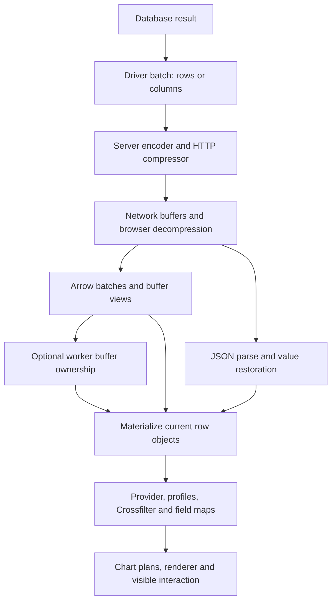

# explorEDA: columnar data transport research

**Decision stage:** research for a concise intent brief and initial shaping.  
**Research date:** 2026-10-12 UTC; request and intended integration archive date: 2026-10-11 America/Indianapolis.  
**Repository baseline:** `byronwall/explorEDA`, `f01ff0fb1f9e1240020744a18816f2dad68bf488`.  
**Assignment:** `prompts/columnar-data-transport.md` in the supplied source packet.  
**Scope:** recommendations and proof design only. No application implementation, dependency installation, production access, repository edits, or Git operations.

## 1. Recommendation for initial shaping

**Preserve exact, complete snapshots when their total client cost is reasonable. Carry Arrow IPC streams into the first proof as the default binary candidate, using internally uncompressed buffers and negotiated HTTP gzip. Compare them against lossless, schema-described row JSON with the same HTTP compression and the same current row consumers. Adopt Arrow only after an end-to-end win.** Brotli is a measured configuration, not an assumed improvement. [R2–R8; E1–E8]

There are two deliberately different decisions:

- **Candidate to investigate:** Arrow IPC stream for complete projected row results and bounded source snapshots. It supplies an established typed column format without requiring a new database, browser query engine, or custom column codec. The first implementation experiment must pay for conversion back to the existing rows. **Status: investigate, CT-002.**
- **Simpler implementation baseline and fallback:** lossless row JSON + gzip. It has the shortest path to the current React/TypeScript provider. Retain it if binary decoding, startup, row reconstruction, or double residency consumes the savings. This is one response encoding in the same product, not a duplicate query platform. **Status: recommend, CT-003.**

The durable recommendation is the small correctness and capacity contract around the bytes, rather than a commitment to a binary format:

1. Give every result an authoritative source/snapshot identity, row meaning, field schema, population scope, coverage, and completion condition. Never combine columns solely because their lengths match. **CT-001, CT-010.**
2. Keep the first browser resident representation as the rows the provider already expects. Decode bounded batches outside the provider and publish a complete snapshot once. Release intermediate representations when safe. **CT-004.**
3. Use a single compression layer by default. Test gzip first, then moderate Brotli settings against elapsed time and server CPU. HTTP compression and Arrow/Parquet internal compression are different mechanisms. **CT-005.**
4. Treat exact scalar preservation and consumer support as separate gates. A format that can carry decimal128 or nanosecond timestamps does not make existing calculations exact for those types. **CT-006.**
5. Measure client capacity independently of transfer size. Include the previous visible snapshot, incoming data, row reconstruction, provider state, Crossfilter, column maps, calculations, chart plans, worker memory, and provenance. **CT-008.**
6. Keep all data, dictionaries, caches, compressed variants, and temporary snapshot artifacts within the dedicated customer instance. “One server” means one customer instance. Hosting owns the choice among serverless, Cloudflare, VPS, and other platforms. **CT-013.**

**Proposed adoption gate:** Arrow must pass exactness checks and either reduce p95 time to a completed, filter-ready view by **at least 20% and 100 ms**, or reduce peak attributable client data memory by **at least 25%** with no more than **5%** latency regression on the named target workload. Reject regressions greater than both **10% and 20 ms** on small outputs. These are reversible shaping thresholds, not measured results or product service-level promises. Include first-visit decoder assets, server encoding, the row bridge, and current consumers. Section 10 defines the experiment and the evidence needed to reverse this recommendation. **CT-009.** The memory gate counts incremental attributable client data across JS heap, unique backing buffers, workers, and known native/WASM/plot allocations using the same browser and instrumentation; moving data out of the JS heap is not itself a memory saving.

### Intent-brief seed

Database-backed exploration should keep filtering and record inspection responsive without changing which records, values, or contributors a view describes. Start with complete, bounded snapshots around 10,000–100,000 rows, varying width. Prove whether a standard columnar transport improves the complete user path over compressed row JSON. Keep source identity, partial coverage, field fidelity, and client capacity explicit. Defer a new resident column engine, general progressive cache, and hosting platform choice until their own evidence requires them.

### What would change the decision?

- **Arrow loses after the row bridge:** use row JSON. A smaller response alone is insufficient.
- **Column JSON wins the same gates with materially less integration work:** select it and stop pursuing binary for that workload.
- **The adapter already produces compatible Arrow batches:** rerun the comparison; avoiding server row-to-column assembly may change the outcome.
- **Existing immutable Parquet plus repeated selective reads dominates the workload:** reopen Parquet delivery with a range-aware reader; charge footer requests, decoding, and residency to that path.
- **Arrow code/startup is the demonstrated bottleneck and only a small scalar schema is required:** investigate a deliberately restricted typed-array envelope.
- **Provider/Crossfilter/trace construction dominates every encoding:** end the transport optimization. A separately shaped consumer change may be needed; wire format cannot fix that bottleneck.

## 2. Access, baseline, and evidence discipline

### Access result: GO for bounded research

The supplied packet identifies the requested repository and exact baseline. SHA-256 verification succeeded for **all 34 manifested baseline files** and **all three notebook photos**, including the recorded photo byte lengths. The separately attached `prompt(1).md` is byte-identical to the assigned transport prompt inside the ZIP. The packet labels itself a **selected source snapshot, not a runnable checkout**. No claim is made to have reviewed the whole repository or current GitHub main. [R0]

The research read **33 of the 34 baseline files in full**, including every mandatory source file and supplied test. The only unread baseline file is the optional `docs/ui-defaults.md`; no controls or UI are being changed. Appendix A lists the exact files. Both other research prompts were read as coordination context; their decisions have not been assumed. The later user instruction adds a fourth hosting track and supersedes any interpretation of one server as one shared server for all customers.

### Notebook evidence

All three original photos were visually inspected, alongside `source-notes.md`:

- **Notebook 1:** server queries serve visible needs; small aggregate results can start a view; query latency becomes part of filtering.
- **Notebook 2:** scatter may need raw x/y/color values for about 10,000 points; full-result delivery, column packing, and progressive row/column caching are alternatives. The sketch explicitly values instant filtering and distinguishes full from partial coverage.
- **Notebook 3:** chart demands may share outputs; Parquet/custom packing and adapters are possibilities; row/transfer/client-memory limits matter; very large cases must not block a good 10k–100k experience.

The handwriting's byte estimate is ambiguous. It is neither a measured result nor an accepted budget. Section 5 replaces it with explicit assumptions and arithmetic. [R0]

### How to read the claims

| Evidence class | Meaning in this report |
| --- | --- |
| **Observed source** | A behavior or declaration visible in the supplied baseline, cited as R references with paths and symbols. |
| **External fact** | A specification, official browser/library API, or direct maintainer source, cited as E references. All external URLs were accessed 2026-10-12 UTC. |
| **Inference / proposal** | Reasoning from those sources, a suggested contract, policy, or experiment. Numeric thresholds are proposals unless explicitly identified as arithmetic. |
| **Calculated estimate** | Deterministic size arithmetic under stated fixtures, not compressed-size, timing, or heap measurements. |
| **Measured result** | None for application performance, codecs, browsers, databases, or hosting. Executed checks are source/photo hash verification, prompt equality, size-arithmetic verification, and deliverable validation. No application or codec performance was measured. |

Current documentation was checked rather than relying on remembered support. One consequential example: current Arrow JS supports explicitly registered IPC compression codecs, although the broad Arrow implementation matrix still leaves the JS compression cell blank. Specific current source and API evidence takes precedence over that incomplete matrix. [E5–E7]

## 3. Repository findings that determine transport cost

Paths below are relative to the packet root. R references in Appendix A resolve them to exact baseline files and symbols.

### 3.1 Existing analytical and UI boundaries

- The project is an existing **React/TypeScript library with a React demo**. The root manifest selects `pnpm@11.9.0`; the library declares React/ReactDOM 18 or 19 peers and `crossfilter2:^1.5.4`. The supplied direct dependencies contain no Arrow or Parquet decoder. The omitted lockfile prevents claims about exact installed versions. [R1]
- `AnalysisQuery` already includes source, lookup, expand, calculate, filter, and aggregate steps. `AnalysisEvaluation` includes rows, fields, stages, diagnostics, counts, revision, and source/contributor references. It does **not** define remote snapshot identity, row/column coverage, transfer truncation, batch sequence, or cancellation. These are useful seams, not an existing remote contract. [R2]
- `ExplorEdaProject` always calls `useAnalysisEvaluation(project, tables, queryId, bindings, createWorker)`. It has no prop accepting an externally evaluated projected result. It spreads each final `row.data` into a new object with positional `__ID`, builds row-key/ID maps, and supplies evaluation and tables to the query/schema/trace UI. [R3]

Consequently, the **smallest transport-only proof** can decode a complete result into the documented host `<ExplorEda data={rows}>` boundary. This proves current row-workspace behavior over the returned rows. It does not prove original database/project lineage. The host must supply compatible `fieldSettings` or restrict the first fixture to unambiguous safe types: the supplied provider has no direct transport-schema input, and `ExplorEdaProject` only constructs declared-type settings after its existing-settings guard. A wire schema does not automatically prevent inferred conversion of numeric-looking text. Verify raw and effective values at the consumer boundary. An existing-API project proof instead supplies complete declared source tables to `ExplorEdaProject.tables` and evaluates locally. A remotely evaluated projected result needs a future narrow result/evaluation seam owned with the query track; pretending that it is an original source would change its meaning. [R1–R3; proposal]

### 3.2 Resident data is substantially more than a wire table

- `sourceFrame`, lookup, expand, and calculate build result/value objects. Evaluated stages retain their rows. Filter stages reuse row objects. Each result's `values` and `data` can alias the same object, and final evaluation rows alias the final stage's rows. **Do not multiply every visible property into a fictitious deep copy.** [R4]
- `DataLayerProvider` retains raw data, runtime data, profiles, calculations, Crossfilter state, and field caches. `getColumnData` walks rows into `Record<IdType, datum>` objects; these are field lookup maps, not typed-array columns. Initializing/replacing data invokes field conversion, profiling, ID setup, and Crossfilter construction. Some called helper implementations are absent, so their exact allocation behavior remains unverified. [R6]
- A new `data` reference calls `setData`; when saved settings exist it also invokes restore. Publishing every network batch this way can repeatedly rebuild the workspace. Buffer/decode outside this boundary and commit once for the first proof. [R6; inference]
- Scatter planning creates membership Sets and point/exclusion records. Bars create numeric lists, row records, bin members, and contributor objects. These costs remain after a smaller transfer. Full renderer/GPU allocation paths were not supplied. [R8–R9]

### 3.3 Worker support does not eliminate copies or obsolete work

`useAnalysisEvaluation` posts source tables when the **outer tables object reference** changes, then posts query definitions/bindings/request ID. The observed calls have no transfer list. Stale replies are rejected and the last finished result for the same query is retained while pending. There is no cancel message in the protocol; dropping a reply does not stop computation. The actual worker bootstrap/result-side `postMessage` is absent. The supplied fake-worker test calls the handler directly and does not measure structured cloning. [R5, R12]

Ordinary object messages require structured serialization; a transferable `ArrayBuffer` changes ownership and detaches the sender. Those are distinct paths. A worker may improve main-thread responsiveness while still increasing total residency. Section 7 accounts for both. [E23–E24; inference]

### 3.4 Row identity and revision must survive transport explicitly

The evaluator distinguishes scalar key types. Unique entity keys can yield stable source keys; duplicate/missing keys fall back to source/row position with diagnostics, preserving distinct physical rows. Expand creates a new row grain and key; aggregate creates group keys and contributor membership. Chart `__ID` is positional within an evaluation. [R3–R4]

The existing evaluation revision uses a `WeakMap` assigning numbers to table-array objects, combined with definitions and bindings. It is **not** a database transaction ID, content fingerprint, or cross-process source version. Fresh equal arrays can receive different tokens, and mutation of an old array can preserve a token. Server snapshot identity must be separate and authoritative. [R4]

### 3.5 Filter scope is part of result identity

Crossfilter maintains linked chart dimensions and workspace-filter dimensions. Chart live groups exclude their own linked dimension so alternatives remain visible; chart-local population filters restrict only that chart. Workspace controls similarly expose other-filter scope. Scatter separately receives all IDs, chart IDs, all-filter IDs, and facet IDs. Bar domains can use all-source values while live measures use a narrower population. [R7–R9]

Transport must carry the query track's effective population/scope identifier. One anonymous `filteredRows` result or one global selection mask cannot silently substitute for every scope. A row snapshot with all required records/fields can support these scopes locally; a server-filtered subset cannot answer filter removal outside its coverage. [R7–R9; inference]

### 3.6 Small aggregate rows may conceal large trace payloads

An evaluation with a single aggregate output row can retain earlier stages plus source references and per-measure contributor entries proportional to input rows × numeric measures. Moreover, naive JSON serialization of the complete `AnalysisEvaluation` repeats aliased structures on the wire. A compact metric payload must therefore be a deliberately defined aggregate result with same-snapshot trace support or an explicit capability limitation. Omitting provenance and filling in empty arrays would misrepresent current inspection behavior. [R2, R4, R10; proposal]

## 4. Format comparison: interchange, HTTP compression, and residency

The three layers must be named separately:

1. **Interchange encoding:** row JSON, column JSON, Arrow IPC, Parquet, or custom buffers.
2. **HTTP representation compression:** for example, `Content-Encoding: gzip` or `br`, negotiated with the browser. This can compress JSON or Arrow bytes.
3. **Browser resident layout:** row objects, ordinary JS column arrays, Arrow vectors/typed buffers, WASM memory, Crossfilter indices, and chart arrays.

Changing layer 1 does not automatically change layer 3. HTTP content coding is decoded before fetch exposes supported encoded bodies to application JS; headers/Content-Length can still describe the encoded representation. Do not apply a second decompressor merely because `Content-Encoding` remains visible. [E1–E2]

### 4.1 Integration and cost

| Option | What reaches the current provider | Principal cost / verdict |
| --- | --- | --- |
| **Row JSON + gzip/br** | Parsed row objects, with schema-guided restoration of special values where required. | Lowest integration/dependency cost. Text parsing and resident row/index cost remain. **Strongest simpler baseline.** |
| **Column JSON + gzip/br** | Ordinary JS column arrays must be transposed into row objects. | Eliminates repeated field names before compression, but adds a transpose into rows. **Useful intermediate benchmark.** |
| **Arrow IPC stream + gzip/br** | Typed batches, then an explicit row-materialization bridge. | Adds Arrow code and schema mapping; may reduce parsing/transfer cost. No mandatory WASM or internal codec for this configuration. **Default binary candidate, conditional adoption.** |
| **Arrow IPC file** | Similar decoded columns/rows, with file metadata. | Useful for complete retained snapshots; indexed batches do not establish browser selective-column fetch support. **Defer unless file access is a real requirement.** |
| **Parquet delivery** | Decoded columns in JS or WASM, then current rows. | Page decoding, reader startup, footer/range access, and, depending on the reader, WASM/IPC bridging. **Consider for existing Parquet or repeated wide projections; defer as default dynamic query response.** |
| **Small typed-array envelope** | Buffers plus custom schema/null/string decoding, then rows. | Small possible decoder, but validation, types, endian rules, framing, and maintenance become project obligations. **Defer until Arrow overhead is measured as the blocker.** |

The cost judgments are proposals grounded in the current consumer path, not benchmark rankings. Arrow's actual JS APIs, Parquet's storage layout, and the two browser Parquet readers are documented below. [R3, R6–R9; E3–E11, E14–E19]

### 4.2 Streaming and random access

| Option | Streaming behavior | Random column access |
| --- | --- | --- |
| Row JSON | `response.json()` consumes a complete JSON value. Incremental row display needs explicit record/batch framing and a parser. HTTP chunks alone do not provide it. | No cheap selective byte range inside one compressed JSON value. Ask the server for a projection. |
| Column JSON | Same complete-value limitation unless independently framed; a whole first column may be useless until companion coordinates/keys arrive. | Field access is cheap after parsing; remote access still requires projection or independently addressed parts. |
| Arrow stream | Schema/dictionaries precede usable record batches. `RecordBatchReader` supports async iteration. `tableFromIPC` gathers all batches before returning a Table. | Sequential stream; select columns server-side. Projecting vectors after arrival does not save transferred bytes. |
| Arrow file | Footer supports indexed record-batch access in the format. The selected JS API does not prove a browser HTTP column-range client. | Requires a suitable seek/range reader and buffer selection; do not infer it from `.getChild()` or `.readRecordBatch()`. |
| Parquet | A completed file's footer locates column chunks; readers can stream decoded pages/batches after metadata discovery. A newly generated file's early bytes are not automatically an early view. | A range-aware reader can fetch selected chunks/row groups. Requires immutable bytes, authentication, correct ranges, and supported encodings. |
| Custom buffers | Can frame aligned batches by design. Bounded frames still require complete companion columns and successful completion. | Possible only with explicit offsets/parts and snapshot/order validation. It is extra protocol work. |

[E3–E4, E8–E10, E14–E18, E28]

Outer whole-file gzip/br prevents original Parquet/footer offsets from directly addressing HTTP bytes. For range-based delivery, serve the file without outer `Content-Encoding`; internal page compression still works. HTTP ranges apply to the encoded representation. Avoid adding remote range machinery for the first complete bounded response. [E2, E14; inference]

### 4.3 Current browser and selected-library support

These are documentation/source checks as of the research date, **not executed browser compatibility tests**:

- **Fetch:** `Response.body` is a `ReadableStream`, including in workers; MDN records broad availability since January 2019. BYOB and other subfeatures need their own checks. The first proof does not depend on BYOB. [E9]
- **Compression Streams:** the general API is broadly available since May 2023. The current `DecompressionStream` constructor page additionally lists `brotli` and `zstd`, with variable subfeature support and exceptions for unsupported formats. HTTP `br` negotiation is separate from the JS constructor. Feature-test any optional application-level codec; gzip HTTP delivery needs no JS codec import. [E11–E12]
- **Arrow JS:** the inspected current docs identify **v21.2.0** and support current major desktop browsers. `RecordBatchReader.from`/async iteration are the streaming seam. Source linked by those docs at commit `04ced72ce03d619836bb8a5445601114a67cbbc3` shows that `tableFromIPC` internally calls `reader.readAll()`, while `tableToIPC` calls `writer.toUint8Array(true)`: these convenience APIs aggregate the result. Use reader/writer streaming APIs when measuring incremental processing. [E3–E4, E8]
- **Arrow IPC compression:** current JS has `compressionRegistry`, initially empty, with synchronous `Uint8Array` codec methods. A codec must be registered explicitly. The broad implementation matrix conflicts with this more specific source. Native asynchronous `DecompressionStream` is not a drop-in synchronous registry codec. The first candidate uses no internal IPC compression and avoids that dependency. [E5–E7, E12]
- **Arrow vector copies:** `Vector.toArray()` can return a view for a single primitive numeric chunk; multiple chunks require a new concatenated array. Null validity must still be checked. Memoizing decoded values adds resident cache cost. [E10]
- **hyparquet:** pure-JS core, range-aware input, and column/page callbacks; omitting the complete-row callback avoids transpose. Core handles uncompressed/Snappy, while extra codecs come through `hyparquet-compressors`, which includes JS and some WASM. Unannotated binary defaults to UTF-8 unless disabled. Its actual browser build and supported type/codec subset must be pinned and tested. [E16–E17]
- **parquet-wasm:** inspected class docs identify **v0.9.0**. `ParquetFile.stream` supports columns, row groups, limits, offsets, batch size, and concurrency. This corrects a stale overview item describing column filtering as future work. WASM initialization, ownership/freeing, and any JS bridge still cost time and memory. [E18–E19]
- **Arrow JS FFI from WASM:** `copy:true` is the documented default; `copy:false` leaves views into WASM memory and requires careful lifetime management. It is a separate, optional dependency and proof burden. [E20]

No claim is made that these are the latest package registry releases or that every physical type/new Parquet encoding works in the selected release. Pin the exact decoder/codec versions and production bundle in the proof. No dependency was installed for this research.

## 5. Explicit size arithmetic and representative workloads

### 5.1 Assumptions and formulas

All numbers in this section are **calculated uncompressed body sizes**, not benchmark measurements, compression predictions, browser heap sizes, or complete Arrow/Parquet files. `N` means returned rows; `G` means aggregate groups. Decimal MB is 1,000,000 bytes; MiB is 1,048,576 bytes.

For the rectangular JSON examples, every field is present, names/text are ASCII without escaping, and values have the stated serialized token lengths. Quotes around string values count in token bytes. Let `p` be field count, `K` the sum of field-name bytes, and `V` all value-token bytes. For `N > 0`:

```text
Compact array of row objects: B_row = N(2 + 4p + K) + V + 1
Object of column arrays:      B_col = pN + 5p + K + V + 1

D(N) = total decimal digits of ordinal keys 0 through N-1
D(10,000) = 38,890; D(100,000) = 488,890; D(1,000,000) = 5,888,890

Fixed-width nullable column:  wN + ceil(N/8)
Flat UTF-8 string column:     4(N+1) + total UTF-8 value bytes
Dictionary string column:    iN + 4(k+1) + kL
  i = index bytes, k = unique labels, L = mean UTF-8 label bytes
```

The buffer formulas use fixed-width values, 32-bit UTF-8 offsets, and optional validity bitmaps. Null fixed-width slots remain allocated. The dictionary table includes its string offsets and bytes. Add validity when nullable. Physical layout definitions come from Arrow; the fixture arithmetic and comparisons are derived here. [E13]

For every candidate add **common identity/schema/coverage/type-exception/provenance metadata**, plus format-specific framing, alignment/padding, dictionary message overhead, and footer costs. Dictionary values and their offsets are already counted in the relevant buffer fixtures. The typed-buffer column below counts selected primitive buffers only. It approximates an Arrow/custom payload body; it is **not an estimate of Parquet bytes**. Parquet may use different physical widths, dictionary pages, definition levels, RLE/delta encoding, and compression. Those sizes must be encoded and measured. [E14–E15, E29]

### 5.2 Narrow scatter: x, y, color, key

Numeric fixture: x/y/color are float64; each JSON numeric token is assumed to average exactly 10 bytes. `key` is a uint32 ordinal used only for this arithmetic. Names `x,y,color,key` give `p=4, K=10`.

```text
V = 30N + D(N)
Row JSON:           58N + D(N) + 1
Column JSON:        34N + D(N) + 31
Typed buffers:      (8+8+8+4)N = 28N
```

| Representation | 10,000 rows | 100,000 rows |
| --- | ---: | ---: |
| Row JSON | 618,891 B | 6,288,891 B |
| Column JSON | 378,921 B | 3,888,921 B |
| Numeric typed buffers | 280,000 B | 2,800,000 B |
| Categorical-color typed variant | 210,388 B | 2,100,388 B |

In the categorical variant, color has 32 labels of 8 UTF-8 bytes. JSON still spends 10 bytes per label including quotes. One-byte dictionary codes replace float64 color:

```text
Dictionary table = 4(32+1) + 32×8 = 388 B
Body = 8N + 8N + 4N + N + 388 = 21N + 388
```

These are plausible compact scatter bodies. They exclude actual durable result keys, trace references, schema, and all installed row/index/mark structures.

### 5.3 Wide mixed records

Twenty fields with average 8-byte names: eight float64 values, four int32 values including the ordinal key, four 32-label categories, two text fields of 32 and 128 bytes, one millisecond timestamp, and one boolean. Numeric float tokens average 10 bytes; the three non-key integer tokens average 6; timestamp JSON text is 24 bytes plus quotes; booleans are evenly true/false. No nulls in this fixture.

```text
p=20; K=160; V=332.5N+D(N)
Row JSON:        574.5N+D(N)+1
Column JSON:     352.5N+D(N)+261
Typed buffers:
  64N floats + 16N integers + 4N category codes
  + 4×388 dictionary bytes
  + (168N+8) text offsets/data + 8N timestamp + ceil(N/8) boolean
  = 260N + ceil(N/8) + 1,560
```

| Representation | 10,000 rows | 100,000 rows |
| --- | ---: | ---: |
| Row JSON | 5,783,891 B | 57,938,891 B |
| Column JSON | 3,564,151 B | 35,739,151 B |
| Typed primitive buffers | 2,602,810 B | 26,014,060 B |

The timestamp token/buffer comparison is legal only for a declared millisecond instant whose representation round-trips. It is not permission to reinterpret a database wall-clock time as UTC or drop higher precision. The fixture's width explains why 100k rows cannot be a standalone capacity guarantee.

### 5.4 Dictionary-friendly low-cardinality categories

Eight category fields, each with 32 labels of 8 bytes and one-byte indices, plus an ordinal uint32 key. Eight names are 8 bytes and `key` is 3: `p=9, K=67`.

```text
Row JSON:        185N+D(N)+1
Column JSON:     89N+D(N)+113
Typed buffers:   8(N+388)+4N = 12N+3,104
```

| Representation | 10,000 rows | 100,000 rows |
| --- | ---: | ---: |
| Row JSON | 1,888,891 B | 18,988,891 B |
| Column JSON | 929,003 B | 9,389,003 B |
| Typed primitive buffers | 123,104 B | 1,203,104 B |

This is the strongest analytical case for dictionaries. It is also friendly to general HTTP compression, so the uncompressed ratio is not a forecast of the gzip ratio. Shuffled versus long category runs belong in the measured fixtures.

### 5.5 High-cardinality text

Unique 64-byte text plus an ordinal key; field names `text,key` give `p=2, K=7`.

```text
Row JSON:        83N+D(N)+1
Column JSON:     68N+D(N)+18
Typed buffers:   4N key + 4(N+1) offsets + 64N text = 72N+4
```

| Representation | 10,000 rows | 100,000 rows |
| --- | ---: | ---: |
| Row JSON | 868,891 B | 8,788,891 B |
| Column JSON | 718,908 B | 7,288,908 B |
| Typed primitive buffers | 720,004 B | 7,200,004 B |

At 10k, this column JSON body is slightly smaller than the primitive buffers. Dictionary encoding every unique value with four-byte indices adds `4N` bytes to the flat string representation, before builder memory and metadata. It is a useful counterexample to “columnar binary is always smaller.”

### 5.6 Nullable numeric fields

Eight float64 fields, each 50% null, plus uint32 ordinal key. The non-null numeric tokens average 10 bytes and `null` costs 4. Names again yield `p=9, K=67`.

```text
Row JSON:        161N+D(N)+1
Column JSON:     65N+D(N)+113
Typed buffers:   4N + 8[8N+ceil(N/8)] = 69N at these N values
```

| Representation | 10,000 rows | 100,000 rows |
| --- | ---: | ---: |
| Row JSON | 1,648,891 B | 16,588,891 B |
| Column JSON | 689,003 B | 6,989,003 B |
| Typed primitive buffers | 690,000 B | 6,900,000 B |

At null fraction `q`, column JSON becomes `(89−48q)N+D(N)+113`; straightforward fixed-width nullable arrays keep their value slots. Very sparse columns therefore deserve an actual comparison. Parquet's definition-level encoding can omit null values from the value stream, but its decoded consumer layout still has a separate cost. [E29]

### 5.7 Small aggregate outputs

Thirty-two groups from a 10k or 100k input: 8-byte group label, uint32 count, float64 sum and average. Names `group,count,sum,avg` give `p=4, K=16`. Sum/average tokens average 10 bytes; counts use 3 or 4 digits for approximately equal groups. The group label identifies the result row.

```text
Row JSON:        (64 + countDigits)×32 + 1
Column JSON:     (34 + countDigits)×32 + 37
Typed buffers:   4(32+1) + 8×32 + 4×32 + 8×32 + 8×32 = 1,028 B
```

| Representation | From 10,000 source rows | From 100,000 source rows |
| --- | ---: | ---: |
| Row JSON | 2,145 B | 2,177 B |
| Column JSON | 1,221 B | 1,253 B |
| Typed primitive buffers | 1,028 B | 1,028 B |

For this body, format framing and decoder startup can outweigh byte savings. Prefer compact lossless JSON provisionally; compare identity/uncompressed and gzip only if response size warrants it. This arithmetic excludes contributor detail. Serializing the current whole evaluation is a different, potentially large workload and must be measured separately. [R4; proposal]

### 5.8 Larger sensitivity and real keys

One million rows is a sensitivity case, not an MVP requirement:

| Fixture | Row / column JSON body | Typed primitive body |
| --- | ---: | ---: |
| Numeric scatter | 63,888,891 / 39,888,921 B | 28,000,000 B |
| Categorical-color scatter | 63,888,891 / 39,888,921 B | 21,000,388 B |
| Wide mixed | 580,388,891 / 358,389,151 B | 260,126,560 B |
| Eight low-cardinality categories | 190,888,891 / 94,889,003 B | 12,003,104 B |
| Unique text | 88,888,891 / 73,888,908 B | 72,000,004 B |
| Half-null numeric | 166,888,891 / 70,889,003 B | 69,000,000 B |
| 32 aggregate groups | 2,209 / 1,285 B | 1,028 B |

**Key sensitivity:** replacing the numeric scatter's four-byte ordinal with an actual unique 36-byte UTF-8 key costs `4(N+1)+36N`, replacing `4N`. Its buffers become `64N+4`, or **6,400,004 bytes at 100k**, versus 2,800,000 bytes with ordinals. JSON replaces `D(N)` with `38N`, including string quotes. Composite keys, expanded-row identity, and contributor lists need their own accounting. A short ordinal can index a separate stable-key table within one snapshot, but cannot erase that table's cost. [R3–R4; arithmetic]

The histogram planner also contains `Math.min(...all)`/`Math.max(...all)`. A 1m test should check this engine argument-count sensitivity; the packet does not establish an actual failure or a universal row threshold. [R9]

### 5.9 When compression earns its CPU

For a simplified non-overlapped comparison, compression is helpful when:

```text
Extra encode + decode + startup time < saved transmitted bytes / bottleneck bytes per second
```

Saving 1 decimal MB avoids approximately 800 ms at 10 Mbps, 80 ms at 100 Mbps, or 8 ms at 1 Gbps, before latency, protocol, queueing, and overlap effects. An extra 50 ms of work can be worthwhile on the first link and lose on the last. These are arithmetic examples, not measurements or inferred compression ratios.

Measure whole critical-path elapsed time because server encoding, transfer, and browser decoding may overlap. Start with gzip at a recorded practical level; compare moderate Brotli quality and identity encoding. Tiny aggregate bodies may not repay codec overhead. Avoid double compression by default; record internal IPC/Parquet codecs separately from HTTP compression. [E13, E38; proposal]

## 6. Encoding tactics and exact-value rules

### 6.1 Tactics worth testing

- **Dictionaries:** build only when cardinality/label bytes offer a margin. The simple break-even inequality is `iN+4(k+1)+kL < 4(N+1)+NL`, before builder hash tables, metadata, and HTTP compression. Scope mappings to snapshot and field. An index means a label in that dictionary, not a global category or business key. Keep a fixed dictionary per field and snapshot within one IPC stream for the first proof. An alternative is self-contained separate IPC streams/parts, each carrying its own schema and dictionary; do not silently replace one mapping or mix these policies. [E3, E13; derived proposal]
- **Null bitmaps:** use one validity bit for database nulls where appropriate. Do not substitute a sentinel number or empty string. Add explicit exceptional-state information only for undefined/absent values that actually need preserving. Unfetched columns are coverage, not null-filled columns. [R2, R11; E13; proposal]
- **Integer widths:** use signedness and min/max/type checks before narrowing. Validate overflow before creating a typed array; casting can discard information. Prefer simple 8/16/32-bit storage over a bespoke bit-packer until data proves the extra codec useful. [E42–E43; proposal]
- **Delta and run-length encoding:** useful candidates for monotone integers/timestamps and long equal-value runs. Parquet provides standard delta and RLE/bit-packing mechanisms. Do not sort or reorder records merely to improve compression without preserving the agreed row domain and order. Decoding into plain arrays restores the full resident values. [E15; proposal]
- **Floating-point storage:** default to float64 for existing JS Number values. Float32 is lossless only for explicitly float32 source values or a validated exact-representability subset. Quantized coordinates belong to an explicit approximate display product with exact filtering/trace semantics separately defined. Invisible quantization is rejected. [E21, E26; proposal]

Binary32 has 24 significant binary digits. Spacing for normal finite values in `[2^e,2^(e+1))` is `2^(e−23)`: about `1.19×10^-7` near 1, `0.0625` near 1,000,000, and **131,072 milliseconds** near contemporary epoch milliseconds. Adjacent integers above `2^24` may collapse. These derived examples explain why “the chart looks the same” does not prove exact filters or keys. [E26]

### 6.2 Type fidelity and the current consumer boundary

| Value family | Lossless transport condition | Current consumer requirement |
| --- | --- | --- |
| Finite numeric values | Preserve float64 or an explicit source numeric type. JSON must use a round-tripping number representation. | A driver that already rounded a decimal/int64 has lost information before transport. Reject that path for exact demands. |
| int64 / uint64 | Keep 64-bit storage or canonical decimal text with a logical type; convert to Number only within the safe integer range. | `AnalysisScalar` lacks bigint. Exact large-integer arithmetic/ranges require a new explicit capability. Textual key use must be intentional. Schema-marked large-integer text must not enter automatic numeric-string parsing, numeric filtering, or aggregation that rounds it. |
| Decimal | Preserve coefficient, scale, and precision, or validated decimal text plus schema. | Decimal-to-Number is not a lossless optimization. Current exact decimal calculations are unavailable until proven; merely displaying text must not enable the existing numeric-string parser accidentally. |
| NaN, infinities, −0 | IEEE storage preserves these value distinctions; JSON needs an exception representation. | Preserve numeric NaN versus the string `"NaN"`. Current measurement rules exclude nonfinite numbers. NaN payload-bit preservation is outside the current scalar contract. |
| Null / undefined / absent property | Null bitmap plus optional explicit undefined/absence state; JSON may use sparse cell exceptions. | Preserve the raw distinction where present. Never represent an unrequested field as successfully fetched undefined data. |
| Empty, whitespace, invalid text | Keep exact bytes/code points; an empty valid string has equal adjacent offsets and a valid bit. | `""`, `" "`, `"001"`, `"bad"`, boolean true, and `"true"` must reach current parsing as their original values/types. |
| UTF-8 strings and binary | Offsets count bytes; validate bounds, monotonicity, dictionary indices, and encoding. Binary needs its own type. | Decoding JS strings allocates. Do not decode arbitrary bytes as text or normalize/truncate/trim strings in the codec. |
| Timestamp instant | Declare epoch unit and instant/timezone semantics. Retain required zone metadata and exact finer units. | Current date path rounds to milliseconds. Micro/ns integers must not be treated as milliseconds or silently rounded for exact local comparisons. |
| Date-only / wall-clock time | Preserve calendar and no-zone meaning separately from instants. | The adapter/query contract must own any timezone/DST interpretation. Existing no-offset→UTC behavior is not a universal database rule. |
| Mixed scalar columns | Preserve the per-cell type with a proven union/tagged representation, or route the snapshot to lossless JSON. | String `"1"` and number `1` have different key/filter meaning. Homogeneous Arrow inference from a sample is unsafe. |
| Nested / opaque / unsupported | Explicit projection or flattening with declared semantics, or a supported typed opaque representation. | No generic `String(object)` fallback. If an exact required operation has no consumer representation, return unsupported; Arrow's type catalogue is insufficient. |

[R2, R4, R11; E21–E22, E25–E27, E30–E31]

The safe integer bound is `2^53−1 = 9,007,199,254,740,991`; beyond it, distinct integers can become the same JS Number. Schema checks must occur before a lossy driver conversion or JSON parse of an unsafe numeric token. [E21, E31]

Plain `JSON.stringify` cannot by itself preserve all existing raw rows: undefined is omitted in objects or becomes null in arrays; NaN/infinities become null; −0 becomes 0; bigint requires customization. The repository already has special-value handling in its saved project/full-analysis codecs, but those are not an adopted remote codec and do not establish every proposed type. [R2, R11; E22]

**Small JSON fallback proposal:** normal scalar row values plus schema and sparse `{rowOrdinal, fieldId, kind}` exceptions for undefined, nonfinite numbers, and signed zero. Placeholders and exception application must be unambiguous and validated; reject duplicate/unknown exception entries. Preserve missing-property state only when the source contract distinguishes it. This avoids confusing a legitimate string with a tag. Do not assume the saved-file codec is reusable unchanged. [R11; proposal]

**UTF-8 boundary:** use byte lengths rather than JS `.length`; decoding malformed bytes should fail explicitly rather than silently replace them. JS strings containing lone UTF-16 surrogates are not preserved by ordinary USVString-to-UTF-8 conversion. If that raw-code-unit case matters, use an explicitly escaped representation or reject it. Include multibyte text, combining characters, escapes, malformed input, and a valid string beginning U+FEFF in the correctness corpus. The string decoder must preserve that leading code point rather than treating it as a removable BOM; this is a proof case, not an observed Arrow JS defect. [E25, E39; proposal]

**Lossless gate:** the first Arrow subset should be declared homogeneous scalar fields with supported raw state handling. For a mixed local field, a rich decimal, or an unsupported nested value, lossless JSON is a format alternative only if the current consumer can still interpret it correctly. JSON is not a waiver for missing semantics. If neither path preserves required behavior, the result is NO-GO for that demand with a typed diagnostic. **CT-006.**


## 7. Follow the bytes, allocations, and owners

### 7.1 Byte/copy flow

This diagram shows the compared paths, not an implemented pipeline. The optional worker branch is an experiment; it is not needed merely to use Arrow.



For row JSON, the materialization box can largely be the parsed row graph itself. Column JSON needs a transpose. Arrow needs scalar/string extraction and row construction. The diagram does not promise copies at every arrow, nor assume that omitted native buffers are free. [R3–R9; E1, E4, E10, E23–E25, E28; inference]

### 7.2 Allocation and lifetime ledger

| Boundary | Possible live allocations / work | Ownership and release condition |
| --- | --- | --- |
| Database → driver | Database execution state; native driver buffers; fetched row objects or native column batches. A driver that buffers the full result already sets a server memory floor. | Adapter must disclose streaming/materialization and cancellation behavior. Release each batch when the encoder no longer references it. No driver path was measured here. |
| Driver → encoder | Row-to-column arrays, null/offset buffers, dictionary hash tables, builders with spare capacity, or JSON serialization state. Existing compatible columns can avoid some assembly. | Bounded builders and backpressure are preferable; do not keep both a full row cache and full encoded variants without counting both. |
| Encoder → HTTP | IPC framing or JSON text/UTF-8 conversion; compressor state and input/output queues; framework/proxy buffering. Convenience whole-body writers may coalesce copies. | Release consumed input. Streaming at the encoder is ineffective if another layer buffers the whole body. [E4, E38] |
| HTTP → browser JS | Browser network/decompression buffers and decoded body chunks; internal HTTP/TLS/process copies are implementation-dependent. | Fetch exposes decoded bytes for supported HTTP codings. A compressed Content-Length is not a decoded allocation budget. [E1–E2] |
| JSON decode | Byte consumption, decoded text/parse temporaries, row objects or column arrays, strings, and exception restoration. | Native `response.json()` does not guarantee a particular temporary-copy count. Avoid additionally retaining `response.text()`, a parsed column graph, and rows unless measured useful. [E28] |
| Arrow decode | Framing, possible message assembly/alignment copies, validity/offset/value buffers, vector wrappers, decoded string values. Internal compression would add decompressed buffers. | Primitive views may share one backing allocation. Multiple chunks and `toArray()` can concatenate. Do not count a view as another full buffer, or describe every decode as view-only. [E4, E10, E13] |
| Worker crossing | Plain row graphs are structured-cloned; an ArrayBuffer in a transfer list changes owner. Moving a view transfers its entire backing buffer, not only its visible slice. | The sender must stop using detached buffers. Copying a small slice to avoid transferring a large shared allocation is a real copy. The current worker's table posts have no transfer lists. [R5; E23–E24] |
| Rows → application | Row graph; optional local evaluation/stages/provenance; `ExplorEdaProject` spreads and key maps; provider state, profiles, Crossfilter indices/dimensions, field maps and calculations. | Preserve aliases where the code does. Release decoder/vector caches only after every consumer has stopped referencing them. Exact helper allocations require the full checkout. [R3–R7] |
| Application → view | Membership Sets, point/bin records, contributor references, renderer buffers, and possibly GPU resources. | Measure the active chart set. Planner source supports some allocations; omitted renderers prevent a total estimate. [R8–R10] |
| Snapshot replacement | The previous coherent view and its applied bindings may overlap the incoming result and newly constructed provider state. | Old data is released after successful replacement, not when the first byte arrives. Also test abort/failure while the old view remains usable. [R5–R6] |

**Server peak proposal:** account for resident instance cache + active database/driver result + encoder/dictionary state + decoded and compressed queues + framework buffers + any newly materialized snapshot. Record database process memory separately if it is a separate service/process. A new compression variant must be charged even when the logical rows are already cached.

**Browser peak proposal:** measure the maximum simultaneous live footprint, not the sum of maxima observed at different times:

```text
P_client = max over time of (
  old active snapshot + incoming decode/batch buffers + new row graph
  + evaluation/provenance + provider/index/field/plot allocations
  + worker-owned data + native/WASM/renderer allocations
)
```

Shared backing stores and aliased object graphs count once at that instant. Retained memory after load, peak during load, total allocated bytes over the operation, and cumulative bytes explicitly copied are four different measurements. A low retained heap after garbage collection does not erase an earlier peak.

### 7.3 Concrete buffer arithmetic, with the unknowns left visible

Take the 100k numeric scatter with **36-byte durable keys**, not the cheap ordinal fixture. Its primitive buffers total **6,400,004 B**. Two additional, distinct decoded queues of **2 MiB** add **4,194,304 B**, for **10,594,308 B** before row objects, old data, indexes, metadata, or rendering. If queues are merely views into those same buffers, they must not be added again.

```text
Illustrative peak = 10,594,308 B
                  + measured old snapshot O
                  + new row graph R
                  + provider/profile state P
                  + Crossfilter and field-map state X
                  + evaluation/provenance C
                  + plot/native/worker allocations G
```

If a whole decoded IPC body and separately copied primitive columns both coexist, add the actual additional body allocation. If the columns view the body, count it once. If worker result rows are cloned back, count the new graph and the period during which both graphs remain live. UTF-8 value bytes becoming JS strings are not guaranteed to have a universal two-bytes-per-character heap cost; engine representations and sharing vary. **No universal bytes-per-row multiplier or exact total heap figure is justified by this packet.** [R3–R10; E10, E23–E25; arithmetic/inference]

### 7.4 Smallest useful change and worker decision

For the first future proof, put one decoder/validator immediately before the current host row boundary, materialize each row once, publish once at verified completion, and discard incoming buffers when safe. Give the JSON baseline the same validation, field settings, snapshot identity, and commit schedule. Do not make JSON perform an unnecessary typed-array round trip. **CT-004.**

A worker is justified if the measured decode/validation work causes unacceptable main-thread stalls. Compare fetching/decoding in the worker with transferring bounded buffers to it. Posting reconstructed rows back still clones a row graph; transferring columns back still requires current main-thread row construction. Neither changes the current evaluation worker into a remote query service. SharedArrayBuffer or WASM FFI could change ownership options but impose lifetime/synchronization or cross-origin-isolation requirements. They are deferred because the first proof does not need them. [R5–R6; E20, E23–E24, E37; proposal]

**Reject the description “end-to-end zero-copy.”** Specific primitive views and ownership transfers can avoid particular copies. They do not establish copy-free database conversion, HTTP handling, string creation, row materialization, or chart construction. **CT-016.**

### 7.5 Instrumentation without false precision

- Record encoded body bytes at the server and decoded bytes at the application reader. Resource Timing exposes encoded/decoded body sizes, but cache behavior and cross-origin restrictions affect the fields; `transferSize` is not an exact packet/TLS byte counter. Keep server counters as a cross-check. [E36]
- Track owned ArrayBuffer/WASM allocations by unique backing allocation and lifetime. Log explicit concatenation, typed-array copying, transpose, row materialization, and worker clone/transfer boundaries. Report known copy bytes plus unmeasured native/parser work; do not invent one universal copy count.
- Browser heap snapshots/allocation recordings reveal retained graphs and allocation sites. `measureUserAgentSpecificMemory()` is a limited-availability, cross-origin-isolated measurement aid, not a portable instantaneous peak meter; measurements are not directly comparable across browsers. Legacy `performance.memory` is not a complete memory budget. Use controlled traces and separate buffer counters, and record what each browser cannot observe. [E32–E34, E41]
- If the eventual server uses Node, record `rss`, `heapUsed`, `external`, and `arrayBuffers` correctly: ArrayBuffers are included in `external`, and RSS includes process memory. Do not add overlapping counters. Other runtimes need equivalent host/process accounting; this example does not select Node hosting. [E35]

## 8. Minimum metadata and payload sketch

### 8.1 Logical requirements, not a frozen query contract

The query track owns request semantics, canonical demand identity, scope, and result meaning. Transport needs the following facts to validate and safely assemble the answer. Several facts can share one canonical descriptor/hash; this is not a demand for a large set of independently invented IDs. [R2–R5, R7; proposal, **CT-001**]

| Required fact | Minimum meaning | Failure it prevents |
| --- | --- | --- |
| Instance and source identity | Authenticated instance plus dataset/source IDs; composite queries identify the relevant source versions. | Reusing another instance's rows, dictionaries, or cache entry. An ID alone is not authorization. |
| Snapshot identity | Authoritative immutable source/result version, tied to a transaction, materialized snapshot, or adapter-supported consistency mechanism. | Combining old x coordinates with new y values. The local evaluation revision is insufficient. |
| Query/population and row grain | Effective definitions/bindings, source population/filter scope, result row meaning, and stable row-set identity. | Treating grouped, expanded, filtered, or sampled rows as original source rows. |
| Schema | Stable field IDs; logical and physical types; null/exception rules; integer width, decimal scale, timestamp units/zone meaning, text/binary distinction; schema fingerprint. | Silent coercion and decoding the same bytes under different types. |
| Keys and order | Stable typed result keys, or an ordinal tied to one immutable row domain and order; uniqueness/duplicate policy. | Joining columns by coincidental position. Positional `__ID` alone is insufficient. |
| Coverage | Which population/rows and which columns are present; exact/approximate/sampled scope; projection dependencies. Distinguish intended coverage from received coverage. | Marking a partial cache complete, or representing an unfetched column as null. |
| Counts | Source, matched, expected-returned, and delivered counts with exact/estimate/unknown labels and clear scope. | Treating unknown as zero or a limit as natural exhaustion. Existing evaluation counts have different meanings. |
| Batches and completion | Sequence, row range or explicit row keys, companion fields, schema/dictionary identity, validated total rows/batches, and successful logical exhaustion. | Accepting duplicates, gaps, reordered parts, or a cleanly truncated stream as a complete query. |
| Request lifecycle | Client request/generation ID, cancellation handle semantics, terminal success/error/truncated state, bounded lifetime. | Obsolete replies overwriting the current view or keeping abandoned queries alive. |
| Expansion / expiry | What row domain and fields may be extended under the same snapshot, and when that capability expires. | Fetching later columns from a newer source without rebuilding the snapshot. |

### 8.2 Example: a bounded complete projected snapshot

The following is a **logical payload sketch**, not an adopted API, media-type registration, or implementation. It shows a 100k-row result with seven batches; only the first batch descriptor is illustrated. The row grain is a source order record. Each actual Arrow batch contains all listed fields for its own rows. A lossless JSON encoding carries the same facts.

```json
{
  "start": {
    "protocolVersion": 1,
    "requestId": "request-42",
    "instanceId": "instance-A",
    "datasetId": "orders",
    "snapshotId": "orders-snapshot-17",
    "resultId": "result-42",
    "rowDomain": {
      "rowSetId": "orders-all-s17",
      "populationScopeId": "source-orders-all",
      "grain": "source order record",
      "orderId": "typed-result-key-ascending-s17",
      "keyField": "key",
      "keyUniqueness": "unique-within-row-set"
    },
    "schema": {
      "id": "schema-7",
      "fields": [
        {"id": "key", "logicalType": "text", "physicalType": "utf8", "nullable": false},
        {"id": "x", "logicalType": "number", "physicalType": "float64", "nullable": true},
        {"id": "y", "logicalType": "number", "physicalType": "float64", "nullable": true},
        {"id": "color", "logicalType": "text", "physicalType": "dictionary-utf8", "nullable": true}
      ]
    },
    "intendedCoverage": {
      "rows": "complete-for-declared-population",
      "fields": ["key", "x", "y", "color"],
      "accuracy": "exact",
      "sampled": false,
      "limitApplied": false
    },
    "counts": {
      "source": {"kind": "exact", "value": 100000},
      "matched": {"kind": "exact", "value": 100000},
      "expectedReturned": {"kind": "exact", "value": 100000}
    },
    "encoding": {"format": "arrow-ipc-stream", "internalCompression": "none"},
    "expectedBatches": 7,
    "expansion": {"sameSnapshotRequired": true, "available": false}
  },
  "exampleBatch": {
    "resultId": "result-42",
    "snapshotId": "orders-snapshot-17",
    "schemaId": "schema-7",
    "orderId": "typed-result-key-ascending-s17",
    "sequence": 0,
    "rowStart": 0,
    "rowCount": 16000,
    "fields": ["key", "x", "y", "color"],
    "dictionaryScope": "orders-snapshot-17/schema-7/color",
    "body": "binary record-batch payload, not JSON or base64"
  },
  "complete": {
    "requestId": "request-42",
    "resultId": "result-42",
    "rowsDelivered": 100000,
    "batchesDelivered": 7,
    "exhausted": true,
    "truncated": false,
    "status": "complete"
  }
}
```

The `complete` block describes an application validation decision, not an Arrow JS completion API or a literal JSON trailer. In the initial known-bounded case, source exhaustion is established before response creation. Client-owned row/batch counters, schema/key checks and a tested response termination/error path determine commit. Empty/schema-only results must define whether batch totals count encoded messages or yielded objects. Normal async-iterator completion, `reader.closed`, or a library counter by itself is not the complete validation rule. If the selected streaming API cannot expose the necessary checks, fully consume a bounded body for the initial correctness proof and include that buffering in its cost; incremental decoding remains a separately verified path. [E8, E13; proposal]

HTTP gzip is negotiated outside this format metadata. Exact schema metadata must also declare allowed special values and string semantics where relevant; the compact sketch omits optional exceptions because its fields use ordinary finite numbers, text, and database nulls. The symbolic IDs stand for canonical validated identities, not arbitrary strings the client trusts.

**Physical packaging for the first proof:** use one bounded response with known expected rows/batches and an application-validated successful end. The small identity/coverage descriptor may be carried in a defined wrapper or supported Arrow schema metadata; Arrow supports schema/field metadata, but the exact JS/server round trip must be proven. Do not append arbitrary JSON to an IPC stream and assume the Arrow reader will parse it. Do not create a separate manifest round trip or multipart framework unless the selected packaging actually needs it. [E13, E27; proposal]

A stream ending at a valid batch boundary is not by itself proof that the logical query exhausted. For known bounded results, validate the expected totals, framing and successful completion against the declared snapshot; set those expected totals only after establishing the complete bounded result, not from an applied row limit. For unknown totals, require an explicit application terminal completion signal, or finish bounded server materialization before issuing the known-size response. A network EOF, HTTP 200, “no more currently buffered rows,” or the current `counts.available` field must not be substituted for that proof. [R2, R4; E13; inference]

This preserves a simple first implementation: a server-side bounded result may be easier than live unknown-length streaming. Its materialization and first-byte delay remain part of the benchmark, rather than hidden from it.

### 8.3 Cache expansion and complete coverage

**Cache correctness is recommended now; a general progressive cache is deferred. CT-010.** The first proof needs one completed snapshot and at most one incoming replacement, not a general cache planner.

- Cache keys must bind the authenticated instance, authoritative snapshot, effective query/population, row grain, order/key domain, schema, projection and dictionary mapping. Different projections can be assembled only when their shared row domain is validated. An identical SQL string or row count is insufficient.
- Ten thousand complete source rows with x/y/color/key support exact local filters over those fetched dependencies. Fetching z later is safe only for those same rows under the same source snapshot, with validated keys/order and a compatible schema. A server response containing z only for the currently selected subset does not fill z for the complete base population.
- A snapshot with every row and four columns is complete for that projection. It cannot evaluate a filter/calculation on an absent fifth field. A snapshot with every column for half the rows cannot remove a filter beyond those rows. Coverage must be expressed on both axes and include dependencies of calculations, scopes, keys and tracing.
- On snapshot expiry, source/schema change, dictionary mismatch, missing keys, or row-order mismatch, do not merge. Request a new coherent snapshot or report that extension is unavailable. Keeping a database transaction open indefinitely is not required; a bounded materialized result or an adapter-supported snapshot lease can satisfy the capability. Without either, extension must remain disabled.
- An error, limit-triggered truncation, cancellation, missing batch, or stale result must not promote incoming coverage to complete. Keep the previous coherent view and its applied bindings visible until a valid replacement commits. If a future partial preview is added, label its limited population and do not give it full-snapshot exact-filter semantics.

[R3–R7; E13; proposals]

### 8.4 Cancellation and bounded failure

The new transport boundary needs request cancellation that reaches the reader, encoder and database operation when the adapter supports it. Backpressure must bound queues, and cancellation must release owned buffers and any unneeded snapshot lease. Abort before headers, between batches, during row materialization, and during replacement in the proof. Fetch cancellation is a browser capability; server/driver cancellation is a separate adapter/hosting obligation. Keep the request-generation check as a second defense against late replies. Fetch abort does not preempt synchronous JSON parsing or row construction: obsolete work must never commit, and owned data is released when safe. Cooperative yielding or worker termination is a conditional responsiveness technique, not an assumed network-abort capability. [R5; E1; proposal]

An error should state the failed capability or exceeded budget and whether any returned data was partial. Never silently return the first N rows as an exact complete population. Retrying with lossless JSON can address a codec limitation; it cannot repair an inconsistent source snapshot, unsupported analytical semantics, or insufficient client memory.

## 9. Practical capacity and transfer policy

### 9.1 Proposed laboratory defaults

These are **starting knobs for the proof**, not established browser limits or product promises. Choose final defaults after measuring the actual provider and target desktop browser. The policy must permit full snapshots when safe and account for width, strings, keys, trace data, charts and replacement overlap. [R3–R10; proposal, **CT-008**]

| Dimension | Starting policy | Meaning |
| --- | --- | --- |
| Row target | Automatically consider complete snapshots through 100,000 returned rows; start validation at 10,000. | A convenience target, not a safety guarantee or hard ceiling. Wider 10k can cost more than narrow 100k. |
| Decoded response | 64 MiB hard proof budget for application-visible, decompressed payload including metadata/provenance. | Enforce at the bounded server response and, for incremental readers, while consuming bytes. This does not bound native Fetch/decompressor buffers before JS sees them. Compressed Content-Length does not satisfy it. |
| Retained client data | 128 MiB provisional budget after a completed view. | Includes measured rows, evaluations, indexes, field caches and active plot data, not only transport buffers. |
| Peak client data | 256 MiB provisional budget above a measured empty-app baseline during load/replacement. | Includes both old and new snapshots, all workers and known native/WASM data. Unobserved renderer/native overhead requires additional host headroom. |
| Wire latency target | 8 MiB soft compressed-body threshold for investigation. | Crossing it prompts latency evaluation; it is not a substitute for the decoded/memory budgets or a reason to mislabel truncated rows. |
| Batch / queue | For incremental paths, target at most 2 MiB decoded per batch and at most two decoded batches in flight; a 16k-row target is subordinate to bytes. | Native whole-body JSON parsing instead pays its actual bounded body/parse temporaries; no custom incremental JSON parser is required. A record exceeding the permitted frame/cell bound needs an explicit diagnostic. |
| Active work | One heavy incoming snapshot build per customer instance initially, with the current completed view retained. | Supersede/cancel obsolete work; evict unpinned cache entries before expanding retention. Charge shared instance resources even if multiple requests arrive. |

These limits are requirements for the proposed response boundary, not established built-in Arrow reader safeguards. Verify limits on schema/dictionary/message sizes, decoded bytes and counts before trusting allocations. Native network/decompressor queues remain an instrumentation blind spot unless the selected browser/runtime exposes them.

The 64/128/256 MiB values have deliberately different meanings. Sixty-four MiB of decoded columns may need more than 256 MiB after row materialization and indexes. Conversely, a narrow million-row body may fit the byte cap yet fail row-processing or chart-planning latency. Neither the row target nor any one number grants acceptance by itself.

### 9.2 Admission, oversize behavior, and server constraints

1. Get authoritative schema and bounded count/width information where available. Estimate decoded buffers and metadata; use measured fixture-specific resident amplification for the existing consumers. Record uncertainty rather than treating a small sample as a complete maximum.
2. Reserve for the old view, incoming representation, and new provider state before starting a large replacement. Enforce actual decoded bytes during incremental reading. A native `response.json()` baseline needs the whole result bounded at the server before response creation and its full parse cost counted; it does not expose an application byte-counting hook. Where client-side byte counting is required, use a bounded whole-body collector before native JSON parsing and charge its assembly/text temporaries. This does not require record framing or a custom incremental JSON parser. Validate lengths/counts before application-directed allocation from metadata; count decompression expansion against the same limits.
3. If the complete result cannot fit, offer a narrower **complete projection** with all required dependencies, an exact server aggregate with truthful trace capability, or a clearly declared bounded/partial result. Query track owns demand adjustment. Do not silently sample or first-N truncate.
4. A deliberate full-snapshot request above 100k may proceed if the measured byte, memory and latency budgets permit it. One million rows remains a sensitivity experiment; no resident-engine rewrite is required to claim an MVP for reasonable 10k–100k results.
5. If precise browser memory measurement is unavailable, use conservative, schema-specific calibrated estimates plus exact owned-buffer counters, not an assumed universal browser heap limit. Missing evidence means uncertainty in admission, not that memory is unlimited.
6. Hosting must provide enforceable per-instance memory, duration, response and concurrency limits, and the adapter must expose cancellation/streaming constraints. Server cache size and snapshot lifetime must fit those limits. No transport decision here chooses the runtime, a durable store, or a serverless/VPS platform.

**Instance scope:** all source credentials, raw rows, result snapshots, row-key tables, dictionaries, compressed variants and temporary files belong to the dedicated customer instance. Cache namespaces must also include query/snapshot identity. Do not put customer response bodies into a shared/public CDN or cross-instance result cache. Public decoder/code assets may be distributed normally because they contain no customer data. Default response caching must preserve this separation; exact headers and operational policy belong to the hosting design. [user constraint; proposal, **CT-013**]

## 10. First falsifiable proof and benchmark matrix

### 10.1 Start with one visible decision

**Question:** can Arrow IPC + HTTP gzip make one complete 100k-row scatter snapshot ready for the same exact interactions meaningfully sooner, or with materially less peak memory, than lossless row JSON + gzip after paying for the current row consumer?

The initial primary proxy is a complete x/y/color/key result with 100k rows, 32 text color categories and real durable text keys. Include a 10k counterpart and the numeric-color variant. Declare the primary workload before collecting timings. If later customer evidence selects another workload, record the change rather than choosing whichever fixture makes Arrow win. These are future experiments; none ran during this assignment. **CT-009.**

### 10.2 Staged proof, with early stopping

1. **Golden correctness corpus, before performance.** Build a small bounded fixture containing the cases in §10.3. Compare source/adapter values, decoded values, and current consumer effective values. Verify type-aware keys, raw-value distinctions, filter membership, row counts/order, scopes and metadata. Do not call stringification equality sufficient: use a comparator that distinguishes absent/undefined/null, −0, numeric/string keys and declared types. Reject unsupported semantics explicitly.
2. **Same current row boundary, two finalists.** A controlled read-only fixture endpoint emits the same snapshot as lossless row JSON and internally uncompressed Arrow IPC, both with the same negotiated gzip and metadata. Decode/validate/materialize outside the provider, apply identical compatible field settings, then commit once into the existing `<ExplorEda data={rows}>` host boundary. Measure first settled view and the first exact interaction. This tests returned-row workspace behavior only.
3. **Project-preserving variant.** Deliver complete declared source tables to `ExplorEdaProject.tables` and run the existing evaluator locally. Check source keys, stages, lookup/expand/aggregate behavior and record tracing. Its larger data and provenance cost is a distinct experiment, not silently excluded from a projected-result claim. A future external-result seam requires separate query-track shaping and truthful trace capability.
4. **Broaden only after an interesting result.** Run the remaining workloads to locate regressions and the route's limits. Add column JSON as the intermediate simpler candidate. Screen Arrow file, Parquet readers and a custom-envelope estimate with byte/CPU/startup experiments; integrate another finalist end-to-end only if it could reverse the decision. Do not build five production paths to perform the comparison.
5. **Replace the controlled source with an adapter fixture.** Use the adapter track's selected bounded read-only database fixture. Include query/cursor time, driver conversion, encode/compress time, cancellation and snapshot establishment. The controlled endpoint alone cannot prove database-to-browser cost or database/local semantic parity.

Stop if Arrow fails correctness, has no meaningful end-to-end gain, or requires a new consumer engine merely to show a benefit. The result can be a useful NO-GO for binary adoption with JSON retained.

### 10.3 Fixture matrix

Use deterministic seeds, committed fixture definitions in the future implementation checkout, and identical rows/order/schema/provenance across encodings. The arithmetic fixtures in §5 specify starting token lengths; actual generated bytes must be counted rather than assumed. No fixture code or application test was created here.

| Fixture / scale | Variations to exercise | Decision being tested |
| --- | --- | --- |
| **F0: small correctness corpus** | Safe-integer edges; int64/uint64 bounds as exact typed values; decimals; NaN/±infinity/−0; null/undefined/absent; empty/whitespace/invalid strings; number `1` versus text `"1"`; `"001"`; Unicode, leading U+FEFF, lone surrogates; date-only, zone/DST, micro/ns units; mixed/nested rejection. | Transport fidelity versus actual consumer capability. Overflow, invalid offsets/dictionary codes and malformed input must fail predictably. |
| **F1: numeric scatter, 10k/100k** | x/y/color float64; ordinal versus 36-byte stable keys; nullable coordinates; thresholds near representational boundaries. | Row bridge and identity cost; exact range/selection parity. |
| **F2: categorical scatter, 10k/100k** | 32 labels × 8 bytes, shuffled versus runs; also 2 and 256 categories; durable text keys. | Primary proxy; dictionary benefit after gzip and string materialization. |
| **F3: wide mixed, 10k/100k** | §5's 20 columns; longer text and more projected fields as bounded width sensitivities; millisecond instants only in the initial supported subset. | Row count versus width; offsets/strings/schema and resident amplification. |
| **F4: categories, 10k/100k** | Eight low-cardinality fields; cardinality and run length varied independently without changing order between codecs. | Dictionary/RLE win versus builder and HTTP-compression cost. |
| **F5: text, 10k/100k** | Unique 64-byte strings, repeated prefixes, multibyte text, long-tail cell sizes. | Flat text versus dictionary overhead; cell/frame limits; JS string allocations. |
| **F6: nullable numeric, 10k/100k** | 10%, 50%, 90% null; random versus clustered nulls; raw invalid/empty states in a separate compatible fixture. | Bitmap versus sparse/definition-level encoding and decoded residency. |
| **F7: 32 aggregate groups** | 10k/100k underlying rows; compact values-only response with explicit trace capability, then full current evaluation/provenance as a separate case. | Startup/framing dominates small bodies; expose contributor payload growth. |
| **F8: lifecycle / cache correctness** | Empty/schema-only result; reader EOS versus underlying response completion; exact and unknown counts; valid-boundary truncation; late/duplicate/missing batch; changed schema/order/dictionary/snapshot; cancel/replace; expired expansion; reordered/duplicate keys. | Completion, atomic publication, old-view retention, no cross-snapshot merge, and resource release. |
| **F9: 1m sensitivity** | Narrow numeric/category, wide mixed and text only after smaller cases pass admission. | Locate capacity/plot bottlenecks; not an MVP acceptance requirement. |

Repository parity assertions should explicitly include linked scatter selection, chart-local population isolation, other-filter domains, workspace filter controls, bar totals/bin membership, missing/invalid exclusions, settings restore, duplicate/missing source keys, and trace contributors versus source membership. Existing tests provide examples, not proof of a new wire path. [R4, R7–R12]

### 10.4 Measurements and comparable conditions

**Record per run:** fixture/version/seed, exact schema and row-key policy, projected fields, lineage mode, all codec/reader versions, bundler/production build, compressor settings, server runtime/driver, machine/OS, browser version, chart configuration, network/cache state and worker strategy.

| Phase | Required measurements | Fairness condition |
| --- | --- | --- |
| Server and wire | Database first row/exhaustion; driver and snapshot materialization; encoding and compression CPU/wall time; peak process data memory; uncompressed/encoded bytes including envelope; first byte. | Same source snapshot and shape. No free pre-encoded Arrow versus freshly encoded JSON unless that is the real cache scenario, separately labeled. |
| Browser load | Decoder asset transfer/parse/initialization; first batch; all bytes; decode/validation; transpose/row creation; worker messages; provider/Crossfilter setup; chart plan and settled paint. | Include cold first visit and warm decoder asset cache. Record time to first partial view separately from completed filter-ready view. In the commit-once proof they may coincide. |
| Interaction | First exact filter after load, subsequent linked/workspace/local filter changes and resets, plotting and restore latency. | Identical row representation, semantics, chart set and action sequence. Do not credit a transport with a consumer redesign's improvement. |
| Memory and lifecycle | Baseline, retained and peak JS/native/buffer/WASM/worker data; known copy ledger; allocated bytes; old/new replacement overlap; cancel/failure release. | Count unique backing allocations, avoid overlapping process counters, disclose native blind spots and garbage-collection effects. |
| Operations | Server concurrency/backpressure; abandoned-query lifetime; instance cache hit/miss; snapshot expiry/rebuild; decoder/compressor dependency footprint. | Charge resource use to each dedicated instance. Report startup and caching assumptions explicitly. |

Use a production browser build on a representative desktop and a slower/constrained desktop. Check current Chromium, Firefox and Safari with exact versions recorded; chart UI scope remains the existing desktop product. Begin with a fast local link to expose CPU, then controlled **10 and 100 Mbps** links and **0/50/150 ms** added round-trip-delay scenarios as separate sensitivities. These settings are proposed lab conditions, not a description of user networks.

Start with at least **30 paired runs** per primary encoding/load condition after **5 warmups**, alternating order to reduce drift. Report raw samples, p50/p95 and effect uncertainty; 30 runs provide a coarse tail estimate. Extend only when uncertainty crosses a decision threshold or a concrete risk remains. Use at least 30 repeatable filter actions for interaction summaries. Keep cold asset/cache cases separate from warm runs. A p95 from a tiny sample is not a precise production SLO.

For compression, record identity, gzip level and moderate Brotli quality rather than assuming a ratio. For Arrow/Parquet internal compression, record the exact registered codec and startup. Treat whole-file HTTP-compressed Parquet and range-based internally compressed Parquet as different experiments. Avoid a full Cartesian product: screen codec bytes/CPU first, then run only plausible finalists through the full view.

### 10.5 Adoption, fallback, and reversal gates

| Gate | Proposed pass condition | Failure decision |
| --- | --- | --- |
| **Correctness, mandatory** | All supported raw values/types/keys, row meaning, coverage/completion, scope and interactions match the reference; unsupported types are explicit; cancellation/stale/mismatch cases cannot commit corrupt state. | No adoption. JSON is a fallback only when it preserves the required consumer semantics. |
| **Completed-view benefit** | On the predeclared primary workload, p95 improves by **≥20% and ≥100 ms**, including server/startup/row/provider cost. | If the memory gate also fails, retain JSON. No wire-size-only win. |
| **Alternative memory benefit** | Peak attributable client data footprint falls by **≥25%**, with p95 completed-view latency regression **≤5%**. | If the latency gate also fails, retain JSON. Use comparable measured categories and disclose unobserved memory. |
| **Small-output guard** | No added p95 latency greater than both **10% and 20 ms** on 10k/tiny-aggregate cases for the proposed routing. | Keep small responses on JSON, or reject a universal binary default. Any size-based routing must remain small and justified. |
| **Warm interaction guard** | No added p95 exact-filter latency greater than both **10% and 5 ms** under the same consumer behavior. | Investigate retained decoder work/state or an unfair consumer difference; do not accept slower exploration for a wire win. |
| **Capacity and responsiveness** | Both paths obey the declared budgets; no silent truncation; release succeeds after abort/replace. Investigate newly introduced main-thread tasks over 50 ms in the 10k case. | Reduce unnecessary copies/retention or keep the simpler route; worker work is conditional on evidence. |
| **Maintenance** | Pin and package a proven scalar subset with a small response boundary; no general column engine, perpetual source transaction or new hosting platform required. | Defer added infrastructure and consumer redesign to a separate shaped problem. |

Latency and memory gates are alternatives; correctness, scope, capacity and the applicable regression guards remain mandatory. Scope adoption to the validated workload/size range. Do not average away a failure on wide text or aggregate responses. If column JSON passes the same gates with lower implementation cost, it can replace Arrow as the selected optimization. If the server supplies native compatible Arrow or immutable Parquet, rerun the changed path rather than treating this conditional choice as permanent.

### 10.6 Application validation commands: not run

The packet is not a runnable checkout. All of these prescribed commands are **NOT RUN**, and reading the supplied tests is not a fresh pass:

```bash
pnpm --filter exploreda exec vitest run src/test/lib/analysis/evaluateProject.test.ts src/test/lib/analysis/useAnalysisEvaluation.test.tsx src/test/lib/analysis/sourceRowIdentity.test.ts src/hooks/CrossfilterWrapper.test.ts
pnpm --filter exploreda check-types
pnpm check:ui
pnpm check
```

A future authorized implementation should use the actual checkout and repository instructions; the full check builds the package and must not run concurrently with another checkout's conflicting work. This research introduces no application code, test implementation or dependencies.

## 11. Short interface handoff to the other tracks

### Query/demand track

Transport needs canonical query/population scope, row grain, result keys, exactness, source/snapshot identity, field schema and projection dependencies. It needs counts with explicit meaning and a way to distinguish complete returned rows, partial cache coverage, aggregates and sampling. Specify trace capability for compact aggregates and a truthful external-result boundary if remotely evaluated results must drive `ExplorEdaProject`. Preserve linked versus chart-local versus other-filter scope. Own SQL/local evaluation parity, aggregate semantics, filter invalidation and demand planning; this report does not choose their final contract. [R2–R4, R7–R12]

### Database-adapter track

Expose exact physical/logical types before lossy conversion, typed stable keys or a documented snapshot-bound ordinal, source consistency/lease limits, streaming versus materializing behavior, bounded cancellation, and source/returned count semantics. Report whether compatible Arrow batches exist natively. Explain how decimal/int64/timestamps, text collations, missing/invalid states, nulls and unsupported types reach the declared result semantics. SQL collation, join/filter rules and timestamp interpretation belong to adapter/query work; transport must preserve their agreed results. No database, arbitrary-SQL interface or production access is selected here. [R2, R4, R11; E21–E22, E27, E30–E31]

### Hosting track: constraints, with platform choice left open

The latest user context calls for a dedicated instance per paying customer, minimal maintenance and highly automated provisioning/operation. The transport design should fit one application instance and one deployed version; it does not require a shared multi-tenant platform. **CT-013.**

| Required / conditional capability | Why transport needs it | What hosting should decide |
| --- | --- | --- |
| **Required:** authenticated instance routing and instance-scoped data/cache/temp storage | Customer data, credentials, dictionaries and snapshots cannot cross instances. | Provisioning, identity, secret delivery, isolation boundaries, deletion and lifecycle automation. |
| **Required:** bounded read-only database access with enforceable memory/duration/concurrency | Driver buffering and abandoned work can dominate transport cost. | Platform connection options, per-instance resource budgets, timeout and cancellation behavior. |
| **Required for streaming benefit:** response streaming/backpressure through the entire path, or a measured buffered alternative | A platform/proxy may erase first-batch gains or increase peak memory. | Whether each candidate can stream under its actual limits; buffering and cold-start costs. A buffered platform can still qualify for bounded complete responses. |
| **Required:** correct Content-Type/Content-Encoding negotiation, bounded decompression, no accidental second encoding | The same logical response may use JSON or Arrow and HTTP gzip/br. | Reverse-proxy settings, body limits, compression placement, measured CPU cost and response caching. |
| **Required:** bounded snapshot/cache lifetime and cleanup | Repeat projections require a coherent retained result or source snapshot; expiry must prevent merging. | Whether state lives in process, ephemeral disk or another instance-scoped facility; rebuild after restart; cleanup automation. Persistent infrastructure is not mandated for the first proof. |
| **Required:** useful per-instance timing/memory/byte/cancel telemetry | Codec wins must include server cost and limits; failures need actionable diagnostics. | Low-maintenance logs/metrics and automated budget enforcement. |
| **Conditional:** immutable authenticated byte-range serving | Needed only if Parquet/IPC file selective reads become a real requirement. | Range/proxy behavior, exact immutable objects, cache semantics and request overhead. No outer HTTP compression on range-addressed Parquet bytes. |
| **Conditional:** WASM assets/workers, cross-origin isolation | Only later reader/shared-memory choices may need them. Ordinary WASM and workers do not themselves require cross-origin isolation; SharedArrayBuffer/shared-memory variants do. Plain Arrow + HTTP gzip does not require SharedArrayBuffer. | Runtime/browser policy support and costs if a measured path requires those features. |

Hosting should compare serverless, Cloudflare, VPS and other options against these constraints, including cold starts, memory/CPU duration, streaming behavior, database connectivity, local-state lifetime, automation burden and per-instance operating cost. **This report makes no claim that a named platform passes or fails those constraints.** No pricing, hosting benchmark or platform recommendation is included. One-server simplicity remains per customer instance.

## 12. Decision register and remaining uncertainty

### Stable recommendations for reconciliation

| ID / status | Decision | Falsifiable proof / reversal |
| --- | --- | --- |
| **CT-001 — recommend** | Define identity, schema, row meaning, coverage and completion before selecting an encoding. | Mismatch/truncation corpus must never produce a complete incorrect snapshot. |
| **CT-002 — investigate** | Arrow IPC stream, internally uncompressed, with HTTP gzip is the default binary candidate. | Compare the full completed-view and memory gates against row JSON; lose → retain JSON. |
| **CT-003 — recommend** | Keep lossless schema-described row JSON as the simpler baseline/fallback. | Round-trip and consumer parity must hold; reject demands whose semantics neither format supports. |
| **CT-004 — recommend** | Decode outside the existing provider, materialize rows once and commit a completed snapshot once. | Trace allocations, setup count, restore behavior and exact interactions. |
| **CT-005 — recommend** | One measured compression layer by default; gzip first, Brotli conditional. | Saved transfer time must exceed extra startup/CPU and comply with instance resource limits. |
| **CT-006 — recommend** | Enforce exact type/raw-state and consumer-capability gates. | Unsafe integers, decimals, temporal precision and mixed/nested cases must preserve meaning or fail explicitly. |
| **CT-007 — investigate** | Measure dictionaries, null layout and validated integer widths; no implicit float quantization. | Run cardinality/null/order/precision fixtures and include builder/rehydration memory. |
| **CT-008 — recommend** | Distinguish transfer, decoded, retained and peak capacity with width-sensitive budgets. | Replacement/oversize fixtures obey budgets without silent truncation. |
| **CT-009 — recommend** | Use staged benchmark adoption with predeclared targets and regression guards. | Publish raw runs including startup, row bridge, provider and database costs. |
| **CT-010 — recommend** | Never merge caches across inconsistent snapshots/row domains; first proof uses one complete snapshot. | Late column, reordered key, expired lease and changed dictionary cases are refused or rebuilt. General progressive caching remains deferred. |
| **CT-011 — defer** | Parquet is not the initial dynamic-query response default. | Reopen for existing immutable Parquet or repeated selective projection that wins including range/reader/row costs. |
| **CT-012 — defer** | Do not own a custom binary envelope/codec before Arrow overhead is demonstrated. | Reopen only if a restricted scalar prototype beats standard encodings after validation and maintenance cost. Logical response metadata is still required. |
| **CT-013 — recommend** | Keep data/cache/resources scoped to each customer instance; hand hosting constraints to the fourth track. | Hosting validates isolation, limits, cancellation, cleanup and automation; transport does not select its platform. |
| **CT-014 — defer** | A resident column store or Crossfilter rewrite is a separate problem. | Reopen only when current consumers demonstrably dominate all encodings and a narrow consumer proof preserves parity. |
| **CT-015 — investigate** | Compact aggregate delivery may use JSON if trace capability remains truthful. | Compare tiny values with actual lineage cost and prove same-snapshot record inspection or explicit limitation. |
| **CT-016 — reject** | Do not label the proposed system end-to-end zero-copy. | Only a measured per-boundary allocation/ownership ledger can support narrower copy-avoidance claims. |

The companion JSON carries these same IDs and statuses with compact evidence and proof fields. Its thresholds match this report.

### Remaining uncertainty and blockers

- **No blocker to this bounded research recommendation.** The packet supplies the mandatory source. Hashes confirm the selected baseline, not the completeness of a checkout.
- **Binary adoption remains unproven:** no actual encoder, browser, driver, heap, startup, compression, filter or hosting measurement was performed. Current API documentation does not prove production-bundle compatibility for every selected type/codec.
- **Missing implementation evidence:** omitted provider initialization helpers, worker bootstrap/result posting, renderers, dependency lockfile, backend and runnable fixtures prevent precise allocation totals and full application parity claims.
- **Product assumptions remain provisional:** actual customer schemas/row widths/key lengths, chart combinations, supported browser/hardware floor, primary workload, acceptable latency, budget values, trace requirements, and snapshot lifetime. These can be kept provisional for the first proof; no essential clarification blocks initial shaping.
- **Consumer limits may block particular demands:** exact decimal/large-integer arithmetic, sub-millisecond timestamps, mixed/nested types, or a remote result claiming full project lineage need explicit supported semantics. Lossless bytes alone cannot clear those gates.
- **Adapter/hosting dependencies remain open:** source snapshot consistency, streaming and cancel capabilities, state retention, per-instance memory/duration/cost and platform choice. They are handoff requirements, not hidden selections.

## Appendix A. Repository and packet evidence

R references resolve below. Ranges such as `[R3–R7]` mean all intervening entries. Source paths are relative to the supplied selected snapshot at commit `f01ff0fb1f9e1240020744a18816f2dad68bf488`; they are not claims about current main. The manifest is the authority for exact bytes. Repository identity: [byronwall/explorEDA](https://github.com/byronwall/explorEDA).

- **R0 — Access and local context:** `source-manifest.json`, `photo-manifest.json`, `source-notes.md`, the attached `prompt(1).md`, `prompts/columnar-data-transport.md`, and visually inspected `notebook-1.jpeg`, `notebook-2.jpeg`, `notebook-3.jpeg`. Coordination only: `prompts/database-query-contract.md`, `prompts/database-adapters.md`. Hosting scope additionally comes from the latest user message. These local additions are not baseline code.
- **R1 — Project/dependency and host boundary:** `AGENTS.md`, `README.md`, `package.json`, `pnpm-workspace.yaml`, `packages/explorEDA/package.json`, `packages/explorEDA/README.md`, `docs/agent-guide.md`, and `packages/explorEDA/src/analysis.ts`. Symbols/topics: packageManager, React peer dependencies, Crossfilter dependency range, documented `<ExplorEda data={rows}>`, public analysis exports.
- **R2 — Existing types:** `packages/explorEDA/src/types/AnalysisProject.ts` (`AnalysisScalar`, `AnalysisQuery`, `AnalysisResultRow`, `AnalysisEvaluation`); `types/ChartTypes.ts` (`datum`, `BaseChartSettings`); `types/FilterTypes.ts`; `types/SavedDataStructure.ts` (`SavedAnalysisStructure`). Shortened paths in this entry share `packages/explorEDA/src/`.
- **R3 — Project UI/evaluation bridge:** `packages/explorEDA/src/components/ExplorEdaProject.tsx` (`ExplorEdaProject`, `useAnalysisEvaluation` invocation, `data`, row-key/ID maps, `renderedSettings`, query/schema/trace panel inputs). Evidence for positional `__ID`, row spreading, settings guard and absence of an external-evaluation prop in this component.
- **R4 — Evaluation, identity, counts and provenance:** `packages/explorEDA/src/lib/analysis/evaluateProject.ts` (`sourceFrame`, scalar key handling, lookup/expand/calculate/filter/aggregate execution, `tableRevisions`, `tableRevision`, `evaluateAnalysisQuery`, final stages/counts). Evidence for typed keys, positional fallback, ambiguous lookup, aliasing, stage retention, contributors and realm-local revision.
- **R5 — Worker and pending state:** `packages/explorEDA/src/lib/analysis/useAnalysisEvaluation.ts` (`sentTables`, request IDs, `settle`, pending/applied state, `postMessage`, unmount termination); `packages/explorEDA/src/lib/analysis/analysisWorkerProtocol.ts` (request union, `handleAnalysisWorkerRequest`). Result-side worker posting is not in the packet.
- **R6 — Provider and resident structures:** `packages/explorEDA/src/providers/DataLayerProvider.tsx` (`DataLayerProvider`, `getDataAndCrossfilterWrapper`, `setData`, `getColumnData`, `getAggregateResult`, `restoreFromStructure`, saved-state fingerprint and data-change effects). Calls to omitted helpers are distinguished from inspected allocations.
- **R7 — Filter populations:** `packages/explorEDA/src/hooks/CrossfilterWrapper.ts` (`getFilteredRowIds`, `getChartFilteredRowIds`, chart/workspace dimensions and live groups); `packages/explorEDA/src/lib/chartPopulation.ts` (`getPopulationTest`); `types/ChartTypes.ts` (linked/local filters) and `hooks/CrossfilterWrapper.test.ts` (scope expectations), with shortened paths under `packages/explorEDA/src/`.
- **R8 — Scatter planner:** `packages/explorEDA/src/components/charts/ScatterPlot/scatterPlan.ts` (all/chart/filtered/facet ID inputs, point membership Sets, point/exclusion construction and domains). Omitted `planScatterPoints`/renderer internals are not assumed.
- **R9 — Bar planner:** `packages/explorEDA/src/components/charts/BarChart/barPlan.ts` (all-source/live population domains, numeric arrays, bin/contributor structures and spread calls to `Math.min`/`Math.max`). Engine-size sensitivity is a proposed check, not a measured failure.
- **R10 — Aggregation and inspection:** `packages/explorEDA/src/lib/aggregates.ts` (`calculateGroupedAggregate`, contributor construction), `evaluateProject.ts` aggregate/source-reference handling, and provider/bar aggregate consumers in R6/R9. Membership and numeric contributors have different meanings.
- **R11 — Value and file semantics:** `packages/explorEDA/src/lib/valueParsing.ts` (`isMissingValue`, `parseNumber`, numeric exclusion, `timeOfDay`, date parsing); `packages/explorEDA/src/hooks/applyFilter.ts`; `packages/explorEDA/src/lib/analysis/projectFile.ts` (special-value encoding/decoding and scalar validation); `packages/explorEDA/src/lib/analysis/sources.ts` (`sourceFromRows`, bounded schema sampling). Observed chart parsing is not assumed to equal analysis-step filters or SQL.
- **R12 — Supplied expectations and validation guidance:** `packages/explorEDA/src/test/lib/analysis/evaluateProject.test.ts`, `useAnalysisEvaluation.test.tsx`, `sourceRowIdentity.test.ts` (the latter two in that same directory); `packages/explorEDA/src/hooks/CrossfilterWrapper.test.ts`; `docs/performance-checks.md`; `docs/intent/current-analysis-trust/intent-brief.md`; `docs/intent/renderer-independent-replay/intent-brief.md`. Read as source, not executed. Historical development measurements were not reused as new benchmark results.

### Exact baseline file inventory read in full

1. `AGENTS.md`
2. `README.md`
3. `package.json`
4. `pnpm-workspace.yaml`
5. `packages/explorEDA/package.json`
6. `packages/explorEDA/README.md`
7. `docs/agent-guide.md`
8. `docs/performance-checks.md`
9. `docs/intent/current-analysis-trust/intent-brief.md`
10. `docs/intent/renderer-independent-replay/intent-brief.md`
11. `packages/explorEDA/src/analysis.ts`
12. `packages/explorEDA/src/types/AnalysisProject.ts`
13. `packages/explorEDA/src/types/ChartTypes.ts`
14. `packages/explorEDA/src/types/FilterTypes.ts`
15. `packages/explorEDA/src/types/SavedDataStructure.ts`
16. `packages/explorEDA/src/components/ExplorEdaProject.tsx`
17. `packages/explorEDA/src/lib/analysis/evaluateProject.ts`
18. `packages/explorEDA/src/lib/analysis/useAnalysisEvaluation.ts`
19. `packages/explorEDA/src/lib/analysis/analysisWorkerProtocol.ts`
20. `packages/explorEDA/src/lib/analysis/projectFile.ts`
21. `packages/explorEDA/src/lib/analysis/sources.ts`
22. `packages/explorEDA/src/providers/DataLayerProvider.tsx`
23. `packages/explorEDA/src/hooks/CrossfilterWrapper.ts`
24. `packages/explorEDA/src/hooks/applyFilter.ts`
25. `packages/explorEDA/src/lib/valueParsing.ts`
26. `packages/explorEDA/src/lib/aggregates.ts`
27. `packages/explorEDA/src/lib/chartPopulation.ts`
28. `packages/explorEDA/src/components/charts/ScatterPlot/scatterPlan.ts`
29. `packages/explorEDA/src/components/charts/BarChart/barPlan.ts`
30. `packages/explorEDA/src/test/lib/analysis/evaluateProject.test.ts`
31. `packages/explorEDA/src/test/lib/analysis/useAnalysisEvaluation.test.tsx`
32. `packages/explorEDA/src/test/lib/analysis/sourceRowIdentity.test.ts`
33. `packages/explorEDA/src/hooks/CrossfilterWrapper.test.ts`

The optional `docs/ui-defaults.md` was hash-verified but not read. All mandatory files and supplied tests were read in full. The missing complete checkout and omitted implementations remain explicit limitations.

## Appendix B. External evidence ledger

All sources below were accessed **2026-10-12 UTC**. Links are primary specifications, official API documentation, or maintained library source/documentation. Version labels describe the pages/source inspected, not an assertion of the latest registry release. Moving documentation/source must be pinned again for a future implementation. Conflicts are resolved explicitly in §4.3. E references and ranges throughout the report resolve to this ledger.

- **E1 — [WHATWG Fetch standard](https://fetch.spec.whatwg.org/).** HTTP content decoding, body streams and cancellation; browser buffering is not a zero-copy promise.
- **E2 — [RFC 9110: HTTP semantics](https://www.rfc-editor.org/rfc/rfc9110.html).** Content coding and byte ranges over the encoded representation.
- **E3 — [Apache Arrow JavaScript current documentation](https://arrow.apache.org/js/current/).** Inspected docs identify v21.2.0; browser integration/support, typed arrays and dictionaries.
- **E4 — [Arrow JS IPC serialization source, pinned commit](https://github.com/apache/arrow-js/blob/04ced72ce03d619836bb8a5445601114a67cbbc3/src/ipc/serialization.ts).** tableFromIPC readAll and tableToIPC contiguous output behavior.
- **E5 — [Arrow JS compression registry source, pinned commit](https://github.com/apache/arrow-js/blob/04ced72ce03d619836bb8a5445601114a67cbbc3/src/ipc/compression/registry.ts).** Initially empty registry; synchronous Uint8Array codec interface.
- **E6 — [Arrow JS maintainer discussion of compression registration](https://github.com/apache/arrow-js/issues/298).** Direct maintainer evidence that codecs are registered explicitly; used alongside current source.
- **E7 — [Apache Arrow implementation status](https://arrow.apache.org/docs/status.html).** Broad capability matrix is less specific than current JS source for compression.
- **E8 — [Arrow JS RecordBatchReader API](https://arrow.apache.org/js/current/classes/Arrow.dom.RecordBatchReader.html).** Async iteration and stream reader API; not proof of HTTP selective-column reads.
- **E9 — [MDN Response.body](https://developer.mozilla.org/en-US/docs/Web/API/Response/body).** ReadableStream body, worker use, broad baseline; subfeatures require separate checks.
- **E10 — [Arrow JS Vector API](https://arrow.apache.org/js/current/classes/Arrow.dom.Vector.html).** Single primitive chunk views versus multiple-chunk concatenation and memoization.
- **E11 — [MDN Compression Streams API](https://developer.mozilla.org/en-US/docs/Web/API/Compression_Streams_API).** API availability and separation from automatic HTTP content decoding.
- **E12 — [MDN DecompressionStream constructor](https://developer.mozilla.org/en-US/docs/Web/API/DecompressionStream/DecompressionStream).** Current listed formats include brotli and zstd; subfeature support varies.
- **E13 — [Apache Arrow columnar format specification](https://arrow.apache.org/docs/format/Columnar.html).** Buffers, validity, offsets, dictionaries, IPC stream/file layout and internal compression.
- **E14 — [Apache Parquet file format](https://parquet.apache.org/docs/file-format/).** Column chunks, row groups and footer metadata.
- **E15 — [Apache Parquet data-page encodings](https://parquet.apache.org/docs/file-format/data-pages/encodings/).** Dictionary, RLE/bit-packing and delta encodings; format catalogue does not prove reader support.
- **E16 — [hyparquet maintained repository/documentation](https://github.com/hyparam/hyparquet).** Pure-JS reader, range access, column callbacks, transpose behavior, core codecs and binary decoding default.
- **E17 — [hyparquet-compressors maintained repository](https://github.com/hyparam/hyparquet-compressors).** Optional extra codecs and JS/WASM dependency choices.
- **E18 — [parquet-wasm documentation](https://kylebarron.dev/parquet-wasm/).** Browser/WASM initialization and Arrow interoperability; older roadmap text qualified by current API.
- **E19 — [parquet-wasm ParquetFile API](https://kylebarron.dev/parquet-wasm/classes/esm_parquet_wasm.ParquetFile.html).** Inspected v0.9.0 API supports column/row-group selection and streaming controls.
- **E20 — [Arrow JS FFI maintained repository](https://github.com/kylebarron/arrow-js-ffi).** Default copying versus views into WASM memory and ownership/lifetime obligations.
- **E21 — [ECMAScript Number.MAX_SAFE_INTEGER](https://tc39.es/ecma262/multipage/numbers-and-dates.html#sec-number.max_safe_integer).** Safe-integer bound and Number behavior.
- **E22 — [ECMAScript JSON.stringify](https://tc39.es/ecma262/multipage/structured-data.html#sec-json.stringify).** Undefined, nonfinite, signed zero and bigint serialization constraints.
- **E23 — [WHATWG HTML structured data](https://html.spec.whatwg.org/multipage/structured-data.html).** Structured serialization, graph identity and transferable ownership.
- **E24 — [MDN transferable objects](https://developer.mozilla.org/en-US/docs/Web/API/Web_Workers_API/Transferable_objects).** ArrayBuffer transfer/detachment; typed-array backing-buffer scope.
- **E25 — [WHATWG Encoding standard](https://encoding.spec.whatwg.org/).** UTF-8 encoding/decoding, fatal errors and BOM handling.
- **E26 — [WebAssembly specification: floating-point values](https://webassembly.github.io/spec/core/syntax/values.html#floating-point).** Binary32/64 significand/exponent definitions underlying spacing arithmetic.
- **E27 — [Apache Arrow schema source](https://raw.githubusercontent.com/apache/arrow/main/format/Schema.fbs).** Integer widths, decimal scale/precision, timestamp units/timezone semantics, schema/field metadata; moving main source.
- **E28 — [MDN Response.json](https://developer.mozilla.org/en-US/docs/Web/API/Response/json).** Full body consumption and JSON parsing; no promise of a precise temporary-copy count.
- **E29 — [Apache Parquet null encoding](https://parquet.apache.org/docs/file-format/nulls/).** Definition levels and omission of nulls from encoded value data.
- **E30 — [Apache Parquet logical types](https://parquet.apache.org/docs/file-format/types/logicaltypes/).** Logical metadata including decimal and temporal distinctions.
- **E31 — [RFC 8259: JSON](https://www.rfc-editor.org/rfc/rfc8259).** JSON number interoperability and character/value constraints.
- **E32 — [MDN measureUserAgentSpecificMemory](https://developer.mozilla.org/en-US/docs/Web/API/Performance/measureUserAgentSpecificMemory).** Limited availability, isolation requirements and comparison limitations.
- **E33 — [WICG measure-memory specification](https://wicg.github.io/performance-measure-memory/).** Measurement model and applicability; not a portable instantaneous peak counter.
- **E34 — [Chrome DevTools: memory problems](https://developer.chrome.com/docs/devtools/memory-problems).** Heap snapshots, allocation recordings and memory diagnostics.
- **E35 — [Node process.memoryUsage](https://nodejs.org/api/process.html#processmemoryusage).** RSS/heap/external/ArrayBuffer overlap and worker scope.
- **E36 — [W3C Resource Timing](https://www.w3.org/TR/resource-timing/).** Encoded/decoded body sizes, cache effects, cross-origin visibility and transferSize semantics.
- **E37 — [MDN SharedArrayBuffer](https://developer.mozilla.org/en-US/docs/Web/JavaScript/Reference/Global_Objects/SharedArrayBuffer).** Cross-origin isolation and shared-memory usage constraints.
- **E38 — [Node zlib documentation](https://nodejs.org/api/zlib.html).** Compression CPU/memory/settings considerations; illustrative server runtime only.
- **E39 — [Web IDL USVString](https://webidl.spec.whatwg.org/#idl-USVString).** Scalar-value string conversion and lone-surrogate limits.
- **E40 — [Apache Arrow Python IPC documentation](https://arrow.apache.org/docs/python/ipc.html).** Official stream/file access distinction; does not establish equivalent JS HTTP range support.
- **E41 — [MDN Performance.memory](https://developer.mozilla.org/en-US/docs/Web/API/Performance/memory).** Legacy limited heap statistics are not total application memory.
- **E42 — [ECMAScript NumericToRawBytes](https://tc39.es/ecma262/multipage/structured-data.html#sec-numerictorawbytes).** Typed-buffer numeric conversion and Float32 rounding.
- **E43 — [ECMAScript ToUint8 / ToFixedSizeInteger](https://tc39.es/ecma262/multipage/abstract-operations.html#sec-touint8).** Fixed-width integer normalization can discard out-of-range information.

## Compact completion summary

- **Access / baseline:** GO using the authorized selected packet for `byronwall/explorEDA` at `f01ff0fb1f9e1240020744a18816f2dad68bf488`; not a runnable checkout.
- **Files read:** 33 of 34 manifested baseline files, every mandatory file and supplied test, both manifests, source notes, assigned prompt and two coordination prompts; all three original notebook photos visually inspected.
- **Checks run:** 34 baseline SHA-256 checks; three photo SHA-256/byte-length checks; outer/assigned prompt byte equality; independent arithmetic verification; Markdown/JSON consistency and archive integrity checks.
- **Checks not run:** application tests, type checks, UI/full checks, codec/browser/database/hosting benchmarks. No dependencies, application changes, Git operations or production access.
- **Deliverables:** `columnar-data-transport-research.md`, `columnar-data-transport-recommendations.json`, and `columnar-data-transport-research.zip` containing both. These are research outputs; no files were placed in the repository integration branch or archive directory.
- **Recommendation:** investigate Arrow IPC stream + HTTP gzip against lossless row JSON, including row reconstruction and full client/server cost; adopt only after the declared correctness and end-to-end gates.
- **Unresolved assumptions:** customer schemas/hardware/workload, capacity/latency thresholds, exact unsupported-type requirements, snapshot/trace capabilities and hosting resource limits.
- **Blockers:** none for this research handoff; binary adoption, richer consumer semantics and any projected remote-result integration remain gated on the first proof and the other tracks.
