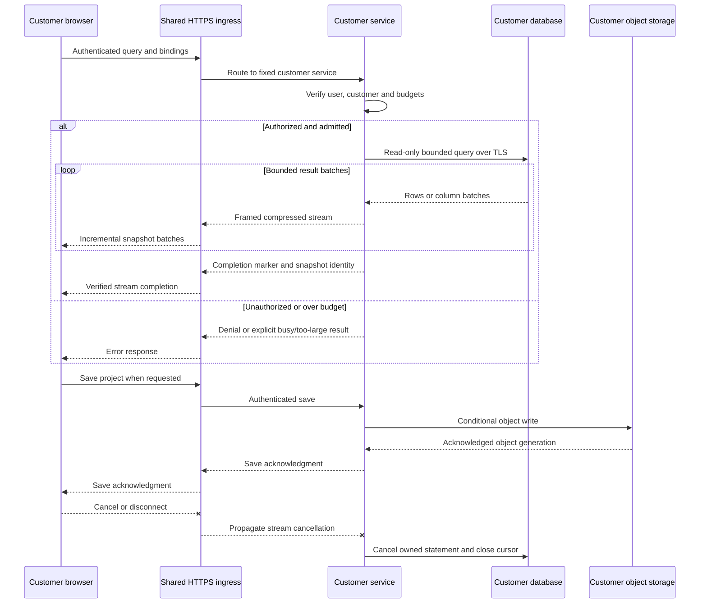
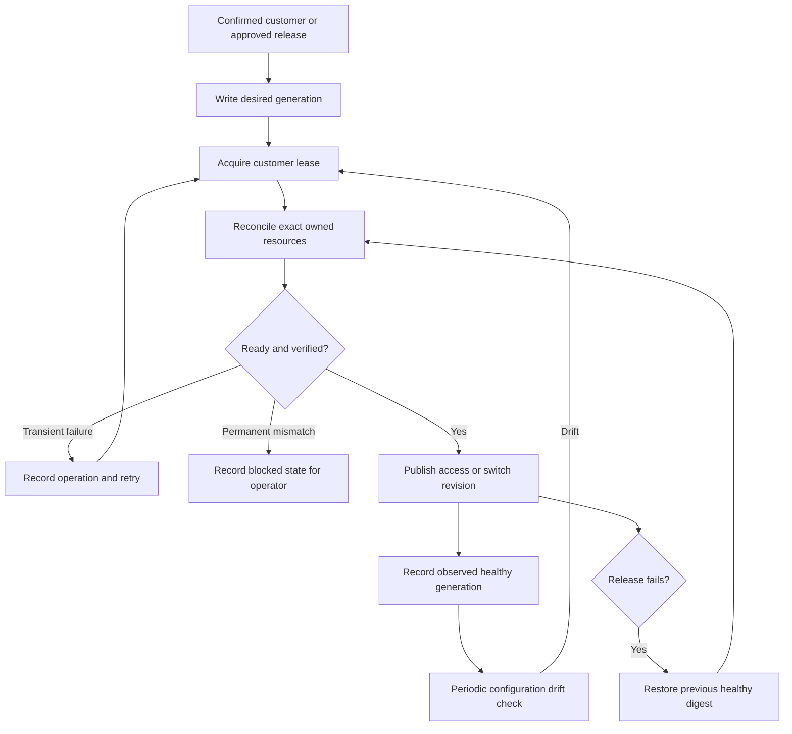

# Dedicated customer-instance hosting for explorEDA

**Track 4 — research and architecture shaping**  
**Evidence date:** 2026-10-12 UTC.  
**Repository baseline:** `byronwall/explorEDA` at `f01ff0fb1f9e1240020744a18816f2dad68bf488`, recorded as `origin/main` when the source packet was prepared.  
**Status:** A recommended architecture and falsifiable proof plan. No infrastructure, accounts, application changes or production tests were created.

## 1. Executive recommendation

**Use one Google Cloud Run Gen2 service per paying customer, deploying one common immutable container image, with a separate runtime service account, database credential and durable object-storage scope for each customer.** Keep the provisioning service shared and keep every customer query runtime exclusive to that customer. The service is the deployment and lifecycle unit; each active Gen2 replica has its own microVM boundary. This supplies dedicated application execution without operating a guest OS fleet. It does not promise a dedicated physical host, exclusive physical CPU, permanent machine, separate provider account or automatic multi-region availability. [CR01], [CR02], [CR10]

The conservative starting configuration is **1 vCPU / 2 GiB, instance-based billing, automatic minimum zero and service-level maximum two**, with small query admission and database pools. Instance billing still scales to zero. It is selected initially to support application liveness and cleanup without depending on ambiguous request-billing probe semantics. Use end-to-end HTTP/2 to an h2c application listener, plus an HTTP/1 health listener in the same application process. These are proposed settings and a new backend, not features already implemented in explorEDA. [CR04], [CR05], [CR22], [CR25], [CR33], [GP16]

**Use a paid Render service per customer as the simpler fallback for always-on application operation.** One Pro workspace, one network-isolated environment/customer, one `1c-2g` service/customer, one image and a small CI/API provisioning script are sufficient. Render manages HTTPS, unhealthy-instance restart and deployment health. Retain external state, using customer-specific S3 storage and Render's service-scoped AWS OIDC trust. This adds AWS IAM/state setup, so it is not universally simpler end to end than Cloud Run with native Google identity/storage. If cold starts alone are the objection, keep Cloud Run and select a warm configuration before changing vendors. [RENDER-COMPUTE], [RENDER-PROJECTS], [RENDER-HEALTH], [RENDER-OIDC]

**Cloudflare Containers deserves a real opportunity to displace Cloud Run.** Current Firecracker isolation, ordinary Linux images, actual-CPU billing and low outbound-transfer rates are strong fits for an I/O-heavy analytical service. The unresolved decisions are concrete: native database TCP egress identity, database-region latency, HTTP-to-driver cancellation, and reliable Worker/DO/container rollouts. Pure Workers is also credible for a restricted streaming adapter, but a 128-MB isolate and partial Node compatibility are an unnecessarily narrow default while database and transport contracts remain unfinished. [CF01], [CF17], [CF22], [CF24], [CF26], [CF28]

The decision follows this order:

1. Preserve a dedicated customer query runtime and narrow credential authority.
2. Keep ordinary native drivers and the largest practical choice of databases.
3. Let the provider replace unhealthy compute and handle routine host operations.
4. Externalize durable state so replacement, rollback and suspension remain simple.
5. Pay for optional warmth, private connectivity or stronger account isolation only when a customer requires it.

**GO for this architecture as the next bounded proof; no production GO is implied.** Essential failures that would reject it include cross-customer authority leakage, unbounded snapshot memory, inability to stop owned SQL, an unacceptable required network/cold-start path, unrecoverable provisioning, or costs that cannot be reconciled to bounded use. The research stops at that decision and proof, rather than selecting more vendors.

## 2. Access, baseline and repository findings

### 2.1 Access preflight

The authorized ZIP was readable and sufficient. Safe extraction checked for absolute/traversal paths. Its manifests describe 34 original source files, five additional source files and three images. **All 39 source-file hashes and all three image hashes matched; no mismatches were found.** The standalone attached prompt is byte-identical to `prompts/customer-instance-hosting.md`. Images were hashed, not visually interpreted; notebook conclusions use the supplied textual notes. This is a selected source snapshot, not a runnable checkout. No newer repository ref or the user's integration worktree was inspected. [REP10]

The assignment, `source-notes.md`, `customer-instance-update.md`, and all three companion prompts were read. They establish dedicated customer instances and roughly 10,000–100,000-row working cases, but do not settle database engines, source-data ownership, a latency/availability promise, fleet count, budget or the final query/transport design. Those remain explicit scenario inputs. [REP09]

### 2.2 Findings that constrain hosting

| Observed source fact | Consequence for this architecture |
|---|---|
| The package is an embedded React/TypeScript library, and the demo uses Vite/React. The supplied CI uses Node 24 and pnpm. | Keep the current UI/library model. A container can serve a future customer application shell plus a backend; changing UI frameworks is unrelated work. [REP01], [REP02] |
| `.github/workflows/deploy.yml` publishes `apps/demo/dist` to GitHub Pages. CI and release workflows run checks and publish packages. | Static demo hosting is neither a database backend nor a restriction on future runtime hosting. No customer provisioner or deployed database API was found in the inspected code/manifests. [REP02] |
| `AnalysisQuery` models source, lookup, expand, calculate, filter and aggregate steps over in-memory tables. `evaluateProject.ts` creates detailed evaluation frames. | A remote executor needs semantic agreement, not a mechanical replacement of a browser call with arbitrary SQL. Push down only supported operations. [REP03] |
| `AnalysisEvaluation` includes result rows, fields, stages, diagnostics, counts and revision. Stage frames contain full rows; rows contain values/data and source/contributor references. | Sending the entire internal result can duplicate data and transmit input-sized provenance even when an aggregate has few output rows. A small query answer can still have a large current object graph. [REP03] |
| `sourceFrame` uses the same object for `values` and `data` locally. Aggregate rows retain contributors and measure contributors. | Ordinary JSON loses object sharing and can repeat the same values and references. Binary encoding alone does not eliminate redundant demand. [REP03] |
| `useAnalysisEvaluation` can send full source tables to an optional Worker and suppress stale replies by request ID. It retains the last completed result for the corresponding query/bindings. The default path evaluates directly. | The existing worker mechanism is a responsiveness seam, not remote job management. Stale reply suppression does not cancel CPU or a database statement. [REP04] |
| `ExplorEdaProject` reconstructs rows from `row.data`, adds `__ID`, builds key maps and passes whole tables to consumers. `DataLayerProvider` owns raw/runtime data, profiles, Crossfilter and caches. | A streamed columnar result can still become multiple large row-object copies on the client. Hosting cannot compensate for unchanged full-table consumers or main-thread decoding/indexing. [REP05] |
| Source identity can fall back to position for invalid/duplicate keys. Revision incorporates table-array identity tracked with a WeakMap. | These values are not durable database snapshot identifiers across replicas, cold starts or refreshed tables. Stable primary keys and snapshot semantics require a new contract. [REP03] |
| Crossfilter/chart population logic intentionally treats the chart's own linked filter differently from workspace/other-chart filters. Parsing distinguishes missing values, finite numeric measures and UTC date handling. | SQL predicates/aggregates and transport types must preserve these semantics. The host must not silently authorize a different analysis result. [REP06] |
| `projectFile.ts` implements validated, storage-neutral import/export including source tables and tagged exceptional scalars. | Reuse the open project format where appropriate. It is not a customer database backup, secret store or hosted autosave service. [REP07] |
| `docs/performance-checks.md` contains historical development observations around 27,004 rows. Supplied tests exercise analysis, identity and filter behavior. | No new hosted latency, memory, concurrency or browser responsiveness was measured. Historical development timings cannot become a production SLA. [REP08] |

A fixture or parameter named for a customer is an analysis input. It does not establish deployed customer isolation. The customer-instance goal supersedes a global shared-query-server assumption while preserving one common software version. [REP03], [REP09]

## 3. What a customer instance actually means

**Recommended definition:** a customer owns one independently deployable service identity and lifecycle record. Every replica of that service executes only that customer's requests and holds only that customer's credentials. Durable project state and any intentional exports have a matching resource/authorization boundary. The instance may sleep and be recreated; it is a logical service with exclusive execution replicas, not a stable machine name.

| Boundary | Dedicated compute meaning | Data/secrets/network separation | Residual shared failure or authority | Fit |
|---|---|---|---|---|
| Separate database or schema, shared query process | No separate application compute. | Can isolate database grants; one process may still hold all credentials and caches. | Shared process, memory bugs, resource exhaustion and deployment. | Insufficient by itself for this assignment. |
| Separate OS process/customer | Separate address space; CPU/RAM only if limits are configured. | Different users/files/secrets are possible. | Host kernel/root, runtime host, disks and reboots. | Minimal logical separation, with more operator work. |
| Separate container/service/customer | Exclusive application processes and resource allocation. | Customer-only secrets and service/environment policies; network defaults must be checked. | Often a shared kernel; provider account, ingress and regional control remain shared. | Viable Render fallback if this is the accepted promise. [RENDER-PROJECTS] |
| Cloud Run Gen2 replica / Cloudflare Container / Fargate task | Customer-exclusive runtime inside a VM or hardware-virtualized boundary; no exclusive physical-core promise. | Separate runtime identity/secrets plus provider-specific networking; state remains external. | Shared physical infrastructure, account/project quotas and operator control. | Best ordinary dedicated-runtime boundary without a guest OS fleet. [CR01], [CF22], [AW05] |
| Worker script/customer | Customer-specific script, bindings and isolates, with CPU/memory limits; no reserved customer process or VM. | Narrow bindings can isolate secrets; runtime and platform are shared. | Isolate model, account limits, platform compatibility and broad control-plane credentials. | Valid only if the product accepts this boundary and bounded streaming fits. [CF01], [CF02] |
| VM/customer | Own guest kernel, OS filesystem and virtual network interface. Shared-vCPU plans still share physical CPU time. | Per-VM firewall/IP and credentials possible. | Provider host/account plus operator root; operator owns guest maintenance. | Stronger guest control with higher recurring work. [DO-POLICIES] |
| Cloud project/account/customer | Separates administrators, policy, quotas and bill ownership to the extent configured. | Can isolate VPC, service keys and ownership more completely. | Shared organization/operator access may remain; not physical dedication. | An explicit stronger tier, not the default. |

Sharing the registry image, identity provider, DNS zone, HTTPS ingress and provisioning controller is compatible with this design. **Sharing a customer query process that switches database credentials based on a `customer_id` is not the recommended design.** A tenant header or hostname cannot substitute for server-side authorization.

The smallest recommended operational unit is therefore **one managed service/customer**, with microVM replicas on the primary. Separate projects/accounts are warranted when customers need their own cloud administration, distinct quotas/budget enforcement, separate network policy ownership, contractual account separation, or customer-controlled infrastructure. They increase setup, IAM, billing, support and resource-inventory work; project creation alone does not necessarily increase compute price. Unique egress addresses and regional infrastructure can create additional recurring floors.

This design assumes trusted application code and constrained analysis expressions. Arbitrary customer shell execution, native plugins or unrestricted UDF code would change the threat and resource model and needs a separate decision.

## 4. Screening and rejection ledger

Six architectures receive detailed treatment below: Cloud Run, pure Workers, Cloudflare Containers, Render, VPS and ECS Express/Fargate. Other products were screened only far enough to determine whether they could change the recommendation.

| Option | Disposition | Reason and condition for reconsideration |
|---|---|---|
| Cloud Run Gen2/customer | Recommended primary. | Ordinary container/native-driver path, microVM replicas, explicit identity and region, scale-to-zero, and documented lifecycle/network controls. Cancellation, health and required network paths remain proof gates. |
| Pure Workers/customer | Investigate as a specialization. | Attractive for database pushdown plus bounded streaming; 128-MB isolate, native compatibility and Hyperdrive constraints prevent a broad default. A large total response alone does not reject it. [CF01], [CF09], [CF17] |
| Cloudflare Containers/customer | Strong challenger. | Firecracker boundary and favorable actual-CPU/egress economics. Do not assume fixed native TCP egress or atomic multi-resource rollout. [CF22], [CF24], [CF26], [CF28] |
| Render/customer | Selected managed-app fallback. | Managed health restart/TLS/deploys, normal Docker and simple always-on operation. Requires paid floor and explicit environment isolation. [RENDER-HEALTH], [RENDER-PROJECTS] |
| Fly Machine/app/customer | Conditional alternative after short screen. | Genuine VM boundary, sleeping and inexpensive app-scoped static egress. Failed health checks do not restart a hung Machine; additional recovery ownership prevents it winning the simplest-operation role. [FLY-SECURITY], [FLY-EGRESS], [FLY-HEALTH] |
| Railway/customer | Credible, not selected. | Pro's $20 minimum is a credit against usage, not an extra $20 plus usage. Optional sleeping depends on outbound silence; pools/telemetry can prevent it, and the first wake request can return 502. Always-on Railway remains viable. Render wins this fallback judgment for fixed service pricing and its documented recovery/deployment model; no measured overall superiority is claimed. [RAILWAY-PRICING], [RAILWAY-SERVERLESS], [RENDER-HEALTH] |
| VPS/customer | Conditional exception; reject as default. | Full Linux/network control at a low bill, but guest operations remain unmanaged. Shared-host containers additionally share the host kernel and outages. [DO-POLICIES] |
| ECS Express/Fargate/customer | Defer unless AWS locality or steady use wins. | Express now automates substantial setup; still has an always-on task and ingress/IP floor in its ordinary configuration. [AW06], [AW07] |
| Ordinary Lambda/customer | Reject for the general snapshot API; retain for small control tasks. | Current streaming supports 200 MB, but post-6-MB throughput is limited to 2 MB/s, invocation remains bounded, and client disconnect does not stop the invocation. A Lambda image is not an unchanged web-service container. [AW01], [AW02], [AW17] |
| Lambda tenant-isolation / Managed Instances | Not the simpler boundary. | Tenant-isolation mode still shares the function execution role; Managed Instances introduces EC2 capacity-provider boundaries. Neither cleanly replaces an independent customer service plus identity. [AW18], [AW19] |
| Lambda MicroVMs | Session-oriented alternative, not persistent customer service. | Full Linux and suspend/resume are relevant, but total lifetime including suspension is capped at eight hours; replacement requires a new endpoint and authentication/session routing. [AW20], [AW21] |
| App Runner for a new operator | Reject. | AWS stopped accepting new customers on March 31, 2026; existing users continue. [AW11] |
| D1, R2, Durable Objects alone | Components, not interchangeable query hosts. | D1 hosts SQLite data, R2 stores objects, DOs coordinate state. They do not automatically provide arbitrary customer database connectivity or a dedicated native query process. [CF34], [CF35], [CF36] |
| Kubernetes, Nomad or a custom fleet scheduler | Reject until a concrete missing capability demands it. | Placement, upgrades, capacity, secrets and recovery are more work than the proposed managed-service lifecycle. |

### Why Fly did not win the fallback

Fly can be the better answer when a customer needs a guest kernel or a cheap individual source IP. One app/customer with a distinct custom private network and one Machine can sleep and wake. Default organization networking is shared; custom network identity must be chosen correctly at creation. Static egress is app- and region-scoped, approximately $3.60 per 720-hour month. [FLY-NETWORK], [FLY-EGRESS], [FLY-AUTOSTOP]

Its low shared-CPU quote is not an equivalent sustained CPU allocation. The current table gives each shared vCPU a 6.25% baseline plus burst credits; a performance vCPU gets full CPU time. Current US examples are $13.39/month for shared-2x/2 GB and $33/month for performance-1x/2 GB. A failed health check stops routing but does not restart a hung Machine. App watchdog/recovery, lease-aware updates and idle-state preservation become operator-owned behavior. Those are acceptable for a requirement that justifies them; they do not make the simplest fallback. [FLY-CPU], [FLY-PRICING], [FLY-HEALTH], [FLY-API]

### Pricing evidence that should not be carried forward from old comparisons

Cloudflare Containers limits and instance shapes have expanded. Render's current names include `1c-2g` (legacy Standard). ECS Express is now a real managed entry point. Hetzner's June 2026 adjustments list US CPX11 at $20.49/month before primary IPv4 and VAT; a historical $6.99 US quote is stale. The report uses current direct documentation instead of those older comparisons. [CF23], [RENDER-COMPUTE], [AW08], [HETZNER-PRICE-CHANGE]

## 5. The six architectures against the actual workload

### 5.1 Cloud Run Gen2 — recommended default

**Design:** common Linux amd64 OCI image; one service and runtime service account/customer; source database chosen near the service region; external GCS project/configuration storage; managed secrets; small shared lifecycle controller. A common image can include a new Node backend and Vite customer application shell. No current source file establishes that backend already exists. [REP01], [REP02], [CR09]

**Documented limits and quotas:** maximum 8 vCPU / 32 GiB per replica; one vCPU can pair with up to 4 GiB. Maximum request duration is 60 minutes. HTTP/1 non-streaming responses are limited to 32 MiB, while streamed/chunked responses are excluded; HTTP/1 requests have a 32-MiB cap, and the HTTP/2 server path removes that provider request-size limit. Concurrency can reach 1,000 but must be set much lower here. These are limits, not evidence of safe application capacity. [CR03], [CR34], [CR35]

**Cancellation is a material caveat.** Google explicitly documents that HTTP/1.1 client disconnects are not propagated to the container. Configure h2c end to end and observe cancellation in the actual database. A browser abort, provider 504 or socket closure is not proof SQL stopped. The app must own a deadline, close the cursor/transaction, and use an adapter-supported cancellation path. [CR24], [CR25], [CR08]

**Health and billing:** use h2c ingress on 8080 and a small HTTP/1 liveness listener on 8081 in the same app process. The API permits a probe port different from the sole exposed ingress port. The health response must reflect the application event loop and must not query the customer's database on every probe. Current billing guidance says probes require instance-based billing, while the detailed health page describes CPU/memory charges when probes execute. The conservative configuration selects instance billing; lower-cost request billing is an optimization to verify later. [CR22], [CR33], [GP16]

**Scaling is not a hard database cap.** Set the maximum on the service (`scaling.maxInstanceCount`), not merely an old revision setting. Normal overshoot is documented. Tagged revisions outside a traffic split are outside the service cap, and old/new replicas can overlap during a release. Small pools and database-side restrictions must protect source systems independently. [CR05], [CR06]

**State:** the default writable filesystem consumes memory and is ephemeral. New Gen2 ephemeral disk is Preview and can be evaluated for disposable spill, with its own quota and price. It is not durable state. GCS FUSE does not supply normal POSIX/locking semantics; do not turn an object bucket into a concurrently writable SQLite/DuckDB database filesystem. [CR09], [CR19], [GP12]

**Network and placement:** choose the service region by database locality and residency. Public TLS works without a Worker-specific driver rewrite. Static egress requires an explicit VPC/NAT design. Direct VPC can need a minute or more to establish connectivity at startup, and the static-NAT guidance warns about tens of seconds. A shared connector can reduce that risk but adds a persistent VM floor and its own capacity. A mandatory fixed/private path must pass a separate cold-start proof. [CR13], [CR14], [CR28], [CR29]

**Operational conclusion:** best default for broad database compatibility plus managed runtime isolation, provided the proposed streaming, cancellation, health and network proofs pass. It is not selected on the claim that all serverless work is free while idle or that every cold start is fast.

### 5.2 Pure Cloudflare Workers — serious bounded-streaming option

**Isolation/design:** one Worker script/customer with customer-specific secret/database bindings and common compiled code. A shared router may dispatch, but should not hold every SQL credential. The runtime boundary is an isolate, not a reserved VM or conventional customer process. Ordinary paid Workers allow 500 scripts/account, so 100 customers does not by itself require Workers for Platforms. [CF01], [CF02], [CF08]

Paid Workers have **128 MB memory per isolate**, a default 30-second CPU allowance configurable up to 300 seconds, and no enforced HTTP response-body ceiling or connected-request wall-time ceiling. CPU time excludes time waiting on I/O. Current uncompressed bundle size is 64 MiB; older smaller-limit summaries are stale. These facts permit a response larger than memory if every driver/encoder stage streams. They do not permit full buffered evaluation graphs to exceed memory. [CF01], [CF03]

Raw outbound TCP/TLS and Node-compatible database libraries exist. Sockets must be created in the request context, so a normal global Node connection pool is not portable unchanged. Direct sockets have destination restrictions, including private/loopback ranges. Node compatibility is partial, including stubs, and memory-backed filesystem support is not native Linux storage. Treat native `.node` addons, ODBC libraries and large local analytical engines as container requirements unless a specific supported alternative is proved. [CF16], [CF17], [CF18]

**Hyperdrive is useful, with real qualifications:**

- It supports PostgreSQL/MySQL-compatible families, not every database adapter. A SQL Server requirement is not satisfied by attaching a Hyperdrive binding. [CF11]
- Paid accounts have **25 database configurations** by default. A 100-customer design with one database/configuration each needs a verified quota increase or another connection path. A **60-second statement limit** and connection timing limits affect the query contract. [CF09]
- Its **50-MB threshold is a cacheability limit**, not a hard result-delivery cap. Larger results can still stream. [CF09], [CF15]
- Transaction pooling changes session behavior. Session state, manual prepared statements, advisory locks and cursors cannot be assumed to behave like a private persistent driver connection; prepared-statement support depends on how the driver uses it. Inspect the exact supported feature and test it. [CF11], [CF12]
- Default caching can return results fresh for 60 seconds and stale for a further period; writes do not automatically invalidate the cache. Disable query caching initially while retaining pooling. Snapshot freshness needs explicit application semantics. [CF15]
- Private databases can use Workers VPC with a customer-side connector; the reviewed guide is beta-marked. Cloudflare IP ranges or placement hints are not customer-exclusive static egress or membership in the customer's VPC. [CF13], [CF14], [CF20]

Workers for Platforms can simplify dispatch at larger scale, but introduces a different plan and lifecycle. Its current documentation still lists a 30-second CPU limit where ordinary paid Workers permit 300 seconds; use the more conservative limit for that product until clarified. It is not required merely to host 100 copies of trusted common code. [CF04], [CF05], [CF07]

**Conclusion:** investigate if adapters push critical work to supported databases, keep memory bounded and need no unsupported native modules/private path. Neither wide rows nor compressed binary output alone forces a container. The unfinished adapter contract and current full-table consumers make Workers a specialization rather than the baseline.

### 5.3 Cloudflare Containers — credible challenger

Cloudflare documents a **Firecracker microVM with its own kernel and network** for each Container. This is materially stronger isolation than describing the whole Cloudflare design as an isolate. Use a stable known Durable Object identity/customer and **one customer Worker plus one container application/class/customer**, keeping secrets customer-specific. Deploy the same Linux amd64 OCI image. Select the **default scheduler** with a deliberate maximum, initially one, and external durable configuration. [CF22], [CF25], [CF30], [CF31]

Current custom shapes support 1–4 vCPU, at most 12 GiB RAM and 20 GB disk, with **at least 3 GiB RAM per vCPU**. The cost model therefore uses 1 vCPU / 3 GiB / 4 GB disk, not a fictitious 1-vCPU/2-GiB shape. Current account ceilings are 6 TiB memory, 1,500 vCPU and 30 TB disk; actual account/application/class quotas must still be checked before onboarding 100 customers. [CF23]

Availability must be described precisely. Containers is documented for Workers Paid accounts; that does not by itself establish a production SLA or a formal GA commitment. The newer `durable_object` scheduler is explicitly public beta, changes rollout ownership, and has an immutable policy selection. The baseline candidate does not need it. New filesystem snapshots have bounded retention and are not transactional customer database backups. [CF21], [CF25], [CF23]

**The important network gap:** a container with internet enabled can use native TCP. The documented outbound interception/allow-deny facilities operate on HTTP ports 80/443; traffic to other ports bypasses those controls while internet remains enabled. Disabling internet blocks the native database ports as well. No official proof of a customer-specific fixed PostgreSQL/MySQL TCP source IP was established. An HTTP policy feature cannot be presented as a general database firewall. [CF28]

Placement can use broad regions/jurisdictions; do not assume precise colocation with a chosen customer database availability zone, or that a restarted container stays on the same host. Query latency and reconnect behavior remain measured requirements. Worker request-signal support and DO fetch forwarding offer a cancellation path, but container HTTP and actual driver cancellation still need proof; `exec()` does not inherently cancel subprocess work on caller abort. [CF27], [CF37], [CF32]

Rollouts span a Worker, DO routing and image deployment. A successful deployment response can precede completion of container image rollout, and Worker code can be live before every image update. Record the observed running digest and keep old images for rollback; do not mark a customer ready on “deploy accepted.” Secret changes take effect in container startup configuration, so credential rotation needs a restart/reconnect sequence. [CF26], [CF30], [CF39]

**Reversal condition:** if the first customer cohort uses public TLS databases without fixed TCP source-IP requirements, and Containers passes latency, cancel, isolation and rollback tests with acceptable support terms, its actual-CPU charging and lower transfer cost can make it the primary. That is a real alternative decision, not a ceremonial mention of Cloudflare.

### 5.4 Render — simpler always-on application operation

Use one Pro workspace and one isolated project environment plus `1c-2g` web service/customer. The plan provides **1 CPU / 2 GB for $25/month/customer**, and Pro is **$25/month/workspace**. Legacy Standard is the same plan. Pro enables network-isolated environments and service OIDC. The official pricing landing page's dynamic tables did not render fully in this reader; current Render compute documentation and its own September/July 2026 pricing explanations corroborate these quotes. [RENDER-COMPUTE], [RENDER-RAILS-PRICE], [RENDER-WORKSPACE-PRICE], [RENDER-FEATURES]

The documented isolation is a separate containerized service, not an established customer guest-kernel or physical-host guarantee. Same-region workspace services can communicate privately by default; create each customer's environment with isolation enabled before adding credentials. This blocks cross-environment private traffic, not public endpoint access or operator authority. Enabling it after the fact does not close already-open connections until restart. [RENDER-SERVICE-TYPES], [RENDER-PROJECTS]

Prebuilt Linux amd64 Docker images support ordinary drivers/native dependencies. Paid services normally remain running; API suspend/resume is an explicit lifecycle operation, not request-driven sleep. Health checks remove unhealthy instances from routing after repeated failures and restart them after about 60 seconds; failed new deployments preserve the old healthy deployment. One service instance still has restart gaps and is not a multi-zone SLA. [RENDER-IMAGE], [RENDER-HEALTH]

The common application image should expose a configurable HTTP/1 API mode for the fallback as well as the primary's h2c mode. Port/protocol selection is a deployment setting to prove; reusing an image does not establish identical upstream proxy or cancellation behavior. This is a requirement for the future backend, not an existing capability claim.

Responses can run up to 100 minutes according to Render's documented comparison, but no verified maximum binary response size was found. More importantly, long-request support does not guarantee survival through a deploy: routing switches, the old process receives SIGTERM after a delay, and shutdown grace is finite. Browser HTTP abort propagation through the proxy to the driver was not established. Streaming, slow receivers, compression, disconnect and deployment-overlap cancellation must be exercised. [RENDER-LONG-HTTP], [RENDER-DEPLOY-DRAIN]

Avoid a persistent disk for authoritative state: one disk binds one instance and complicates horizontal scaling and zero-downtime deployment. Use S3 Standard and a bucket/customer. Render-to-AWS OIDC is GA on Pro; exact-service trust binds the workload token to one narrow role, with customer-only bucket access. This is workload identity, not customer login. Keep the same application identity provider as the primary. OIDC does not authenticate image pulls from ECR; private registry credentials are a separate release concern. [RENDER-DISKS], [RENDER-OIDC], [RENDER-OIDC-GA], [RENDER-IMAGE]

Static egress is expensive if needed individually: **$100/month for a regional set of three IPv4 addresses**, four sets/workspace by default. Any address in the set may be used. One shared set gives a platform allowlist identity; one set/customer costs $100N and needs quota approval above four. Private links are a narrower supported same-region AWS connection, starting at $30/workspace for up to three links, not generic on-premises connectivity. [RENDER-DEDICATED-IP], [RENDER-DEDICATED-IP-PRICE], [RENDER-PRIVATE-LINK]

Provisioning is automatable but not instantaneous at arbitrary fleet size. The default API permits **20 service creates/hour/user** and 50 domain create/verify operations/hour/user. One hundred customers consumes five hourly quota allocations and several elapsed hours, depending on window alignment. Update desired image configuration and then trigger a deployment; retain/reconcile the intended digest even after rollback. Keep broad Render API credentials exclusively in the provisioner. [RENDER-RATE-LIMITS], [RENDER-UPDATE-SERVICE], [RENDER-CREATE-DEPLOY], [RENDER-AUTH]

**Conclusion:** viable fallback when an always-on floor and application-container boundary are acceptable. It simplifies application operation, while external state and two-provider IAM prevent a claim of universal end-to-end simplicity.

### 5.5 VPS — cheap resources with continuing guest ownership

One DigitalOcean VM/customer offers ordinary native drivers, TCP/TLS, an individual virtual network/guest kernel and persistent local disk. Automated API creation, cloud-init, a pinned image, a supervised process and an automatic TLS proxy can make setup repeatable. None of those makes the guest OS managed: the operator owns security/base-image updates, container runtime, reboots, disk capacity, process hangs, backup verification and recovery. DigitalOcean explicitly describes Droplets as unmanaged. [DO-CLOUD-INIT], [DO-POLICIES]

A practical small implementation would keep source database and important app state external, rebuild VMs from manifests, use cloud firewalls and narrow instance credentials, and retain the prior image. Do not put a broad cloud control token in user-data; guest metadata exposes that material. A container restart policy addresses crashes, but a health-check failure alone is not always a restart action. Guest/kernel failures and host replacement still need remote observation. [DO-METADATA]

The current Basic Regular **2-GiB / one shared-vCPU / 50-GiB disk / 2,000-GiB transfer** plan is $12/month. Weekly backups add 20%; daily add 30%. Powered-off allocated VMs still bill until destroyed. The monthly cap is 672 hours under current per-second billing, so a full 720-hour planning month reaches the quoted cap. VM memory includes OS/proxy/container-engine overhead; it is not 2 GiB exclusively available to the app. Sustained shared-CPU performance is unmeasured. [DO-PRICING], [DO-BILLING], [DO-BACKUPS]

Putting separate customer containers on a shared VM retains dedicated processes but shares the kernel, root administrator, disk pressure and host outage. Strong cgroup limits, nonroot users, capability removal and separate secrets/network namespaces help, but do not create customer VMs. At scale, bin packing, rebalancing and host draining become a small scheduler.

Even the savings are conditional. An 8-GiB/4-shared-vCPU Basic VM is $48/month. With 2 GiB reserved for the host and three 2-GiB customer containers, weekly backup makes it $57.60/host, or $19.20/customer at full packing. A 100-customer fleet requires 34 such hosts and $1,958.40/month. Lower memory caps or oversubscription may save money, but those are workload assumptions and change failure isolation. [DO-PRICING], [DO-BACKUPS]

**Conclusion:** use only when networking, guest control or a sufficiently different measured workload justifies the operator burden. It is not the minimum-maintenance default, and a shared-host control panel does not change that ownership.

### 5.6 ECS Express Mode/Fargate — credible AWS alternative

ECS Express Mode now creates much of the Fargate service, HTTPS ALB, network and deployment setup through a simpler service interface, with no additional Express fee. Default sizing is 1 vCPU/2 GiB, minimum one task and maximum 20, with autoscaling and canary deployment. Up to 25 Express services in one VPC share an ALB. This is a meaningful improvement over older claims that every small ECS app requires hand-assembling the whole stack. [AW06], [AW07], [AW08]

Run one ECS service/customer, with a customer-specific task role and security group; the **Fargate task is the hardware-virtualized boundary**. Containers within the task share it. Ordinary native drivers and region/VPC placement fit well. Public task IPv4 is not a persistent fixed source IP across replacements; required allowlisting needs a separate static egress path. [AW05], [AW14]

Minimum zero does not supply Cloud Run-style request wake and buffering by itself; autoscaling needs a usable signal. The ordinary minimum-one configuration has an always-on floor. At Virginia x86 list rates, 1 vCPU/2 GiB costs $35.546688 per 720-hour month before IP, ALB, transfer and other services. ARM may lower compute price after native-driver validation. Rollouts temporarily overlap tasks; there is no reason to invent a permanent two-task floor. [AW04], [AW07], [AW09], [AW10]

ALB and public-IP floors can be shared, but the data-processing charge is the maximum of LCU dimensions, not a flat known total from query count alone. The current Virginia internet-transfer rate table was not retrieved successfully; this report leaves it explicit rather than borrowing another region's example. That gap limits an all-in AWS quote, not the verified task/ingress floor or the architecture screen. [AW13], [AW14], [GP20]

**Conclusion:** reconsider for AWS-resident private databases or continuously occupied customers, especially when the operator already owns AWS networking. For an unknown mix of dormant customers, Cloud Run remains the more coherent primary. There is no need to add Kubernetes to use Fargate.

## 6. Workload constraints and snapshot strategy

### 6.1 Row counts do not select a host

The working row range needs byte, CPU and concurrency dimensions. The following arithmetic is a sensitivity illustration, not a measurement of explorEDA:

| Synthetic shape | Logical value bytes before framing/object overhead | Consequence |
|---|---:|---|
| 10,000 rows × 20 eight-byte values | 1.6 MB | A plausible small complete snapshot. |
| 100,000 rows × 20 eight-byte values | 16 MB | Potentially practical in a browser after bounded decoding. |
| 100,000 rows × 100 eight-byte values | 80 MB | More than the proposed initial 64-MiB decoded snapshot budget; projection or a larger proved budget is needed. |
| 100,000 rows × 100 fields averaging 32 bytes | 320 MB | Strings, validity/offset buffers, provenance and JS objects make this a substantial browser-memory case. |
| 1,000,000 rows × 20 eight-byte values | 160 MB | A larger sensitivity case, not automatically a promised first-release full snapshot. |

Compression changes bytes on the wire, not the memory cost of decoded values, source-row references, Crossfilter dimensions or repeated React-facing row objects. A streaming Worker can carry a result larger than its memory if bounded batches remain bounded. Conversely, a 2-GiB container can fail on a much smaller result if every stage and provenance array is materialized. These are architectural deductions from the inspected data structures, not measured memory ratios. [REP03], [REP05]

### 6.2 Provisional request and resource budget

Use these as proof settings, then revise from evidence:

| Layer | Starting setting | Purpose and qualification |
|---|---|---|
| Customer service | 1 vCPU, 2 GiB, automatic min 0, service max 2 | A small general container with replacement headroom; no hard fleet or cost ceiling. |
| Container request concurrency | 4 | Leaves room for control/auth/health-related work while limiting admitted requests. |
| Active database queries | At most 2/replica | Separate semaphore from HTTP concurrency; reject excess promptly with a retryable busy result instead of an unbounded queue. |
| Database pool | 2 query connections/replica, plus a separately budgeted cancellation connection if required | Cancellation must not wait behind the two queries it is meant to stop. Pools multiply during rollout and overshoot. |
| Source database connection budget | Explicit customer-specific role limit where supported; start proof around 8 total connections and adjust for its adapter | This is a proposed guardrail, not a universal DB guarantee or a derivation that max-two makes eight a hard provider bound. Reserve administration/recovery capacity outside explorEDA. |
| Query deadline | 60 seconds end to end | App deadline plus DB-enforced statement/transaction timeout where supported; cursor fetches must not reset the overall deadline indefinitely. |
| Service request timeout | 90 seconds | Allows bounded transfer/error cleanup; timeout alone does not kill SQL. |
| Complete browser snapshot | At most 100,000 rows and 64 MiB of decoded column/value buffers initially | Both limits apply. This is not 64 MiB of JavaScript heap; real browser expansion is measured separately. |
| Batch/receiver handling | A bounded driver fetch and encoder batch, initially 1,000–4,000 rows plus a byte cap | Wide values require the byte cap; downstream backpressure must stop further reads. |
| Oversized result | Explicit too-large response, narrower projection or aggregate demand | Never silently truncate and label a result complete. |

At two replicas, normal query pools use four connections. A release, tagged smoke test, retained idle pool or platform overshoot can exceed that nominal count. DB-side protections and admission are required even when the service maximum is one. A service should fail closed on resource exhaustion and return a useful busy/retry indication rather than opening another unbounded pool. [CR05], [CR06], [GP17]

### 6.3 What actually forces a container

| Proposed workload/transport choice | Container required? | Judgment |
|---|---|---|
| PostgreSQL/MySQL query pushdown, TLS and incremental result encoding | Not inherently. | Workers/Hyperdrive can be viable after exact driver/pooling/limit proof. [CF11], [CF16] |
| HTTP streaming, Arrow-like binary batches or compression | Not inherently. | Both edge and container runtimes can stream; codec CPU, compatibility and buffering decide fit. No transport format is selected by this report. |
| A complete snapshot larger than 128 MB in total | Not by itself. | Total streamed size differs from peak working memory. Browser admission may still reject it. |
| Native database client libraries, ODBC, unsupported Node addons, broad filesystem-dependent code | Usually yes for the baseline. | A normal Linux image is the compatibility escape hatch; pin/test each library rather than assuming every database client works. [CF17], [CR09], [RENDER-IMAGE] |
| In-process server DuckDB for large joins/materialization or disk spill | Strong container preference. | An embedded analytical engine can exceed isolate memory. It also changes memory/temp-disk sizing; do not make it mandatory without query-track evidence. |
| Browser DuckDB/WASM or browser-local Crossfilter | No server container requirement. | Client processing still needs off-main-thread work, sensible batch sizes and memory admission. [REP05] |
| Authoritative local SQLite/DuckDB database | Selects a durable-storage topology, not merely a container. | Cloud Run/Cloudflare ephemeral files and object FUSE are not sufficient. A managed DB or explicitly operated persistent VM/service is a separate decision. [CR09], [GP12], [RENDER-DISKS] |
| On-premises database | No universal answer from runtime name. | Requires a verified network route and customer-side installation/permissions. This is a separate onboarding/support profile. |

### 6.4 Browser snapshots versus server caches

**Baseline:** after an authorized bounded query completes, retain the admitted snapshot in the browser and reuse it for local interactions. Continue to use the existing analysis/selection semantics. Fetch a new snapshot explicitly when bindings, source revision or freshness policy require it. Move decode/index construction to a Worker or equivalent client execution seam, and avoid eagerly converting every column back into repeated row objects. [REP04], [REP05]

The response contract needs a query/request identity, customer/source identity, stable schema/types, a declared freshness/snapshot token, bounded batches, diagnostics and an unambiguous completion marker. A footer/count/checksum or equivalent framing must distinguish a complete snapshot from an interrupted response. A request ID answers “which request is this?”; it does not prove a coherent database snapshot. Replaying the old WeakMap-derived revision on another server does not establish freshness. [REP03], [REP04]

Keep server result caches disabled initially. A small in-memory cache may later be a disposable optimization, keyed by customer, source identity, credentials/authorization version, query/bindings, schema and snapshot/freshness version. It cannot be the only copy of an acknowledged user save. Persistent immutable snapshot objects should be added only if measured repeated transfers justify storage, invalidation, permission and retention work.

A browser holding a full authorized snapshot can keep displaying it during backend sleep or a temporary disconnect. That is useful, but revoking future server access cannot recall bytes already delivered to the browser or exported as a file. The product must distinguish refresh permissions from possession of a prior snapshot. This follows directly from the proposed data flow; it is not a provider-specific feature.

## 7. Concrete primary architecture

### 7.1 Resource inventory

| Scope | Resources | Authority and lifecycle |
|---|---|---|
| Shared per operating environment/region | One control-plane Cloud Run job, one Firestore desired-state database, one reconciliation schedule, a registry and common image releases | Only the provisioner can manage fleet resources. One finite reconciler; no new orchestration platform. |
| Shared production ingress | One external Application Load Balancer, regional serverless NEG configuration, one parent DNS zone and managed certificates | Routes customer hosts to the correct customer service. It does not execute SQL or hold database credentials. |
| Customer runtime | One Cloud Run Gen2 service, revisions/replicas, service account, fixed customer ID and auth policy | The app validates the user and customer on every query. It cannot read fleet Firestore or another customer's storage/secrets. |
| Customer durable app state | One GCS bucket/customer, project/configuration objects, version history and explicit lifecycle rules | Customer-authored project state and intentionally retained exports only; source database remains elsewhere. |
| Customer database access | Secret Manager secret resources/version references, TLS material, narrow DB account | Secret values are supplied by an authorized onboarding path and never embedded in the image, desired-state record or logs. |
| Optional customer network profile | Regional VPC, firewall tags/routes and NAT/static egress or a separately supported connector | Provision only when required; shared IP versus exclusive customer IP is recorded explicitly. |

The project-level provisioner necessarily has broader cloud authority than a query runtime. Restrict that authority to the managed environment, protect it from customer requests, and keep operator recovery possible. A per-customer runtime must not receive broad Firestore IAM merely because documents have tenant IDs: server libraries use IAM, not browser Security Rules. [CR10], [CR11], [GP15]

### 7.2 Request/data flow

This diagram is a proposed flow, not observed traffic. The provisioner is absent from customer queries. The database is customer-owned by default. Saves and query results are separate operations; an ordinary query is not automatically archived. A browser must not receive database passwords, cloud administrator credentials or a cross-customer object capability.

### 7.3 Browser access, hostnames and TLS

Use the provider's `run.app` URLs for the first hosted proof. For production customer subdomains, use an external ALB with a serverless NEG URL mask or explicit region-aware routing. Cloud Run's native domain mapping remains Preview and explicitly not production-ready due to latency. A shared certificate through Certificate Manager and DNS authorization can cover an owned wildcard; ordinary key types avoid extra per-connection certificate charges. Custom customer-owned domains add a real DNS verification/manual boundary. [CR07], [CR18], [GP21], [GP22]

For a one-region launch, deterministic service names can match `customer-id.apps.example.com`. When adding regions, maintain an explicit host-to-region mapping or region-qualified domain scheme; do not point a URL mask at a service that exists only in another region. Validate unknown hosts and customer identity rather than relying on string parsing alone.

Production tagged-revision smoke tests also use the ALB. Preconfigure a reserved smoke path with a serverless NEG URL mask containing both `<service>` and `<tag>`; placing the tag in the path preserves the existing customer-host certificate. The application authorizes the controller for a narrow smoke operation against the exact customer and intended generation. An ordinary customer-host mask does not select a tag, and a default-network controller cannot bypass restricted ingress by calling a tagged `run.app` URL merely because it shares the project. Remove the revision tag after verification. This avoids adding a VPC solely for smoke tests. [CR18], [GP14]

Application authentication is explicit. A shared managed identity provider such as Google Identity Platform can authenticate users; the customer backend verifies the token/session issuer, audience, expiry and customer membership against its fixed customer identity. The runtime service account authorizes cloud access and does not authenticate a browser. At the platform layer, allow the intended browser ingress and apply authentication in the app; production `internal-and-cloud-load-balancing` ingress prevents direct public `run.app` bypass of the load balancer. Use host-bound secure sessions and appropriate CSRF/CORS handling for the eventual auth flow. [GP08], [GP13], [GP14]

Revocation needs a stated propagation contract. A control-plane document update is not magically visible to running replicas. The simplest whole-customer suspension uses verified platform disabling and bounded draining. Individual-user revocation must follow a tested managed-session/token policy; if immediate revocation is required, add a narrowly scoped current-membership check or customer-specific policy propagation and price its reads. Do not grant every runtime global identity-administration privileges merely to check revocation.

### 7.4 Database/network profiles

| Profile | Baseline mechanism | Manual prerequisite | Cost/architecture consequence |
|---|---|---|---|
| Public database with TLS and narrow credentials | Normal driver connection from the customer's service region | Customer creates/authorizes DB identity and confirms certificate/objects. | Lowest network setup and idle floor. No fixed-source-IP promise. |
| Public database with an operator-wide allowlist | Regional VPC plus shared NAT addresses, if required | Customer permits the exact shared IP set. | Shared regional cost and blast radius; test Direct VPC cold connectivity. |
| Customer-exclusive static egress | Dedicated priced egress path | Customer approves address ownership/rotation behavior. | Shared NAT or Render regional ranges do not satisfy it. Fly app-scoped egress becomes attractive. |
| Private cloud database | Supported VPC route/endpoint/peering/VPN design | Customer cloud owner configures routing, security and DNS. | Provider/cloud/region specific; connector and transfer charges may dominate. |
| On-premises database | A separately scoped customer connector or VPN | Customer installs/maintains allowed software or network appliance. | Manual networking/support responsibility is unavoidable; not an automatic first-release feature. |

Keep TLS hostname/certificate validation on and parameterize SQL safely. “Read-only” should be enforced by database grants and operation policy; it does not make every function harmless or every analytical query cheap. Statement deadlines, connection restrictions and source-specific cost guards are still required. [GP17], [GP19]

## 8. Automated customer lifecycle

### 8.1 Minimum durable desired-state record

A single record/customer is sufficient. It should contain the following nonsecret fields:

| Field group | Required content |
|---|---|
| Ownership | Immutable customer ID, managed-resource owner marker, provider/environment/project/region. |
| Desired configuration | Spec generation/hash, desired image digest, runtime size/scaling/network profile, auth audience/customer binding, desired lifecycle state. |
| Resource identity | Service ID/name, service-account ID, bucket ID, secret resource/version references, hostname/DNS/certificate references, optional network resource IDs. |
| Recovery | Previous healthy image/revision/config version, current operation ID and phase, optimistic version/etag, short lease owner/expiry, retry count/next attempt, last recoverable error. |
| Verification | Observed spec/digest, readiness timestamp, last drift check and result; no “ready” flag based solely on request submission. |
| Retention | Suspension/retirement time, export reference, deletion-after time and exact owned-resource deletion outcomes. |

Do not store plaintext credentials, arbitrary customer query results or an ever-growing workflow history in this record. It is a finite lifecycle journal and desired specification, not a general workflow engine. Cloud Run's API exposes asynchronous operation/reconciliation/readiness fields; use those and deterministic ownership checks to resume interrupted work. [CR26]

### 8.2 Provisioning/update flow

### 8.3 Full workflow and automation boundaries

| Stage | Automatic work | What remains manual or conditional |
|---|---|---|
| Confirm customer | Accept one verified entitlement/creation command; reserve immutable ID and idempotency key. | Customer confirmation/contract is an input. Payments UI and billing integration are below this track's cut line. |
| Select region and network | Resolve an allowed profile from database location, customer requirements and supported regions; record it before creation. | Customer supplies database engine/location/access requirements. A private-network exception needs human design/approval. |
| Allocate resources | Create or reconcile exact service account, bucket, secret resources, service and optional network bindings; label ownership. | One-time provider billing/API/operator setup and quota increases. Nothing is created during this report. |
| Inject credentials | Use the authorized secret path; grant only the customer runtime access; deploy pinned secret versions. | Customer supplies DB credentials/TLS material or permits a connector identity. Rotation at the source needs customer cooperation. |
| Establish access | Configure hostname, certificate, ingress and fixed customer/user authorization; deny query use until configuration is complete. | Domain ownership outside the operator zone may require a customer DNS change. Shared login remains an explicit product choice. |
| Verify and hand off | Confirm actual ready digest, health, auth failure behavior and a permitted lightweight DB query; expose the access URL only after success. | No test against production customer tables without authorization. Handoff automation need not email anyone until sending is authorized. |
| Operate | Provider restarts unhealthy app; log timing/error classes and request/instance IDs; measure query, transfer and memory budgets. | Operator responds to new adapter bugs, outages, credential problems and customer support. Database slowness is not fixed by recycling app instances. |
| Update | Build once, test once, update an internal customer then small customer cohorts; smoke test, move a customer's traffic to the healthy revision and record it. | A destructive data-format migration needs a separate decision. The fleet stays on common code; no customer forks. |
| Detect drift | One regional scheduled controller reads provider configuration and compares desired/observed spec, identities and image digest. | Report/repair unexpected high-impact changes cautiously; retain one owner of each resource. Do not HTTP-probe every sleeping tenant just to detect config drift. |
| Roll back | Restore the retained image/config and routing, verify, record failed target digest. | Code rollback does not undo incompatible stored data changes. Keep formats backward compatible or design recovery separately. |
| Suspend | Immediately run the same controller, record suspended intent, clear all revision tags, set manual scaling zero, verify no new service requests succeed, drain/cancel bounded in-flight work. | This is not min-zero autoscaling. Platform disable is not instant SQL termination; token revocation has its declared policy. |
| Resume | Restore automatic scaling, healthy digest, intended limits and current credential versions; verify before access resumes. | Changed/expired customer credentials or network permissions may block readiness. |
| Export | Produce customer-authored project/config files and any explicitly requested bounded data exports; include version/schema/freshness metadata, omit secrets. | Exporting the customer's entire source database is a separate service/authorization. |
| Retire | Revoke app/DB credentials, preserve agreed exports/history, then delete exact owned runtime, DNS and state resources at the retention deadline; record outcomes for retries. | Retention and final deletion are product choices. Never cascade-delete the external customer DB, shared registry, shared ingress or another customer's resources. |

A timed-out create operation may already have succeeded. Query recorded IDs or deterministic owner/name before retrying; never create a random replacement blindly. Retry transient errors with bounded backoff, continue from the last confirmed phase, and stop for permanent permissions/ownership mismatches. Limit parallel customer changes initially to three to five. Polling every service every second is unnecessary and can hit write/read quotas. [CR26], [CR03]

At 100 customers, Cloud Run's published 1,000 services/project/region and 180 writes/minute/project/region fit this resource-count model, subject to actual regional CPU/memory/network quotas. IAM service-account count/create limits now vary by project; do not assume a universal limit of 100. Check actual account capacity before selling the next cohort. Render's create quota requires a longer queue; do not evade it by creating artificial user accounts. [CR03], [CR27], [RENDER-RATE-LIMITS]

For Cloud Run updates, use a brief tagged smoke revision then a **whole-customer 100% revision cutover**, rather than a long percentage split within a max-two service. Remove smoke tags promptly and keep the previous revision untagged for rollback. Manual-zero suspension does not disable tag-only revisions; leaving a smoke tag is a real bypass of naive suspension. [CR05], [CR20], [CR21]

For Render, update the service's intended image configuration and trigger deployment explicitly; a one-off image override is not a durable desired-state update. Exact service/environment IDs also bind AWS OIDC permissions. Replacing the service requires a new trust subject and a cleanup of the previous one. [RENDER-UPDATE-SERVICE], [RENDER-CREATE-DEPLOY], [RENDER-OIDC]

### 8.4 Durable saves, backup and recovery

Store project/configuration objects using conditional generation/version checks so concurrent saves do not silently overwrite one another. Use versioning and an explicit, bounded lifecycle for old versions; propose a 30-day recovery window for ordinary project edits and seven-day soft-delete protection, pending the actual retention decision. The cost model's prior-version allowance is a byte assumption, not a guarantee that any amount of churn remains free. [GP01], [GP10], [GP11]

An acknowledged save should be recoverable from durable object history; the service itself should be reproducible from the desired-state record and image. Propose a 30-minute rebuild/restore target for app state in the proof. This is not an availability or RPO/RTO commitment to paying customers. Source-database backups remain the customer/database provider's responsibility in the baseline. Secrets may need reissuance; an exported project file must not become the secret backup. [REP07]

The operator still owns app dependencies/base-image rebuilds, authorization, driver behavior, query safety, restoration drills and incident decisions. Managed containers eliminate guest host maintenance, not software maintenance. Avoid adding multi-region active/active deployment, database replication, a service mesh, custom KMS keys or an enterprise change board without a concrete requirement.

## 9. Cost and operator-effort scenarios

### 9.1 Common assumptions and limits of comparison

These are **planning calculations, not invoices, measured benchmarks, a user budget or a promise of equal platform throughput**. Prices were checked on 2026-10-12 UTC. Use USD, a 30-day/720-hour month, public list prices, US hosting and North American browser traffic unless noted. Exclude tax, negotiated discounts, committed-use discounts and trial credits. The same account's included allowance is counted once, not once per customer.

| Workload/customer/month | Query requests | Occupied request wall time | Actual CPU assumption | Awake instance time for sleeping containers | Browser outbound |
|---|---:|---:|---:|---:|---:|
| Idle | 0 | 0 | 0 | 0 after sleep | 0 |
| Bursty | 2,000 × 5 seconds | 10,000 seconds | 25%, or 2,500 vCPU-seconds | 22 hours including idle tails | 10 GiB |
| Steady | 500,000 × 5.184 seconds | 720 hours | 50%, or 1,296,000 vCPU-seconds | 720 hours | 100 GiB |

Requests are sequential in this arithmetic. For Cloud Run request billing, concurrent I/O requests can share one allocation interval; their individual durations should not simply be summed. The 25%/50% CPU fractions and equal response durations are assumptions, not proof of identical CPUs/encoders. The 22 awake hours is an independent burst-clustering assumption, not a result derived from 2,000 requests. Isolated requests spread throughout the month can keep instances awake much longer.

Cloud Run uses 1 vCPU/2 GiB. Cloudflare custom Containers require 1 vCPU/3 GiB and use 4 GB ephemeral disk. Render uses its named 1-CPU/2-GB plan. The VPS has 2 GiB including its guest OS and a shared vCPU. Pure Workers has a much smaller isolate and is not performance-equivalent. Those differences prevent a cheapest-row-only decision.

GiB means 2^30 bytes. For Render and Cloudflare outbound, the calculation conservatively interprets their GB/TB labels as decimal units, converting `GB = GiB × 1.073741824`; actual metering should be reconciled because the reviewed tables do not fully define every unit. S3 explicitly defines storage GB as binary. Google quotes GiB. Monthly plan caps and second-based usage can differ from an exact 720-hour invoice. [AWS-S3-BILLING], [GP01], [CF24], [RENDER-BANDWIDTH]

### 9.2 Core fleet comparison

The table includes the stated runtime, required shared plan and modeled public browser egress where verified. It excludes durable app state/auth/builds/logs/private networking/source-database costs unless the row says otherwise. The primary's production ingress and other components are added in §9.4. `L` means AWS ALB LCU charges and `T` means AWS internet transfer; ECS entries are explicitly **floors**, not comparable all-in totals.

| Architecture and cost scope | Workload | 1 customer | 10 customers | 100 customers |
|---|---|---:|---:|---:|
| Cloud Run, instance billing + browser egress | idle | $0.00 | $0.00 | $0.00 |
| Cloud Run, instance billing + browser egress | bursty | $1.08 | $24.08 | $288.90 |
| Cloud Run, instance billing + browser egress | steady | $63.68 | $684.90 | $6,807.30 |
| Cloudflare Containers + Worker/DO/egress | idle | $5.00 | $5.00 | $5.00 |
| Cloudflare Containers + Worker/DO/egress | bursty | $5.37 | $10.94 | $72.74–$85.24 |
| Cloudflare Containers + Worker/DO/egress | steady | $50.36 | $505.08 | $5,289.54 |
| Pure Workers, constrained workload | idle | $5.00 | $5.00 | $5.00 |
| Pure Workers, constrained workload | bursty | $5.00 | $5.00 | $9.40 |
| Pure Workers, constrained workload | steady | $30.32 | $263.60 | $2,608.40 |
| Render service + Pro workspace + egress | idle | $50.00 | $275.00 | $2,525.00 |
| Render service + Pro workspace + egress | bursty | $50.00 | $287.36 | $2,682.31 |
| Render service + Pro workspace + egress | steady | $62.36 | $432.31 | $4,131.86 |
| VPS + weekly backup + included transfer | idle | $14.40 | $144.00 | $1,440.00 |
| VPS + weekly backup + included transfer | bursty | $14.40 | $144.00 | $1,440.00 |
| VPS + weekly backup + included transfer | steady | $14.40 | $144.00 | $1,440.00 |
| ECS Express/Fargate stable floor only | idle | $62.55 + L + T | $414.87 + L + T | $4,008.27 + L + T |
| ECS Express/Fargate stable floor only | bursty | $62.55 + L + T | $414.87 + L + T | $4,008.27 + L + T |
| ECS Express/Fargate stable floor only | steady | $62.55 + L + T | $414.87 + L + T | $4,008.27 + L + T |

Sources and arithmetic: Cloud Run [CR04], [CR16]; Cloudflare [CF03], [CF24], [CF33]; Render [RENDER-RAILS-PRICE], [RENDER-WORKSPACE-PRICE], [RENDER-BANDWIDTH]; VPS [DO-PRICING], [DO-BACKUPS]; ECS/Fargate [AW04], [AW07], [AW13], [AW14], [GP20].

**Interpretation:** Cloud Run and Cloudflare have low sleeping-runtime floors. Render pays for continuous readiness but is cheaper than the selected Cloud Run shape under the modeled steady workload. The VPS price does not include the developer's guest-operation time or establish adequate sustained shared-CPU capacity. Cloudflare's low transfer price and actual CPU charging make it a serious steady-use competitor, subject to its networking/operation proof.

The Cloudflare burst range at 100 customers reflects DO billable lifetime: active request time versus all assumed container idle tails can cross an additional $12.50 duration unit. No container-specific fixed-egress, database or log charge is hidden in those totals. The current DO pricing rounds overage up to its billable unit; this is included. [CF33]

### 9.3 Reproducible price arithmetic

**Cloud Run, us-central1.** Instance rates are $0.000018/vCPU-second plus $0.000002/GiB-second. Gross 1-vCPU/2-GiB cost is `awake_seconds × 0.000022`: **$1.7424/customer at 22 hours**, or **$57.024 at 720 hours**. Apply the single billing-account allowance of 240,000 vCPU-seconds and 450,000 GiB-seconds separately to the corresponding dimensions. Bursty compute for 1/10/100 customers becomes $0/$12.204/$169.02; steady becomes $51.804/$565.02/$5,697.18. [CR04]

Google North America internet egress uses its shared first 1 GiB allowance and quoted tiers: $0.12/GiB through 1 TiB, $0.11/GiB through 10 TiB and $0.08 beyond. Ten GiB/customer costs $1.08/$11.88/$119.88 at 1/10/100; 100 GiB/customer costs $11.88/$119.88/$1,110.12. No source-database egress is included in these browser bytes. [CR16]

**Request-billing optimization sensitivity:** active rates are $0.000024/vCPU-second, $0.0000025/GiB-second and $0.40/million requests. The burst case is `10,000 × (0.000024 + 2 × 0.0000025) + 2,000 × 0.4/1,000,000 = $0.2908` gross. This is not the recommended initial health/billing configuration. It can lower cost after hosted proof. An idle retained minimum instance with request billing is approximately $19.44/month at this size; the conservative instance-billed always-on variant is $57.024. Startup, probing, shutdown and revision overlap must be measured in each mode. [CR04], [CR22]

**Cloudflare Containers.** The $5 Workers plan includes 22,500 vCPU-seconds, 90,000 GiB-seconds and 720,000 GB-seconds of container disk. Overage is actual CPU × $0.000020, provisioned RAM-time × $0.0000025 and disk-time × $0.00000007. Add the Worker/DO, not merely the OCI runtime. NA/EU container egress is $0.025/GB after the shared 1-TB allowance. Routing CPU is assumed at 2 ms/request; DO requests/duration use current allocations and rounding. [CF24], [CF33]

**Pure Workers.** The $5 paid plan includes 10 million requests and 30 million CPU-ms; additional requests are $0.30/million and CPU is $0.02/million CPU-ms, with no Workers egress fee. It earns the low numbers only if the constrained execution/driver/buffering path actually fits; its cost cannot validate native container compatibility. [CF03]

**Render.** For `N` customers and outbound `E` GiB/customer: `25N + 25 + max(0, 1.073741824NE − 25) × 0.15`. The workspace's 25 GB is shared. One ordinary custom hostname/customer adds `max(0, N − 15) × $0.25`, or $21.25 for 100 customers. TLS renewal is managed. [RENDER-RAILS-PRICE], [RENDER-WORKSPACE-PRICE], [RENDER-CUSTOM-DOMAINS]

**VPS.** `N × ($12 + 20% × $12) = $14.40N`, with the modeled traffic within the full-month transfer allocation. A shared CPU may fail the steady workload. A documented CPU-Optimized 2-vCPU/4-GiB plan is $42/month, or $50.40 including weekly backup, illustrating how a stronger sustained-CPU requirement changes the apparent saving. [DO-PRICING], [DO-BACKUPS]

**ECS Express/Fargate.** Gross x86 task compute is `2,592,000 × (0.000011244 + 2 × 0.000001235) = $35.546688/customer`. Add $3.60/customer for a public task IPv4, and `ceil(N/25) × ($16.20 ALB + $7.20 for two ALB IPv4)` before LCUs. That yields the displayed $62.55/$414.87/$4,008.27 floors. ALB byte processing alone contributes roughly $0.008 per billed GB, but connection/rule dimensions can be higher. AWS confirms 100 GB shared monthly internet-transfer allowance; the current Virginia per-GB rate was not successfully retrieved. **T remains an explicit quote requirement.** This report does not substitute the Ireland S3 example, label it Virginia, or imply network is free. [AW04], [AW07], [AW13], [AW14], [GP20]

### 9.4 Add the primary's real production components

The following small-state production model adds one shared HTTPS ALB, object state/history, secrets and control operations. It retains the same public-database/no-NAT assumption. It deliberately models gross ancillary charges rather than spending the same compute allowance again on the controller.

| Component | Current rate or explicit allowance | Model treatment |
|---|---|---|
| Production global ALB | $0.025/hour for the first five global forwarding rules; $0.008/GiB processed inbound and outbound | $18 shared base; add both directions. Browser request payload assumed 2 KiB/request for this calculation. Do not double-count ordinary internet egress. [CR17], [CR16] |
| State and older versions | Iowa Standard storage ≈$0.02/GiB-month, exact hourly rate $0.000027397 | 1 GiB live + 1 GiB retained history/customer, about $0.04/customer. All retained/soft-deleted bytes count. [GP01] |
| Object operations | Class A $0.005/1,000; Class B $0.0004/1,000 | 1,000 writes and 100,000 reads/customer/month, $0.045/customer. This is small project/config state, not a save of every query result. [GP01] |
| Secrets | $0.06/active version/month; access $0.03/10,000 after included usage | Budget two active versions/customer at $0.12 gross; provider allowances can reduce it. High secret-access rates/replication need separate accounting. [GP02] |
| Shared controller/Firestore | Regional reads $0.03/100,000; writes $0.09/100,000, with limited free daily use | One hourly job reads fleet configuration; immediate lifecycle changes invoke the same code. A 1-vCPU/0.5-GiB job at a one-minute minimum for 720 runs is about $0.82 gross, before actual longer operations. [GP03], [CR04] |
| Schedule | $0.10/job/month with three included jobs/billing account | One schedule per environment/region, not per customer. [GP04] |
| DNS/TLS | One DNS zone $0.20/month plus $0.40/million regular queries; Certificate Manager first 100 certificates/project included | One existing parent domain and ordinary certificate key types. Domain purchase/renewal is external and TLD-dependent. [GP07], [GP21] |
| Build and registry | e2-standard-2 build $0.006/minute; registry ≈$0.10/GiB-month above 0.5 GiB | Illustratively four ten-minute builds/month and 5 GiB retained images: about $0.24 + $0.44 gross/allowance-adjusted. Build once per release. [GP09], [GP06] |
| Shared operational allowance | **$3/fleet/month, a planning allowance, not a provider plan** | Covers the bounded controller, small Firestore use, DNS, registry/build and small metadata backup in this model. Longer operations, more regions or CI usage change it. |
| Logs | $0.50/GiB after 50 GiB/project/month, with ordinary included retention | Illustrative 0.25 GiB/customer plus ≤1 GiB shared logs stays below allowance at 100. Log sizes/retention must be capped; full rows/SQL literals are excluded. [GP05] |
| Authentication | Email/social first 50,000 MAU included; generic OIDC/SAML first 50 MAU included then $0.015/MAU | Baseline email/social and 10 active users/customer is within the quoted allowance. 1,000 federated MAU would instead be about $14.25/month, before SMS or separate identity-provider charges. [GP08] |

| Primary production model before contingency | 1 customer | 10 customers | 100 customers |
|---|---:|---:|---:|
| idle | $21.20 | $23.04 | $41.45 |
| bursty | $22.36 | $47.93 | $338.35 |
| steady | $85.70 | $716.02 | $6,929.51 |

These are illustrative public-network production totals, **before contingency, operator time, source database, optional NAT/private access, premium support, domain registration and unmeasured overhead**. For planning, carry roughly 20% of metered runtime/transfer as contingency until measured; this is not a spending cap. Dormant services must genuinely sleep with health enabled to achieve the idle row. The report does not claim a $3 allowance will cover an arbitrarily complex controller.

At 100 bursty customers, a rough few-hundred-dollar fleet envelope is defensible under these assumptions; the exact result is not a customer price. At steady occupation, the primary is thousands per month and the selected always-on alternatives deserve reevaluation. The dominant unknown is the actual per-customer duty cycle and byte volume, including database transfer that this service's browser egress meter does not see.

### 9.5 Optional floors and sensitivities

| Requirement/change | Cost consequence and operational meaning |
|---|---|
| Shared Cloud Run static egress via Direct VPC/NAT | NAT uses $0.0014/assigned-VM-hour up to 32 assignments, capped at $0.044/hour thereafter, plus $0.005/IP-hour and $0.045/GiB in both directions. The documented table does not establish that one service equals one billable NAT assignment. Model $3.60–$35.28 shared regional base before bytes; observe the actual SKU/assignment behavior. [CR15], [CR32] |
| Shared connector instead of Direct VPC | Two e2-micro VMs, two-VM NAT hourly cost and one IP give an illustrative us-central1 floor about $17.68/month before traffic. Connectors can scale out and do not automatically scale back in; recreation may be needed to reduce their floor. [CR28], [CR29], [CR31] |
| Warm primary for every customer | Instance-billed min one sets a gross compute floor of $57.024/month/customer before other costs even when idle. It is not added again to an already continuously occupied instance. Use a separate priced profile, not a hidden default for all dormant customers. [CR04] |
| Sparse bursts keep runtimes awake | At 1,000 isolated requests with a full 15-minute tail each, up to about 250 additional hours/customer is possible before overlapping tails/month caps; at the primary rate that is $19.80 gross. This is an upper sensitivity assumption, not the documented duration for every request. [CR22] |
| Native temporary disk | Current Cloud Run ephemeral-disk Preview is $0.000109589/GiB-hour; 10 GiB retained for 720 hours is about $0.79. Its feature maturity/quota and lost-on-replacement semantics matter more than this small fee. [CR19], [CR04] |
| Render fixed source IPs | One shared dedicated set is $100/month; one/customer is $100N and exceeds default four-set quota. The set has three IPv4 addresses, not one. [RENDER-DEDICATED-IP], [RENDER-DEDICATED-IP-PRICE] |
| Render fallback state | 2 GiB retained in S3 Standard + 1,000 PUT + 100,000 GET is $0.091/customer/month, or $9.10 for 100, before S3 transfer. IAM and SSE-S3 add no separate service/encryption fee. Do not infer AWS's same-region transfer exemption solely from Render geography. [AWS-S3-RATES], [AWS-S3-BILLING], [AWS-IAM-PRICING], [AWS-S3-ENCRYPTION] |
| A new managed source database/customer | This is not in the baseline. As a concrete sensitivity, Render documents 2-GB Postgres compute at $40/month plus storage $0.30/GB/month: 10 GB adds $3, or $43/$430/$4,300 for 1/10/100 before optional HA/transfer and source-specific work. A tiny $6 tier is not evidence it fits analytics. [RENDER-RAILS-PRICE], [RENDER-WORKSPACE-PRICE] |
| 100 GiB of retained app/export data/customer | Primary Standard storage alone is about $2/customer/month; S3 Standard about $2.30. Old versions and backup copies add to retained bytes. This is much cheaper than repeatedly transmitting all of it, but requires a deliberate retention/freshness product. [GP01], [AWS-S3-RATES] |
| One extra 1 GiB download repeated 100 times/month | Adds 100 GiB/customer before caching/compression effects. Google/Render transfer can exceed small burst compute by orders of magnitude; source DB egress may add another bill. |
| Source database sends 10× browser result bytes | The DB owner may pay cross-cloud egress; NAT processes inbound DB bytes too. Compressing the final browser response does not reduce already-transferred database bytes. Pushdown and region placement matter. |
| Many customers updated together | Temporary replicas, image pulls, connection overlap and smoke requests add cost and quota load. Build once, update cohorts and remove tags; don't multiply build minutes by N unless builds actually differ. |

**Cloudflare logging price change:** October pricing remains event-based, with the paid allowance and overage described in Workers pricing. The canonical Observability page schedules a December 1, 2026 move to pooled log/trace bytes: 50 GB ingestion and 10 GB-month storage included, then $0.25/GB and $0.10/GB-month. Its current worked storage example has inconsistent arithmetic; this report uses the rate table and does not reproduce the faulty total. Reprice after measuring event byte sizes before launch. This future change is excluded from the October core rows. [CF03], [CF40]

No provider's maximum-instance setting is a complete customer-dollar cap. Cloud Run now has Preview spend-cap budgets at project/product scope, but reporting/enforcement can lag and a shared cap can stop every customer. Do not rely on that preview as a precise per-service limit. Credible control comes from measured shape, bounded SQL/admission/rows/bytes, small pools, explicit large-export workflows, observable cost and a verified suspend path. The strict requirement “the bill can never exceed exactly X” is not established for any metered architecture here. [CR05], [CR23]

### 9.6 Operator effort

These are **judgment ranges for planning after automation stabilizes, not provider facts or measured staffing needs**. They exclude feature development, customer onboarding, customer database troubleshooting and major incidents. The purpose is to expose work ownership, not manufacture precise labor forecasts.

| Architecture | 1 customer | 10 customers | 100 customers | Main recurring work |
|---|---:|---:|---:|---|
| Cloud Run primary | 1–3 h/month | 2–5 h | 4–10 h | Image/dependency updates, auth/driver health, release cohorts, restore spot-checks, quotas and bills. |
| Render fallback | 1–3 h | 2–5 h | 4–10 h | Similar app work; simpler always-on operation, plus Render/AWS state-identity lifecycle. |
| Cloudflare Containers | 2–4 h | 3–7 h | 6–14 h | Worker/DO/container deployment compatibility, evolving interfaces, image readiness and network/cancel evidence. |
| Pure Workers specialization | 1–3 h | 2–5 h | 4–10 h | Driver/Hyperdrive limits, CPU/memory regressions, cache/pool semantics and quotas. |
| ECS Express/Fargate | 2–4 h | 3–7 h | 6–14 h | Task/IAM/VPC/ALB/transfer dimensions, releases and networking exceptions. |
| VPS/customer | 3–6 h | 5–12 h | 12–30 h | Guest patches/reboots, host capacity, image/process recovery, disks and backup/restore fleet work. |

Initial work is not zero for managed services. Building the first backend/adapter/auth/streaming contract is likely more consequential than generating 100 deployment records, but no time estimate is asserted while those tracks remain unfinished. A shared-host VPS arrangement can exceed the VPS ranges if bin packing, outages and rebalancing become active duties.

Support should be estimated separately: **support hours = customer count × tickets/customer/month × handling time**. For illustration only, one 30-minute ticket/customer/month adds 0.5/5/50 hours for 1/10/100 customers. No host removes that workload, and premium provider support is neither included nor assumed required in the cost model.

## 10. First proof and rejection gates

### 10.1 First local proof — proposed, not executed

Use a later authorized runnable checkout and a synthetic local database. Start with PostgreSQL as a **test vehicle**, not a product decision that other engines are unsupported. Add the first actual customer engine before launch. Run the same small backend image in **two local processes or containers**, each with one fixed customer identity and separate credentials, and reproduce the current query/filter/type cases.

The minimal local proof should:

1. Compare current evaluation semantics with one real driver query for source/filter/aggregate and the supported lookup/expand/calculate subset. Include null/missing/numeric text/date cases, duplicate keys, filter provenance and aggregate contributors. Do not assert support for an operation the adapter cannot represent faithfully. [REP03], [REP06], [REP08]
2. Stream 10k and 100k narrow rows in bounded batches. Add the 80-MB numeric, 320-MB mixed-width and million-row sensitivities. A wide case may correctly produce a declared too-large result or smaller projection; silent truncation is a failure.
3. Measure driver/encoder/container RSS and browser decode/index/render behavior under fast and slow consumers. Preserve a previous correct snapshot while a new request is pending, and mark incomplete streams explicitly.
4. Cancel a deliberately long read while the query pool is fully occupied. Verify in the database that only the owned statement ends, the transaction/cursor closes, and a subsequent request reconnects successfully. PostgreSQL cancellation uses its protocol/driver mechanism; a close or request ID alone is insufficient. [GP17], [GP18], [GP19]
5. Run the new application behind local HTTP/2 and an HTTP/1 comparison proxy; verify the separate health listener reflects a stalled app. Local success does not establish Cloud Run or Render proxy behavior.
6. Serialize/export and restore a project without credentials, and show that replacing the application runtime does not lose an acknowledged external save.

This proof resolves whether the execution/transport can stay bounded before cloud automation obscures the issue. It is research follow-on work; no test backend, Dockerfile or infrastructure was implemented in this assignment.

### 10.2 Smallest later hosted sandbox

With separate authorization, create **two synthetic customers, two primary services and identities, one shared test controller and a small authorized non-production database**. Use the same image digest, the proposed 1-vCPU/2-GiB settings, and provider URLs first. Add the real production ALB/h2c path before concluding cancellation/streaming passes. Test static/private egress only if the intended first customer needs it.

Bound the experiment: initially one region, two services, synthetic data, small retained objects, a measured byte/request allowance, an explicit test deadline and automated cleanup. A full 24 hours at two continuously running primary instances costs about $3.80 gross compute before network/other services; an ALB adds about $0.60/day. Those are rates for planning, not permission to spend or a hard sandbox bill cap. Credits should not hide billable dimensions. [CR04], [CR17]

Do not simultaneously build all alternatives. If the primary fails a mandatory gate **or measured cost and operational requirements make a challenger materially preferable**, test the smallest relevant alternative: Render for always-on application operation, or Cloudflare Containers where public DB networking and lower egress could reverse the decision. A unique-egress requirement may justify a focused Fly proof instead of forcing either default.

### 10.3 Observable acceptance/rejection matrix

All numerical targets below are **proposed acceptance targets**, not current measurements or contractual commitments. They should be fixed before executing the proof so an inconvenient result cannot be explained away after the fact.

| Gate | Proposed passing evidence | Reject or change the recommendation when |
|---|---|---|
| **P01 — Semantics and driver** | Exact results/types/filter behavior for representative supported operations; documented unsupported cases; source identity/snapshot contract works after restart. | SQL, codec or full-evaluation demand changes analysis meaning or cannot fit the bounded plan. |
| **P02 — Isolation** | A's valid token/host/query ID cannot access B; A runtime cannot read B secrets/objects or fleet records; intended network isolation holds. A saturation preserves B's admitted query capacity. | Any cross-customer data or authority path succeeds, or the advertised kernel/account boundary is absent. |
| **P03 — Cancellation and health** | Browser explicit cancel and disconnect stop owned SQL within a proposed 2 seconds where the driver supports it. App/DB deadlines bound all other work. A full pool does not block cancel. Crash and hung-loop recovery need no operator action. | Only the UI stops; SQL remains unbounded; cancellation reaches the wrong revision/customer; or the health endpoint hides a hung app. |
| **P04 — Stream and memory** | First batch precedes full result; slow-reader backpressure works; service RSS stays below 1.5 GiB on the 2-GiB plan at the configured query concurrency. A completed snapshot has checked framing/count/checksum. | Buffers grow with all stage rows/contributors, a partial stream appears complete, or resources exceed the bound. |
| **P04 — Alternative runtime memory** | Cloudflare Containers demonstrates bounded RSS with headroom on its actual 3-GiB shape. Pure Workers demonstrates peak isolate memory comfortably below its 128-MB limit, including WASM, virtual filesystem, buffers and concurrent invocations. | A primary-container threshold is reused to approve a smaller isolate, or a larger alternative shape is required without repricing it. |
| **P04 — Browser responsiveness** | Define one reference browser/device and measure it. Initial target: no decode/index main-thread task over 100 ms, p95 filter interaction under 100 ms after snapshot, and incremental browser memory under 256 MiB for the admitted narrow fixture. | A full snapshot freezes the UI or row-object expansion defeats the intended byte budget. Change client demand/representation before adding server RAM. |
| **P05 — Spin-up and update** | Duplicate/interrupted create converges to one owned service; after credentials/network are ready, provision without external DNS dependency within proposed 10 minutes. Bad image/config restores the prior healthy version within proposed 5 minutes. | Retrying leaks resources, readiness is falsely reported, image/config mix is unrecoverable, or old/new streams become silent wrong results. |
| **P06 — Cold/reconnect/network** | For a fast synthetic query, record at least 20 cold and 100 warm samples; proposed public-path p95 cold-to-first-result ≤5 seconds. Report database time separately. Reconnect after restart/credential rotation works. Required egress identities remain correct. | Mandatory static/private access fails, approved region/residency cannot be met, or cold readiness needs a warm floor the product rejects. |
| **P07 — Suspend/revoke/resume** | Remove tags, disable service, verify new requests fail, and show bounded in-flight drain. Resume the recorded healthy generation. User revocation meets the declared session/expiry policy. | A tag/default/public path bypasses suspension or stale authority survives beyond its promised window. |
| **P08 — Idle and cost** | Health-enabled dormant service actually scales to zero. Meter occupied/awake time, CPU, both byte directions, storage/retention and each billable SKU; reconcile within proposed 20% after units/allowances/startup are normalized. | Tail time or network charges invalidate the acceptable business model, or a supposedly fixed cap is the only cost protection. |
| **P09 — Backup/export/retire** | Rebuild into a fresh service from desired state and versioned objects within proposed 30 minutes; recover acknowledged saves; omit secrets from export; delete exactly A while B and the customer source DB remain intact. | Local disk was authoritative, backups cannot restore, or cleanup touches shared/customer-owned resources. |

Cancellation must also be tested during revision overlap, a killed process, network interruption and request timeout. A separate `/queries/{id}/cancel` endpoint with only an in-memory map is not enough: it may reach a different replica even when the service normally has one instance. Prefer the proved same-request HTTP/2 disconnect path; if insufficient, explicitly select same-connection WebSocket control or a tenant-scoped ownership/cancel mechanism. That additional machinery has to earn its place. [CR24], [CR25], [RENDER-DEPLOY-DRAIN]

Likewise, filesystem restore must use real object versions, not a mock, and quota/billing checks must use the actual test account. None of these provider properties can be certified by unit tests alone. Failure should produce a changed scope/configuration or changed host, not a claim that deployment success establishes production readiness.

## 11. Handoff to the unfinished research tracks

The other three prompts are context, not accepted decisions. This report imposes the following hosting constraints for reconciliation.

| Track | Required interface/constraint | Likely conflict to resolve |
|---|---|---|
| Query/demand contract | Customer scope fixed at runtime; request identity distinct from snapshot/source identity; row/byte/time/concurrency budgets; support/unsupported capability reporting; explicit stale/cancelled/incomplete states. | Current full stage frames and input-sized contributor arrays cannot automatically become network payloads. Determine which provenance is needed eagerly and how deferred demand preserves selection semantics. |
| Columnar transport | Bounded batches and backpressure from browser to driver; incremental compression/decoder; complete-snapshot framing; type fidelity for missing/null, dates and precise numbers; client work off the main thread. | A compact wire format that is expanded into multiple full object tables can still freeze the browser. A codec/native dependency may specialize the runtime; neither Arrow nor any other format is selected here. |
| Database adapters | Verified TLS, ordinary native client support in the container, streaming/cursor fetch, real cancellation, read-only grants, bounded pools/deadlines, restart/rotation behavior and explicit private/static-egress needs. | Hyperdrive transaction/session limits, a 60-second statement ceiling, native addons and unsupported engines can reject a pure Worker path. Cancellation must not require a cross-customer administrator credential. |

A coherent baseline is **database pushdown where semantically supported → bounded customer-service stream → admitted complete browser snapshot → local interactive filtering**, with external persistence only for customer-authored state and requested artifacts. A shared provisioner remains compatible with this model; a global shared database-query runtime is not the inferred default. [REP03], [REP04], [REP05], [REP09]

Do not finalize infrastructure interfaces until the reports reconcile: snapshot identity/freshness, query cancellation ownership, provenance demand, native driver/codec dependencies, allowed source engines and source-network assumptions are the main dependencies. This does not require blocking the current research recommendation; it blocks pretending the new backend already exists.

## 12. Major decisions, alternatives and confidence

The recommendation IDs match the JSON. Confidence describes the decision from present evidence; **high confidence in a documented limit is not high confidence in unmeasured application performance**.

| Decision IDs | Recommendation and benefit | Maintenance cost / strongest alternative | Confidence | Falsifiable proof |
|---|---|---|---|---|
| H01–H02 | Service/customer with customer-exclusive microVM replicas on Cloud Run; preserves dedicated runtime without guest operations. | Manage per-service IAM/state records; separate project/account if contractual/administrative isolation demands it. | Medium for fit; high for documented boundary. | P02 isolation, P05 replacement, P06 network. |
| H03 | Instance billing, min zero, real liveness and h2c; dependable health/cleanup with sleeping. | Idle tails and two listeners; request billing is a measured optimization, warm min one a paid profile. | Medium. | P03 restart/cancel and P08 idle/bill. |
| H04, H20 | Customer-owned DB first; defer hosted DB, permanent embedded cache and private connectors until required. | Customer onboarding/credential coordination remains; managed DB/customer is the separately priced alternative. | High for scope; medium for eventual demand. | P01 real driver and P06 real network. |
| H05–H06 | Push down supported work and stream bounded snapshots; keep ordinary cache disposable. | Reconcile current consumers/provenance and browser memory; bounded local container evaluation is the fallback. | Medium. | P01 semantics and P04 memory/responsiveness. |
| H07 | Confirm SQL cancellation and DB deadlines, with cancel capacity independent of busy query pools. | Driver/proxy integration; same-connection control is the alternative if HTTP/2 abort fails. | High that required; unmeasured implementation. | P03 database-observed cancellation in all failure paths. |
| H08 | Runtime identity and credentials limited to one customer; browser auth bound to fixed tenant. | IAM/rotation/session policy; customer cloud account if stronger ownership needed. | High. | P02 cross-tenant negative tests, P07 revoke. |
| H09–H10 | Small desired-state reconciler and common-image customer cohorts; recover partial failures and bad releases. | One controller/state/schedule and finite provider adapter; versioned manifests plus CI script is the simpler initial interface. | Medium for operational fit. | P05 duplicate/partial create, drift and rollback. |
| H11 | Bucket/customer and versioned project state; rebuild rather than preserve a particular runtime. | Conditional saves, retention and restore drill; S3 for Render or managed DB for real transactional needs. | High for architecture. | P09 fresh-service recovery and exact cleanup. |
| H12 | Explicit public/static/private network profiles; don't assume allowlisting or exact placement. | Shared/dedicated egress charges and customer-side setup; Fly/VPC/customer connector when a profile requires it. | High for the distinction. | P06 source IP/TLS/cold/reconnect proof. |
| H13 | Render always-on fallback; provider health/deploy/TLS simplifies continuous app operation. | Paid floor and second-provider S3 IAM; warm Cloud Run if only cold starts are the issue. | Medium. | P02 isolation, P03 abort, P05 deploy and P09 restore. |
| H14–H15 | Cloudflare challenger and pure Worker specialization remain open. | Worker/DO/container or Hyperdrive-specific lifecycle/limits; ordinary container is the alternative. | Medium. | P01/P03/P04/P06 plus observed image rollout and P08 economics. |
| H16–H18 | Reject VPS/shared-query/Kubernetes defaults; defer ECS until AWS/steady requirements justify it. | Exceptions need explicit guest/network/operating commitments; managed dedicated service is the baseline. | High on scope; medium on future economics. | A concrete requirement and proof that simpler managed services fail. |
| H19 | Local proof followed by separately authorized two-customer hosted sandbox. | Small finite experiment and cleanup; no production claim based on documents alone. | High. | All applicable P01–P09 gates pass or trigger a documented decision change. |

## 13. Unresolved judgments, lock-in and migration triggers

### 13.1 Three consequential choices

No answer is required to complete this research; these are the three product choices to settle before implementation:

1. **What does “dedicated” promise?** Separate application runtime, separate guest kernel, unique outbound IP, or customer-owned cloud account? The primary supplies the first two for active Gen2 replicas; Render's documented fallback boundary is narrower.
2. **Which database engines/locations and network paths must the first release support?** Public TLS, a shared approved IP set, customer-exclusive IP, or private/on-premises? Native drivers, region, warm behavior and onboarding depend on this answer.
3. **What duty cycle, cold-start tolerance and availability promise must the price support?** Sporadic customers suit sleeping; continuously occupied customers favor fixed runtime economics. The 5-second cold proof target and all price envelopes remain proposals until chosen.

### 13.2 Portability and stronger commitments

The OCI image, standard SQL driver boundary, open project format, HTTP/binary contract and exported desired-state identifiers preserve useful portability. Cloud Run IAM/Secret Manager/GCS/Firestore and ALB configuration are provider-specific. Render OIDC/API and S3 IAM are different, and Cloudflare Worker/DO/scheduler routing is more deeply tied to that platform. “Containerized” does not mean that identity, network, cancellation and provisioning move unchanged.

Avoid building a universal infrastructure abstraction now. Keep the application executable and storage/query interfaces narrow; implement one finite provider reconciler when authorized. A migration can create a replacement service from the same image, issue the new runtime's narrow credentials, copy/verify app state, test customer auth, switch the owned DNS route, then revoke the old service. Database reconnect and source-side egress approval may require customer action.

More difficult or effectively irreversible choices include public isolation/availability promises, copied customer data retention, deletion of source or backup data, incompatible project/schema formats, long commitments, and customer network allowlists embedded in contracts. No such commitment is made here. Provider-specific IDs and temporary local cache layouts should remain replaceable.

Revisit the winner when evidence shows one of these concrete conditions:

- Most instances stay occupied: compare Render, Cloudflare and ECS at measured throughput and all transfer costs.
- Public databases and large repeated snapshots dominate, and Cloudflare's network/cancel/rollout proof passes: promote Containers if its operating model and support terms are acceptable.
- Unique customer egress or a guest-kernel requirement dominates the fallback: test Fly or a cloud VPC/VM profile rather than buying $100 Render IP sets without comparison.
- Mandatory static/private access breaks the cold target: price a shared connector, warm tier, provider near the DB or customer connector; reject the unsupported route.
- Durable embedded databases, large local spill or cross-region live cache become essential: select a state topology first, then reconsider runtime; do not make an ephemeral filesystem authoritative.
- Customer-owned accounts, stronger administrative separation or an availability contract becomes required: create an explicit stronger tier and corresponding support/restore design.

The recommendation is intentionally coherent for the stated unknowns: a small dedicated managed runtime/customer, one software version, external durable app state and a finite automated lifecycle. Its proof is allowed to reject it.

## 14. Sources and evidence register

All external sources below are official primary sources accessed **2026-10-12 UTC**. Repository evidence is the attached, hash-verified snapshot at `f01ff0fb1f9e1240020744a18816f2dad68bf488`. Price quotations are public USD list prices; technical maturity and unit qualifications appear next to the relevant claims.

### Repository evidence

- **REP01 — Application and package shape:** `README.md`; `package.json`; `packages/explorEDA/package.json`; `packages/explorEDA/README.md`; `apps/demo/package.json`; `apps/demo/vite.config.ts`.
- **REP02 — Current deployment and verification workflows:** `.github/workflows/deploy.yml`; `.github/workflows/ci.yml`; `.github/workflows/release.yml`.
- **REP03 — Query and evaluation contracts:** `packages/explorEDA/src/types/AnalysisProject.ts`; `packages/explorEDA/src/lib/analysis/evaluateProject.ts`.
- **REP04 — Local evaluation and Worker protocol:** `packages/explorEDA/src/lib/analysis/useAnalysisEvaluation.ts`; `packages/explorEDA/src/lib/analysis/analysisWorkerProtocol.ts`.
- **REP05 — Full-table consumers and runtime data layer:** `packages/explorEDA/src/components/ExplorEdaProject.tsx`; `packages/explorEDA/src/providers/DataLayerProvider.tsx`.
- **REP06 — Linked filters and scalar semantics:** `packages/explorEDA/src/hooks/CrossfilterWrapper.ts`; `packages/explorEDA/src/lib/valueParsing.ts`; `packages/explorEDA/src/lib/chartPopulation.ts`.
- **REP07 — Project import/export:** `packages/explorEDA/src/lib/analysis/projectFile.ts`; `packages/explorEDA/src/types/SavedDataStructure.ts`.
- **REP08 — Historical performance context and supplied tests:** `docs/performance-checks.md`; `packages/explorEDA/src/test/lib/analysis/evaluateProject.test.ts`; `packages/explorEDA/src/test/lib/analysis/useAnalysisEvaluation.test.tsx`; `packages/explorEDA/src/test/lib/analysis/sourceRowIdentity.test.ts`; `packages/explorEDA/src/hooks/CrossfilterWrapper.test.ts`.
- **REP09 — Customer-instance intent and companion research contracts:** `source-notes.md`; `customer-instance-update.md`; `prompts/customer-instance-hosting.md`; `prompts/columnar-data-transport.md`; `prompts/database-adapters.md`; `prompts/database-query-contract.md`.
- **REP10 — Packet provenance and operating guidance:** `source-manifest.json`; `hosting-source-manifest.json`; `photo-manifest.json`; `AGENTS.md`; `docs/agent-guide.md`.

### Official documentation and price sources

- **CR01:** [Cloud Run security](https://docs.cloud.google.com/run/docs/securing/security) — accessed 2026-10-12.
- **CR02:** [Cloud Run execution environments](https://docs.cloud.google.com/run/docs/configuring/execution-environments) — accessed 2026-10-12.
- **CR03:** [Cloud Run quotas and limits](https://docs.cloud.google.com/run/quotas) — accessed 2026-10-12.
- **CR04:** [Cloud Run pricing](https://cloud.google.com/run/pricing) — accessed 2026-10-12.
- **CR05:** [Cloud Run maximum instances](https://docs.cloud.google.com/run/docs/configuring/max-instances) — accessed 2026-10-12.
- **CR06:** [Cloud Run instance autoscaling](https://docs.cloud.google.com/run/docs/about-instance-autoscaling) — accessed 2026-10-12.
- **CR07:** [Mapping custom domains](https://docs.cloud.google.com/run/docs/mapping-custom-domains) — accessed 2026-10-12.
- **CR08:** [Configure request timeout](https://docs.cloud.google.com/run/docs/configuring/request-timeout) — accessed 2026-10-12.
- **CR09:** [Cloud Run container runtime contract](https://docs.cloud.google.com/run/docs/container-contract) — accessed 2026-10-12.
- **CR10:** [Configure service identity](https://docs.cloud.google.com/run/docs/configuring/services/service-identity) — accessed 2026-10-12.
- **CR11:** [Configure secrets](https://docs.cloud.google.com/run/docs/configuring/services/secrets) — accessed 2026-10-12.
- **CR13:** [Static outbound IP address](https://docs.cloud.google.com/run/docs/configuring/static-outbound-ip) — accessed 2026-10-12.
- **CR14:** [Direct VPC egress](https://docs.cloud.google.com/run/docs/configuring/vpc-direct-vpc) — accessed 2026-10-12.
- **CR15:** [Cloud NAT pricing](https://cloud.google.com/nat/pricing) — accessed 2026-10-12.
- **CR16:** [VPC network pricing](https://cloud.google.com/vpc/network-pricing) — accessed 2026-10-12.
- **CR17:** [Cloud Load Balancing pricing](https://cloud.google.com/load-balancing/pricing) — accessed 2026-10-12.
- **CR18:** [Global external Application Load Balancer with serverless backend](https://docs.cloud.google.com/load-balancing/docs/https/setup-global-ext-https-serverless) — accessed 2026-10-12.
- **CR19:** [Configure ephemeral disk volumes](https://docs.cloud.google.com/run/docs/configuring/services/ephemeral-disk) — accessed 2026-10-12.
- **CR20:** [Rollouts, rollbacks, and traffic migration](https://docs.cloud.google.com/run/docs/rollouts-rollbacks-traffic-migration) — accessed 2026-10-12.
- **CR21:** [Manually scale services](https://docs.cloud.google.com/run/docs/configuring/services/manual-scaling) — accessed 2026-10-12.
- **CR22:** [Cloud Run billing settings](https://docs.cloud.google.com/run/docs/configuring/billing-settings) — accessed 2026-10-12.
- **CR23:** [Budget spend caps](https://docs.cloud.google.com/billing/docs/how-to/budgets-spend-caps) — accessed 2026-10-12.
- **CR24:** [Cloud Run troubleshooting: client disconnect](https://docs.cloud.google.com/run/docs/troubleshooting#client_disconnect) — accessed 2026-10-12.
- **CR25:** [Use HTTP/2](https://docs.cloud.google.com/run/docs/configuring/http2) — accessed 2026-10-12.
- **CR26:** [Cloud Run v2 services API](https://docs.cloud.google.com/run/docs/reference/rest/v2/projects.locations.services) — accessed 2026-10-12.
- **CR27:** [IAM quotas and limits](https://docs.cloud.google.com/iam/quotas) — accessed 2026-10-12.
- **CR28:** [Serverless VPC Access](https://docs.cloud.google.com/vpc/docs/serverless-vpc-access) — accessed 2026-10-12.
- **CR29:** [Configure Serverless VPC Access connectors](https://docs.cloud.google.com/run/docs/configuring/vpc-connectors) — accessed 2026-10-12.
- **CR31:** [General-purpose Compute Engine pricing](https://cloud.google.com/products/compute/pricing/general-purpose?hl=en) — accessed 2026-10-12.
- **CR32:** [Cloud NAT product interactions](https://docs.cloud.google.com/nat/docs/nat-product-interactions) — accessed 2026-10-12.
- **CR33:** [Cloud Run health checks](https://docs.cloud.google.com/run/docs/configuring/healthchecks) — accessed 2026-10-12.
- **CR34:** [Configure CPU](https://docs.cloud.google.com/run/docs/configuring/services/cpu) — accessed 2026-10-12.
- **CR35:** [Configure memory limits](https://docs.cloud.google.com/run/docs/configuring/services/memory-limits) — accessed 2026-10-12.
- **AW01:** [Lambda response streaming](https://docs.aws.amazon.com/lambda/latest/dg/configuration-response-streaming.html) — accessed 2026-10-12.
- **AW02:** [Lambda quotas](https://docs.aws.amazon.com/lambda/latest/dg/gettingstarted-limits.html) — accessed 2026-10-12.
- **AW04:** [AWS Fargate pricing](https://aws.amazon.com/fargate/pricing/) — accessed 2026-10-12.
- **AW05:** [AWS Fargate for ECS](https://docs.aws.amazon.com/AmazonECS/latest/developerguide/AWS_Fargate.html) — accessed 2026-10-12.
- **AW06:** [ECS Express Mode overview](https://docs.aws.amazon.com/AmazonECS/latest/developerguide/express-service-overview.html) — accessed 2026-10-12.
- **AW07:** [How ECS Express Mode works](https://docs.aws.amazon.com/AmazonECS/latest/developerguide/express-service-work.html) — accessed 2026-10-12.
- **AW08:** [Announcing ECS Express Mode](https://aws.amazon.com/about-aws/whats-new/2025/11/announcing-amazon-ecs-express-mode/) — accessed 2026-10-12.
- **AW09:** [ECS Express Mode ARM architecture support](https://aws.amazon.com/about-aws/whats-new/2026/09/amazon-ecs-express-mode-arm-architecture/) — accessed 2026-10-12.
- **AW10:** [ECS service auto scaling](https://docs.aws.amazon.com/AmazonECS/latest/developerguide/service-auto-scaling.html) — accessed 2026-10-12.
- **AW11:** [App Runner CreateService API](https://docs.aws.amazon.com/apprunner/latest/api/API_CreateService.html) — accessed 2026-10-12.
- **AW13:** [Elastic Load Balancing pricing](https://aws.amazon.com/elasticloadbalancing/pricing/) — accessed 2026-10-12.
- **AW14:** [Amazon VPC pricing](https://aws.amazon.com/vpc/pricing/) — accessed 2026-10-12.
- **AW17:** [Create a Lambda function from a container image](https://docs.aws.amazon.com/lambda/latest/dg/images-create.html) — accessed 2026-10-12.
- **AW18:** [Lambda tenant isolation](https://docs.aws.amazon.com/lambda/latest/dg/tenant-isolation.html) — accessed 2026-10-12.
- **AW19:** [Lambda Managed Instances](https://docs.aws.amazon.com/lambda/latest/dg/lambda-managed-instances.html) — accessed 2026-10-12.
- **AW20:** [AWS Lambda MicroVMs](https://docs.aws.amazon.com/lambda/latest/dg/lambda-microvms-guide.html) — accessed 2026-10-12.
- **AW21:** [Running and using Lambda MicroVMs](https://docs.aws.amazon.com/lambda/latest/dg/microvms-launching.html) — accessed 2026-10-12.
- **CF01:** [Cloudflare Workers limits](https://developers.cloudflare.com/workers/platform/limits/) — accessed 2026-10-12.
- **CF02:** [How Workers works](https://developers.cloudflare.com/workers/reference/how-workers-works/) — accessed 2026-10-12.
- **CF03:** [Cloudflare Workers pricing](https://developers.cloudflare.com/workers/platform/pricing/) — accessed 2026-10-12.
- **CF04:** [Workers for Platforms pricing](https://developers.cloudflare.com/cloudflare-for-platforms/workers-for-platforms/reference/pricing/) — accessed 2026-10-12.
- **CF05:** [Workers for Platforms limits](https://developers.cloudflare.com/cloudflare-for-platforms/workers-for-platforms/reference/limits/) — accessed 2026-10-12.
- **CF07:** [Workers for Platforms custom limits](https://developers.cloudflare.com/cloudflare-for-platforms/workers-for-platforms/configuration/custom-limits/) — accessed 2026-10-12.
- **CF08:** [How Workers for Platforms works](https://developers.cloudflare.com/cloudflare-for-platforms/workers-for-platforms/how-workers-for-platforms-works/) — accessed 2026-10-12.
- **CF09:** [Hyperdrive limits](https://developers.cloudflare.com/hyperdrive/platform/limits/) — accessed 2026-10-12.
- **CF11:** [Hyperdrive supported databases and features](https://developers.cloudflare.com/hyperdrive/reference/supported-databases-and-features/) — accessed 2026-10-12.
- **CF12:** [Hyperdrive connection pooling](https://developers.cloudflare.com/hyperdrive/concepts/connection-pooling/) — accessed 2026-10-12.
- **CF13:** [Hyperdrive firewall and networking](https://developers.cloudflare.com/hyperdrive/configuration/firewall-and-networking-configuration/) — accessed 2026-10-12.
- **CF14:** [Hyperdrive private database via Workers VPC](https://developers.cloudflare.com/hyperdrive/configuration/connect-to-private-database-vpc/) — accessed 2026-10-12.
- **CF15:** [Hyperdrive query caching](https://developers.cloudflare.com/hyperdrive/concepts/query-caching/) — accessed 2026-10-12.
- **CF16:** [Workers TCP sockets](https://developers.cloudflare.com/workers/runtime-apis/tcp-sockets/) — accessed 2026-10-12.
- **CF17:** [Workers Node.js compatibility](https://developers.cloudflare.com/workers/runtime-apis/nodejs/) — accessed 2026-10-12.
- **CF18:** [Workers fs](https://developers.cloudflare.com/workers/runtime-apis/nodejs/fs/) — accessed 2026-10-12.
- **CF20:** [Workers placement](https://developers.cloudflare.com/workers/configuration/placement/) — accessed 2026-10-12.
- **CF21:** [Cloudflare Containers overview](https://developers.cloudflare.com/containers/) — accessed 2026-10-12.
- **CF22:** [Container lifecycle and runtime](https://developers.cloudflare.com/containers/concepts/architecture/) — accessed 2026-10-12.
- **CF23:** [Container limits and instance types](https://developers.cloudflare.com/containers/platform/limits/) — accessed 2026-10-12.
- **CF24:** [Container pricing](https://developers.cloudflare.com/containers/platform/pricing/) — accessed 2026-10-12.
- **CF25:** [Container scheduling policies](https://developers.cloudflare.com/containers/configuration/scheduling-policy/) — accessed 2026-10-12.
- **CF26:** [Container rollouts](https://developers.cloudflare.com/containers/configuration/rollouts/) — accessed 2026-10-12.
- **CF27:** [Container placement](https://developers.cloudflare.com/containers/concepts/placement/) — accessed 2026-10-12.
- **CF28:** [Container outbound traffic](https://developers.cloudflare.com/containers/configuration/outbound-traffic/) — accessed 2026-10-12.
- **CF30:** [Container environment variables and secrets](https://developers.cloudflare.com/containers/examples/env-vars-and-secrets/) — accessed 2026-10-12.
- **CF31:** [Container scaling and routing](https://developers.cloudflare.com/containers/configuration/scaling-and-routing/) — accessed 2026-10-12.
- **CF32:** [Durable Object Container API](https://developers.cloudflare.com/containers/api/durable-object-container/) — accessed 2026-10-12.
- **CF33:** [Durable Objects pricing](https://developers.cloudflare.com/durable-objects/platform/pricing/) — accessed 2026-10-12.
- **CF34:** [Durable Objects limits](https://developers.cloudflare.com/durable-objects/platform/limits/) — accessed 2026-10-12.
- **CF35:** [D1 limits](https://developers.cloudflare.com/d1/platform/limits/) — accessed 2026-10-12.
- **CF36:** [R2 pricing](https://developers.cloudflare.com/r2/pricing/) — accessed 2026-10-12.
- **CF37:** [Workers request AbortSignal](https://developers.cloudflare.com/workers/runtime-apis/request/) — accessed 2026-10-12.
- **CF39:** [Container image management](https://developers.cloudflare.com/containers/guides/image-management/) — accessed 2026-10-12.
- **CF40:** [Cloudflare Observability pricing effective December 1, 2026](https://developers.cloudflare.com/observability/pricing/) — accessed 2026-10-12.
- **RENDER-COMPUTE:** [Compute Plans](https://render.com/docs/compute-plans) — accessed 2026-10-12.
- **RENDER-RAILS-PRICE:** [Production-Grade Rails Hosting: Architecture & Scaling Guide](https://render.com/articles/production-rails-hosting-guide) — accessed 2026-10-12.
- **RENDER-WORKSPACE-PRICE:** [How much does cloud application hosting cost for small businesses](https://render.com/articles/how-much-does-cloud-application-hosting-cost-for-small-businesses) — accessed 2026-10-12.
- **RENDER-FEATURES:** [Platform Features by Plan](https://render.com/docs/platform-features-by-plan) — accessed 2026-10-12.
- **RENDER-SERVICE-TYPES:** [Service Types](https://render.com/docs/service-types) — accessed 2026-10-12.
- **RENDER-PROJECTS:** [Projects and Environments](https://render.com/docs/projects) — accessed 2026-10-12.
- **RENDER-IMAGE:** [Deploying an Image](https://render.com/docs/deploying-an-image) — accessed 2026-10-12.
- **RENDER-HEALTH:** [Health Checks](https://render.com/docs/health-checks) — accessed 2026-10-12.
- **RENDER-DEDICATED-IP:** [Dedicated Outbound IPs](https://render.com/docs/dedicated-ips) — accessed 2026-10-12.
- **RENDER-DEDICATED-IP-PRICE:** [Dedicated IPs for your services on Render](https://render.com/blog/dedicated-ips-for-your-services-on-render) — accessed 2026-10-12.
- **RENDER-PRIVATE-LINK:** [Private Links](https://render.com/docs/private-link) — accessed 2026-10-12.
- **RENDER-LONG-HTTP:** [Render vs Vercel](https://render.com/docs/render-vs-vercel-comparison) — accessed 2026-10-12.
- **RENDER-DISKS:** [Persistent Disks](https://render.com/docs/disks) — accessed 2026-10-12.
- **RENDER-OIDC:** [OIDC on Render](https://render.com/docs/oidc) — accessed 2026-10-12.
- **RENDER-OIDC-GA:** [Render-to-AWS OIDC authentication now generally available](https://render.com/changelog/render-to-aws-oidc-authentication-now-generally-available) — accessed 2026-10-12.
- **RENDER-AUTH:** [API Authentication](https://api-docs.render.com/reference/authentication) — accessed 2026-10-12.
- **RENDER-UPDATE-SERVICE:** [Update service](https://api-docs.render.com/reference/update-service) — accessed 2026-10-12.
- **RENDER-CREATE-DEPLOY:** [Trigger deploy](https://api-docs.render.com/reference/create-deploy) — accessed 2026-10-12.
- **RENDER-ROLLBACK:** [Rollbacks](https://render.com/docs/rollbacks) — accessed 2026-10-12.
- **RENDER-RATE-LIMITS:** [API Rate Limiting](https://api-docs.render.com/reference/rate-limiting) — accessed 2026-10-12.
- **RENDER-CUSTOM-DOMAINS:** [Custom Domains](https://render.com/docs/custom-domains) — accessed 2026-10-12.
- **RENDER-BANDWIDTH:** [Outbound Bandwidth](https://render.com/docs/outbound-bandwidth) — accessed 2026-10-12.
- **FLY-PRICING:** [Pricing](https://docs.fly.io/about/pricing) — accessed 2026-10-12.
- **FLY-SECURITY:** [Security](https://fly.io/security/) — accessed 2026-10-12.
- **FLY-CPU:** [CPU Performance](https://docs.fly.io/machines/cpu-performance/) — accessed 2026-10-12.
- **FLY-NETWORK:** [Custom Private Networks](https://docs.fly.io/networking/custom-private-networks) — accessed 2026-10-12.
- **FLY-EGRESS:** [Static Egress IPs](https://docs.fly.io/networking/egress-ips) — accessed 2026-10-12.
- **FLY-AUTOSTOP:** [Automatic Stop and Start](https://docs.fly.io/launch/autostop-autostart) — accessed 2026-10-12.
- **FLY-HEALTH:** [Health Checks](https://docs.fly.io/reference/health-checks/) — accessed 2026-10-12.
- **FLY-API:** [Machines API Resource](https://docs.fly.io/machines/api/machines-resource/) — accessed 2026-10-12.
- **RAILWAY-PRICING:** [Pricing](https://docs.railway.com/pricing) — accessed 2026-10-12.
- **RAILWAY-SERVERLESS:** [Serverless](https://docs.railway.com/deployments/serverless) — accessed 2026-10-12.
- **DO-PRICING:** [Droplet Pricing](https://www.digitalocean.com/pricing/droplets) — accessed 2026-10-12.
- **DO-BILLING:** [Droplet Pricing Details](https://docs.digitalocean.com/products/droplets/details/pricing/) — accessed 2026-10-12.
- **DO-BACKUPS:** [Backups Pricing](https://docs.digitalocean.com/products/backups/details/pricing/) — accessed 2026-10-12.
- **DO-CLOUD-INIT:** [Provide User Data](https://docs.digitalocean.com/products/droplets/how-to/provide-user-data/) — accessed 2026-10-12.
- **DO-METADATA:** [Metadata API](https://docs.digitalocean.com/reference/api/metadata/) — accessed 2026-10-12.
- **DO-POLICIES:** [Droplet Policies](https://docs.digitalocean.com/products/droplets/details/policies/) — accessed 2026-10-12.
- **HETZNER-PRICE-CHANGE:** [Price Adjustment](https://docs.hetzner.com/general/infrastructure-and-availability/price-adjustment/) — accessed 2026-10-12.
- **RENDER-DEPLOY-DRAIN:** [Deploying on Render](https://render.com/docs/deploys) — accessed 2026-10-12.
- **AWS-S3-RATES:** [Automated Security Response on AWS: Cost](https://docs.aws.amazon.com/solutions/latest/automated-security-response-on-aws/cost.html) — accessed 2026-10-12.
- **AWS-S3-BILLING:** [S3 Pricing](https://aws.amazon.com/s3/pricing/) — accessed 2026-10-12.
- **AWS-IAM-PRICING:** [IAM FAQs](https://aws.amazon.com/iam/faqs/) — accessed 2026-10-12.
- **AWS-S3-ENCRYPTION:** [Using SSE-S3](https://docs.aws.amazon.com/AmazonS3/latest/userguide/UsingServerSideEncryption.html) — accessed 2026-10-12.
- **AWS-S3-VERSIONING:** [Retaining multiple versions with S3 Versioning](https://docs.aws.amazon.com/AmazonS3/latest/userguide/Versioning.html) — accessed 2026-10-12.
- **GP01:** [Cloud Storage pricing](https://cloud.google.com/storage/pricing) — accessed 2026-10-12.
- **GP02:** [Secret Manager pricing](https://cloud.google.com/secret-manager/pricing) — accessed 2026-10-12.
- **GP03:** [Firestore pricing](https://cloud.google.com/firestore/pricing) — accessed 2026-10-12.
- **GP04:** [Cloud Scheduler pricing](https://cloud.google.com/scheduler/pricing) — accessed 2026-10-12.
- **GP05:** [Google Cloud Observability pricing](https://cloud.google.com/products/observability/pricing) — accessed 2026-10-12.
- **GP06:** [Artifact Registry pricing](https://cloud.google.com/artifact-registry/pricing) — accessed 2026-10-12.
- **GP07:** [Cloud DNS pricing](https://cloud.google.com/dns/pricing) — accessed 2026-10-12.
- **GP08:** [Identity Platform pricing](https://cloud.google.com/identity-platform/pricing) — accessed 2026-10-12.
- **GP09:** [Cloud Build pricing](https://cloud.google.com/build/pricing) — accessed 2026-10-12.
- **GP10:** [Cloud Storage soft delete](https://docs.cloud.google.com/storage/docs/soft-delete) — accessed 2026-10-12.
- **GP11:** [Cloud Storage Object Versioning](https://docs.cloud.google.com/storage/docs/object-versioning) — accessed 2026-10-12.
- **GP12:** [Cloud Storage FUSE mounts on Cloud Run](https://docs.cloud.google.com/run/docs/configuring/services/cloud-storage-volume-mounts) — accessed 2026-10-12.
- **GP13:** [Cloud Run platform public access](https://docs.cloud.google.com/run/docs/authenticating/public) — accessed 2026-10-12.
- **GP14:** [Cloud Run ingress restrictions](https://docs.cloud.google.com/run/docs/securing/ingress) — accessed 2026-10-12.
- **GP15:** [Firestore server-library IAM](https://docs.cloud.google.com/firestore/native/docs/security/iam) — accessed 2026-10-12.
- **GP16:** [Cloud Run Container API and HTTPGetAction](https://docs.cloud.google.com/run/docs/reference/rest/v2/Container#HTTPGetAction) — accessed 2026-10-12.
- **GP17:** [PostgreSQL client connection settings and timeouts](https://www.postgresql.org/docs/current/runtime-config-client.html) — accessed 2026-10-12.
- **GP18:** [node-postgres cursor API](https://node-postgres.com/apis/cursor) — accessed 2026-10-12.
- **GP19:** [PostgreSQL protocol flow and cancellation](https://www.postgresql.org/docs/current/protocol-flow.html) — accessed 2026-10-12.
- **GP20:** [AWS EC2 pricing and shared internet transfer allowance](https://aws.amazon.com/ec2/pricing/on-demand/) — accessed 2026-10-12.
- **GP21:** [Certificate Manager pricing](https://cloud.google.com/certificate-manager/pricing) — accessed 2026-10-12.
- **GP22:** [Google-managed certificates with DNS authorization](https://docs.cloud.google.com/certificate-manager/docs/deploy-google-managed-dns-auth) — accessed 2026-10-12.

### Reference links

[CR01]: https://docs.cloud.google.com/run/docs/securing/security "Cloud Run security — accessed 2026-10-12"
[CR02]: https://docs.cloud.google.com/run/docs/configuring/execution-environments "Cloud Run execution environments — accessed 2026-10-12"
[CR03]: https://docs.cloud.google.com/run/quotas "Cloud Run quotas and limits — accessed 2026-10-12"
[CR04]: https://cloud.google.com/run/pricing "Cloud Run pricing — accessed 2026-10-12"
[CR05]: https://docs.cloud.google.com/run/docs/configuring/max-instances "Cloud Run maximum instances — accessed 2026-10-12"
[CR06]: https://docs.cloud.google.com/run/docs/about-instance-autoscaling "Cloud Run instance autoscaling — accessed 2026-10-12"
[CR07]: https://docs.cloud.google.com/run/docs/mapping-custom-domains "Mapping custom domains — accessed 2026-10-12"
[CR08]: https://docs.cloud.google.com/run/docs/configuring/request-timeout "Configure request timeout — accessed 2026-10-12"
[CR09]: https://docs.cloud.google.com/run/docs/container-contract "Cloud Run container runtime contract — accessed 2026-10-12"
[CR10]: https://docs.cloud.google.com/run/docs/configuring/services/service-identity "Configure service identity — accessed 2026-10-12"
[CR11]: https://docs.cloud.google.com/run/docs/configuring/services/secrets "Configure secrets — accessed 2026-10-12"
[CR13]: https://docs.cloud.google.com/run/docs/configuring/static-outbound-ip "Static outbound IP address — accessed 2026-10-12"
[CR14]: https://docs.cloud.google.com/run/docs/configuring/vpc-direct-vpc "Direct VPC egress — accessed 2026-10-12"
[CR15]: https://cloud.google.com/nat/pricing "Cloud NAT pricing — accessed 2026-10-12"
[CR16]: https://cloud.google.com/vpc/network-pricing "VPC network pricing — accessed 2026-10-12"
[CR17]: https://cloud.google.com/load-balancing/pricing "Cloud Load Balancing pricing — accessed 2026-10-12"
[CR18]: https://docs.cloud.google.com/load-balancing/docs/https/setup-global-ext-https-serverless "Global external Application Load Balancer with serverless backend — accessed 2026-10-12"
[CR19]: https://docs.cloud.google.com/run/docs/configuring/services/ephemeral-disk "Configure ephemeral disk volumes — accessed 2026-10-12"
[CR20]: https://docs.cloud.google.com/run/docs/rollouts-rollbacks-traffic-migration "Rollouts, rollbacks, and traffic migration — accessed 2026-10-12"
[CR21]: https://docs.cloud.google.com/run/docs/configuring/services/manual-scaling "Manually scale services — accessed 2026-10-12"
[CR22]: https://docs.cloud.google.com/run/docs/configuring/billing-settings "Cloud Run billing settings — accessed 2026-10-12"
[CR23]: https://docs.cloud.google.com/billing/docs/how-to/budgets-spend-caps "Budget spend caps — accessed 2026-10-12"
[CR24]: https://docs.cloud.google.com/run/docs/troubleshooting#client_disconnect "Cloud Run troubleshooting: client disconnect — accessed 2026-10-12"
[CR25]: https://docs.cloud.google.com/run/docs/configuring/http2 "Use HTTP/2 — accessed 2026-10-12"
[CR26]: https://docs.cloud.google.com/run/docs/reference/rest/v2/projects.locations.services "Cloud Run v2 services API — accessed 2026-10-12"
[CR27]: https://docs.cloud.google.com/iam/quotas "IAM quotas and limits — accessed 2026-10-12"
[CR28]: https://docs.cloud.google.com/vpc/docs/serverless-vpc-access "Serverless VPC Access — accessed 2026-10-12"
[CR29]: https://docs.cloud.google.com/run/docs/configuring/vpc-connectors "Configure Serverless VPC Access connectors — accessed 2026-10-12"
[CR31]: https://cloud.google.com/products/compute/pricing/general-purpose?hl=en "General-purpose Compute Engine pricing — accessed 2026-10-12"
[CR32]: https://docs.cloud.google.com/nat/docs/nat-product-interactions "Cloud NAT product interactions — accessed 2026-10-12"
[CR33]: https://docs.cloud.google.com/run/docs/configuring/healthchecks "Cloud Run health checks — accessed 2026-10-12"
[CR34]: https://docs.cloud.google.com/run/docs/configuring/services/cpu "Configure CPU — accessed 2026-10-12"
[CR35]: https://docs.cloud.google.com/run/docs/configuring/services/memory-limits "Configure memory limits — accessed 2026-10-12"
[AW01]: https://docs.aws.amazon.com/lambda/latest/dg/configuration-response-streaming.html "Lambda response streaming — accessed 2026-10-12"
[AW02]: https://docs.aws.amazon.com/lambda/latest/dg/gettingstarted-limits.html "Lambda quotas — accessed 2026-10-12"
[AW04]: https://aws.amazon.com/fargate/pricing/ "AWS Fargate pricing — accessed 2026-10-12"
[AW05]: https://docs.aws.amazon.com/AmazonECS/latest/developerguide/AWS_Fargate.html "AWS Fargate for ECS — accessed 2026-10-12"
[AW06]: https://docs.aws.amazon.com/AmazonECS/latest/developerguide/express-service-overview.html "ECS Express Mode overview — accessed 2026-10-12"
[AW07]: https://docs.aws.amazon.com/AmazonECS/latest/developerguide/express-service-work.html "How ECS Express Mode works — accessed 2026-10-12"
[AW08]: https://aws.amazon.com/about-aws/whats-new/2025/11/announcing-amazon-ecs-express-mode/ "Announcing ECS Express Mode — accessed 2026-10-12"
[AW09]: https://aws.amazon.com/about-aws/whats-new/2026/09/amazon-ecs-express-mode-arm-architecture/ "ECS Express Mode ARM architecture support — accessed 2026-10-12"
[AW10]: https://docs.aws.amazon.com/AmazonECS/latest/developerguide/service-auto-scaling.html "ECS service auto scaling — accessed 2026-10-12"
[AW11]: https://docs.aws.amazon.com/apprunner/latest/api/API_CreateService.html "App Runner CreateService API — accessed 2026-10-12"
[AW13]: https://aws.amazon.com/elasticloadbalancing/pricing/ "Elastic Load Balancing pricing — accessed 2026-10-12"
[AW14]: https://aws.amazon.com/vpc/pricing/ "Amazon VPC pricing — accessed 2026-10-12"
[AW17]: https://docs.aws.amazon.com/lambda/latest/dg/images-create.html "Create a Lambda function from a container image — accessed 2026-10-12"
[AW18]: https://docs.aws.amazon.com/lambda/latest/dg/tenant-isolation.html "Lambda tenant isolation — accessed 2026-10-12"
[AW19]: https://docs.aws.amazon.com/lambda/latest/dg/lambda-managed-instances.html "Lambda Managed Instances — accessed 2026-10-12"
[AW20]: https://docs.aws.amazon.com/lambda/latest/dg/lambda-microvms-guide.html "AWS Lambda MicroVMs — accessed 2026-10-12"
[AW21]: https://docs.aws.amazon.com/lambda/latest/dg/microvms-launching.html "Running and using Lambda MicroVMs — accessed 2026-10-12"
[CF01]: https://developers.cloudflare.com/workers/platform/limits/ "Cloudflare Workers limits — accessed 2026-10-12"
[CF02]: https://developers.cloudflare.com/workers/reference/how-workers-works/ "How Workers works — accessed 2026-10-12"
[CF03]: https://developers.cloudflare.com/workers/platform/pricing/ "Cloudflare Workers pricing — accessed 2026-10-12"
[CF04]: https://developers.cloudflare.com/cloudflare-for-platforms/workers-for-platforms/reference/pricing/ "Workers for Platforms pricing — accessed 2026-10-12"
[CF05]: https://developers.cloudflare.com/cloudflare-for-platforms/workers-for-platforms/reference/limits/ "Workers for Platforms limits — accessed 2026-10-12"
[CF07]: https://developers.cloudflare.com/cloudflare-for-platforms/workers-for-platforms/configuration/custom-limits/ "Workers for Platforms custom limits — accessed 2026-10-12"
[CF08]: https://developers.cloudflare.com/cloudflare-for-platforms/workers-for-platforms/how-workers-for-platforms-works/ "How Workers for Platforms works — accessed 2026-10-12"
[CF09]: https://developers.cloudflare.com/hyperdrive/platform/limits/ "Hyperdrive limits — accessed 2026-10-12"
[CF11]: https://developers.cloudflare.com/hyperdrive/reference/supported-databases-and-features/ "Hyperdrive supported databases and features — accessed 2026-10-12"
[CF12]: https://developers.cloudflare.com/hyperdrive/concepts/connection-pooling/ "Hyperdrive connection pooling — accessed 2026-10-12"
[CF13]: https://developers.cloudflare.com/hyperdrive/configuration/firewall-and-networking-configuration/ "Hyperdrive firewall and networking — accessed 2026-10-12"
[CF14]: https://developers.cloudflare.com/hyperdrive/configuration/connect-to-private-database-vpc/ "Hyperdrive private database via Workers VPC — accessed 2026-10-12"
[CF15]: https://developers.cloudflare.com/hyperdrive/concepts/query-caching/ "Hyperdrive query caching — accessed 2026-10-12"
[CF16]: https://developers.cloudflare.com/workers/runtime-apis/tcp-sockets/ "Workers TCP sockets — accessed 2026-10-12"
[CF17]: https://developers.cloudflare.com/workers/runtime-apis/nodejs/ "Workers Node.js compatibility — accessed 2026-10-12"
[CF18]: https://developers.cloudflare.com/workers/runtime-apis/nodejs/fs/ "Workers fs — accessed 2026-10-12"
[CF20]: https://developers.cloudflare.com/workers/configuration/placement/ "Workers placement — accessed 2026-10-12"
[CF21]: https://developers.cloudflare.com/containers/ "Cloudflare Containers overview — accessed 2026-10-12"
[CF22]: https://developers.cloudflare.com/containers/concepts/architecture/ "Container lifecycle and runtime — accessed 2026-10-12"
[CF23]: https://developers.cloudflare.com/containers/platform/limits/ "Container limits and instance types — accessed 2026-10-12"
[CF24]: https://developers.cloudflare.com/containers/platform/pricing/ "Container pricing — accessed 2026-10-12"
[CF25]: https://developers.cloudflare.com/containers/configuration/scheduling-policy/ "Container scheduling policies — accessed 2026-10-12"
[CF26]: https://developers.cloudflare.com/containers/configuration/rollouts/ "Container rollouts — accessed 2026-10-12"
[CF27]: https://developers.cloudflare.com/containers/concepts/placement/ "Container placement — accessed 2026-10-12"
[CF28]: https://developers.cloudflare.com/containers/configuration/outbound-traffic/ "Container outbound traffic — accessed 2026-10-12"
[CF30]: https://developers.cloudflare.com/containers/examples/env-vars-and-secrets/ "Container environment variables and secrets — accessed 2026-10-12"
[CF31]: https://developers.cloudflare.com/containers/configuration/scaling-and-routing/ "Container scaling and routing — accessed 2026-10-12"
[CF32]: https://developers.cloudflare.com/containers/api/durable-object-container/ "Durable Object Container API — accessed 2026-10-12"
[CF33]: https://developers.cloudflare.com/durable-objects/platform/pricing/ "Durable Objects pricing — accessed 2026-10-12"
[CF34]: https://developers.cloudflare.com/durable-objects/platform/limits/ "Durable Objects limits — accessed 2026-10-12"
[CF35]: https://developers.cloudflare.com/d1/platform/limits/ "D1 limits — accessed 2026-10-12"
[CF36]: https://developers.cloudflare.com/r2/pricing/ "R2 pricing — accessed 2026-10-12"
[CF37]: https://developers.cloudflare.com/workers/runtime-apis/request/ "Workers request AbortSignal — accessed 2026-10-12"
[CF39]: https://developers.cloudflare.com/containers/guides/image-management/ "Container image management — accessed 2026-10-12"
[CF40]: https://developers.cloudflare.com/observability/pricing/ "Cloudflare Observability pricing effective December 1, 2026 — accessed 2026-10-12"
[RENDER-COMPUTE]: https://render.com/docs/compute-plans "Compute Plans — accessed 2026-10-12"
[RENDER-RAILS-PRICE]: https://render.com/articles/production-rails-hosting-guide "Production-Grade Rails Hosting: Architecture & Scaling Guide — accessed 2026-10-12"
[RENDER-WORKSPACE-PRICE]: https://render.com/articles/how-much-does-cloud-application-hosting-cost-for-small-businesses "How much does cloud application hosting cost for small businesses — accessed 2026-10-12"
[RENDER-FEATURES]: https://render.com/docs/platform-features-by-plan "Platform Features by Plan — accessed 2026-10-12"
[RENDER-SERVICE-TYPES]: https://render.com/docs/service-types "Service Types — accessed 2026-10-12"
[RENDER-PROJECTS]: https://render.com/docs/projects "Projects and Environments — accessed 2026-10-12"
[RENDER-IMAGE]: https://render.com/docs/deploying-an-image "Deploying an Image — accessed 2026-10-12"
[RENDER-HEALTH]: https://render.com/docs/health-checks "Health Checks — accessed 2026-10-12"
[RENDER-DEDICATED-IP]: https://render.com/docs/dedicated-ips "Dedicated Outbound IPs — accessed 2026-10-12"
[RENDER-DEDICATED-IP-PRICE]: https://render.com/blog/dedicated-ips-for-your-services-on-render "Dedicated IPs for your services on Render — accessed 2026-10-12"
[RENDER-PRIVATE-LINK]: https://render.com/docs/private-link "Private Links — accessed 2026-10-12"
[RENDER-LONG-HTTP]: https://render.com/docs/render-vs-vercel-comparison "Render vs Vercel — accessed 2026-10-12"
[RENDER-DISKS]: https://render.com/docs/disks "Persistent Disks — accessed 2026-10-12"
[RENDER-OIDC]: https://render.com/docs/oidc "OIDC on Render — accessed 2026-10-12"
[RENDER-OIDC-GA]: https://render.com/changelog/render-to-aws-oidc-authentication-now-generally-available "Render-to-AWS OIDC authentication now generally available — accessed 2026-10-12"
[RENDER-AUTH]: https://api-docs.render.com/reference/authentication "API Authentication — accessed 2026-10-12"
[RENDER-UPDATE-SERVICE]: https://api-docs.render.com/reference/update-service "Update service — accessed 2026-10-12"
[RENDER-CREATE-DEPLOY]: https://api-docs.render.com/reference/create-deploy "Trigger deploy — accessed 2026-10-12"
[RENDER-ROLLBACK]: https://render.com/docs/rollbacks "Rollbacks — accessed 2026-10-12"
[RENDER-RATE-LIMITS]: https://api-docs.render.com/reference/rate-limiting "API Rate Limiting — accessed 2026-10-12"
[RENDER-CUSTOM-DOMAINS]: https://render.com/docs/custom-domains "Custom Domains — accessed 2026-10-12"
[RENDER-BANDWIDTH]: https://render.com/docs/outbound-bandwidth "Outbound Bandwidth — accessed 2026-10-12"
[FLY-PRICING]: https://docs.fly.io/about/pricing "Pricing — accessed 2026-10-12"
[FLY-SECURITY]: https://fly.io/security/ "Security — accessed 2026-10-12"
[FLY-CPU]: https://docs.fly.io/machines/cpu-performance/ "CPU Performance — accessed 2026-10-12"
[FLY-NETWORK]: https://docs.fly.io/networking/custom-private-networks "Custom Private Networks — accessed 2026-10-12"
[FLY-EGRESS]: https://docs.fly.io/networking/egress-ips "Static Egress IPs — accessed 2026-10-12"
[FLY-AUTOSTOP]: https://docs.fly.io/launch/autostop-autostart "Automatic Stop and Start — accessed 2026-10-12"
[FLY-HEALTH]: https://docs.fly.io/reference/health-checks/ "Health Checks — accessed 2026-10-12"
[FLY-API]: https://docs.fly.io/machines/api/machines-resource/ "Machines API Resource — accessed 2026-10-12"
[RAILWAY-PRICING]: https://docs.railway.com/pricing "Pricing — accessed 2026-10-12"
[RAILWAY-SERVERLESS]: https://docs.railway.com/deployments/serverless "Serverless — accessed 2026-10-12"
[DO-PRICING]: https://www.digitalocean.com/pricing/droplets "Droplet Pricing — accessed 2026-10-12"
[DO-BILLING]: https://docs.digitalocean.com/products/droplets/details/pricing/ "Droplet Pricing Details — accessed 2026-10-12"
[DO-BACKUPS]: https://docs.digitalocean.com/products/backups/details/pricing/ "Backups Pricing — accessed 2026-10-12"
[DO-CLOUD-INIT]: https://docs.digitalocean.com/products/droplets/how-to/provide-user-data/ "Provide User Data — accessed 2026-10-12"
[DO-METADATA]: https://docs.digitalocean.com/reference/api/metadata/ "Metadata API — accessed 2026-10-12"
[DO-POLICIES]: https://docs.digitalocean.com/products/droplets/details/policies/ "Droplet Policies — accessed 2026-10-12"
[HETZNER-PRICE-CHANGE]: https://docs.hetzner.com/general/infrastructure-and-availability/price-adjustment/ "Price Adjustment — accessed 2026-10-12"
[RENDER-DEPLOY-DRAIN]: https://render.com/docs/deploys "Deploying on Render — accessed 2026-10-12"
[AWS-S3-RATES]: https://docs.aws.amazon.com/solutions/latest/automated-security-response-on-aws/cost.html "Automated Security Response on AWS: Cost — accessed 2026-10-12"
[AWS-S3-BILLING]: https://aws.amazon.com/s3/pricing/ "S3 Pricing — accessed 2026-10-12"
[AWS-IAM-PRICING]: https://aws.amazon.com/iam/faqs/ "IAM FAQs — accessed 2026-10-12"
[AWS-S3-ENCRYPTION]: https://docs.aws.amazon.com/AmazonS3/latest/userguide/UsingServerSideEncryption.html "Using SSE-S3 — accessed 2026-10-12"
[AWS-S3-VERSIONING]: https://docs.aws.amazon.com/AmazonS3/latest/userguide/Versioning.html "Retaining multiple versions with S3 Versioning — accessed 2026-10-12"
[GP01]: https://cloud.google.com/storage/pricing "Cloud Storage pricing — accessed 2026-10-12"
[GP02]: https://cloud.google.com/secret-manager/pricing "Secret Manager pricing — accessed 2026-10-12"
[GP03]: https://cloud.google.com/firestore/pricing "Firestore pricing — accessed 2026-10-12"
[GP04]: https://cloud.google.com/scheduler/pricing "Cloud Scheduler pricing — accessed 2026-10-12"
[GP05]: https://cloud.google.com/products/observability/pricing "Google Cloud Observability pricing — accessed 2026-10-12"
[GP06]: https://cloud.google.com/artifact-registry/pricing "Artifact Registry pricing — accessed 2026-10-12"
[GP07]: https://cloud.google.com/dns/pricing "Cloud DNS pricing — accessed 2026-10-12"
[GP08]: https://cloud.google.com/identity-platform/pricing "Identity Platform pricing — accessed 2026-10-12"
[GP09]: https://cloud.google.com/build/pricing "Cloud Build pricing — accessed 2026-10-12"
[GP10]: https://docs.cloud.google.com/storage/docs/soft-delete "Cloud Storage soft delete — accessed 2026-10-12"
[GP11]: https://docs.cloud.google.com/storage/docs/object-versioning "Cloud Storage Object Versioning — accessed 2026-10-12"
[GP12]: https://docs.cloud.google.com/run/docs/configuring/services/cloud-storage-volume-mounts "Cloud Storage FUSE mounts on Cloud Run — accessed 2026-10-12"
[GP13]: https://docs.cloud.google.com/run/docs/authenticating/public "Cloud Run platform public access — accessed 2026-10-12"
[GP14]: https://docs.cloud.google.com/run/docs/securing/ingress "Cloud Run ingress restrictions — accessed 2026-10-12"
[GP15]: https://docs.cloud.google.com/firestore/native/docs/security/iam "Firestore server-library IAM — accessed 2026-10-12"
[GP16]: https://docs.cloud.google.com/run/docs/reference/rest/v2/Container#HTTPGetAction "Cloud Run Container API and HTTPGetAction — accessed 2026-10-12"
[GP17]: https://www.postgresql.org/docs/current/runtime-config-client.html "PostgreSQL client connection settings and timeouts — accessed 2026-10-12"
[GP18]: https://node-postgres.com/apis/cursor "node-postgres cursor API — accessed 2026-10-12"
[GP19]: https://www.postgresql.org/docs/current/protocol-flow.html "PostgreSQL protocol flow and cancellation — accessed 2026-10-12"
[GP20]: https://aws.amazon.com/ec2/pricing/on-demand/ "AWS EC2 pricing and shared internet transfer allowance — accessed 2026-10-12"
[GP21]: https://cloud.google.com/certificate-manager/pricing "Certificate Manager pricing — accessed 2026-10-12"
[GP22]: https://docs.cloud.google.com/certificate-manager/docs/deploy-google-managed-dns-auth "Google-managed certificates with DNS authorization — accessed 2026-10-12"
[REP01]: #repository-evidence "Application and package shape — attached baseline"
[REP02]: #repository-evidence "Current deployment and verification workflows — attached baseline"
[REP03]: #repository-evidence "Query and evaluation contracts — attached baseline"
[REP04]: #repository-evidence "Local evaluation and Worker protocol — attached baseline"
[REP05]: #repository-evidence "Full-table consumers and runtime data layer — attached baseline"
[REP06]: #repository-evidence "Linked filters and scalar semantics — attached baseline"
[REP07]: #repository-evidence "Project import/export — attached baseline"
[REP08]: #repository-evidence "Historical performance context and supplied tests — attached baseline"
[REP09]: #repository-evidence "Customer-instance intent and companion research contracts — attached baseline"
[REP10]: #repository-evidence "Packet provenance and operating guidance — attached baseline"

## 15. Closing execution and handoff record

- **Access/baseline:** GO through the authorized attached source packet. Baseline `f01ff0fb1f9e1240020744a18816f2dad68bf488`; selected snapshot only. All 39 source-file and three image SHA-256 checks passed. The standalone prompt matched the assigned packet prompt. No newer ref or integration worktree was accessed.
- **Files read:** Assignment, all three companion prompts, source notes/update, manifests, `AGENTS.md`, `docs/agent-guide.md`, root/package/demo manifests and READMEs, demo Vite configuration, deploy/CI/release workflows, `AnalysisProject.ts`, `evaluateProject.ts`, `useAnalysisEvaluation.ts`, `analysisWorkerProtocol.ts`, `projectFile.ts`, `DataLayerProvider.tsx`, `CrossfilterWrapper.ts`, `valueParsing.ts`, performance notes and the supplied four analysis/filter/identity tests. Additional integration reads covered `ExplorEdaProject.tsx`, `SavedDataStructure.ts`, `FilterTypes.ts`, `chartPopulation.ts` and the supplied analysis/replay intent briefs. Planner files were searched for relevant row/provenance seams, not represented as fully reviewed; images were hash-checked only. Exact repository evidence paths are in §14 and the JSON.
- **Checks run:** ZIP extraction-path safety; source/image manifest SHA-256 comparisons; prompt byte equality; source inspection; official documentation and pricing review; independent scenario arithmetic; final Markdown reference, JSON required-field/ID/source integrity, and ZIP content/CRC checks. These are research/artifact checks, not application tests.
- **Checks not run:** `pnpm --filter exploreda check-types`, `pnpm check:ui`, `pnpm --filter demo docs:check`, `pnpm check`, supplied targeted Vitest tests, builds, browser benchmarks, real database queries, provider account/quota/billing inspection, hosted networking/streaming/cancellation/provision/update/restore tests. The selected source packet is not a runnable checkout, and the assignment forbids implementation/provisioning.
- **Deliverables:** `customer-instance-hosting-research.md`; valid `customer-instance-hosting-recommendations.json` with recommendation IDs H01–H20 and proof gates P01–P09; `customer-instance-hosting-research.zip` containing exactly those two files. These are research handoff artifacts. No claim is made that they have been integrated into the user's repository or `docs/intent/customer-instance-hosting/raw/2026-10-11-pro/`.
- **Recommendation:** Cloud Run Gen2 service/customer with customer-exclusive replicas, identity/secrets/state, conservative health-compatible instance billing and min zero; paid Render service/customer as the qualified simpler always-on fallback; Cloudflare Containers as a genuine proof challenger.
- **Assumptions:** Trusted common application code, customer-owned database and public TLS path by default, small external app state, provisional size/query/snapshot budgets, no selected SLA/budget/engine/fleet size, and scenario rather than measured performance/cost. Private connectivity, unique egress, warmer service and stronger account boundaries are separate profiles.
- **Blockers:** None to the research deliverable. Production remains blocked on reconciliation with the unfinished query/transport/adapter tracks, actual customer isolation/network/service targets and the hosted proof gates. Evidence gaps are explicit: Render guest-kernel/abort guarantees; Cloudflare fixed native TCP egress/exact placement/SLA/cancellation; and a current retrievable Virginia AWS internet-transfer quote. No accounts, paid resources, production data, credentials, deployments, migrations, commits, issues or PRs were created or accessed.
