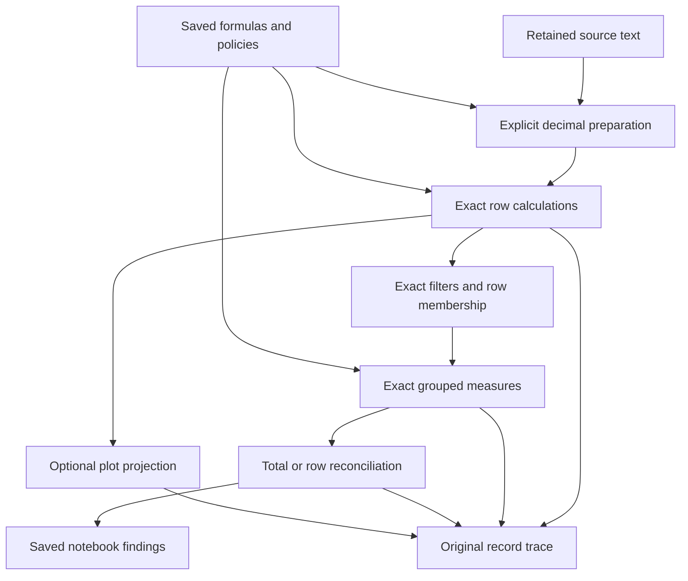

# Exact decimal measures, rounding, and ledger reconciliation

## Decision

**Build an explicit exact-decimal calculation mode over preserved source values, using a bounded coefficient-and-scale scalar.** Use native `BigInt` for integer arithmetic inside a small owned kernel, and a canonical string coefficient at every row, worker, callback, and JSON boundary. Keep ordinary measurement calculations on their present numeric path.

The useful capability is a complete reconciliation workflow: retain decimal source text, create typed amount/rate fields, calculate invoice lines under an authored rounding policy, summarize the declared population, compare exact results, inspect contributors and exclusions, and reopen the same analysis. A currency symbol or display precision cannot establish this contract.

The selected public value is:

```ts
type DecimalValue = Readonly<{
  kind: "decimal";
  coefficient: string;
  scale: number;
}>;
// { kind: "decimal", coefficient: "1005", scale: 3 } means 1.005.
// { kind: "decimal", coefficient: "100", scale: 2 } means 1.00.
```

- **Boundary:** typed derived fields in the existing calculation manager, with the same exact mode added to existing query calculate steps. No second formula language, general measure framework, or prerequisite research project.
- **Arithmetic:** exact addition, subtraction, multiplication, comparison, and accumulation within stated bounds. Exact terminating division is available through `/`; `divide(a,b,scale,rounding)` produces a correctly rounded quotient. Rounding is never inherited from display settings.
- **Persistence:** the decimal object is plain JSON data; raw input stays separate and immutable. Saved formula text, the arithmetic mode, source-read recipe, and explicit rounding calls are authoritative. Derived results are recomputed.
- **Initial product loop:** single-source line checks in Rows/Data Table and exact metric cards, with import, tracing, save/reopen, Dashboard text, and deliberate refresh. Grouped project queries, entity reconciliation, folders, and pivot totals follow as a second complete loop.
- **Later consumers:** exact notebook findings and writeback, followed by narrowly selected approximate chart projections. Approximate coordinates never define exact amount membership.
- **Dependency decision:** no new production decimal package for this finite operation set. The kernel must remain small and independently testable. `big.js` is the strongest fallback if kernel maintenance becomes disproportionate; a library would still need nearly all of the source, scalar, persistence, and trace adapters.

The stable decisions are ED-01–ED-28 in [recommendations.md](recommendations.md). [implementation-plan.md](implementation-plan.md) names modules, contracts, tests, docs, examples, and risks for each stage. All implementation described here is proposed.

## 1. Access, baseline, and evidence

**Access succeeded.** The complete attached packet contains 48 complete baseline files, each with matching BEGIN/END boundaries at `d3920a285f3755a8324998775deb131747e959f5`, followed by two explicitly marked prior-proposal summaries. All 48 files and both summaries were read across the source review. Supplemental GitHub reads at that exact SHA succeeded for 31 files needed to establish filter, sorting, CSV, DSL, notebook, and import seams. Supplemental coverage was targeted; this is not a claim to have inspected the entire repository or run a checkout.

The quantity-calculation summary at `7f8b330d2dbd9fdc52f82ccd04ce887bbc9726e5` and numeric-preparation summary at `48b5f004242b927cf90a21f137b7a38fb474a26c` are proposals. Neither supplies a shipped type system, reader policy, refresh API, or persistence adapter. Their historical demand gates and exact-decimal deferrals do not constrain this mission. The attached mission and current research direction authorize the capability.

Evidence labels used in this report:

- **Checked baseline fact:** supported by the named source file and symbol at the fixed SHA.
- **External fact:** supported by a direct primary-source URL in §10.
- **Derivation:** arithmetic or reasoning stated here and in [fixture-proofs.md](fixture-proofs.md).
- **Product policy / proposal:** a chosen rule or implementation design, not a statement about current behavior.

### The boundaries that decide the design

Repository paths below are relative to `packages/explorEDA/src/` unless otherwise stated.

| Checked path and symbol | Current behavior | Consequence |
| --- | --- | --- |
| `lib/valueParsing.ts::parseNumber/isExactNumberText` | Numeric text can become `Number`; the integer-safe inference check does not prove arbitrary fractional text is preserved. | Add a separate exact parser. Do not redefine the approximate reader as exact. |
| `lib/fieldSettings.ts::convertFieldValue/formatFieldValue/displayRoundsValue` | Explicit conversion can change runtime values; precision/currency affect formatting. | Bind exact source declarations to raw cells. Keep business rounding separate from display. |
| `lib/calculations/parser/semantics.ts::number/convertToExpression` | Numeric literals pass through `parseFloat`, then lose their original numeric token in conversion. | Exact mode must parse the original token before numeric conversion. Reparsing `String(value)` is too late. |
| `engine/Calculator.ts::evaluateValue`, `functions/registry.ts::numericValue` | Operators, row sums, and averages use JavaScript numbers. Nonfinite results fail. | Add a small exact evaluator branch and function allowlist; do not globally overload ordinary operators. |
| `CalculationState.ts::CalculationManager` | Owns dependency checks, cached columns, per-row errors, and trace trees. | Extend this manager, including raw-source access and error provenance. |
| `providers/DataLayerProvider.tsx::toRuntimeCalculations/toSavedCalculations` | Rebuild calculation objects from name and expression only. | Carry exact mode through both projections and every restore path. |
| `lib/aggregates.ts::summarizeGroup/reduceNumbers` | Numeric addition; entity measure agreement uses `Object.is`. | Use exact accumulators and numeric decimal equality, not object identity. |
| `MetricCard/metricCardPlan.ts::planMetricCard` and `MetricCard.tsx` | Comparisons independently subtract/divide and inspect numeric zero. | Adapt planning and rendering; a shared reducer change alone is insufficient. |
| `PivotTable/utils/calculations.ts::aggregate/generateCells` | Pivot has its own reducer; totals are recomputed from source rows. | Dispatch exact supported operations here and preserve source-based totals. |
| `lib/analysis/evaluateProject.ts::stable/filterFrame/aggregateFrame` | Keys use type plus stringification; equality is primitive equality; reductions are numeric. | Add semantic decimal keys, comparisons, and the same reducer contract. |
| `lib/project/tables.ts::typedCell`, `lib/readers/columns.ts::typeTextColumns` | Both import routes can convert numeric text to `Number`. | A preserved-text option must take effect before these conversions. |
| `lib/readers/typedColumns.ts::convertColumn` | Typed decimals first become exact text, then small-significance columns can become `Number`. | Preserve coefficient/scale before that branch; digit count does not establish exact binary representation. |
| `saveDataUtils.ts::isSavedRow/validateSavedData`, `projectFile.ts::validateAnalysisProjectFile` | Scalars exclude decimal objects; existing special-value codecs do not authorize arbitrary objects. | Add a strict decimal shape guard at every relevant validation boundary. |
| `DataTable/filteredRows.ts::compareValues`, `DataTableToolbar.tsx::toTableCsv` | Sorting uses numeric parsing; CSV/search/clipboard have stringification paths. | Exact compare/format/export adapters must ship with the first usable table. |
| `lib/notebook/findings.ts::evaluateNotebookFindings`, `writeBack.ts::writeBackSettings` | Rest-mode findings skip workspace calculations; writeback handles charts. | Notebook support needs a full evaluation and edit/save loop, not just decimal display. |

The 31 supplemental files also establish that Crossfilter dimensions already use row IDs and delegate predicates. Decimal support does **not** require replacing Crossfilter. `FilterTypes.ts` and `CrossfilterWrapper.ts` have independent scalar unions, so widening only `ChartTypes.datum` is insufficient.

The checked `AGGREGATIONS` constant in `lib/aggregates.ts` contains `count`, `sum`, `average`, `max`, and `min`. Older intent/README summaries listing three operations are not exhaustive evidence of the baseline API. Exact metric min/max belong in M1 alongside sum/average; dimensionless counts keep their existing scalar form.

## 2. Ranked question 1: representation and exactness

### 2.1 Compare the alternatives

| Representation | What it supplies | Decision and tradeoff |
| --- | --- | --- |
| Binary64, explicit tolerance, compensated summation | Fast approximate arithmetic; improved sum accuracy over already represented binary inputs. | Keep for measurements. It cannot restore source digits or turn decimal ties into an exact ledger contract. Tolerance remains an explicitly different comparison, never exact equality. |
| Declared-scale integers | Exact amounts at one chosen quantum, such as cents; simple sums and equality. | Useful after rounding, insufficient alone for prices, quantities, discounts, tax rates, and intermediate fractions. `BigInt` cents also need type/scale metadata. Repeated rescaling turns this approach into the chosen coefficient/scale model. |
| Coefficient plus scale | Represents each finite base-10 input exactly, preserves its scale, and supports exact aligned arithmetic. | **Build.** A bounded owned kernel covers the required operations and keeps precision loss explicit. The major work is the surrounding product integration, not integer addition. |
| Rational numerator/denominator values | Exact `1/3` and arbitrary division chains, postponed rounding. | Use for independent proofs and local division reasoning, not as a public row type. General rational cells add denominator growth, another ordering/serialization/display system, and decisions outside the required ledger loop. |
| Browser decimal library behind a tagged wrapper | Mature arithmetic, modes, parsing, and tests; some offer broader functions. | Credible fallback. A wrapper must still enforce the chosen grammar, bounds, original scale, raw-input provenance, and operation policies. Do not expose library instances as row values. |
| Database DECIMAL/NUMERIC only | Useful upstream exact preparation and independently comparable SQL behavior. | Complement the feature. It does not fulfill interactive row calculations, exact filtering, record tracing, and saved reconciliation inside explorEDA. |

ECMAScript Number is binary64; BigInt supplies integer arithmetic but is not directly JSON-serializable by the default JSON algorithm [E01, E02]. Compensated-summation research addresses errors in sums of floating-point operands [E10]. The deduction is narrow: even a perfect sum of already rounded binary inputs cannot recover the original decimal lexemes.

### 2.2 Browser libraries: strong choices, different contracts

All three compared libraries document browser and Node use and an MIT license. The upstream size statements below are differently measured and **are not a comparable bundle benchmark** [E05–E07].

| Library | Documented behavior and packaging | Fit for this mission |
| --- | --- | --- |
| `big.js` | Exact add/subtract/multiply; division-related operations use decimal-place/rounding settings. Strict mode rejects native-number construction. README advertises 6 KB minified; TypeScript types are supplied through DefinitelyTyped. | Closest fallback for a small wrapper. Its four rounding modes do not directly cover both directional floor and ceiling, and preserved input scale still needs separate metadata. |
| `bignumber.js` | Exact add/subtract/multiply and configurable decimal-place division; richer rounding modes and bundled declarations. README advertises 8 KB minified and gzipped. | Strong library alternative when avoiding owned rounding code outweighs the larger API. Disable nonfinite values, nondecimal inputs, and implicit Number adoption. |
| `decimal.js` | Rounds arithmetic to configured significant-digit precision, including addition and multiplication; offers many additional functions. Browser/Node and declarations documented. | Good arbitrary-precision numerical tool, but its default arithmetic model differs from “exact until an explicit quantization.” A precision budget and extra validation would be needed; no measured bundle figure is claimed here. |

The inspected API snapshots show `big.js` v7.0.x and `bignumber.js` v11.1; the inspected changelogs include `bignumber.js` 11.1.5 and `decimal.js` 10.6.0 [E11]. These are observed upstream documentation/changelog entries, not a guarantee of the registry's latest release. No library was installed, benchmarked, or selected as a production dependency in this mission.

**Why own the small kernel:** native integers already provide the only high-precision primitive needed for finite-decimal +, −, ×, compare, and quotient/remainder rounding. There is no requirement for transcendentals, roots, arbitrary powers, NaN propagation, or a general decimal context. Avoiding a library does not excuse ad hoc arithmetic: centralize the finite rules, publish the limits, and test against the independently derived fixture corpus.

The fallback trigger is concrete: if implementation cannot keep the kernel small, understandable, and conformant, use a pinned library behind the same public atom and tests. Do not change the public contract to match a library's convenience defaults.

### 2.3 Database comparisons: distinguish the operator

- DuckDB documents exact decimal addition/subtraction/multiplication with a maximum width of 38, and ordinary decimal `/` produces floating point [E08].
- Current DuckDB **2.0** documentation also describes `decimal_division`, a decimal result with half-even rounding and an optional output scale. It explicitly says the function was added in 2.0 [E09]. It would be incorrect to say DuckDB has no exact decimal division route.
- The baseline package has `@duckdb/node-api: 1.5.6-r.1` as a development dependency. A 2.0 documentation feature is not a shipped explorEDA dependency.
- PostgreSQL `numeric` provides exact decimal operations where representable and rounds ties away from zero when rounding numeric values [E04]. PostgreSQL's default numeric rounding is therefore not an oracle for explorEDA's chosen half-even examples.

These systems show why a type name alone does not specify division, scale, or rounding location. The proposed 128-digit/38-scale policy below is explorEDA's bounded contract, not an attempt to emulate either database.

### 2.4 Four promises that must remain distinct

1. **Exact input:** the interpreted value equals retained decimal text or a typed decimal coefficient/scale supplied by the source. Native Number input does not satisfy this provenance claim.
2. **Exact operation:** the mathematical result is represented without changing its value, within the declared finite-decimal limits.
3. **Correctly rounded operation:** compute the mathematical quotient or quantization decision exactly, then select the result at the saved target scale and mode. A repeating quotient's output is exact as a stored decimal but is not the exact mathematical quotient.
4. **Approximate projection:** convert a decimal to a binary coordinate or decorative width for drawing. The exact value, comparisons, keys, row identities, and trace remain authoritative.

## 3. Numerical contract

All rules in this section are **chosen product policies**, versioned as `{kind:"decimal",version:1}`. They define a finite ledger capability, not conformance to all IEEE or General Decimal Arithmetic operations. The General Decimal Arithmetic model and quantize operation are useful primary references [E03]; signed-zero handling, limits, missing-value behavior, and exact-only slash division here are deliberately narrower.

### 3.1 Input language and preservation

After removing only surrounding ASCII space, tab, CR, and LF, accept:

```regex
^[+-]?(?:[0-9]+(?:\.[0-9]+)?|\.[0-9]+)(?:[eE][+-]?[0-9]+)?$
```

- Accept `0`, `-0.00`, `+001.2300`, `.5`, `1e3`, and `1.2300e2`.
- Reject `1.`, grouping separators, currency symbols, percent suffixes, accounting parentheses, hexadecimal, underscores, internal whitespace, non-ASCII digits, Infinity, and NaN.
- Null, undefined, an empty string, or an ASCII-whitespace-only string is **missing**. Invalid nonblank text is **invalid**, not zero and not silently missing. A non-ASCII-space-only token is invalid under this grammar.
- Retain the **original raw value** exactly, including whitespace, leading zeros, sign, exponent spelling, and trailing zeros. It remains in the source row and trace. The interpreted scalar has a normalized coefficient but retains effective scale.
- A parser result includes a status and diagnostic alongside the value; error objects are not stuffed into the scalar union.

Let the unsigned significand digits form integer `C`, let `f` be the count after the decimal point, and let `e` be the exponent or zero. If `f-e >= 0`, use coefficient `±C` and scale `f-e`. Otherwise multiply the coefficient by `10^(e-f)` and use scale zero. Strip coefficient leading zeros; normalize a zero coefficient to `"0"`; do **not** strip trailing zeros from the stored representation.

Examples:

| Raw source | Interpreted coefficient / scale | Preserved exact text |
| --- | --- | --- |
| `+001.2300` | `12300 / 4` | `1.2300`; original `+001.2300` remains in the source |
| `1.2300e2` | `12300 / 2` | `123.00` |
| `1e3` | `1000 / 0` | `1000` |
| `-0.00` | `0 / 2` | `0.00`; original negative zero remains in the source |

Typed Parquet/Arrow decimal values have an exact coefficient/scale source, not necessarily an original textual lexeme. Preserve that distinction in the trace. The reader can create exact decimal text from those components without claiming it was text in the file. A small validated per-field `decimalSourceOrigins` descriptor carries the native format and declared scale with those rows through host/provider input, full-analysis JSON, and M2 source snapshots/folder text. Refresh replaces the descriptor with the new source's metadata. This preserves the origin distinction after reopen without introducing a general metadata framework.

### 3.2 Bounds and failure rules

| Boundary | Limit or invariant | Failure behavior |
| --- | --- | --- |
| Source token | At most 256 characters before trimming | Reject with `DECIMAL_INPUT_LIMIT`; never truncate |
| Exponent | Absolute magnitude at most 128, checked before expansion | Reject as an input-limit error |
| Stored coefficient | Canonical `0` or `-?[1-9][0-9]*`, at most 128 digits excluding sign | `DECIMAL_COEFFICIENT_LIMIT` |
| Stored/target scale | Integer 0–38 | `DECIMAL_SCALE_LIMIT` |
| Internal scratch | At most 256 coefficient digits for this operation set | Deterministic limit diagnostic; never float fallback |
| Wire object | Exactly the declared decimal fields, canonical strings, valid integer scale | Reject malformed typed values before state mutation |

Check token length, exponent magnitude, effective scale, and expanded coefficient digit length **before** zero padding or BigInt construction. Leading-zero normalization can be counted lexically; it does not require allocating the expanded number first.

Preserved scale counts toward coefficient storage. Thus a row addition or a sum without output quantization of a 128-digit integer and `0.0` can fail because the exact scale-1 representation needs 129 coefficient digits. This is intentional and must be tested and explained. Do not silently trim meaningful scale to make a value fit. An explicitly quantized sum uses the wide accumulator and can succeed at scale zero with `unnecessary`, as specified in §4.6.

Multiplication normally has scale `s_a+s_b`. If that exceeds 38, fail even when trailing zeros might allow a numerically equivalent shorter representation. An author can explicitly rescale an operand when that is the intended contract. Public intermediate expression results also obey the limits.

These bounds cover very large monetary totals while bounding parsing, padding, multiplication, and formatting. They are not benchmark results and do not promise good latency for arbitrary million-row workloads. Increasing them later is a deliberate contract decision.

### 3.3 Native JavaScript numbers

`decimal(0.1)` and `decimalSource(fieldContainingANumber)` fail with `DECIMAL_TEXT_REQUIRED`. `String(number)` produces a useful spelling of the represented Number, not proof of the original source text. Do not silently take that route, even when a particular fraction happens to be exactly representable.

One narrow bridge is allowed: `exactInteger(number)` accepts only a finite safe integer and produces a scale-zero decimal. It explicitly adopts the **currently represented integer**; it does not recover or certify original digits. Booleans, fractional numbers, nonfinite numbers, and unsafe integers fail. The trace names the bridge. Counts and trusted small quantities can therefore enter exact expressions without permitting broad mixed arithmetic.

For example, native Number already holding `9007199254740992` could have originated from `9007199254740993`. Neither parsing its shortest spelling nor adding a currency format can discover the lost unit. This path must request retained text or reimport, not invent an answer.

### 3.4 Equality, order, and hash keys

- **Numeric equality:** `1`, `1.0`, and `1.00` as typed decimals compare equal; align scales using integer arithmetic. Every decimal zero compares equal.
- **Scale-sensitive equality:** coefficients and scales must both match. `1.0` and `1.00` differ. This is a representation audit, not measure equality.
- **Lexical equality:** compare the raw source strings separately. `+01.00` and `1.00` may have equal values and scale but different original spelling.
- **Canonical numeric key:** remove trailing coefficient zeros only while reducing a positive scale; make all zeros one key; include a decimal type prefix and unambiguous separators. Do not mutate the stored scalar when forming the key.
- **Cross-type equality:** decimal `1`, Number `1`, and text `"1"` remain distinct. Arithmetic that mixes exact and approximate operands fails unless the explicit integer bridge is used.
- **Ordering:** decimal compare returns -1, 0, or 1 after exact alignment. Stable occurrence ID or current dataset row position breaks equal-value sort ties; that does not establish durable refresh identity.
- **Min/max ties:** choose the maximum input scale among the numerically tied extremal values. This makes the returned representation independent of input order.

For source/entity identifiers, retain existing typed primitive keys initially. Reject decimal identity/relationship endpoints explicitly in M2; decimal **measure** equality at entity grain is required and is separate from decimal identifiers.

## 4. Ranked question 2: arithmetic and rounding

### 4.1 Exact row operations and grouped operations

For a scalar `x = C × 10^-s`:

| Operation | Value and scale rule | Missing/error behavior |
| --- | --- | --- |
| Add/subtract | Align to `max(s_a,s_b)`, add/subtract integer coefficients; preserve that scale | Missing propagates; invalid input retains its causal diagnostic |
| Multiply | Multiply coefficients; scale is `s_a+s_b` | Enforce result bounds; no automatic rounding |
| Unary +/−, absolute value | Exact coefficient operation, same scale | Zero has canonical unsigned coefficient |
| Compare | Align exactly; return Boolean/comparison sign | No numeric-string coercion; ordering of missing operands is not a numeric comparison |
| Exact `/` | Reduce the rational quotient; succeeds only for a finite decimal within bounds; use minimal terminating scale | Zero divisor errors; nontermination errors |
| `divide(a,b,t,mode)` | Compute exact quotient/remainder at target scale `t`, round once, return scale `t` | Missing policy errors; inexact + `unnecessary` errors |
| `round(x,t,mode)` | Explicit quantization to scale `t`; pad zeros when scale increases | Changing display precision never calls this |
| Sum | Wide exact accumulation at maximum contributor scale; apply any explicit output quantization, then the public output bound | Empty/all-ineligible public summaries have no amount, not a fabricated zero |
| Average | Wide sum divided by valid contributing unit count, rounded once to an explicitly saved output scale/mode | No unweighted average of subgroup averages |
| Min/max | Exact numeric extremum; deterministic maximum-scale tie representation | No valid inputs gives no amount |
| Count | Ordinary integer count of a named row/entity/valid-value population | Dimensionless; never inherit currency formatting |

The exact row dialect supports +, −, ×, comparisons, guarded conditionals, `sum`, `min`, `max`, exact `avg`, and the explicit functions above. Row `avg(x,y,...)` is `sum/count` with exact-only division; if it does not terminate, use an explicit `divide(sum(...),count,scale,mode)` expression. A count entering arithmetic must be an exact literal or use `exactInteger`. Grouped average always saves its quotient policy.

The scale and rounding-mode arguments are policy metadata, not amount operands. In v1 the compiler requires a literal integer scale in 0–38 and a literal supported mode, then builds the plain output-policy object. Row-dependent policy expressions are outside this version. This avoids accidentally sending the exact amount representation of `2` into an API expecting a scale integer.

Boolean conditions must be Boolean, not the truthiness of a decimal object. Preserve short-circuit behavior so an unused division-by-zero branch is not evaluated. Missing arithmetic propagates a missing result; predicates and guards must handle it explicitly. A known input error takes precedence over another missing operand in an evaluated operation. A row error and its dependent results retain the originating field/expression diagnostic rather than turning into an unexplained missing amount.

Exact-mode `^`, roots, logs, trigonometry, variance, standard deviation, regression, interpolation, and arbitrary JavaScript functions are outside this path. Existing approximate calculations keep their behavior. Unknown exact functions fail validation before a formula is applied.

### 4.2 Division proof and one-rounding rule

For `a = c_a / 10^s_a` and `b = c_b / 10^s_b`, form:

```text
numerator   = c_a × 10^s_b
denominator = c_b × 10^s_a
```

Normalize the denominator positive and reduce by the greatest common divisor. An exact base-10 expansion exists precisely when the reduced denominator has no prime factors except 2 and 5. If it is `2^p × 5^q`, the minimal scale is `max(p,q)`; multiply the numerator by the missing powers to create a denominator of `10^scale`. Apply the public bounds. Zero divided by a nonzero value has coefficient zero, scale zero on this exact-only route.

For an explicitly rounded quotient at scale `t`, perform integer quotient/remainder division of the absolute scaled rational directly. Do not first calculate a rounded decimal at some intermediate precision and round again. This is how the implementation establishes the correctly rounded promise for `1/3`, large ratios, and negative values.

The same rule applies to averages: use the wide sum and count directly. An average may fit the public coefficient bound even when its unfinalized sum would not; do not prematurely finalize that sum as a public decimal.

### 4.3 Rounding modes, including negative values

Let `q` and `r` be the nonnegative quotient and remainder of the magnitude after scaling, and let `d > 0` be the divisor. Decide whether to increase `q`, then restore the original sign. No binary epsilon participates.

| Mode | Decision | Examples at scale zero |
| --- | --- | --- |
| `halfEven` | Nearest; if `2r=d`, choose even final integer | `2.5→2`, `3.5→4`, `-2.5→-2`, `-3.5→-4` |
| `halfAwayFromZero` | Nearest; exact tie increases magnitude | `2.5→3`, `-2.5→-3` |
| `towardZero` | Discard nonzero remainder | `2.9→2`, `-2.9→-2` |
| `floor` | Toward negative infinity | `2.1→2`, `-2.1→-3` |
| `ceiling` | Toward positive infinity | `2.1→3`, `-2.1→-2` |
| `unnecessary` | Accept only zero remainder | `2.0→2`; `2.1` is `DECIMAL_INEXACT` |

The editor may offer half-even as its prefilled choice, but every committed rounding operation/average saves the selected mode and scale. Missing policy is an error, not a default supplied by the formatter or a mutable library global.

The trace distinguishes an explicit quantization from a changed value: `1.2300→1.23` removes scale positions but is not mathematically inexact. Record the chosen scale/mode and an `inexact` flag based on a nonzero discarded remainder. Negative results rounded to zero use coefficient `"0"` at the target scale; raw negative spelling remains visible.

### 4.4 Line rounding, total rounding, and component order

These are different authored computations:

```text
line-rounded tax  = sum(round(lineNet × taxRate, 2, "halfEven"))
total-rounded tax = round(sum(lineNet × taxRate), 2, "halfEven")
```

The first quantizes each row before reduction. The second quantizes a complete aggregate. Store and display the location, not just “precision 2.” A saved exact measure may carry `decimal.output = {scale:2,rounding:"halfEven"}`; on a sum, that means **after** accumulation. A line calculation's `round(...)` means before aggregation.

An invoice recipe must also name which components are rounded. Rounding net and tax separately then adding can differ from rounding their combined exact total. Discounts can be a percentage of a stated base or a fixed amount. For percentage factors applied to the same base without intermediate rounding, multiplication commutes; do not manufacture an ordering difference. A fixed discount before tax versus after tax changes the tax base and legitimately changes the result.

Refunds retain signed amounts and the declared rule. Nearest half-even and half-away are sign-symmetric; directional floor and ceiling are not sign-symmetric under refund negation. Do not silently choose a different refund policy.

Rates are stored as exact fractions: `0.10` means 10%. Percent input suffixes are outside the grammar. Authors can explicitly divide a decimal percentage by exact `100`. A grouped rate is a declared ratio of totals over stated populations, not an average of row percentages. M2 can express it with aggregate numerator/denominator fields followed by an exact calculate step using `divide`. A zero denominator errors or yields an explicitly missing result through a saved guard; it never silently becomes zero.

### 4.5 Allocation is deferred

Do **not** include allocation of a rounded invoice total back to lines in M1–M3. Those stages can expose and reconcile a rounding residual without assigning it to a line. Allocation adds a distinct business rule about weights, signs, eligible recipients, and stable ties.

The future seam is narrow: `allocateRoundedTotal(total, weights, stableKeys, rule)` returning exact minor-unit assignments and a trace. A possible largest-remainder rule would truncate shares at the allocation quantum and distribute the remaining signed units in descending exact remainder order, breaking ties by an explicitly supplied stable key. That is a future design sketch, not a settled implementation contract or a reason to delay the current capability.

### 4.6 Sum/average regrouping and bounded arithmetic

Without intervening rounding, integer-aligned sums are numerically order-independent. Store partial accumulators in widened scratch form, including scale and count, then merge them before finalizing. Do not round or enforce the 128-digit public result limit after each incoming row.

Finalization order is explicit: without `decimal.output`, validate the accumulated value at its maximum contributor scale. With `decimal.output`, quantize the wide exact accumulator **first**, then validate the resulting public coefficient/scale. Do not require a bounded unrounded public sum as an intermediate. D-G023/D-G025 demonstrate the boundary: a 128-digit all-nines integer plus `0.0` fails without output policy, but succeeds with `{scale:0,rounding:"unnecessary"}` and `inexact:false`.

With coefficient bound `P=128`, scale bound `S=38`, and a safe integer count `N`, a conservative aligned-sum bound is `P+S+ceil(log10 N)+1` digits. That is below 256 for feasible JavaScript row counts. The fixed scratch ceiling therefore covers accumulation without an unbounded rational engine.

This guarantee has two limits:

- Explicit rounding destroys associativity: summing rounded group subtotals is a different formula from rounding the grand raw total.
- Public row expressions check every intermediate result. `(max128 + 1) - max128` can fail at its first addition even though the final mathematical result is 1. `sum([max128,1,-max128])` uses the wide accumulator and succeeds. Describe this as a bounded-operation distinction, not a nondeterministic sum.

For averages, retain exact sum and count. Recombining subgroup averages is correct only with the corresponding counts and unrounded sufficient state. If only rounded subgroup averages remain, reconstruct from original contributors or report that the exact pooled average is unavailable.

## 5. Ranked question 3: portable proofs and expected outputs

The authoritative machine-readable cases are in [decimal-fixtures.json](decimal-fixtures.json): **215 primitive, aggregate, and serialized-value cases**, plus ledger, population, entity, regrouping, projection, source-loss, and paired-reconciliation datasets. Decimal amounts and coefficients are strings; counts and scales are integers. Each case specifies its operation, policies, status, exact output or error, and derivation. Dataset cases additionally specify complete memberships, exclusions, and counts. Fixture operation names are portable test notation, not a competing saved application API.

[verify-fixtures.py](verify-fixtures.py) is an original inspection companion using Python arbitrary-size integers, `fractions.Fraction`, and quotient/remainder decisions. It is not the proposed TypeScript kernel and imports no decimal arithmetic package. Its author-run checks were executed successfully. Local integration agents do not need to execute downloaded programs: [fixture-proofs.md](fixture-proofs.md) gives the derivations, and implementation tests should copy/adapt the expected cases into the repository's test environment.

### 5.1 Decisive arithmetic cases

| Case | Exact result under the declared rule | Why it matters |
| --- | --- | --- |
| `0.1 + 0.2` | `0.3` | `1/10 + 2/10 = 3/10` |
| Ten / one million occurrences of `0.1` | `1.0` / `100000.0` | Repetition keeps exact numeric value and contributor scale |
| Large amount + `0.01` − same large amount | `0.01` | Cancellation must not discard the small contribution |
| `9007199254740993 + 0.01` | `9007199254740993.01` | Works beyond safe integer Number precision |
| `1.20 + 2.003` | `3.203` | Addition preserves maximum input scale |
| `1.20 × 2.0` | `2.400` | Multiplication preserves summed scale |
| `1.005` to cents, half-even / half-away | `1.00` / `1.01` | An exact tie has an even lower cents coefficient |
| `2.675` to cents, half-even | `2.68` | An exact tie has an odd lower cents coefficient |
| `-1.005` to cents, half-even / half-away | `-1.00` / `-1.01` | Negative ties are explicitly defined |
| Exact `1/3` / rounded to six places | `DECIMAL_NON_TERMINATING` / `0.333333`, inexact | Exact versus correctly rounded division |
| Exact `1/8` / half-even to cents | `0.125` / `0.12` | A terminating quotient can still require business rounding |
| `1.2451` directly to cents / via three places | `1.25` / `1.24` | Double rounding is not equivalent |
| Empty population / one actual `0.00` | no amount / `0.00` | Unknown or empty is not a measured zero |

For the cent ties, the proof is entirely integer based. `1.005 = 201/200`; multiplying by 100 gives quotient 100, remainder 100 over divisor 200. Half-even keeps 100 because it is even. `2.675 = 107/40`; at cents the quotient is 267 and remainder is 20 over divisor 40, so half-even increments to 268.

### 5.2 Line-rounded and total-rounded invoice

D-L001 has three source occurrences, each with net `0.05` and rate `0.10`. Each exact tax is `0.0050`.

| Authored policy | Tax | Invoice total |
| --- | ---: | ---: |
| Half-even each line to cents, then sum | 0.00 | 0.15 |
| Sum exact taxes, then half-even the total to cents | 0.02 | 0.17 |

The exact aggregate tax is `3/200 = 0.0150`. At cents it lies halfway between one and two cents; the even result is two. Both totals are correct under their respective rules. Neither policy is hidden inside display formatting, and no allocation back to lines is implied.

D-L002 provides a fuller sale and refund:

- Price `19.99`, quantity `3`, discount rate `0.10`, tax rate `0.07`.
- Gross `59.97`; exact discount `5.9970`; rounded discount `6.00`.
- Taxable net `53.97`; exact tax `3.7779`; rounded tax `3.78`.
- Total `57.75`. Reversing quantity under the same sign-symmetric rule gives `-57.75`.

D-L006 changes the tax base using a fixed discount: `100.00` less `10.00`, taxed at `0.10`, gives `99.00` when the discount reduces the taxable base, versus `100.00` when tax uses the original base and the fixed discount is subtracted afterward. These are declared mathematical recipes, not tax-compliance advice.

### 5.3 Groups, subtotals, and a filtered population

D-L005 has eight source occurrences: six valid amounts, one blank, one invalid. The JSON includes every ID and group.

| Group | Exact valid subtotal | Half-even subtotal at cents |
| --- | ---: | ---: |
| A: `10.005,20.005` plus blank/invalid rows | 30.010 | 30.01 |
| B: `-5.005,0.000,1.005` | -4.000 | -4.00 |
| C: `2.675` | 2.675 | 2.68 |

The valid exact grand subtotal is `28.685`. Rounding that once gives `28.68`. Summing individually rounded lines also gives `28.68` in this dataset. But summing the rounded group subtotals gives `28.69`. The equality of two results is accidental; the third exposes the scope difference.

The full-population result remains **partial**, because blank and invalid source rows have not disappeared. An exact partial subtotal is useful evidence but cannot produce a complete-reconciliation pass.

Filtering to group A selects four occurrences: two valid, one missing, one invalid. Its raw valid subtotal is `30.010`; total rounding is `30.01`; line rounding sums to `30.00`. A saved valid-only eligibility filter reduces that population to the two declared contributors, with the two upstream exclusions still traceable. The resulting complete statement applies to that smaller population.

The exact threshold `amount >= 1.005` selects `L01,L02,L05,L08`, four valid occurrences. Their exact total is `33.690`, total-rounded `33.69`, and line-rounded `33.68`. The original ledger still has eight rows; a filtered ledger is not silently relabeled as the full ledger.

The valid grand average is `28.685 / 6 = 5737/1200`, rounded once to `4.780833` at six places. Dividing by eight would incorrectly include missing/invalid amounts in the denominator.

### 5.4 Entity-grain reconciliation

D-E001 contains 12 occurrences and eight nonmissing typed entity keys. It preserves distinct typed entity identities while testing duplicate agreement, conflicts, and inconsistent availability.

- Entity `I1` has `1.0` and `1.00`: numerically agreeing, one contribution at scale two. The selected value is `1.00`; the representative occurrence is the lexically smallest eligible occurrence ID, `e01`; both original records stay in lineage.
- Entity `I2` has `2.00` and `2.01`: conflict, not “first wins” and not agreement after display rounding.
- All-missing and invalid entities remain excluded with their own reasons. A valid/missing disagreement is inconsistent availability and cannot silently select the valid observation.
- Numeric entity ID `1` and string entity ID `"1"` remain separate. Missing IDs form no synthetic entity.

Four fully eligible entity values would total `6.00` and average `1.50`. Because the selected population contains a conflict, the authoritative result is unavailable with value null. Eligible-only values are explicitly diagnostic partial values and cannot feed a passed reconciliation.

The same scalar may appear in several input objects. Object identity must never decide agreement. Conversely, exact numeric equality must not collapse distinct source/entity identities.

### 5.5 Regrouping and matching claims

For groups `[1,3]` and `[9]`, the sufficient states are `(sum=4,count=2)` and `(sum=9,count=1)`. Merge to `(13,3)`, then round the mean to `4.33`. Averaging the displayed group means `2` and `9` instead gives `5.50`.

Define two different reconciliation statements:

- **Totals match:** the operands are additive exact sum findings, including sums with explicit post-total quantization. They belong to the same finished evaluation revision, declared population, and grain; both are complete and available; their exact delta is zero. Means, min/max, and counts are valid findings but are not ledger-total operands. This does not assert that every line matches.
- **Lines match:** each pair of line values is present and valid on the same occurrences, and the count of nonzero exact line residuals is zero. A total residual of zero is insufficient: `+0.01` and `-0.01` cancel.

A total-rounded invoice has no assigned per-line rounded total unless an allocation rule exists. The totals comparison must not require fictional row allocations just to compare two complete amounts. This is why the proposed reconciliation contract discriminates total checks from row checks.

### 5.6 Source loss and projection collisions

D-X002 begins with text `9007199254740993` that a reader already converted to Number `9007199254740992`. D-X003 loses the extra digits of `0.100000000000000005` into Number `0.1`. Both must be refused as original exact inputs. A correct diagnosis says the original text is needed.

D-X001 has exact amounts `9007199254740992.00` and `9007199254740993.00`. Their approximate binary plot coordinates coincide, but an exact lower bound of `9007199254740993.00` selects only the second record. The exact trace and row membership therefore cannot be reconstructed from chart positions.

## 6. Ranked question 4: the complete analyst flow

### 6.1 Start from retained evidence

1. Import CSV/text with selected amount, quantity, and rate fields preserved as text. Store `decimalInputs:{fields:[...],readAs:"text"}` so a later file read/refresh uses the same policy.
2. Preview original values and interpretation statuses. Show full counts for valid, missing, invalid, and native-number/refused inputs; preview row limits must be labeled. A sample of successful values cannot stand in for the full exclusion count.
3. Choose **Create exact amount** in field/calculation controls. Create a new field, leaving the original field and raw rows untouched.
4. For a source-derived field, generate `decimalSource(["Price text"])`. This intrinsic accepts a source-field AST reference and reads the original cell, bypassing ordinary runtime field conversions. `decimal("1.005")` parses explicitly supplied text; `exactInteger(quantity)` is the separately named numeric-integer bridge.

A source cell already converted to Number before it entered the raw dataset remains refused. The source accessor is not a recovery mechanism. Reimport with preserved text or provide an explicitly typed decimal from the host.

### 6.2 Calculate and inspect the declared recipe

The existing calculation editor gains an explicit arithmetic choice. Its saved form is additive to the existing name/expression contract:

```json
{
  "resultColumnName": "tax",
  "expression": "round(net * taxRate, 2, \"halfEven\")",
  "arithmetic": {"kind": "decimal", "version": 1}
}
```

The UI must make the raw source binding visible, not present `decimalSource` as an unexplained implementation detail. A trace shows original text, parsed coefficient/scale, dependent expressions, exact intermediate values, each quantization, and any exclusion/error. Editing display precision changes none of those.

Use the existing dependency and cache lifecycle in `CalculationManager`. Add source access/status resolution to its context instead of a new preparation graph. Exact mode recognizes numeric literal lexemes before Number conversion and validates its narrow supported operations before applying the edit.

For project queries, `decimalSource` accepts an incoming field with original-source origin. Read that incoming projected value through its field mapping; do not pick an arbitrary `sourceRows` entry by source ID, because repeated lookups can reference the same source more than once. Derived/aggregate-only fields are not raw-source arguments.

### 6.3 Summarize and reconcile

M1 provides a complete single-source line-check loop:

- Exact Rows/Data Table values and formula traces.
- Exact metric sums and averages under saved output policy, plus exact min/max.
- Exact filters on residuals; a missing/invalid state filter is separate from numeric ranges.
- A visible count of nonzero line residuals and unresolved inputs, so a zero summed residual cannot be mistaken for agreement of every line.
- Metric comparisons retain exact baselines and deltas. Automatic share/percent strips are disabled for exact measures until an explicit quotient policy exists.

M2 adds invoice/group reconciliation:

- Query calculate steps prepare exact fields, then group by invoice, currency label, customer, or another declared grain.
- Exact sum/average measures, post-aggregate calculations, and exact filters produce reviewable query result rows.
- Pivot uses the same exact reducer contract for its supported decimal operations and recomputes row/column/grand totals from underlying contributors.
- Entity mode counts an agreeing entity once; conflicts or inconsistent availability make the authoritative measure unavailable. Every conflicting and duplicate occurrence remains reachable.

An amount field does not supply a currency-exchange or unit system. The first ledger examples are in one declared currency. Analysts must group/filter separately when source currencies differ. The prior quantity proposal can later attach compatible units to the same typed output, but it is not required for decimal arithmetic.

### 6.4 Exact membership and bounded profiles

Add explicit decimal range/value/state predicates. Range endpoints are validated decimal atoms, never Numbers. Equality uses numeric decimal equality. State predicates consult the per-field sidecar to distinguish a missing source value from a failed calculation whose visible cell is absent.

Rows sorting calls the exact comparator. Search, copy, and plain value display use all stored digits and scale. A decimal profile initially contains exact min/max, valid/missing/invalid counts, and canonical distinct-value information. It does not run decimal values through `Float64Array`, automatic numeric histograms, or categorical object-identity maps.

The existing `ColumnFilter` numeric inputs, `Number(raw)`, 12-digit formatting, and sliders cannot own exact decimal predicates. Use text bounds and exact validation. A chart/category/row-ID selection can still narrow the population without approximate amount thresholds.

### 6.5 Save, reopen, and refresh

- **Settings JSON:** saves formulas, arithmetic modes, source-read declaration, exact predicates, measure output policy, and layout; no raw rows. The host must supply suitable source rows again.
- **Full analysis JSON:** additionally saves unchanged raw source rows. Strictly validate decimal atoms if the host supplied typed source values. Recompute derived values on reopen; do not treat a previously displayed amount as fresh source evidence.
- **Dashboard text:** M1 implements parse and export for exact declarations, calculations, bounds, and supported measure policies. A missing spelling is an explicit export error.
- **Project/folder files:** M2 passes source declarations into reading before coercion, saves query formulas/measure policies/bindings, and rejects omissions before writes.
- **Notebook files:** M1/M2 reject decimal notebook authoring/export before state acceptance or callbacks. M3 adds exact definitions, findings, parameter binding, at-rest/live evaluation, and targeted writeback together.
- **Refresh:** an explicitly chosen refresh operation reapplies retained current recipes to new raw rows, rebuilds all exact results and traces, and preserves layout. Ordinary new-import/reset behavior remains separate.

The provider currently resets through `setData`; a prior refresh proposal is not an implementation. The narrow new path should reuse existing store/calculation rebuilding and `holdStateChanges`, not introduce a transaction subsystem. Host data replacement is not echoed as a user edit; a committed user rule edit is one callback/undo step. Failed validation/export preparation produces no accepted state or outward write.

Retain positional selections only when the existing carryover helper proves a unique unchanged source record. Changed, gone, or ambiguous occurrences clear their selections. A retained exact value predicate can be reevaluated against the refreshed values; a recipe meaning change must invalidate dependent predicates deliberately. This does not claim a new durable identity framework.

### 6.6 CSV, clipboard, and unsupported exports

CSV value export writes the full coefficient/scale text, without locale grouping, currency symbols, display rounding, or Number conversion. Raw columns retain their original source text. Copy value/row uses the same scalar formatter; those paths are separate from CSV in the baseline.

**Plain CSV is a values-only export.** Its action must say so; it does not restore semantic type, formulas, or rounding rules. Quoting a decimal token does not stop another application from inferring a number. Use the native analysis bundle or an M2 folder containing source/read definitions and formulas for a semantic round trip. A sidecar CSV format is not required for the first capability.

Generic JSON import supports source decimal strings. It must not promise original decimal fidelity for arbitrary numeric JSON tokens: the current JSON reader preserves some unsafe integer tokens but not arbitrary fractional/exponent lexemes. Typed decimal atoms belong in the dedicated validated analysis/project codec or an explicit host API; generic flattening must not silently turn an atom into unrelated dotted fields.

Exports that cannot represent the selected exact feature must fail before producing a partial file or calling the host. In particular, current multi-view Dashboard export can substitute the first view's shared definitions, and folder export currently discards the omissions list. Conflicting decimal definitions must become a blocking conflict; no approximate substitute is acceptable.

## 7. Integration map and stage support

The representation crosses these boundaries because values need to remain semantic decimals, not because every chart must become arbitrary precision.

| Boundary | Required adapter | First supported stage |
| --- | --- | --- |
| Raw import | `preserveTextFields` through delimited/typed-column readers; saved `decimalInputs`; raw-source binding | M1 |
| Scalar types | Shared decimal-capable alias used by ChartTypes, FilterTypes, AnalysisScalar, SavedDatum, Crossfilter field values, calculation values | M1 structural support; query execution M2 |
| Formula parser and manager | Exact literal tokens, exact evaluator/functions, mode propagation, raw accessor, cached per-row statuses/traces | M1 |
| Rows/DataTable | Exact cells, comparison/sort, text-bound predicates, state predicates, search, clipboard, values-only CSV | M1 |
| Metric card | Exact value/baseline/delta, explicit average/output policy, full input trace; no automatic exact share strip | M1 |
| Grouped definitions / query results | Exact key/filter/reducer, source memberships, typed bindings, post-group calculations | M2 |
| Entity measures | Numeric agreement, deterministic value/representative, all duplicate/conflict lineage, unavailable authoritative conflict result | M2; explicit refusal in M1 |
| Pivot | Exact sum/avg/min/max and source-recomputed totals; gate unsupported reducers | M2 |
| Worker | Plain atom messages, policy/revision propagation, same results and memberships as direct execution, stale-result protection | M2 |
| Native JSON and callbacks | Strict atom/policy validation, stable fingerprint, raw rows in full save, validated restore | M1 |
| Dashboard text | Exact grammar and export; loss/conflict preflight for multi-view export | M1 |
| Folder source/query/analysis text | Source read policy before parsing, typed literals/bindings, inspected omissions, reopen/refresh | M2 |
| Notebook compiler/reader/writeback/findings | Exact values, derived-column resolution at rest and live, total/row check distinction, preflight before callbacks | M3 |
| Selected bar/scatter projection | Approximate positions plus exact values and IDs; amount filters remain exact | Optional M4 |

### The end-to-end relationship



The source and the saved interpretation are separate inputs. The plot projection is a consumer; it has no edge back into exact predicates or aggregation.

### Why these changes are narrower than an all-chart migration

Keep `finiteNumber` rejecting decimal objects. Add decimal-specific parsing/formatting/comparison and only dispatch supported operations to it. A field picker or restored chart using a decimal value in an unsupported role reports that unsupported role explicitly; it must not quietly render an empty plot because every value was treated as nonnumeric.

M4 can project one scatter coordinate and one grouped bar value with exact tooltip/trace payloads. Prefer categorical bar selection and record-ID scatter selection. Do not create an exact range from binary brush endpoints. If a brushing interaction is included, it must select explicitly represented record IDs under a named screen-selection action; exact threshold authoring remains a text-bound control. Coordinate collisions stay visible in trace even if they cannot be separated visually.

No decimal histogram, density grid, regression, log transform, or statistical chart is implied. Each would need its own semantics and trace work. Projection overflow/underflow checks are defensive boundary behavior; the chosen bounded decimal domain itself is comfortably inside binary64's exponent range, so the common loss is precision and coordinate collision.

## 8. Ranked question 5: stages, costs, risks, and seams

### 8.1 Four stages with complete loops

| Stage | Usable outcome | Docs and runnable example in the same stage |
| --- | --- | --- |
| M1 — Exact line checks | Import retained text; calculate lines; inspect errors and residuals; read exact cards; save/reopen/refresh in a standalone workspace | New `exact-decimals.mdx`; calculated-fields/data-table/metric-card/filters/export/developers updates; `decimal-line-reconciliation` runnable demo |
| M2 — Grouped ledger reconciliation | Prepare/query related data; reconcile invoice groups and entity measures; inspect pivot subtotals; save/reopen a project folder; direct/worker parity | project-folders/dashboard-text/pivot/trace sections; `decimal-invoice-groups` project and focused pivot example |
| M3 — Saved narrative checks | Bind exact findings; compare totals or rows honestly; edit policies; persist notebook text; reopen and refresh the same result | notebooks/exact-decimals sections; `decimal-ledger-notebook` with live and reopened findings |
| M4 — Optional selected plots | Explore patterns with approximate marks while retaining exact predicates, values, and contributors | scales-and-axes/trace/exact-decimals sections; coordinate-collision example |

Do not ship an arithmetic helper as M1's user-visible result. The first stage includes source access, metadata, table/filter output, trace, save/reopen, refusal behavior, and docs/example acceptance. M2 does not depend on quantity, numeric preparation, reusable-output, or selection-identity proposals.

### 8.2 Performance and package implications

Expected costs, not measured results:

- BigInt operations and decimal strings allocate more than native numeric arithmetic. Long coefficients and scale alignment increase cost. The finite bounds make the maximum work understandable.
- String coefficients are easy to clone/serialize but require parsing to BigInt during arithmetic. Start by parsing once per evaluated cell/operation context or bounded column evaluation; avoid a global cache retaining every ever-seen amount.
- Existing calculated-column caches and query workers are available integration points. A stale result must never pair one revision's values with another revision's memberships or rules.
- Per-row trace objects can dominate memory. Preserve raw rows plus occurrence references and field/status data; reconstruct detailed arithmetic trace when requested using the existing manager. Do not duplicate complete source records into every aggregate.
- Canonical grouping keys may be cached within an evaluation. The key must not erase the scalar's retained scale or source spelling.
- No production package is added in the selected design. Measure the real bundled delta with the repository build; there is no honest estimated KB saving or speed ratio from this research.

The targeted performance experiment is 10k, 100k, and, where the existing application can load it, 1M ledger rows with short ordinary decimals and a separate bounded-long-coefficient stress case. Measure source preparation, cached field access, exact filtering, grouped reduction, trace opening, worker transfer, and retained memory. Compare with the ordinary numeric path to quantify the cost; do not make an unrun benchmark a shipping claim. Optimize only an observed bottleneck.

### 8.3 Main risks and decisions

- **Source fidelity is lost before arithmetic.** Test both CSV routes and the typed-decimal small-significance branch. Refuse native Numbers as original decimal sources.
- **Partial scalar support leaks into ordinary code.** Audit actual adapters and separately declared unions. Supported tables, filters, serializers, and metric renderers all require exact handling.
- **Correct amounts with the wrong population.** Keep source occurrences, valid contributors, entities, duplicates, exclusions, and conflicts separate. A mathematical result is scoped to its contributors.
- **Policy loss during persistence.** Test object reconstruction, DSL round trips, multi-view conflicts, folder omissions, and notebook writeback before outward callbacks.
- **Implicit rounding in helper defaults.** Use per-operation policy, exact-only slash, and direct integer remainder decisions. Display format is read-only presentation.
- **Overlarge first stage.** Keep grouped/entity/Pivot support in M2, notebooks in M3, projections optional. Every deferred route fails explicitly when it cannot preserve an exact contract.
- **Kernel maintenance.** Keep the operation set narrow and independently specified. If the code expands toward a general numerical engine, return to the pinned-library alternative without changing the public semantic contract.

### 8.4 Narrow future integration seams

- Numeric-preparation proposals can provide more input conventions, but must produce preserved strings or validated decimal atoms and diagnostic provenance at the same source boundary. No punctuation guessing is adopted here.
- Quantity proposals can attach units to a typed exact field or calculation result. Decimal arithmetic remains responsible for digits/rounding; a quantity layer would decide unit compatibility.
- Reusable-measure proposals can reference the small exact measure definition and its grain/population, not replace it with formatted values.
- Refresh/identity proposals can improve record continuity. This design already has a correct conservative refresh loop and does not wait for durable keys.

## 9. What was checked, what is proposed, and remaining questions

### Checked in this research run

- Complete attached source-packet boundaries and all baseline/proposal contents were read; 31 targeted supplemental files were retrieved at the same exact SHA.
- Decisive current source behavior was traced through raw import, calculation mode loss, reducers, entity comparison, exact-membership seams, JSON validation, CSV/clipboard, Dashboard/folder exports, and notebook evaluation/writeback.
- Primary documentation and upstream repositories were consulted for ECMAScript numbers/JSON, decimal arithmetic, browser libraries, PostgreSQL, DuckDB, and accurate floating-point summation.
- Exact fixture values were derived with rational/integer arithmetic; all 215 cases and the coherent dataset checks passed the supplied author-run verifier. A separate numerical review cross-checked all 109 successful numerical-output cases with Python Decimal at 512-digit precision, plus the central ledger examples, without reusing the Fraction verifier or regenerating expected values. Error, membership, and wire-shape coverage remains in the primary verifier. TypeScript contract syntax was checked separately; it contains declarations rather than a product implementation, and no TypeScript type-checker run is claimed.

### Proposed and not executed

The decimal feature, application tests, browser workflows, worker/persistence round trips, export behavior, examples, package changes, and performance measurements have not been implemented or run. A source packet is not a runnable checkout. No repository commit, push, PR, or deployment was made.

### Open implementation questions

No missing input or product question blocks M1. Remaining choices are bounded implementation details:

1. Place the exact-source action and arithmetic-mode control in the existing field/calculation UI while retaining the documented compact layout and trace entry points.
2. Measure whether repeated BigInt parsing or trace construction is a real bottleneck before adding local caching.
3. Decide whether optional M4's limited projections justify their adapter cost after the exact analytical loops ship.
4. If the owner later needs more than 128 coefficient digits or 38 fractional positions, revise the explicit contract and fixtures rather than silently relaxing limits.

Use React, TypeScript, and pnpm in the existing library/demo. Each visible stage includes its docs page, registered runnable example, exact-value tests, persistence tests, and scoped browser verification. No outside demand study is a prerequisite.

## 10. Primary sources

These sources support the external facts identified above. The proposed grammar, scalar limits, saved shapes, stage boundaries, source rules, and reconciliation policy are design decisions for explorEDA. No source is presented as proof that the proposed product is implemented.

| Reference | Primary source | Decisive use |
| --- | --- | --- |
| E01 | [ECMAScript specification: data types and values](https://tc39.es/ecma262/multipage/ecmascript-data-types-and-values.html), especially Number and BigInt | Number's binary64 semantics and integer BigInt arithmetic. A represented Number is not an original decimal lexeme. |
| E02 | [ECMAScript specification: JSON serialization](https://tc39.es/ecma262/multipage/structured-data.html#sec-serializejsonproperty) | Default serialization rejects BigInt values; use canonical string coefficients in the public atom. |
| E03 | [General Decimal Arithmetic: model](https://speleotrove.com/decimal/damodel.html), [operations, including quantize](https://speleotrove.com/decimal/daops.html), and [context and rounding](https://speleotrove.com/decimal/dncont.html) | Decimal coefficient/exponent reasoning, rounding modes, and explicit quantization. This proposal is a bounded subset with its own policies. |
| E04 | [PostgreSQL documentation: numeric types](https://www.postgresql.org/docs/current/datatype-numeric.html) | Exact numeric behavior and ties-away-from-zero numeric rounding; useful comparison rather than an identical contract. |
| E05 | [big.js API](https://mikemcl.github.io/big.js/) and [upstream repository/README](https://github.com/MikeMcl/big.js) | Strict string construction, arithmetic/context behavior, four rounding modes, MIT license, browser support, upstream size claim, and type-distribution location. |
| E06 | [bignumber.js API](https://mikemcl.github.io/bignumber.js/) and [upstream repository/README](https://github.com/MikeMcl/bignumber.js) | Exact basic arithmetic, rounding alternatives, browser support, declarations, MIT license, and differently measured upstream size claim. |
| E07 | [decimal.js API](https://mikemcl.github.io/decimal.js/) and [upstream repository/README](https://github.com/MikeMcl/decimal.js) | Significant-digit precision applied to arithmetic, broader function set, browser support, declarations, and MIT license. |
| E08 | [DuckDB 2.0: numeric data types](https://duckdb.org/docs/2.0/sql/data_types/numeric) | DECIMAL width limits, exact basic operations, and floating-point ordinary decimal division. |
| E09 | [DuckDB 2.0: numeric functions](https://duckdb.org/docs/2.0/sql/functions/numeric) | Separate `decimal_division`, introduced in 2.0, with decimal output and half-even rounding. Keep distinct from `/` and the baseline's 1.5 development package. |
| E10 | Ogita, Rump, and Oishi, *Accurate Sum and Dot Product* (2005): [author-hosted paper](https://ogilab.w.waseda.jp/ogita/math/doc/2005_OgRuOi.pdf), [publisher DOI](https://epubs.siam.org/doi/10.1137/030601818) | Accurate summation operates on floating-point inputs. It does not establish recovery of pre-conversion decimal source values. No paper benchmark is attributed to explorEDA. |
| E11 | [bignumber.js upstream changelog](https://raw.githubusercontent.com/MikeMcl/bignumber.js/main/CHANGELOG.md) and [decimal.js upstream changelog](https://raw.githubusercontent.com/MikeMcl/decimal.js/master/CHANGELOG.md) | Observed release entries only. No claim that a moving branch or documentation snapshot proves the latest registry package. |

Repository evidence is fixed to [explorEDA at d3920a285f3755a8324998775deb131747e959f5](https://github.com/byronwall/explorEDA/tree/d3920a285f3755a8324998775deb131747e959f5). Paths and symbols in §1 and the implementation plan distinguish checked behavior from proposed changes.

## 11. Delivery and final access statement

### Complete deliverables

| File | Purpose |
| --- | --- |
| [report.md](report.md) | Decision, ranked answers, numerical contract, complete workflow, evidence, and uncertainties |
| [implementation-plan.md](implementation-plan.md) | Four complete stages with modules, APIs, exact acceptance cases, docs, runnable examples, and risks |
| [recommendations.md](recommendations.md) | ED-01–ED-28 with Build / Explore / Defer / Avoid decisions |
| [decimal-fixtures.json](decimal-fixtures.json) | 215 portable cases plus coherent datasets, exact outputs, errors, memberships, and counts |
| [fixture-proofs.md](fixture-proofs.md) | Independent integer/rational derivations and fixture navigation |
| [verify-fixtures.py](verify-fixtures.py) | Original author-run inspection companion; no integration-agent execution required |
| [decimal-contract.ts](decimal-contract.ts) | Proposed public types, policy constants, and API declarations; no shipped kernel |
| [exact-decimal-methods.zip](exact-decimal-methods.zip) | All seven deliverables together |

### Files read and access limits

The complete attached pro-prompt and source packet were readable. All 48 baseline files and both final proposal summaries were read; the following inventory identifies them. Supplemental files were fetched at the same baseline and inspected for the decisive seams. No required file was missing, and no full-checkout access or product execution is claimed.

**Baseline packet: 48 complete files.** Paths are repository-relative.

```text
AGENTS.md
CODING_STANDARDS.md
README.md
apps/demo/src/docs/catalogue.ts
apps/demo/src/docs/live/examples.ts
docs/agent-guide.md
docs/intent/research-ideas-100/ideas/R037-decimal-precision-contract.md
docs/intent/reusable-analysis-metrics/intent-brief.md
docs/research/DIRECTION.md
docs/ui-defaults.md
package.json
packages/explorEDA/README.md
packages/explorEDA/package.json
packages/explorEDA/src/components/charts/MetricCard/measureInputs.ts
packages/explorEDA/src/components/charts/MetricCard/metricCardPlan.ts
packages/explorEDA/src/components/charts/PivotTable/utils/calculations.ts
packages/explorEDA/src/lib/aggregates.test.ts
packages/explorEDA/src/lib/aggregates.ts
packages/explorEDA/src/lib/analysis/analysisWorkerProtocol.ts
packages/explorEDA/src/lib/analysis/evaluateProject.ts
packages/explorEDA/src/lib/analysis/projectFile.ts
packages/explorEDA/src/lib/analysis/useAnalysisEvaluation.ts
packages/explorEDA/src/lib/calculations/CalculationState.ts
packages/explorEDA/src/lib/calculations/engine/Calculator.ts
packages/explorEDA/src/lib/calculations/functions/registry.ts
packages/explorEDA/src/lib/calculations/parser/semantics.ts
packages/explorEDA/src/lib/calculations/types.ts
packages/explorEDA/src/lib/fieldSettings.test.ts
packages/explorEDA/src/lib/fieldSettings.ts
packages/explorEDA/src/lib/notebook/compileNotebook.ts
packages/explorEDA/src/lib/notebook/findings.ts
packages/explorEDA/src/lib/notebook/readNotebook.ts
packages/explorEDA/src/lib/project/analysisText.ts
packages/explorEDA/src/lib/project/tables.ts
packages/explorEDA/src/lib/project/writeFolder.ts
packages/explorEDA/src/lib/readers/columns.ts
packages/explorEDA/src/lib/readers/delimited.ts
packages/explorEDA/src/lib/readers/readTable.ts
packages/explorEDA/src/lib/readers/typedColumns.ts
packages/explorEDA/src/lib/valueParsing.test.ts
packages/explorEDA/src/lib/valueParsing.ts
packages/explorEDA/src/providers/DataLayerProvider.tsx
packages/explorEDA/src/providers/lib/dataLayerState.ts
packages/explorEDA/src/test/lib/calculations/engine/Calculator.test.ts
packages/explorEDA/src/types/AnalysisProject.ts
packages/explorEDA/src/types/ChartTypes.ts
packages/explorEDA/src/types/SavedDataStructure.ts
packages/explorEDA/src/utils/saveDataUtils.ts
```

The final packet section's complete quantity-calculation and numeric-preparation summaries were also read. Their distinct refs are recorded in §1; they remain proposals, not shipped dependencies.

**Supplemental exact-SHA reads: 31 files.** These were targeted source inspections, not a claim of whole-repository review.

```text
packages/explorEDA/src/components/SummaryTable/utils/dataTypeDetection.ts
packages/explorEDA/src/components/SummaryTable/utils/statisticsCalculator.ts
packages/explorEDA/src/components/charts/DataTable/DataTable.tsx
packages/explorEDA/src/components/charts/DataTable/DataTableBody.tsx
packages/explorEDA/src/components/charts/DataTable/DataTableContextMenu.tsx
packages/explorEDA/src/components/charts/DataTable/DataTableHeader.tsx
packages/explorEDA/src/components/charts/DataTable/DataTableToolbar.tsx
packages/explorEDA/src/components/charts/DataTable/components/ColumnFilter.tsx
packages/explorEDA/src/components/charts/DataTable/filteredRows.ts
packages/explorEDA/src/components/charts/MetricCard/MetricCard.tsx
packages/explorEDA/src/components/charts/MetricCard/definition.ts
packages/explorEDA/src/components/charts/MetricCard/metricCardTrace.ts
packages/explorEDA/src/components/charts/PivotTable/types.ts
packages/explorEDA/src/components/notebook/ExplorEdaNotebook.tsx
packages/explorEDA/src/hooks/CrossfilterWrapper.ts
packages/explorEDA/src/hooks/applyFilter.ts
packages/explorEDA/src/hooks/useFilteredFieldProfiles.ts
packages/explorEDA/src/lib/categories.ts
packages/explorEDA/src/lib/declaredFieldTypes.ts
packages/explorEDA/src/lib/dsl/compile.ts
packages/explorEDA/src/lib/dsl/export.ts
packages/explorEDA/src/lib/dsl/paths.ts
packages/explorEDA/src/lib/dsl/project.ts
packages/explorEDA/src/lib/dsl/views.ts
packages/explorEDA/src/lib/fieldProfiles.ts
packages/explorEDA/src/lib/notebook/writeBack.ts
packages/explorEDA/src/lib/project/folder.ts
packages/explorEDA/src/lib/readers/json.ts
packages/explorEDA/src/lib/readers/types.ts
packages/explorEDA/src/providers/lib/carryRowSelections.ts
packages/explorEDA/src/types/FilterTypes.ts
```

### Checked versus proposed; open questions

The completed checks cover source behavior, primary-source claims, exact fixture derivation and execution, and companion syntax. They do not establish product integration, application test results, browser behavior, performance, or a deployed capability. The implementation plan supplies those future acceptance gates explicitly.

No missing input blocks implementation. The remaining questions are UI placement, measured performance/caching needs, and whether optional chart projections earn their cost. The numerical and reconciliation contracts are decided here. The repository was not changed, committed, pushed, or deployed.
