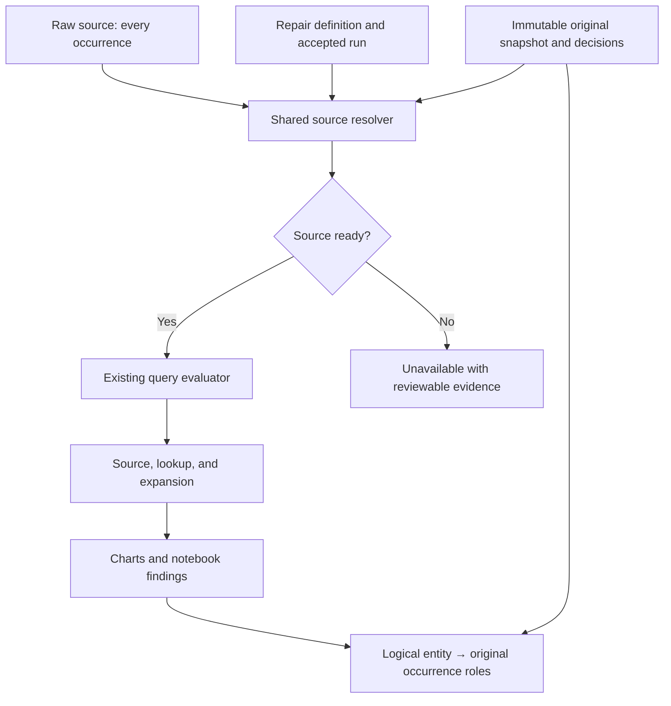

# Explicit duplicate-key repair for explorEDA

**Design decision: build a named, reusable repaired source.** Start with exact-record collapse and guarded whole-record choices for a single declared entity key, and ship the complete relationship → repaired source → notebook workflow together. Add explicitly ordered latest/earliest selection next, then composite keys across both source grain and relationship endpoints. Preserve every loaded original occurrence in an immutable accepted-run evidence archive. Never overwrite the raw source, infer recency from input order, or turn unresolved groups into an apparently successful smaller table.

**Baseline:** `ab4ecd2aa98f3fd1da11e8f552efdb269f4b65a6`, supplied scoped packet for `byronwall/explorEDA`. **Research date:** October 31, 2026. **Mode:** Design; no repository changes, commits, pushes, or pull requests. Byron's demand is sufficient to recommend the feature. Earlier research's demand gates are superseded.

The companion [implementation plan](implementation-plan.md), [recommendations](recommendations.md), [exact fixtures](fixtures.json), [fixture verifier](verify_fixtures.py), and [proposed contracts](proposed-contracts.ts) form one handoff. The contract file is a design sketch, not a repository patch. Fixture expectations are hand-enumerated; their verifier checks the fixture package, not an implemented explorEDA feature.

## 1. What should ship

### The first complete release

An analyst starts from an ambiguous relationship or a source's duplicate-key finding, opens **Resolve duplicate keys**, states what one output row means, and reviews all original records sharing each proposed key. The analyst can:

- Explicitly collapse identical data records, with every original occurrence represented in the evidence.
- Choose one entire original record value class when records disagree; the losing records remain accessible with their exclusion reason.
- Explicitly exclude records with unusable keys from this repaired output, or return to the raw data to fix them. Exclusion is never a mutation of the raw table.
- Choose a different existing unique key or keep the table at event grain and use expansion when repetition is legitimate.
- Apply a named repaired source and, in the same project transaction, redirect the relationship that opened the inspector. Other relationships change only when explicitly selected in the impact preview.
- Read that source directly in a query, use it as a lookup or expansion target, reopen it from JSON or a project folder, and obtain current notebook findings with navigable original evidence.

This is a useful release even before ordered selection or composite endpoints exist. An exact-only release would strand common conflicting entities; an inspector-only release would strand the analyst at the existing warning. The first milestone therefore includes manual conflict resolution, reuse, save/restore, refresh safety, and notebook integration. It is a meaningful vertical feature, even if delivered through several implementation commits. [DKR-001–007, DKR-011–014]

### The bounded bundle and alternatives

| Candidate | Decision | Reason and boundary |
| --- | --- | --- |
| Explicit exact-record collapse | Build in M1 | Low inference, useful for repeated imports; all data fields must agree and all copies remain represented. Exact equality alone does not prove that event multiplicity is accidental. |
| Chosen-key groups with conflict review | Build in M1 | Restores a usable entity target when values disagree without inventing a synthetic entity record. |
| Latest/earliest record | Build in M2 | Scales review when an actual ordering field exists. Require declared parsing, direction, invalid-value policy, and unresolved-tie handling. |
| Composite entity and relationship keys | Build in M3 | Preserves legitimate observations whose identity has multiple components. Implement grouping and matching together. |
| Change declared grain / use expansion | Build as an M1 alternative; extend in M3 | Many orders per customer are valid events. Changing the grain or traversal can be correct without excluding anything. |
| Field-by-field coalesced record | Defer | Produces a record that may never have existed and requires per-field provenance and conflict policies. It is a different operation. |
| Arbitrary reusable query output | Defer as a prerequisite | Adds cross-query graphs and parameter semantics that this feature does not need. |
| Relationship-local winner rule | Defer | Gives the same customer table different meanings in different consumers. An eventual as-of join would deserve a separate contract. |
| First/last input occurrence, automatic fuzzy merge | Avoid | Neither establishes business identity or recency; both can erase distinct observations without a defensible rule. |

The product should ask **“What does one row represent?”** before showing a reduction policy. That question guides an operation already requested; it is not an outside-demand gate or a requirement for a usability study.

## 2. Checked repository facts that determine the design

All facts in this section are static source observations at the fixed baseline. References identify both paths and symbols; Appendix A provides the complete reading inventory. New APIs elsewhere in this report are explicitly proposed.

1. **A query preparation step cannot repair a raw lookup target.** `AnalysisStep` includes only source, lookup, expand, calculate, filter, and aggregate. `sourceFrame`, `lookupFrame`, and `expandedFrame` each obtain rows from physical `tables[...]`; a lookup builds its own target index. There is no query-output target indirection. The resolver boundary must change for reuse to work. [R02, R04]
2. **Ambiguity is already handled conservatively.** `lookupFrame` selects a target only when exactly one row matches. Multiple matches produce `ambiguous-lookup`; projected values are undefined and matching target references remain in `contributors`. The test named “reports ambiguity and duplicate identity without choosing the first match” covers this. This protection should remain for every raw relationship. [R04, R11]
3. **A generated row number solves occurrence distinction, not business identity.** `sourceFromRows` tries a unique ID-like field, then a unique string field, and otherwise adds a collision-free `row_number`. It never chooses among records with the same customer identity. The generated field currently has no provenance marker distinguishing it from a user's real field with that name. [R03]
4. **Current row keys are insufficient for persistent manual picks.** `sourceReferences` and `sourceRowIdentities` give duplicate or missing keys positional references such as `customers:row:2`. `resolveSourceRow` rejects some obsolete positional references, but cannot prove which duplicate-key record occupies a position after reorder. Store snapshot-bound occurrences and content-guarded choices instead. [R04, R10]
5. **Entity-aware aggregation already rejects disagreeing measures.** `aggregateFrame` resolves entity identity through a matching `sourceRows` reference before falling back to a field value. In `entityGrain.test.ts`, x:{10,20}, y:{5} has two entities, while its measured count, sum, and average are unavailable. x:{10,10}, y:{5} gives measured count 2, sum 15, average 7.5. A source repair must not change that reducer into an implicit winner selector. [R04, R11]
6. **Relationship preview counts have specific units.** `countMatches.matched` counts referencing rows with at least one target and includes the ambiguous subset. `expanded` counts extra fanout rows, not total output rows. The new inspector must show unambiguous matches, ambiguous input rows, missing matches, and output row counts separately. [R07]
7. **Edge-key rules are not uniform today.** The evaluator excludes nullish and NaN relationship keys; raw entity-reference construction accepts non-null scalar blanks and infinities. Preview `countMatches` excludes nullish values but does not exclude NaN. This report's strict repair-key policy is new behavior scoped to the new feature and explicitly versioned relationships, not a claim about existing uniform semantics. [R03, R04, R07, R18]
8. **Save formats and revisions need real extensions.** `projectFile.ts` validates a string `entityKey`, scalar endpoints, and version 1. Its encoder preserves undefined and nonfinite numbers and escapes reserved-tag collisions, but does not preserve negative zero. `selectAnalysisProjectView` follows direct query sources and relationship endpoints, not derived ancestors. Evaluation revisions use process-local immutable-array revision numbers, not durable snapshot identity. [R05, R04]
9. **Workers already share the evaluator and reject late replies.** `analysisWorkerProtocol.ts` invokes `evaluateAnalysisQuery`; `useAnalysisEvaluation` sends sources separately from definitions and accepts only the latest request. Extend that route, not a separate repair evaluator with different semantics. [R06]
10. **Notebook reuse requires more than changing lookup.** The supplied `compileNotebook` compiles charts over supplied rows. Supplemental `readNotebookText` evaluates a query but returns only `.rows.map(row => row.data)`, dropping query diagnostics and provenance. `ProjectWorkspace` passes the folder-loaded notebook rows, so local project edits do not automatically replace them. `ExplorEdaNotebook` supplies a data layer but no analysis context; findings currently treat an empty count as zero. The first release must carry current evaluation, readiness, and identity into notebook charts and findings. [R16, R17]
11. **Folder save ordering is not a transaction.** Supplemental `FolderSaver` serializes writes but catches a failed write and permits its chain to continue. Merely queueing an evidence file before project text could publish a pointer after its evidence failed. Add a fail-fast dependent commit, and stage the project change until its required evidence is safely available. [R17]

These findings justify a narrow new capability. They do not turn this mission into an audit or require unrelated repairs before building it.

## 3. Primary-source comparison and what to borrow

The following are documented product behaviors, not executed comparator experiments. Sources were opened during this run; no comparator application was installed or exercised. The external-source summaries are intentionally narrow. The product decisions that follow them are inferences and proposals.

### Power Query: useful grouping, unsafe assumptions about survivors

`Table.Distinct` compares all columns unless equation criteria identify a subset, and Microsoft expressly does not guarantee which duplicate survives optimization or folding. The API documentation suggests buffering for predictable behavior. Microsoft's separate sort guidance warns that grouping, merging, and distinct operations need not preserve earlier sorting; it recommends sorting within groups or ranking with an explicit tiebreaker. Therefore, “sort descending, then remove duplicates” is not a sufficient product contract. [P01, P02]

`Table.Group` accepts one or several key columns, allows comparers, and does not guarantee result ordering. A comparer can equate different keys, placing a row under a group key different from its own. The UI's **All rows** aggregation retains each group's rows as a nested table; its preview can be truncated, and the full table remains reachable. Borrow the group-first review and explicit full-group navigation. Do not substitute a convenient comparer for a recorded identity transformation. [P03, P04]

Power Query documents case-sensitive duplicate handling and a separate duplicates-only filter. explorEDA should similarly make comparison semantics and the inspection scope visible. Case normalization would be a separate deliberate preparation operation; this feature must not silently lowercase identifiers. [P05]

### OpenRefine: reviewable judgments, not proof of entity identity

OpenRefine's clustering finds similar textual values and requires approval before proposed edits change data. Its technical documentation separates syntactic clustering from semantic reconciliation. Reconciliation matches against an external dataset or service and may require several rounds of judgments. Borrow grouped alternatives, explicit acceptance, and a visible unresolved queue. Do not import fuzzy clustering or a reconciliation service into a local exact-key repair operation. [P06, P07, P08]

OpenRefine saves edit history with a project, and project archives carry it when exported. That is useful evidence that history belongs to a project artifact rather than just a transient result table. explorEDA's proposed archive is narrower: snapshots and decisions for accepted repairs, not a universal edit log or remote authority registry. [P09]

### SQL: separate equality, ranking, and output order

PostgreSQL documents `DISTINCT` over selected output values, with nulls considered equal for that comparison. `DISTINCT ON` retains the first qualifying row, but it is predictable only when enough ordering columns uniquely determine that row. Its window tutorial says tied `row_number()` rows receive unspecified order. This supports an explicit tie state instead of treating `row_number() = 1` as an explanation. [P10, P11]

PostgreSQL also separates ordering within a window from ordering the final result. Its default null placement changes with ascending versus descending order; a descending order defaults to nulls first. explorEDA should not inherit that default for “latest.” It should require an eligible parsed order value or an explicit exclusion decision. [P11, P12]

SQL's null-equal `DISTINCT` rule is appropriate for deduplicating result values. It does not mean two missing customer keys identify one customer. This design deliberately distinguishes exact-value comparison from key eligibility.

### pandas: concise policy knobs, limited explanation

`DataFrame.drop_duplicates` exposes selected-column comparison and first, last, or remove-all duplicate policies; it ignores the index, including time indexes. These are useful distinctions for an API comparison, but a positional first/last choice still needs a separately established ordering to mean newest/oldest. Borrow the explicit policy vocabulary, while supplying the conflict evidence and reusable source semantics the API itself does not specify. No pandas dependency is proposed. [P13]

### Comparison distilled into product requirements

| Dimension | Evidence from comparators | explorEDA decision |
| --- | --- | --- |
| Equality | Whole-result distinct, selected-column criteria, text normalization, and semantic reconciliation are different operations. | Typed data equality, key grouping, and order-value parsing are separate named contracts. |
| Winner | Distinct is not generally a recency promise; row numbering does not settle tied distinct records. | A whole-record value class wins by an explicit choice or declared order; unresolved ties remain visible. |
| Nulls | SQL distinct groups null values; sorting defaults can move nulls to the front. | Missing keys never identify one entity; invalid order values never become latest by accident. |
| Scope | Facets and filters can limit what a user sees or edits; group previews may show only a sample. | Repair uses the full source, while inspector search only changes display; complete counts remain visible. |
| Provenance | Grouped all-rows views and saved edit history aid explanation. | Persist every original occurrence and accepted decision, then link from the prepared entity to that evidence. |

## 4. Exact semantics

Everything in this section is the proposed normative contract. It is intentionally stricter and more explicit than the baseline's inconsistent edge-key handling.

### 4.1 Three questions that must not share one equality function

1. **Key equality:** do these eligible scalar tuples name the same declared entity?
2. **Record equality:** do these complete data records contain exactly the same typed values and field presence?
3. **Ordering equality:** after the selected parser, do these records have the same ordered value tuple?

A numeric key `2` differs from the string key `"2"`. A numeric order rule may parse the values `2` and `"2"` to the same rank. Those records are still different raw data records and may leave an unresolved tie. Two ISO strings with different offsets may denote the same instant for ordering while remaining different original values for exact comparison.

### 4.2 Eligible keys and composite tuples

- Eligible components are finite numbers, booleans, and nonblank strings. Preserve nonblank strings exactly, including case, Unicode composition, and surrounding whitespace. `" A "`, `"A"`, and `"a"` are different keys.
- Null, undefined, an absent field, an empty string, whitespace-only text, numeric NaN, and numeric infinities are ineligible. Keep their distinct values and reasons in evidence. The text `"NaN"` is a valid text identifier.
- Normalize negative zero and positive zero to one numeric **key** value. Preserve their original signs in archived records and distinguish them for exact record equality.
- Composite equality is componentwise typed equality over an ordered, nonempty list of distinct field IDs. If any component is ineligible, the tuple is ineligible. Never join components with a delimiter.
- A canonical key token can serialize tagged tuples, such as `[["string","a|b"],["string","c"]]`. It differs from `[["string","a"],["string","b|c"]]` and from a tuple containing numeric `1` instead of textual `"1"`.
- A repaired source's declared `entityKey` is the single authority for its grouping grain. M1 supports one field. M3 generalizes the existing property to a string or nonempty field tuple; one boundary helper normalizes both into an ordered array.

A changed grain starts a new identity epoch. A rename of a display label does not. Reordering key components changes the schema of the tuple and therefore also starts a new epoch, even if it happens to partition the current rows identically.

### 4.3 Whole-record equality and field conflicts

For exact collapse, compare every user data field, with field presence included. Null differs from undefined, which differs from an absent property. Empty text differs from whitespace. Numeric NaN equals the same tagged NaN for **record classification only**; positive and negative infinity remain distinct tags. This is a storage/evidence equivalence relation, not a numeric measurement rule.

Canonicalize field names in a defined order when forming record tokens. Object property insertion order does not change equality. Compare canonical tokens or verified values, not hashes alone. Any hash is an acceleration index whose collision must be checked before grouping or accepting a guard. Undeclared input fields must be registered or reported as a schema change before repair; silently discarding them could make different rows appear exact.

Known runtime `__ID` and positively marked generated occurrence columns are technical metadata, not data-field equality. Add a generated-field marker when `sourceFromRows` creates a row number. Omit only such marked fields from the repaired output's data schema while retaining their original values in the archive. Never infer that a column is technical merely because its name is `row_number`. An unmarked legacy field remains a data field; the analyst must explicitly verify its technical role, or handle its differences through review. A technical-role change is itself part of the previewed schema and identity contract. [DKR-025]

**Chosen fields define a group, not equality of all the records in that group.** If customerId and region agree but credit differs, show a credit conflict. Do not offer “exact” collapse over an arbitrary subset while carrying unexamined differing fields forward. A later projection feature could intentionally omit those fields; it is not part of this release.

For each key group, build complete record value classes and a field-conflict matrix. A field conflict is two or more distinct presence-sensitive typed values in the group. Missing-versus-present is a conflict. The inspector can hide agreeing fields for readability, but must expose them and retain all original values.

### 4.4 Exact repeats, conflicting entities, and repeated events

- **Exact repeats:** same eligible key, one distinct data record class, multiple original occurrences. After an explicit collapse decision, emit that class once and represent every copy. No physical occurrence receives an invented business priority.
- **Conflicting entities:** same eligible key, several data record classes. Emit one whole class only after a manual choice or successful explicit ordering. Retain all other occurrences as excluded candidates with a reason.
- **Legitimate repeated events:** repeated customer IDs may name separate orders, readings, or payments. Keep the raw rows at event grain. Use the existing unique event identifier, a composite key after M3, or expansion at the appropriate relationship. Do not force an entity table out of valid events just to satisfy a many-to-one declaration.

Even identical event records can represent two real events. Exactness permits a low-inference collapse operation; it does not authorize it automatically. The analyst's declared row meaning and Apply action authorize the reduction.

### 4.5 Whole-record selection and ties

Manual choice selects a **value class**, not “row 4.” If the chosen record appears twice identically, both copies are represented and both are included in `winnerRefs`; the output still contains one logical entity. An optional independently unique record ID can help locate a class, but never removes the content and group guard.

The ordered policy evaluates an explicitly authored lexicographic order tuple:

- A date rule uses string input and the shared date parser with a saved preset; default to ISO and the library's documented UTC behavior. Numeric epoch timestamps require a separately explicit unit interpretation and are deferred from this date rule. A numeric rule uses the existing finite-number parsing rules. A textual secondary tiebreaker accepts nonblank strings only, keeps their contents verbatim, and compares lexicographically by UTF-16 code units using JavaScript `<`/`>`; it never calls `String()` or locale sorting. Nullish, blank, and non-string text-order candidates are ineligible. Under this rule, `"10"` sorts before `"2"`; numeric ordering reverses that relation.
- The interface calls a date extremum **Latest** or **Earliest** and a numeric extremum **Highest** or **Lowest** unless the user explicitly labels it a version sequence.
- By default, a conflicting group containing an ineligible required order value is unresolved. The analyst can instead explicitly exclude those candidates, with exact excluded membership. If no eligible candidate remains, the group is unresolved; it does not disappear.
- Rank complete value classes. If one best class remains, it wins. If several distinct classes share the best order tuple, the result is unresolved. The analyst can add a meaningful secondary rule or choose the record explicitly.
- A complete exact class does not need an ordering decision: if exact collapse was accepted, identical copies with an invalid date can still collapse. That does not claim their date is valid or recent.
- Input position is never an implicit tiebreaker. A UI sort changes only inspection order. Saved source display order is also separate from selection policy.

If explicit ordered exclusions remove candidates from a group, distinguish `ineligible-order` exclusions from otherwise eligible `not-selected-by-order` records. A manual override is allowed to select an otherwise ineligible order candidate, but the inspector states that this group uses a manual whole-record decision instead of the order rule.

### 4.6 Missing keys and nonfinite inputs

Default to **needs review**, with Apply disabled until the analyst chooses an explicit exclusion policy or repairs the keys upstream. Missing-key records are not grouped into one null entity and never match a repaired relationship. Exclusion applies only to this repaired source; the raw source and its full snapshot remain available.

Nonfinite values in a nonkey, nonorder field remain part of the chosen original record. They are not converted to null or zero. Numeric summaries continue using `numericExclusionReason` and the existing aggregate rules. A key policy and a measurement policy answer different questions. [R18]

### 4.7 Output and membership invariants

For an accepted source snapshot, let O be all original physical occurrences. For a ready repair:

- Each output entity g has a represented set W(g), containing every occurrence of its chosen exact data class.
- Its rejected candidates are E(g). Invalid-key exclusions are I; any expressly supported whole-group exclusion would need a separate reason and is deferred from the initial UI.
- The sets W(g), E(g), and I are pairwise disjoint across groups and cover O exactly. One output row corresponds to one selected class, not to every represented occurrence.
- Output values equal the complete data-field projection of every row in W(g). No nontechnical field is borrowed from E(g), filled from another row, or replaced by a default.
- `winnerRefs` and `representedRefs` name the same selected-class members. The two labels distinguish the selection decision from the count of original occurrences it represents; neither chooses a privileged physical twin.
- A blocked preview has an additional unresolved set U. It must still partition O for inspection, but has no usable final output. Partially resolved preview rows are never published as a ready source.

The output row's execution identity is a logical repaired entity reference. The raw evidence ledger stores W, E, I, and U separately. Rejected records are **considered evidence**, not contributors to the selected values or extra aggregate inputs.

## 5. Identity, refresh, and original-record preservation

### Three identities with different lifetimes

| Identity | Contents | Purpose |
| --- | --- | --- |
| Prepared entity | Prepared source ID + identity epoch + canonical typed key tuple | Stable selection and entity-aware reduction while the declared grain is unchanged. |
| Record value class | Complete canonical data record, with schema, types, and field presence | A guarded manual choice and an exact-repeat group; not proof of physical continuity. |
| Original occurrence | Raw source ID + immutable snapshot ID + ordinal in that snapshot | Exact navigation to every originally reviewed row, including identical twins and rejected records. |

The snapshot archive stores all loaded raw records, including technical fields and missing/invalid values, plus source schema and original occurrence order. This preserves the typed rows explorEDA actually received. It does not claim to reconstruct unparsed CSV quoting, spreadsheet formatting, or original file bytes. The raw files remain untouched.

All committed repair runs reference immutable evidence. Multiple runs can reference one input snapshot; drafts are ephemeral. No automatic pruning is included. This costs disk space proportional to accepted input snapshots, which is preferable to silently losing the evidence required by this mission. Optional future compaction must prove that no active definition, historical decision, or undo checkpoint loses its required evidence. [DKR-005, DKR-024]

### Manual guards

A manual decision stores the typed group key, chosen complete record token, and the reviewed group's complete multiset of record tokens and multiplicities, together with its schema/equality version. Persisting only the winner's ID is insufficient: an unseen new competitor could change the decision.

- Reordering the same data records preserves the guard.
- Adding an unrelated group preserves the existing group's choice, but the new full-source result still awaits refresh acceptance.
- Adding even an exact copy to the reviewed group changes multiplicity and requires that group's review under the initial conservative rule.
- Adding a conflicting candidate, deleting a member, changing a value, changing field presence, or changing the comparison schema makes that group's decision stale.
- Deleting the chosen class cannot silently select another row. A content-identical replacement can satisfy a value-class guard, but the UI must not claim it is the same physical event.

### Refresh policy for the first bundle

**Reorder-only changes with the same semantic record multiset remain ready. Content changes produce a proposed new run that must be accepted before dependent results are current.** This is a deliberate bounded policy, not a claim that every future pipeline must be manually refreshed.

For a reorder, the prior accepted snapshot remains the exact evidence. Current-source navigation can find all members of a matching value class, but an archived ordinal must never be silently interpreted against the new table. Without an independent stable occurrence ID, individual exact twins cannot be tracked across reorder.

For content changes, show new/removed keys, changed winners, changed represented counts, stale manual choices, newly invalid keys, and new ties. Reuse unchanged guarded choices in the candidate preview. An ordered rule can compute a new proposed winner, but the active notebook and relationship must not silently switch to it. **Accept refresh** appends its full evidence and activates the new run in one transaction.

While waiting, current evaluation is unavailable. A historical view may show the previous run only with its source snapshot and historical status visible. Do not publish old values as current, or interpret an unavailable source as a successful empty table with count zero. An opt-in automatic acceptance mode is an Explore item after this contract works. [DKR-007, DKR-011, DKR-023]

Changing a rule without changing key grain creates a new run and revision but preserves logical entity keys. Changing the key schema starts a new identity epoch so saved selections are reported unresolved instead of being reinterpreted. Undo restores definitions, selected relationship targets, and accepted-run pointers; the archive stays append-only. An undone run may be historical if the current raw input no longer matches it.

### Concurrency within one local session

Preview records its project revision and input semantic stamp. The host checks them before saving and again before writing the project pointer. The host owns publication of the complete desired project/evidence transaction and resolves its callback only afterward. A post-acknowledgement guard compares against that desired committed state or transaction ID, not the old base revision, because a successful commit changed the project. The source can still change during the final write; a successfully saved but now-obsolete run remains valid historical evidence and cannot become current. Late worker replies similarly cannot replace a newer preview or active evaluation.

## 6. Minimal data model and execution change

### 6.1 Choose a prepared source, with one bounded operation

| Location for repair | Benefit | Cost and decision |
| --- | --- | --- |
| Named source preparation | Every source read and relationship can use one accepted interpretation; raw source remains separately addressable. | Requires a shared source resolver and evidence state. **Choose this.** |
| Reusable query output | General composability, potentially many future preparation operations. | Requires cross-query graphs, bindings, exposed schemas, cycle handling, and output lifetimes. Do not make it a prerequisite. |
| Relationship-local policy | Small surface for one ambiguous lookup. | Not reusable as a table; can disagree across relationships and notebooks. Defer. |

Add an optional `SourceDefinition.preparation` for `duplicate-repair`. A prepared source has its own ID, name, declared key, and data fields. It names exactly one physical input source. `tables` continues to hold physical inputs only. Reject a physical table under the prepared source ID, a query input, a prepared input, a self-reference, and a cycle. Rejecting chains now does not require building a generic dependency engine.

The preparation contains its version, input source ID, identity epoch, exact-equality contract, missing-key policy, review/ordered policy, and accepted-run ID. Manual choices and complete group guards belong to the accepted immutable run. A definition cannot execute against an asset with another source, schema, policy signature, or run ID. The companion `proposed-contracts.ts` spells out a suggested boundary; Codex should adapt naming to the existing exports.

The prepared source is a view of an accepted interpretation of its raw input. Derived values, group indexes, and row caches are runtime products, never an untracked replacement raw table. A flattened CSV export can be useful later, but is not the canonical reproducible artifact.

### 6.2 One resolver shared by existing consumers

Introduce proposed `lib/analysis/resolveSource.ts`, supported by a bounded `duplicateRepair.ts`, `repairKeys.ts`, and `repairEvidence.ts`. These are new modules, not checked existing files.

The resolver returns a ready source with field definitions, explicit row entries, logical identity, and evidence references, or an unavailable source with structured reasons. Each indexed entry carries its own reference. Do not map references only by JavaScript object identity: a host can put the same row object at two physical positions, and both occurrences must survive.

Route these paths through it:

- `sourceFrame`, `lookupFrame`, and `expandedFrame` in `evaluateProject.ts`.
- Relationship indexing and preview counts in `relationshipEditing.ts` and the Schema panel.
- Source profiling, parameter options for supported scalar keys, and source navigation.
- Query inspection, source preview, chart trace context, and notebook query evaluation.

The preparation computes one resolved source. The existing query evaluator continues calculating, filtering, expanding, and aggregating it. There is no new query step or second query engine.



The archive is evidence and accepted decision state. It is not extra numeric input. An unresolved source never flows through the ready branch as a shortened table.

### 6.3 Execution references and repair evidence

Keep a prepared logical reference in `AnalysisResultRow.sourceRows`, with the prepared source ID and stable logical row key. Prepared fields' origins name the prepared source. This lets the existing `aggregateFrame` source-reference rule identify one prepared entity when an entity-field measure repeats across orders or expansions. [R04]

Prepared `contributors` refer to the contributing logical entity; its selected original value class is reachable through a dedicated `repairEvidence` reference. Raw parent references remain ordinary contributors. Add an explicit ledger accessor that returns represented and excluded original occurrences by role. Do not put losing records into selected `sourceRows`, or flatten every evidence witness into the numeric candidates.

This changes `QueryStageRows.relatedRecords` and `resolveSourceRow` callers: a prepared reference resolves through the source/evidence resolver, not `tables[preparedId]`. An ordinary raw ambiguous lookup still lists all its possible targets as ambiguous evidence, as it does today. The inspector labels that meaning distinctly from a selected prepared contributor.

An aggregate result unions repair evidence references for trace navigation, while `measureContributors` remains a ledger of the actual reduced query candidates. A conflicting measured entity remains unavailable. The repair feature cannot silently convert a conflict in a later calculation into a source-level selection decision.

### 6.4 Relationship compatibility and downstream impacts

A ready repaired source is unique on its declared entity key, not on every field it exposes. A relationship that targets a nonunique email can remain ambiguous even when the source is unique by customer ID. Preview the actual selected endpoint and keep the existing ambiguity protection. Fixture DR-F11 covers this distinction.

Retargeting a lookup can also change **field origin**, even when the projected alias stays the same. Consider orders → customers as `customer`, then a lookup from `customer.regionId` through a relationship declared from raw `customers.regionId`. After retargeting the first lookup to `customers_repaired`, that alias has a prepared-source origin. The second raw-source relationship may no longer match `relationshipSide`. [R04]

Therefore Apply's impact planner must validate every affected query by field origin, not just by unchanged field names. The first release may block **Apply and update relationship** until the affected steps are rewired; **Create repaired source** can still succeed. An explicitly selected atomic change can clone/retarget the downstream relationship and update the affected steps together. Do not automatically repoint a shared relationship used elsewhere.

For new repaired relationships, use a saved strict typed-key semantics version on both sides. The shared match planner must also reproduce actual legacy lookup semantics for the before-preview. If rejecting blank/infinite keys changes an existing relationship's matches, show that as a key-policy consequence. Merely reusing the current preview helper without matching the evaluator would conceal that difference. [R04, R07]

M3 extends relationship endpoints with an exclusive single-field/composite-field union and adds the corresponding explicit input-field tuple override for lookup/expand. Validate equal tuple arity, distinct field IDs, field existence, and whole-tuple lineage on both sides. No synthetic delimiter field is needed. A change of entity grain alone never makes a partial-key lookup unique.

Scalar source-backed parameter pickers are a separate boundary. They may read repaired sources with scalar keys through the resolver. A composite source must not silently bind its first component; reject that picker configuration until tuple parameters and filters are designed. Composite source reads, relationships, expansion, and notebooks do not depend on that later extension.

### 6.5 Revisions, workers, and availability

The active evaluation depends on query definitions, relationship endpoints/key semantics, the preparation policy, identity epoch, accepted run, relevant evidence, current raw ancestor availability and semantic content, parameters, and bindings. A dependency-closure helper must include the physical ancestor even when the query mentions only the prepared source. A missing-to-present dependency transition invalidates the result too.

Cache prepared grouping by immutable raw-array identity plus schema/policy revision; build exact semantic content once per new array. Reordering can invalidate an execution cache without changing logical entity identity. Changing a selected record, its evidence, or run must invalidate trace revisions even if the projected value and row count happen to stay identical. The baseline WeakMap revision is useful for local invalidation but cannot serve as a durable snapshot ID or a cross-worker equality assertion. [R04, R06]

Extend the existing worker protocol to transfer physical snapshots/evidence once, then send compact definitions and preview intent. Both worker and direct modes call the same preparation and source-resolution code. Keep the existing request-ID stale-reply guard. Preview can run in the worker without saving; only Apply/Accept refresh produces an evidence append.

Expose an explicit unavailable query outcome before consumers reach numeric reducers. Prefer a discriminated outcome whose unavailable branch has no current row counts. A loaded empty source can produce a ready count of zero; an unresolved repair cannot. Existing “Updating…” behavior can preserve prior content only with its actual revision/status. The first bundle should show an unavailable current notebook rather than promise a historical joined notebook unless snapshots for every nonrepair input are also retained. The repair archive itself always remains inspectable.

## 7. JSON, text, folders, callbacks, and notebook traces

### 7.1 JSON and project validation

Use project/file version 2 for the new capability, with explicit v1 normalization on read. The baseline validator already rejects unknown project/file versions; relying on ignored additive metadata would be unsafe. Preserve legacy scalar keys and raw projects through migration. [R05]

The JSON file contains compact definitions plus the required evidence store. Extend the special-scalar codec rather than using ordinary JSON stringification on evidence. In particular, preserve property absence, explicit undefined, NaN, both infinities, and negative zero, and keep reserved-tag collision escaping. Persist snapshot IDs and accepted run IDs exactly. No runtime row index, React state object, worker cache, or regenerated winner list is authoritative saved state.

Validate structural errors at import: unknown sources/fields, wrong tuple arity, duplicate field IDs, input/source kind conflicts, unsupported versions, invalid evidence IDs, and mismatched run/spec. A saved definition with data-dependent unresolved groups or missing current files remains inspectable but unavailable. Do not make a stale manual choice disappear merely to make the whole project validate.

`selectAnalysisProjectView` must export the complete prepared → physical ancestor → evidence closure, including all originals and exclusions even when the only reference is a lookup target. A selected-view export is not a winners-only data export. Keep unrelated project sources out of that closure, as the current helper already intends. [R05]

### 7.2 Canonical project text and folder save

Keep the existing source/field grammar and add one nested repair declaration. The following illustrates **proposed** syntax; it is not accepted by the baseline:

```text
project @repair-demo format=2

source @customers key=id path=data/customers.json {
  field id string
  field name string
  field credit number
  field updated date
}
source @orders key=id path=data/orders.json {
  field id string
  field customer string
  field amount number
}
source @customers_repaired "Customers repaired" key=id {
  field id string
  field name string
  field credit number
  field updated date
  repair from=customers mode=review missing=exclude identity=1 run=repair-001 evidence=.exploreda/repairs/repair-001.json
}
relate @order-customer orders.customer -> customers_repaired.id
query @orders-with-customers "Orders with customers" {
  source orders
  lookup customer via=order-customer
}
```

The output source's `key=` owns grouping. The repair's evidence path is a serialization mapping analogous to raw source paths; the model stores the accepted run identity. Prepared sources have no physical `path=` or database definition. Their fields come from the reviewed data-field schema, not `tables[preparedId] = []` inference. `readProjectFolder` must recognize them before its current no-path loading path. [R13, R14]

Manual guards and full original rows belong in immutable `.exploreda/repairs/…json` assets, not enormous DSL tokens. Export and compile preserve those references. The **new** text reader must diagnose an unsupported format or operation and prevent a runnable fallback. Opening v2 project text in an older build is unsupported under the mission's one-deployed-version assumption. A `format=2` header cannot retrofit rejection into the baseline reader: it ignores the project format pair, diagnoses an unknown repair child while still constructing a source, and the folder path can supply an empty table for that no-path source. JSON v2 rejection is verified; old-text-reader rejection is not. [R05, R13, R14]

The folder writer must promote an analysis-local raw declaration into the necessary project dependency closure when a project-level repaired source depends on it. It must include repair definitions even if a view's query references them only through a relationship. The existing `writeFolder.ts` source-usage logic is the concrete place to extend. [R17]

### 7.3 One Apply transaction and a fail-fast save

Retain `onStateChange` for chart/settings edits. Widen `onProjectChange` with a repair transaction containing the proposed project/view, immutable evidence append, expected project/source revisions, and reason `apply` or `accept-refresh`. Require explicit host capability opt-in for evidence persistence; a legacy handler that only stores `{project, view}` must not expose repair Apply and silently discard the archive.

For repair-capable hosts, the proposed callback returns a promise. This is a new acknowledgement contract; the baseline callback returns void. The host stages and then publishes the new project/evidence together and resolves only after that publication and its required save. The component does not perform a second independent publication. A successful user Apply is one undo checkpoint; per-candidate preview changes and Cancel emit none. [R15]

For folder hosts:

1. Drain or cancel obsolete queued project writes, serialize project-definition edits for the duration of the commit, validate the base revisions, and assign a transaction ID. Ordinary saver writes must not overtake this transaction.
2. Write required immutable evidence assets successfully. Reusing the same asset ID is idempotent only if its content agrees.
3. Recheck base project/source revisions immediately before writing the canonical project definition containing the source, selected relationship changes, and accepted-run pointer. Use the adapter's safe file-replacement path; do not claim that a generic queue makes several files atomic.
4. A failed evidence write or failed pre-pointer check prevents the pointer write. A pointer failure leaves unreferenced evidence and the previous active state, with the draft retryable.
5. The host publishes the complete desired project/evidence state, creates one user edit checkpoint, and resolves the callback. The component's post-acknowledgement guard checks the desired committed revision or transaction ID, not the old base. If the source changed during the final pointer write, the saved run is historical and the resolver keeps current dependent results unavailable until reviewed.

The existing `FolderSaver` catch-and-continue behavior cannot implement this guarantee by queue order alone. Add a dependent `commitBundle` operation or a small dedicated writer with this failure barrier. Avoid a second generic persistence framework. [R17]

Deletion of a prepared definition does not automatically delete its evidence. Undo changes pointers and definitions, not historical bytes. A future explicit archive cleanup can identify truly unreferenced snapshots; it is deferred.

### 7.4 Notebook compilation and exact records

The notebook path must carry the full query outcome in addition to projected chart data. Update `readNotebookText`/`NotebookReadResult` and the app's notebook binding to use current project, current evidence, current tables, and the named query. Reevaluate after Apply and accepted refresh without requiring a folder reload. Retain current query diagnostics and source availability. [R16, R17]

Supply notebook charts and findings with the same runtime `__ID` → `AnalysisResultRow` map used by `ExplorEdaProject`, plus the repair evidence accessor. Extend `AnalysisChartContext` or introduce a thin project-notebook adapter; do not make `compileNotebook` another source engine. A finding's records must trace the current reduced candidates to logical repaired entities, and then open represented/excluded original records separately.

Add a finding unavailability reason such as `source-unavailable` before both static and live reducers run. `evaluateNotebookFindings` and `NotebookFindings.useFindingResults` need the guard. Comparisons inherit unavailable operands. A genuinely empty ready population still counts zero. `lastValid` is a fallback for invalid notebook block text, not permission to use an old dataset or hide an unresolved repair. [R16]

Finding revisions must include the evaluation/run/availability revision, not just provider nonce or numeric result. If a new accepted record has the same credit value but different evidence, a previously opened records popover must close or explicitly refresh; it cannot remain under the old explanation. The existing notebook popover revision check is a useful seam to retain. [R16]

## 8. Inspector, counts, and consequence preview

### Entry and scope

Place **Resolve duplicate keys** beside the ambiguous relationship evidence and in the source-key section of the Schema panel. Reuse the existing nonmodal narrow/wide side-panel pattern. The header carries source name, proposed output name, key/grain, full-source scope, and Apply/Cancel. Avoid an introductory wall of prose. Explain subtle controls in accessible help and tooltips. [R01, R09]

The repair always reads the full raw input. Chart selections, local row filters, and inspector searches can limit the visible evidence list only. Display both statements when relevant: **All 8 source records evaluated** and **2 matching records shown**. A selected-only repair would create a different source population; it is deferred rather than hidden behind current chart filtering.

Show summary counts in named units:

- Original occurrences, valid key groups, exact-repeat groups, conflicting groups, and invalid-key occurrences.
- Proposed output entities, represented original occurrences, excluded conflicting occurrences, excluded invalid-key occurrences, and unresolved occurrences/groups.
- Existing and proposed relationship matches by referencing row, plus actual inner/left expansion output totals.

Do not call `matched` “successful lookups” while it includes ambiguous rows. Show **single matches = matched − ambiguous**. Do not call extra fanout rows total expanded output. Do not claim the prepared entity count equals the represented original count.

### Group review

Each group shows its typed key, occurrence count, number of distinct full records, changed fields, decision, and reason. A compact list filters to unresolved groups by default, while all groups remain available. Choosing a group opens whole record alternatives; identical copies form one alternative with their occurrence list accessible.

Default the detail table to conflict fields plus the key and authored order fields. **Show all fields** restores the complete data record. Show raw and interpreted order values together where parsing matters. Render null visibly; distinguish absent and undefined in evidence detail. Use a radio choice for a whole record class, not independent checkboxes that imply field coalescing.

An original record action opens the archived source snapshot and its exact ordinal, source ID, schema, and role. An optional **Find in current source** searches the full data class and can return several matches. It must not claim that content matching identifies a particular historical physical twin.

### A worked eight-record preview

Fixture DR-F01 contains A×2 exact at credit 10; B at 20 and 25; C tied in date at 30 and 35; E at 50; and one null-key record at 60. M1 explicitly selects B25 and C35, collapses A, and excludes the null-key occurrence. M2 can select B25 by latest date, but the tied C still requires a choice.

| Measure | Before | After accepted repair |
| --- | ---: | ---: |
| Physical target records / output target entities | 8 | 4 |
| Original target occurrences represented | 8 raw occurrences | 5 |
| Original target occurrences excluded from prepared values | 0 | 3 |
| Referencing order rows | 6 | 6 |
| Matched order rows, including ambiguous | 4 | 4 |
| Ambiguous order rows | 4 | 0 |
| Unmatched order rows | 2 | 2 |
| Extra fanout rows | 4 | 0 |
| Inner expansion output rows | 8 | 4 |
| Keep-unmatched expansion output rows | 10 | 6 |

The surviving values are A10/B25/C35/E50. Represented target occurrences are `{c1,c2,c4,c6,c7}`. Excluded target occurrences are `{c3,c5,c8}`. These are fixture aliases, not durable IDs; the fixture maps each to its original snapshot and ordinal.

The six order amounts sum to **90** before and after lookup. The repaired customer-credit sum over order rows is **80** (A counted twice). Once per matched repaired customer, it is **70** (A+B+C). Across the complete repaired customer source, it is **120** (A+B+C+E). These deliberately different answers establish the intended populations; a provenance list must not make them converge.

### Apply, cancel, and affected consumers

The impact section lists every relationship that can read the original target, the selected relationships to redirect, directly reading queries, and dependent notebooks/views. For each selected change, validate the full query path and show changed match/expansion counts. Do not repoint all raw consumers automatically.

Apply is available only for a complete usable source, a current preview revision, valid selected relationship rewrites, and an evidence-capable host. Cancel restores the project exactly and does not alter layout, current chart selections, or raw tables. Choosing a different grain is a separate explicit change whose impact must be previewed; it does not silently dismiss an ambiguous partial-key relationship.

If a refresh occurs while the inspector is open, keep draft choices visible but disable the old Apply result until recomputed. Show which decisions remain valid, which changed, and which need another choice. Keep historical records available even when a previously selected row no longer exists in the current file.

### Keyboard and width behavior

- At 1280 px, use a group list beside the detail table. At 783 px, stack or use the wide inspector while retaining key context. At 390 px, use a full-width sheet with the group context and Apply/Cancel reachable while records scroll.
- Follow the repository's compact control scale, inline label/control settings rows, shared `FieldMetadata`/`FieldPicker`, and semantic border/focus tokens. Horizontally scroll genuinely wide record tables; do not hide conflict fields without an alternative.
- Tab reaches every action. Arrow keys move within the group list or candidate radio group; Space selects a record class; Enter opens the focused source action. Escape closes the active nested control first, then cancels/leaves the draft with focus returned to the initiating action.
- Announce completed preview counts and readiness through a polite live region. Save failures are alerts. Accessible names explain icon actions; hover text is supplemental. Never make a tooltip the only way to learn why Apply is disabled.
- Alt-click/Alt-Enter on chart marks retains the existing trace interaction. The repair inspector is reached through those trace records or Schema, without adding forbidden mark-level Inspect buttons.

These are design requirements, not results of a browser usability test. The plan makes real wide/intermediate/narrow input verification a feature acceptance gate. [R01]

## 9. Exact fixtures, proof boundaries, and implementation sequence

The JSON fixture file supplies 16 named cases with complete original snapshots, exact expected values, represented/excluded/unresolved membership, relationship counts, and refresh transitions. Special scalar notation is explicitly fixture notation; it must not be copied into an unescaped production codec.

| Fixture | Decisive coverage |
| --- | --- |
| DR-F01 | Eight original target rows; exact/manual and later ordered policies; reusable lookup/notebook populations 90/80/70/120. |
| DR-F02 | Equality on selected visible fields cannot conceal other conflicting fields or authorize coalescing. |
| DR-F03 | Legitimate events remain distinct under appropriate grain; repair is not automatic event deletion. |
| DR-F04 | Typed scalar keys, true versus textual true, numeric versus textual numbers, and exact typed matching. |
| DR-F05 | Composite delimiter/type collisions, ordered field tuples, endpoint validity. |
| DR-F06 | Separate missing, blank, absent, undefined, and nonfinite key evidence; block versus explicit exclusion. |
| DR-F07 | Latest/earliest, equal instants, tied distinct records, and exact top copies. |
| DR-F08 | Explicit date/number parsing; order equality does not redefine record equality. |
| DR-F09 | Reorder, unrelated append, same-group additions, changed/removed winners, guarded refresh, historical navigation. |
| DR-F10 | Missing dependencies, invalid definitions, valid empty versus unavailable, schema and downstream-origin acceptance conditions. |
| DR-F11 | A repaired source can still be ambiguous on another relationship field. |
| DR-F12 | Existing entity-aware conflicting measures stay unavailable; provenance is not extra input. |
| DR-F13 | Lossless scalar evidence, reserved tags, round-trip acceptance, transitive export closure. |
| DR-F14 | Whole-record types, absent properties, explicit undefined, null, NaN, and signed zero. |
| DR-F15 | Generated technical identity versus a real `row_number` column. |
| DR-F16 | Full-source scope, Apply/Cancel/undo, source changes during preview/save, keyboard acceptance. |

`verify_fixtures.py` performs independent internal checks of specified memberships, original/projection values, key identities, count arithmetic, relationship vectors, group guards, and a standalone lossless scalar-codec model. It does not import or execute an explorEDA repair implementation. Dependency, UI, worker, actual project-format, and notebook integration assertions remain exact acceptance specifications for Codex to implement and run. Parser vectors are hand expectations against the chosen shared-parser policy; the verifier is not a new date parser for the product.

The implementation plan orders three usable releases:

1. **M1 — exact/manual repair with complete reuse and preservation.** Shared source resolution, grouped inspector, guarded manual selection, full evidence, atomic persistence, raw dependency closure, worker parity, and current notebook results/traces. This is the largest milestone because its correctness depends on those pieces arriving together.
2. **M2 — explicitly ordered selection.** Saved date/numeric/text order semantics, exact-class ties, invalid-order exclusions, and visible changed-winner preview, using the same source/persistence path.
3. **M3 — composite identity and relationships.** Ordered typed tuples for grain, endpoints, explicit input overrides, previews, saved keys, and the event-preserving demo; scalar parameter-picker limitations are explicit.

Each release includes exact acceptance cases, relevant source files, its main risk, a docs page/section, and a runnable demo project. No feature is declared shipped merely because its schema or inspector exists. Keep React/TypeScript, pnpm, and shared test time limits. Run targeted checks while implementing and the repository's broad check once before Codex's integration PR. No implementation or repository tests were run in this design mission.

## 10. Rejected alternatives, tradeoffs, and open questions

### Rejected or deferred

- **Overwrite or delete raw rows:** violates the evidence contract and changes all existing consumers. Avoid.
- **Keep first/last in input order:** deterministic only relative to an unstable list; not a recency rule. Avoid.
- **Implicit null entity:** combines unknown identities and can create false matches. Avoid.
- **Automatically merge names by similarity:** substitutes a record-linkage problem for explicit entity keys, with no requested fuzzy-service scope. Avoid.
- **Field-by-field coalescing:** potentially useful, but requires synthetic output identity and field-level provenance. Defer to its own intentional merge design.
- **Complete generic query reuse or preparation DAG:** valuable separate proposals; unnecessary to implement this single raw-source operation. Defer as a prerequisite.
- **Arbitrary selected-only repairs:** would bind a reusable source to transient chart scope. Defer until a saved selection can be an explicit input definition.
- **Automatic content-refresh acceptance:** can be useful after stable policy/evidence behavior is proven. Explore an explicit opt-in later; the first bundle requires accepting changed content.
- **Archive compaction:** may matter for large repeatedly refreshed files, but cannot silently discard originals. Explore only with reference-aware, explicit retention decisions.

### Costs worth accepting

The accepted-run archive increases disk use. Full-source grouping costs roughly linear work in row/field input size, plus ordering or canonicalization overhead for distinct groups; large conflict tables need bounded rendering. Those are expected algorithmic costs, not measured benchmarks. Reuse indexes and classify each new immutable input only once; do not hash every original record during every chart filter interaction.

The strict key policy may expose blanks or nonfinite identifiers that legacy raw lookup accepted. Make that a visible consequence of choosing the repaired relationship, preserve the raw route, and keep explicit policy versions. Supporting every possible identifier coercion would import the separate join-key preparation mission.

Requiring review on content refresh adds one acceptance action. It also makes changed winners, new exclusions, and original evidence explicit, and keeps the first implementation within one local version rather than a fully automated data pipeline.

### Open questions for implementation review; defaults already chosen

None of these blocks starting M1:

1. **Legacy generated row numbers:** choose the smallest explicit classification UI if old projects commonly lack metadata. Default: include unmarked fields in equality; never guess by name.
2. **Archive storage optimization:** start with complete immutable accepted snapshots shared by run reference. Deduplication/compaction is optional later work, not a correctness prerequisite.
3. **Partial raw-source schemas from hosts:** default: require field discovery or block with a schema diagnostic before exact collapse. Do not silently ignore undeclared own data fields.
4. **Retargeting complex lookup chains:** default: show the invalid steps and block the selected relationship update until explicitly rewired; source-only creation remains possible. Auto-cloning relationship chains is optional after the simple path works.
5. **Future automatic refresh:** default: explicit acceptance of changed content. A later opt-in can reuse these exact rules while recording every automatic run and changed winner.
6. **Composite source-backed parameters:** default: reject that picker configuration; do not bind the first tuple component. Tuple parameters are separate work.

API spelling, exact DSL token choices, and final helper placement remain Codex integration decisions. The semantic distinctions, preservation invariants, and acceptance values should remain stable.

## Appendix A. Access status and source evidence

**Access confirmed.** The supplied packet contains 33 complete scoped files at the named baseline. All 33 were read across the source review. Additional decisive notebook/folder/trace seams were fetched through the connected repository at the same full SHA. The repository was not cloned or executed, `main` was not substituted, and the supplied attachments were not modified. Two exploratory paths (`src/components/ExplorEdaNotebook.tsx` and `src/index.ts`) returned 404; the actual notebook component was then located under `src/components/notebook/` and read. These failures did not leave a decisive missing input.

### Complete packet reading inventory

Paths below beginning with `src/` are under `packages/explorEDA/`.

| Evidence ID | Complete files and decisive symbols |
| --- | --- |
| R01 | `AGENTS.md`; `README.md`; `CODING_STANDARDS.md`; `docs/agent-guide.md`; `docs/ui-defaults.md`; `docs/research/DIRECTION.md`. Existing React/TypeScript/pnpm, docs/examples, UI, and test boundaries. |
| R02 | `src/types/AnalysisProject.ts`: `SourceDefinition`, `RelationshipDefinition`, `AnalysisStep`, `AnalysisResultRow`, `AnalysisSourceReference`, `AnalysisEvaluation`. |
| R03 | `src/lib/analysis/sources.ts`: `sourceFromRows`, `isUnique`, `addSourceFromRows`, `singleTableProject`. |
| R04 | `src/lib/analysis/evaluateProject.ts`: `sourceReferences`, `sourceFrame`, `relationshipSide`, `lookupFrame`, `expandedFrame`, `aggregateFrame`, `tableRevision`, `evaluateAnalysisQuery`. |
| R05 | `src/lib/analysis/projectFile.ts`: `encode`, `decode`, `selectAnalysisProjectView`, `stringifyAnalysisProject`, `parseAnalysisProject`, `validateAnalysisProjectFile`. |
| R06 | `src/lib/analysis/useAnalysisEvaluation.ts`; `src/lib/analysis/analysisWorkerProtocol.ts`: request IDs, pending results, `handleAnalysisWorkerRequest`. |
| R07 | `src/components/project/relationshipEditing.ts`: `countMatches`, `blockedByAmbiguity`, `queriesUsingRelationship`, relationship mutations. |
| R08 | `src/components/project/queryEditing.ts`: query/stage/source editing and copying helpers. |
| R09 | `src/components/project/ProjectSchemaPanel.tsx`; `ProjectQueryPanel.tsx`; `QueryStageRows.tsx`: schema preview, query inputs/stages, `relatedRecords`. |
| R10 | `src/components/project/sourceRowIdentity.ts`: `sourceRowIdentities`, `resolveSourceRow`, `matchingSourceRows`. |
| R11 | `src/test/lib/analysis/evaluateProject.test.ts`; `entityGrain.test.ts`; `sourceRowIdentity.test.ts`: baseline ambiguity, conflict, and navigation expectations. |
| R12 | `src/test/fixtures/shopProject.ts`: source/relationship/query fixture conventions. |
| R13 | `src/lib/dsl/project.ts`: `compileProjectText`, `exportProjectText`, source/field/relationship/step serialization and validation. |
| R14 | `src/lib/project/analysisText.ts`; `src/lib/project/folder.ts`: analysis query binding, `readProjectFolder`, inferred and implicit source handling. |
| R15 | `src/components/ExplorEdaProject.tsx`: props/change callback, evaluation-to-chart identity map, Schema/Query panels, `AnalysisChartContextProvider`. |
| R16a | `src/lib/notebook/compileNotebook.ts`: rows-first block compilation and last-valid-text handling. |
| R18 | `src/lib/valueParsing.ts`: `isMissingValue`, `finiteNumber`, `numericExclusionReason`, `parseDateText`, `timestampOf`. |
| R19 | `apps/demo/src/demos/analyses/shop.ts`; `apps/demo/src/docs/pages/project-folders.mdx`; `apps/demo/src/folder/FolderPage.tsx`: runnable demo, documented grammar, standalone app handoff. |
| R20 | `docs/intent/research-ideas-100/ideas/R039-duplicate-key-repair.md`; `docs/research/entity-grain-2026-10-21/README.md`: research boundaries, explicitly distinguished from shipped code. |

### Supplemental complete files at the exact baseline

R16b comprises `packages/explorEDA/src/lib/notebook/index.ts`, `lib/notebook/readNotebook.ts`, `lib/notebook/findings.ts`, `components/AnalysisChartContext.tsx`, `components/notebook/ExplorEdaNotebook.tsx`, and `components/notebook/NotebookFindings.tsx`. R16 refers to R16a and R16b together.

R17 comprises `packages/explorEDA/src/lib/project/index.ts`, `lib/project/writeFolder.ts`, `apps/app/src/App.tsx`, `apps/app/src/saver.ts`, and `apps/app/src/ProjectWorkspace.tsx`. These eleven supplemental files resolved notebook query handoff, live findings, source traces, folder write closure, and save acknowledgement behavior. Directory listings were used only to locate the notebook component, not as evidence of file contents.

Every repository path in this report can be inspected at the fixed tree:

[explorEDA baseline ab4ecd2](https://github.com/byronwall/explorEDA/tree/ab4ecd2aa98f3fd1da11e8f552efdb269f4b65a6)

### Checked versus proposed

- **Checked:** complete source text and baseline tests as written; primary-source documentation; internal fixture consistency with the supplied verifier.
- **Inferred:** the need for shared source resolution, the downstream field-origin hazard, the need to preserve logical identity separately from original evidence, and the consequences of current folder/notebook call sites.
- **Proposed:** every repair API, schema version, text extension, inspector, source resolver, archive/commit path, release, demo, and production acceptance test in this handoff.
- **Not executed:** repository build/tests, browser interaction, production repair behavior, real folder round trips, SQL/comparator applications, or performance benchmarks. Codex must run the integration acceptance tests against its working checkout.

## Appendix B. Primary sources

All sources below were accessed on October 31, 2026. URLs are primary vendor/project documentation. Source IDs are stable within this report; citations next to claims identify the specific support.

- **P01 — [Microsoft, Table.Distinct](https://learn.microsoft.com/en-us/powerquery-m/table-distinct).** Whole/selected-column comparison and the absence of a general survivor guarantee.
- **P02 — [Microsoft, Common issues: preserving sort](https://learn.microsoft.com/en-us/power-query/common-issues#preserving-sort).** Downstream ordering limitations and ranking/group-local sorting alternatives.
- **P03 — [Microsoft, Table.Group](https://learn.microsoft.com/en-us/powerquery-m/table-group).** Composite grouping keys, comparer behavior, and unspecified result order.
- **P04 — [Microsoft, Grouping or summarizing rows](https://learn.microsoft.com/en-us/power-query/group-by).** All-rows nested groups, preview limits, and explicit row extraction.
- **P05 — [Microsoft, Working with duplicate values](https://learn.microsoft.com/en-us/power-query/working-with-duplicates).** Case-sensitive duplicate comparison and duplicates-only inspection.
- **P06 — [OpenRefine, Cell editing: Cluster and edit](https://openrefine.org/docs/manual/cellediting#cluster-and-edit).** User-approved grouped alternatives and preview/merge behavior.
- **P07 — [OpenRefine, Clustering methods in depth](https://openrefine.org/docs/technical-reference/clustering-in-depth).** Syntactic similarity versus semantic reconciliation.
- **P08 — [OpenRefine, Reconciling](https://openrefine.org/docs/manual/reconciling).** External-source matching and iterative judgments.
- **P09 — [OpenRefine, Running: History (Undo/Redo)](https://openrefine.org/docs/manual/running#history-undoredo).** Persistent project edit history and archive transfer.
- **P10 — [PostgreSQL, Select lists: DISTINCT](https://www.postgresql.org/docs/current/queries-select-lists.html#QUERIES-DISTINCT).** Null equality for distinct values and ordered survivor requirements.
- **P11 — [PostgreSQL, Window functions tutorial](https://www.postgresql.org/docs/current/tutorial-window.html).** Unspecified ordering of tied row numbers and separate window/output ordering.
- **P12 — [PostgreSQL, Sorting rows](https://www.postgresql.org/docs/current/queries-order.html).** Explicit ordering, lexicographic sort components, and null placement.
- **P13 — [pandas, DataFrame.drop_duplicates](https://pandas.pydata.org/docs/reference/api/pandas.DataFrame.drop_duplicates.html).** Subset, first/last/remove-all policies, and ignored indexes.


