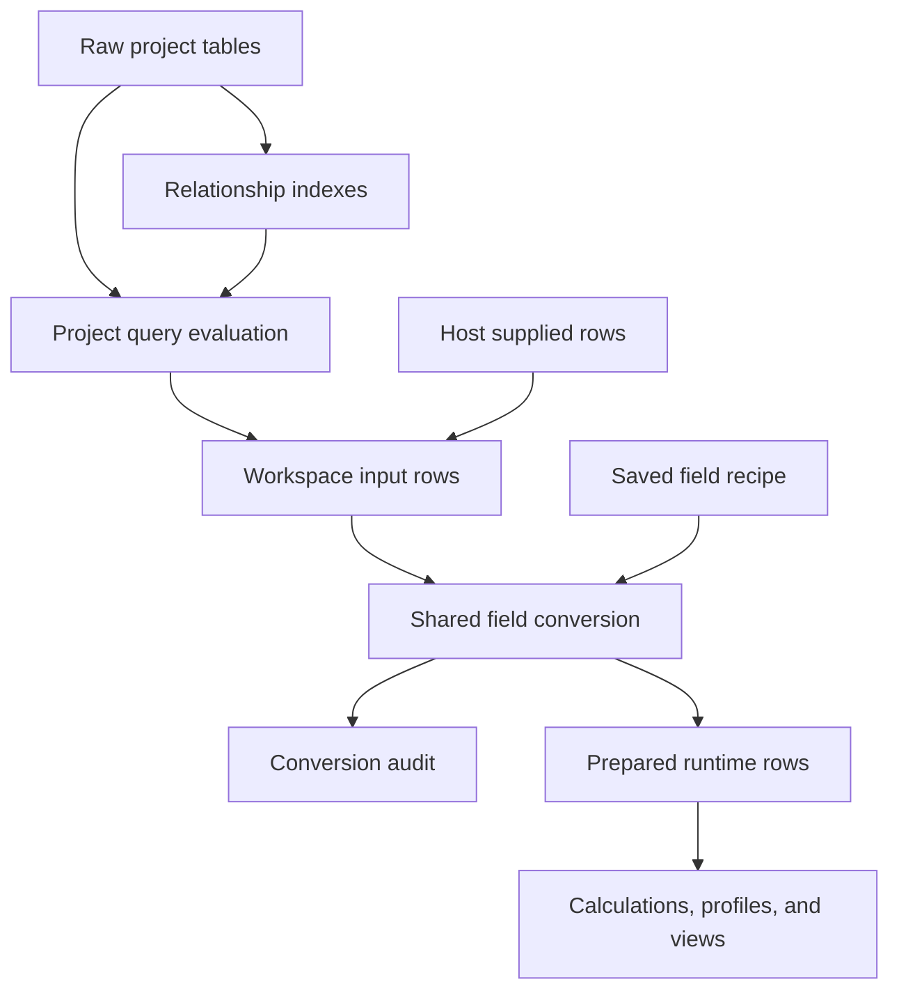

# Decision: build explicit, reviewable numeric preparation in the workspace

**Build a saved numeric-input recipe on source-field settings, with strict whole-value parsing, a complete conversion audit, and an atomic Apply action.** Start at the existing workspace conversion boundary. Preserve the original values, make every rejected or changed record inspectable, and reapply the same interpretation to fresh raw rows. Follow with additional conventions and percent input, then a separate query preparation step for measurements needed before project calculations and filters.

This is a capability proposal for Byron, the repository owner. It does not depend on outside demand, a usability study, or the unbuilt category-mapping, reshaping, ordered-difference, or join-key proposals. Keep the existing React and TypeScript implementation and pnpm workflow. The first milestone is a usable feature with persistence, refresh, documentation, and runnable examples—not a parser-only or documentation-only release.

**Baseline:** `9d64a021e35d312887b1bc848e307f42b6c3091f`, recorded in the attached packet, dated October 26, 2026. **Research date:** October 26, 2026. **Evidence:** all 43 supplied file bodies were read; primary documentation was researched; isolated checks used unchanged baseline numeric helpers. No application changes, browser acceptance checks, or repository test suite were performed.

The companion `implementation-plan.md` contains the ordered milestones, complete 34-record fixture, refresh versions, precise test expectations, file ownership, and verification run sheet. Everything described as a new behavior below is a proposal.

## Recommendation register

These IDs are stable across both reports.

| ID / disposition | Recommendation | Reason |
|---|---|---|
| **NP-01 — Build** | Own initial preparation in `FieldSettings.numericInput` on workspace input fields. | This is the existing reversible raw-to-runtime boundary. |
| **NP-02 — Build** | Offer named, finite input grammars with exact grouping rules. | Examples communicate the convention without guessing a locale. |
| **NP-03 — Build** | State and enforce the binary64, safe-integer, rounding, overflow, underflow, and zero contract. | Syntactic success alone does not guarantee a faithful measurement. |
| **NP-04 — Build** | Provide all-row outcomes, representative cases, full record inspection, and alternate successful interpretations. | First-eight previews and failure counts miss consequential successes. |
| **NP-05 — Build** | Add percent text, accounting signs, Indian grouping, and decimal-point space grouping in milestone 2. | These are useful, bounded extensions with distinct scale/sign semantics. |
| **NP-06 — Build** | Commit interpretation and affected-filter invalidation as one undoable transaction. | Existing predicates may encode the previous numeric meaning. |
| **NP-07 — Build** | Round-trip JSON, Dashboard text, folder analyses, and notebook field edits; preserve raw special values. | Apply must survive the product's actual save/reopen paths. |
| **NP-08 — Build** | Distinguish retained-settings refresh from an explicit new-dataset reset. | Later loads must use the saved recipe exactly once. |
| **NP-09 — Build** | Add an explicit query `prepare-number` step in milestone 3. | Query calculations and filters run before workspace conversion. |
| **NP-10 — Explore** | Prototype audit responsiveness and inspector layout at the required widths. | Scheduling and density need measured implementation feedback; demand does not. |
| **NP-11 — Defer** | Arbitrary-precision output types, arbitrary custom grammars, currency parsing, and non-ASCII digit systems. | Each changes the representation or language boundary substantially. |
| **NP-12 — Avoid** | Automatic convention selection, per-row fallback, punctuation stripping, and consumer-specific parsers. | They conceal ambiguity or let different views read one value differently. |
| **NP-13 — Defer** | Numeric relationship-key normalization and globally prepared project sources. | Measurement conversion does not establish key identity or endpoint ownership. |
| **NP-14 — Build** | Ship exact fixtures, a docs page, and a runnable example in every feature milestone. | The repository explicitly treats these as feature scope. |

## 1. Access and verified baseline

### Access status

The prompt and packet are available locally. The packet identifies its files as complete, unchanged bodies from the recorded commit. Its 43 BEGIN/END file pairs were extracted for bounded reading and analysis; no repository checkout or current-main state was substituted. The full file inventory appears at the end.

The packet is sufficient to make this design decision. Some imported implementation files are absent, including selection-remapping internals and the multi-view exporter; these are named as worker inspection points rather than treated as already verified behavior.

### Claims checked against code

| Baseline claim | Finding | Evidence |
|---|---|---|
| `parseNumber` rejects blanks, booleans, and radix prefixes, then uses JavaScript Number. | Confirmed. It passes native numbers through, including nonfinite numbers; explicit conversion subsequently requires finiteness. | [R09], `parseNumber`; [R11], `convertFieldValue`. |
| Inference is stricter than deliberate conversion. | Confirmed, with a qualification: safe-integer checking applies only to plain-integer spelling. Decimal/exponent forms can round, and `"1e-400"` can underflow during inference. | [R09], `EXACT_NUMBER`, `PLAIN_INTEGER`, `isExactNumberText`; [R14], `detectColumnType`. |
| Numeric conventions are not saved. | Confirmed. Current fields cover type, date preset, null tokens, labels, display format, precision, unit, and currency. | [R11], `FieldSettings`; [R22], `FIELD_SETTING_WORDS`. |
| Percent formatting does not parse percent text. | Confirmed. It configures `Intl.NumberFormat` after ordinary numeric reading. | [R11], `formatFieldValue`. |
| Raw values are preserved and conversion precedes calculations/profiles. | Confirmed for workspace initialization, Apply, and restore. | [R17], `getInitialStoreState`, `updateFieldSettings`, `restoreAnalysisFromStructure`; [R18]. |
| Preview uses raw rows and counts all of them. | Confirmed. It collects all failures but only the first eight eligible example rows. | [R17], `getFieldConversionPreview`; [R11], `buildConversionPreview`; [R15]. |
| A new input convention automatically causes a rebuild. | False without changes: semantic-change detection recognizes only type, date preset, and null tokens. | [R17], `updateFieldSettings`. |
| Replacing data retains an in-app recipe. | Not generally. `setData` resets settings; the data-prop effect restores them only when saved settings are supplied. | [R17], `setData` and prop synchronization effect. |
| Notebook field edits already write back. | False. `writeBackSettings` currently handles chart differences, not field settings. | [R34], `handleStateChange`; [R36], `writeBackSettings`. |
| Workspace conversion affects project joins and upstream queries. | False. Source frames and lookup/expand indexes read source tables before workspace conversion. | [R21]; [R26], `sourceFrame`, `lookupFrame`, `expandedFrame`. |

The inference qualification matters to scope. This mission does **not** quietly widen or “repair” automatic inference. The explicit recipe gets a documented stronger contract. A change to existing inference should be a separate decision.

The older R030 text says demand is not demonstrated. `docs/research/DIRECTION.md` explicitly supersedes that gate and says Byron is the demand. This report follows DIRECTION and the attached mission. [R07], [R08]

## 2. Ranked question 1 — What should be built?

### Initial user flow and ownership

An analyst opens a source field's inspector, selects Numeric, chooses an input example such as **1,234.50** or **1.234,50**, reviews the complete outcomes, and applies the change. The workspace then supplies prepared numbers to its charts, filters, calculations, and record table. Raw values remain available in the audit and saved analysis.

The owner is the input field identified by its actual field name/ID in one workspace. A label is not an identity. A chart does not own an interpretation. A notebook has one shared provider, so a field recipe applies across its sheets. In a project view, the workspace's input may be an evaluated query result rather than an original source table. [R17], [R21], [R26], [R34], [R35]

A recipe is reusable because it is data-independent saved intent: a field name, a preset, a number/percent mode, accounting behavior, and existing null tokens. It never stores the eight example values or the current output array as its meaning.

### Alternatives and tradeoffs

| Approach | Strength | Decision |
|---|---|---|
| Explicit input presets | Compact, understandable, easy to save and test. | **Choose for authoring.** Label by syntax examples and specify the full grammar behind each. |
| Declarative grammar | One executable contract can serve UI, API, text, and later query evaluation. | **Choose internally.** A closed registry of presets; no arbitrary regex or locale database editor. |
| Workspace field conversion | Already preserves raw rows and feeds runtime analysis. | **Choose first.** Complete this boundary, including persistence and refresh. |
| Source-level preparation | Could share normalized measurements across queries and endpoints. | **Defer global source mutation.** Existing query and relationship paths would need a larger ownership change. |
| Query preparation step | Places a derived measurement before selected query operations, with provenance. | **Build third.** Reuse the scalar contract and retain the original field. |
| Upstream preparation | Appropriate for unsupported formats, exact decimals, or established ETL pipelines. | **Keep as an escape path.** It does not satisfy the requested in-workspace capability by itself. |

The important combination is **presets in the interface, a declarative closed grammar in code, and workspace settings as the initial owner**. These are complementary choices, not three competing architectures.

### Lessons from current primary tools

**Power Query.** Microsoft documents per-column conversion using a locale, culture-aware `Table.TransformColumnTypes`, and cell-level conversion errors that can be inspected or isolated. Adopt explicit interpretation and addressable error records. explorEDA should bind an exact syntax to the field instead of inheriting the host locale. This does not require a full preparation pipeline before a useful first release. Sources: [data types](https://learn.microsoft.com/en-us/power-query/data-types), [column conversion](https://learn.microsoft.com/en-us/powerquery-m/table-transformcolumntypes), [conversion errors](https://learn.microsoft.com/en-us/power-query/dealing-with-errors).

**readr.** Its documentation distinguishes strict `parse_double`/`parse_integer` from `parse_number`, which extracts a number while ignoring surrounding text and grouping marks. Its own percent example returns `10` for `"10%"`. Adopt the distinction between strict parsing and extraction, plus the separate row/column/expected/actual problem records. Reject affix extraction as the preparation default; stripping a percent sign does not establish a scale contract. Sources: [introduction](https://readr.tidyverse.org/articles/readr.html), [parse_number](https://readr.tidyverse.org/reference/parse_number.html), [problems](https://readr.tidyverse.org/reference/problems.html).

**DuckDB.** The current CSV reference exposes both `decimal_separator` and `thousands`, as well as explicit column types. Its rejects mechanism records faulty lines and error information while skipping those lines. Adopt explicit parameters and exact record diagnostics. explorEDA should retain each source row, put `undefined` in the failed prepared cell, and keep failure status separately. The opened documentation does not establish exact Western or Indian grouping-width enforcement; no such competitor claim is made. Sources: [CSV import, current 2.0 documentation](https://duckdb.org/docs/2.0/data/csv/overview), [faulty CSV records](https://duckdb.org/docs/2.0/data/csv/reading_faulty_csv_files).

**OpenRefine.** Common type transforms leave unsuccessful cells in their original type and value. Its facets can isolate errors, and extractable history operations can be replayed as JSON. Adopt inspectable before/after work, durable intent, and a comprehensible undo unit. In explorEDA, a failed numeric conversion should not quietly leave text inside the prepared numeric column, and existing chart filters should not limit the rows transformed. Sources: [cell editing](https://openrefine.org/docs/manual/cellediting), [facets](https://openrefine.org/docs/manual/facets), [history and reusable operations](https://openrefine.org/docs/manual/running).

These are documentation-backed comparisons, not results from running those tools against this fixture. Their exact parsers are not adopted as explorEDA's grammar.

### Minimum useful first milestone

Milestone 1 delivers five number conventions, all-record audit and ambiguity review, Apply/Cancel/Reset, calculation and filter integration, saved JSON and text, folder and notebook persistence, and retained-settings refresh. Percent/accounting and two additional grouping conventions follow in milestone 2. A project query step follows in milestone 3.

The first milestone must work end to end. Deferring notebook field writeback or refresh after exposing Apply would leave the principal “save the interpretation for later loads” promise incomplete.

## 3. Ranked question 2 — Exact language and numeric representation

### Saved model

Proposed final shape:

```ts
type NumericInputPreset =
  | "dot-plain"
  | "comma-plain"
  | "dot-comma"
  | "comma-dot"
  | "comma-space"
  | "dot-space"
  | "indian-dot";

type NumericInput = {
  preset: NumericInputPreset;
  mode: "number" | "percent";
  accounting: boolean;
};

// Added to FieldSettings:
type NumericFieldSettings = {
  type: "numeric";
  numericInput: NumericInput;
  nullTokens?: string[];
};
```

All three recipe members are explicit and serialized in a fixed order. Milestone 1 accepts its five presets with `mode:"number"` and `accounting:false`; milestone 2 extends the accepted options. Do not save unsupported choices in an earlier stage.

A present `numericInput` requires explicit `type:"numeric"` and is invalid on a calculated output. The shared inspector creates a `dot-plain` recipe when the user newly selects Numeric, then displays that selection for review. Existing settings without `numericInput` remain valid and keep the baseline conversion contract until the analyst explicitly chooses an input convention. Absence must remain absence through save/restore; no inferred recipe, model-version migration, or mixed-version adapter is needed.

### Preset registry

Grouping is optional, but if present it must be correct.

| Preset and stage | Decimal mark | Grouping rule |
|---|---|---|
| `dot-plain` — M1 | `.` | None; example `1234.50`. |
| `comma-plain` — M1 | `,` | None; example `1234,50`. |
| `dot-comma` — M1 | `.` | Comma; Western groups of three, example `1,234.50`. |
| `comma-dot` — M1 | `,` | Dot; Western groups of three, example `1.234,50`. |
| `comma-space` — M1 | `,` | One consistent allowed space character; Western groups of three. |
| `dot-space` — M2 | `.` | Same space rule, example `1 234.50`. |
| `indian-dot` — M2 | `.` | Comma; final group three, earlier groups two, example `12,34,567.89`. |

Do not label these as complete implementations of “US,” “German,” “French,” or “Indian locale.” They are bounded numeric languages. A named locale also carries conventions outside this feature.

### Whole-token grammar

After missing-value handling and outer trimming, the entire text must match the chosen language.

- **Outer whitespace:** use ECMAScript `trim()`. Do not collapse internal whitespace. Raw text retains its original whitespace.
- **Digits:** ASCII `0–9` only. Reject Arabic-Indic and fullwidth digits; do not apply Unicode normalization.
- **Sign:** one optional ASCII `+` or `-` immediately before the mantissa. No trailing sign, repeated sign, Unicode minus, or space after the sign.
- **Mantissa:** an ungrouped integer, a correctly grouped integer, either followed by an optional decimal fraction, or a fraction-only form such as `.5`/`,5`. A decimal mark must be followed by at least one digit. Thus `1.` fails.
- **Exponent:** optional `[eE][+-]?[0-9]+` after the mantissa. No grouping or spaces in the exponent. A grouped mantissa may precede it.
- **Western grouping:** initial group has 1–3 digits; every subsequent group has exactly three. All groups occur before the decimal mark.
- **Indian grouping:** initial group has 1–2 digits, any intervening groups have two, and the final group has three. The separate ungrouped integer branch remains valid. Thus `1,234` and `12,345` pass, `1,23,456` passes, and `123,456` fails under this preset.
- **Space grouping:** allow U+0020 regular space, U+00A0 nonbreaking space, or U+202F narrow nonbreaking space. A token must use the same code point at every grouping position. Different rows may use different allowed kinds. Reject doubled spaces, internal tabs/newlines, and mixed space kinds.
- **Leading zeros:** accept explicit measurement conversion, for example `0012 → 12`, with a `leading-zeros-removed` review flag. For grouped input, apply width rules first; leading zeros do not excuse malformed grouping.
- **Accounting:** when enabled, one complete outer pair of parentheses means negative. No inner sign, nested parentheses, or padding immediately inside the pair. `(1,234.50)` passes only when enabled. `(-12)` never passes.
- **Percent:** in percent mode, text requires exactly one terminal ASCII `%` directly adjacent to the number/exponent, inside an accounting pair if present. `12%` and `(12%)` can pass; `12 %`, `12%%`, and `(12)%` fail. Number mode rejects percent text.
- **Other material:** currency symbols/codes, units, apostrophe grouping, underscores, radix prefixes, and trailing text are outside the language. A display currency or unit never expands the input grammar.

A field uses **one chosen convention**. Do not try presets until one works, even for a field that contains mixed conventions.

### Missingness and native values

Retain the existing null-token contract. This is an intentional compatibility choice for an existing feature, not a new guessing rule. [R11]

1. Raw `null` and `undefined` are missing.
2. Compare configured null tokens, case-sensitively, against `raw.trim()` for strings or `String(raw)` for native values.
3. A remaining blank string is missing.
4. A remaining native finite number passes through as an already represented measurement. It is never regrouped or percent-scaled.
5. A remaining native boolean fails. A native nonfinite number fails.
6. Remaining strings follow the selected grammar.

Therefore native `12` with token `"12"` is missing; native `true` with token `"true"` is missing; otherwise the boolean fails. `" NA "` matches `"NA"`, but `"na"` does not. An explicit token `"NaN"` can designate that text or native NaN as missing rather than failed. Configured token text itself is not silently case-folded or normalized.

The UI must allow a token containing commas. Replace comma-splitting entry with a compact token-list editor; a comma inside a token is data, not a separator.

The outcome is a discriminated record: `valid` with a number, `missing` with a missing reason, or `failed` with a stable reason code. Missing and failed both produce `undefined` in runtime data, but remain distinct in the audit. Rows are never removed.

### Representation policy

**Storage remains JavaScript Number, the IEEE 754 binary64 format.** Ordinary decimal fractions can be approximated; this feature does not introduce an exact-decimal runtime. The binary64 nearest-value operation uses ties-to-even. The current ECMA-262 conversion specification allows implementation-dependent handling beyond twenty significant decimal digits. Consequently the new text contract limits the canonical nonzero coefficient to **20 significant digits**, rather than promising arbitrary-length portable rounding through `Number`. Count digits after removing leading and trailing coefficient zeros while adjusting the exponent. Sources: [Number representation](https://tc39.es/ecma262/multipage/ecmascript-data-types-and-values.html#sec-ecmascript-language-types-number-type), [RoundMVResult](https://tc39.es/ecma262/multipage/abstract-operations.html#sec-roundmvresult).

The living specification pages identify themselves as 2027 drafts. This report uses the retrieved Number semantics; it does not claim a 2027 edition has been released.

Apply these explicit policies:

- **One decimal conversion.** Normalize valid text to an exact coefficient and base-10 exponent. Percent text shifts the exponent by −2 before one conversion. Do not parse to Number and then divide by 100.
- **Safe-integer text.** Reject an exact scaled integer outside `±9007199254740991` under every spelling. Also reject a fractional text whose binary64 result is an unsafe integer. The safe-integer boundary is defined by [ECMA-262](https://tc39.es/ecma262/multipage/numbers-and-dates.html#sec-number.max_safe_integer).
- **This is a range policy.** `"1e20"` is rejected even though that particular Number is representable. Large native finite measurements remain accepted because their representation was already chosen upstream; an unsafe native integer gets `native-precision-unknown`. The feature cannot reconstruct lost source digits.
- **Overflow.** If the converted scaled decimal is nonfinite, reject `overflow` before applying the safe-integer check.
- **Underflow.** If a mathematically nonzero scaled decimal becomes either zero, reject `underflow-to-zero`. A genuine decimal zero remains valid regardless of exponent.
- **Subnormals.** Accept nonzero subnormal results, including `5e-324 → Number.MIN_VALUE`, and mark `subnormal` plus any rounding. Do not flush them to zero.
- **Zero.** Normalize prepared negative zero to positive zero and record `negative-zero-normalized`. Preserve the raw native negative zero through the existing saved-analysis special-value codec with a new `"-0"` tag.
- **Rounding.** Accept ordinary binary64 approximation and mark `binary-rounded` using an exact decimal-versus-binary rational comparison. A small BigInt/DataView helper is sufficient; it is diagnostic arithmetic, not a new runtime number type. `0.1` is approximate even though its shortest printed text is `"0.1"`.
- **Display precision.** It affects formatting only. Neither precision nor currency/unit settings round or rescale the stored measurement.
- **Resource bound.** After missing/token handling, reject trimmed numeric text longer than 4,096 UTF-16 code units as `input-too-long`. Classify huge exponents by length/order before constructing powers; never allocate a BigInt power proportional to an untrusted exponent. This is a proposed explicit input limit.

Rounding flags are information, not a confirmation gate. Leading-zero conversion is also permitted by the deliberate measurement choice. Identifiers should remain text: this feature does not promise lossless key conversion or make `"0012"` and `"12"` distinct numeric values.

### Exact interpretations of the mission's examples

These first two columns use number mode, accounting disabled, and the strict representation rules above. A printed decimal means the corresponding binary64 Number, not an exact rational unless it is exactly representable.

| Raw text | `dot-comma` | `comma-dot` |
|---|---|---|
| `1,234` | `1234` | `1.234` |
| `1.234` | `1.234` | `1234` |
| `1,234.50` | `1234.5` | Reject `invalid-grouping`. |
| `1.234,50` | Reject `invalid-grouping`. | `1234.5` |
| `12,34,567.89` | Reject `invalid-grouping`. | Reject `invalid-grouping`. |
| `0012` | `12`; leading-zero flag. | `12`; leading-zero flag. |
| `9007199254740993` | Reject `unsafe-integer`. | Reject `unsafe-integer`. |
| `1e309` | Reject `overflow`. | Reject `overflow`. |
| `1e-400` | Reject `underflow-to-zero`. | Reject `underflow-to-zero`. |

Other conventions and modifiers are exact alternatives, never automatic fallbacks:

| Input / selected rule | Output | Explanation |
|---|---|---|
| `1,234` / `comma-plain` or `comma-space` | `1.234` | Comma is the decimal mark. |
| `1.234` / `dot-plain` or `dot-space` | `1.234` | Dot is the decimal mark. |
| `1,234` / `dot-plain` or `dot-space` | Reject `invalid-syntax`. | Comma is neither decimal nor grouping for those presets. |
| `1.234` / `comma-plain` or `comma-space` | Reject `invalid-syntax`. | Dot is not part of those mantissas. |
| `12,34,567.89` / `indian-dot` | `1234567.89` | Valid 2/2/3 grouping; binary-rounded. |
| `1 234,50` / `comma-space` | `1234.5` | U+0020 grouping. |
| `1\u00a0234,50` / `comma-space` | `1234.5` | U+00A0 grouping. |
| `1\u202f234,50` / `comma-space` | `1234.5` | U+202F grouping. |
| Those three space strings / `dot-comma` | Reject `unsupported-character`. | Internal spaces are not accepted grouping here. |
| `1 234.50` / `dot-space` | `1234.5` | Added in M2. |
| `(1,234.50)` / `dot-comma`, accounting off | Reject `accounting-disabled`. | Sign convention is explicit. |
| Same / accounting on | `-1234.5` | Parentheses negate the magnitude. |
| `12%` / number mode | Reject `unexpected-percent`. | Percent text is not an ordinary measurement literal. |
| `12%` / percent mode | `0.12` | Text scales by 1/100. |
| `0.12%` / percent mode | `0.0012` | Percent scale is applied to the stated percent amount. |
| `12` as text / percent mode | Reject `missing-percent`. | No inference of fraction versus percent points. |
| Native `12` / percent mode | `12` | Already numeric; percent display would be `1,200%`. |
| Native `0.12` / either mode | `0.12` | Already numeric; percent display is `12%`. |
| `(12%)` / percent mode, accounting on | `-0.12` | Suffix is inside the accounting pair. |

Percent display multiplies a stored value by 100 for presentation; that operation is separate from reading input text. [ECMA-402, PartitionNumberPattern](https://tc39.es/ecma402/#sec-partitionnumberpattern); baseline [R11].

Additional exact cases:

| Input | Expected prepared result | Reason or review flag |
|---|---|---|
| `"NaN"`, `"+NaN"`, `"-NaN"`, `"Infinity"`, `"+Infinity"`, `"-Infinity"` | Failed → `undefined` | `non-finite`, unless configured as a null token. |
| Native NaN, ±Infinity | Failed → `undefined` | `non-finite`, subject to the same token precedence. |
| Native `true` or `false` | Failed → `undefined` | `boolean-not-numeric` unless explicitly a null token. |
| `null`, `undefined`, `""`, `" \t\n"` | Missing → `undefined` | Original null/undefined/blank, never zero. |
| `"NA"`, `" NA "`, `"-"` with tokens `["NA","-"]` | Missing → `undefined` | Configured token. |
| `"na"` under those tokens | Failed → `undefined` | `invalid-syntax`. |
| `"-0"`, native `-0` | Valid `+0` | `negative-zero-normalized`; raw representation retained. |
| `"0e-400"` | Valid `+0` | Exact zero is not underflow. |
| `"9007199254740993.0"`, `"9.007199254740993e15"` | Failed → `undefined` | `unsafe-integer`; spelling does not bypass the check. |
| `"1e20"` | Failed → `undefined` | `unsafe-integer` by selected range policy. |
| Native `9007199254740992` or `1e20` | Same native value | `native-precision-unknown`. |
| `"5e-324"` | `Number.MIN_VALUE` | `binary-rounded` and `subnormal`. |
| `"1e-324"` | Failed → `undefined` | `underflow-to-zero`. |
| `"0.1"` | `0.1` | `binary-rounded`. |
| `".5"` / decimal-point preset | `0.5` | Exact binary representation. |
| `"1."` | Failed → `undefined` | `invalid-syntax`. |
| `"1e"`, `"1e+"` | Failed → `undefined` | `invalid-exponent`. |
| `"0.12345678901234567890"` | `0.12345678901234568` | 19 significant digits after trailing-zero removal; `binary-rounded`. |
| `"0.123456789012345678901"` | Failed → `undefined` | `precision-limit`; 21 significant digits. |
| `"$1,234.50"`, `"1234USD"`, `"12kg"` | Failed → `undefined` | `invalid-syntax`; unsupported currency/unit material. |
| `"1234 USD"`, `"12 kg"` / `dot-comma` | Failed → `undefined` | `unsupported-character`; forbidden internal whitespace takes precedence. |
| `"0x10"`, `"0b11"`, `"0o17"`, `"1_000"` | Failed → `undefined` | `invalid-syntax`. |
| `"١٢"`, `"１２"`, `"−12"` | Failed → `undefined` | `unsupported-character`. |

### Deterministic failures and alternatives

Choose the first applicable reason in this order: missing/null-token/blank; native type/nonfinite; input-length limit; exact nonfinite text; accounting syntax; percent requirements; sign/character/exponent/grouping grammar; significant-digit limit; numeric overflow; nonzero-to-zero underflow; exact/result unsafe integer.

Within the grammar phase, check sign structure, prohibited Unicode/whitespace, exponent structure, then mantissa grouping/decimal structure. Reserve `invalid-grouping` for an allowed grouping mark in an illegal position or width; other malformed mantissas use `invalid-syntax`. Currency/unit material is rejected, never extracted; any earlier whitespace/character error wins. A space before a terminal percent sign specifically produces `invalid-syntax`, and multiple/misplaced percent signs produce `invalid-percent`. Recognize an exponent only after a numeric mantissa, so `eleven` is `invalid-syntax`, not `invalid-exponent`. Repeat nonfinite recognition after removing a valid percent/sign wrapper, so `NaN%` is `non-finite` in percent mode. The plan gives exact executable test rows.

Any parenthesis with accounting disabled produces `accounting-disabled`. When accounting is enabled, unmatched/nested/misplaced parentheses, an inner sign, empty contents, or whitespace immediately inside the pair produce `invalid-syntax`. Thus `(12)%`, `(-12%)`, and `( 12%)` all fail syntax with accounting enabled; `(12)` in percent mode instead reaches `missing-percent`.

Representation guards act **after exact percent scaling**. `9007199254740993%` yields valid `90071992547409.94` with `binary-rounded`; `1e309%` fails `unsafe-integer` because the scaled `1e307` is finite; `1e311%` fails `overflow`. `0e99999` stays zero. These cases distinguish the chosen contract from early integer rejection, parse-then-divide, or unbounded exponent expansion.

An alternative successful interpretation is a separate flag, not a parse failure. Evaluate supported alternative presets only for review, with the same mode/accounting/null settings; collect distinct successful numeric meanings different from the chosen result. They cannot change the chosen output, rescue a failed row, or choose a preset by success rate.

For `1,234`, show **selected: 1234; decimal-comma interpretation: 1.234**. This is a meaningful ambiguity even if every row parses successfully. Conversely, different presets that both produce 1234 do not count as different meanings.

## 4. Ranked question 3 — What does the analyst see and do?

### Compact controls

Reuse the existing FieldInspector and its draft state; do not add a permanent preparation sidebar. Keep the field name, applied type, close action, and tabs visible. The Type tab gains an **Input convention** selector labeled by examples. M2 adds **Input values: Number / Percent text** and an **Accounting negatives** toggle with explanatory tooltips. Display settings stay in Display. [R05], [R15], [R16]

Use the repository's 28 px settings controls, label/control rows, semantic border tokens, nonmodal popovers, and viewport bounds. Add a narrow/wide review mode within the existing inspector. On narrow screens, keep a single scrollable tab row and a reachable footer; use stacked record detail instead of squeezing five columns into 390 px.

Changing Type to another type clears `numericInput` in the **draft**. “Use automatic type” removes the explicit numeric recipe on Apply, then recomputes from raw data. Clearing only the numeric recipe while keeping numeric type returns to the existing ordinary numeric conversion contract; label the action **Use standard numeric syntax**, not “keep locale settings hidden.”

### Before/after review

The review should show these as distinct readings:

- **Raw:** exact value and type. Quote text; distinguish null, undefined, NaN, Infinity, native −0, and string `"-0"`. Offer an escaped-character detail for NBSP, narrow NBSP, tabs, and line breaks.
- **Applied:** current runtime value before the draft.
- **Prepared:** the proposed stored Number, using its shortest round-trip decimal by default and precise representation details on request.
- **Display:** the optional formatted output, clearly labeled as display.
- **Outcome:** valid, missing reason, failed reason, and informational flags.

At compact width, show Raw → Prepared and outcome. Open one record to see Applied, Display, precision explanation, all source fields, and its identity. This keeps semantic differences visible without making the main table excessively wide.

Counts are over **all raw rows owned by this workspace**, regardless of chart filters, local Rows filters, or search. Say “All 34 input rows” beside the counts. For a project view this means all rows returned by its current query/bindings, not rows that an upstream query already excluded.

Use mutually exclusive top-level counts:

```text
total = valid + missing + failed
```

Keep review flags separate because they overlap: changed successful values, leading zeros, alternate meanings, rounding, subnormal values, and upstream precision. Define “changed successful value” using `!Object.is(raw, prepared)`, so a string becoming a number and −0 becoming +0 are changes, while a native unchanged number is not.

### Beyond the first eight rows

Show a deterministic representative set across outcome reasons and meaningful flags, ordered by original row order within each group. Include at least one representative for each present failure reason and one for alternate meanings, leading zeros, percent scale, and rounding. If a limited summary cannot show every group, state the limit and link to the complete list; never truncate the underlying counts.

Count buttons open local audit subsets: **Changed**, **Failed**, **Missing**, and **Other interpretations**. These controls filter the audit only. They must not set a chart/workspace filter or alter which rows will be converted.

The complete audit is paginated or virtualized, searchable by field value and record label, and exportable as a report with raw type/value, applied/prepared value, recipe, revision, outcome, and reason. Exact failing records remain reachable even when the first invalid value is far beyond row eight. An original row ordinal is valid within the displayed data revision; a stable source key is shown when one actually exists. A fixture's `id` is not evidence that all embedded rows already have persistent identities.

No row-editing tool is required for M1. The analyst can change the recipe or tokens, inspect the source record, or correct the upstream data.

### Draft, Apply, Reset, Cancel

- Opening captures applied field settings and the current raw-data revision.
- Draft changes update the preview only. No chart movement, filter clearing, state callback, or history checkpoint occurs.
- **Reset draft** restores the settings currently applied when the edit session began, provided no external settings replacement has occurred.
- **Cancel**, Escape, close, and outside dismissal discard unapplied changes and return focus. A nested select/list closes before the inspector.
- **Apply** is available only after a semantic/display change, valid configuration, and a complete preview for the current data revision. Row failures do not block it: copy states how many prepared values become missing, and the audit remains available afterward.
- Raw data refresh reruns the draft against the new revision. An external settings replacement cancels the stale edit session and reopens from the new applied settings; it must not silently overwrite external work.
- “Remove numeric preparation” is an explicit draft change, reviewed and applied like any other interpretation change.

Do not insert an additional confirmation dialog for every failure or binary approximation. The existing draft and deliberate Apply are the decision point.

### Apply consequences

| State | Required behavior | Reason |
|---|---|---|
| Raw rows and source identifiers | Preserve values, types, order, and references. | Preparation is reversible interpretation. |
| Prepared field, calculations, profiles, caches | Recompute from raw input using the shared converter. | All analysis must see the same result. |
| Value/range/category predicates on the field and dependent calculated fields | Clear atomically, including chart `localFilters`, linked chart filters, workspace filters, and Rows filters. | Their bounds or categories may encode the old interpretation. |
| Unrelated filters | Retain. | A Region selection does not change meaning when Amount is reparsed. |
| Record membership selections | Retain on same-row Apply when identity is unchanged. On refresh retain only when remapping is proven. | A selected record differs from a selected numeric interval. |
| Facet membership and value-derived selections | Invalidate affected membership; recompute distributions. | Old category/bin meanings can be stale. |
| Layout, chart definitions, labels, display settings | Retain. | Interpretation should not rearrange the analysis. |
| Authored axis limits and fixed color domains | Retain and use existing out-of-range indications. | They are explicit presentation choices, not hidden parser settings. |
| Data-derived domains, marks, and statistics | Recompute from the prepared data. | They describe the new values. |
| History and host callback | One coherent checkpoint/callback; Cancel emits none. | The recipe and invalidated predicates are one edit. |

Baseline Apply clears direct-field filters but lacks the broader local/dependency policy. Existing chart-specific selection representations require inspection during implementation; the report does not claim they were exhaustively read. [R17], [R32]

### Keyboard and accessibility

Controls have visible labels or accessible names; tooltips supplement them. Tab reaches convention, mode, accounting, counts, record actions, Reset, and Apply. Arrow keys operate the preset selector and audit navigation according to the shared components. Enter activates focused actions; Escape dismisses the innermost layer first. Focus returns to the field/axis trigger. Publish a concise live-region summary when preview computation finishes, not one announcement per parsed row.

Test actual pointer and keyboard input at 1280, 783, and 390 px, including long field names, zoomed text, hidden failures, and active filters. The proposed review layout needs a small implementation prototype; the grammar and product decision do not need a study.

## 5. Ranked question 4 — API, persistence, evaluation, and lifecycle

### One conversion path

Expose `parseNumericInput` through `lib/valueParsing.ts`. Pure helpers may live in a focused `lib/numericInput/` directory, but row consumers continue to read through the established boundary.

`convertFieldValue` invokes it only when a valid explicit recipe exists. `applyFieldSettings`, `buildConversionPreview`, initialization, restore, and Apply use that same function. Charts receive ordinary prepared numbers and never learn locale syntax. The aggregate trace's existing conversion call must use the same result/reason. [R09], [R11], [R17]

Return structured numeric outcomes from the common evaluation, rather than reconstructing reasons with another parser in the inspector. Store diagnostic indexes/counts keyed by raw-data revision and canonical recipe. Raw values can be referenced by row rather than duplicated in large diagnostic objects. Details and audit pages may read through the same converter if not retained; they cannot use a looser approximation.

The dependency closure for invalidation must use the repository's actual expression parser. Direct and transitive calculated dependents, aggregate helper fields where applicable, and field-dependent predicate owners must be found before the Apply transaction. Do not use text substring matching for dependencies.

The resulting ownership is explicit:



The M3 preparation step belongs inside query evaluation when explicitly ordered there. M1 field conversion remains downstream of relationship indexes.

### Saved JSON and validation

Add `numericInput` to `FieldSettings` and validate it in both `getFieldSettingsError` and saved-data validation. Reject wrong types, missing required recipe members, unknown members/presets, unsupported stage options, calculated-field targets, and incompatible type combinations. Never fall back to another preset after a bad saved recipe.

All entry points canonicalize the same shape. Include `numericInput` in both conversion triggers and semantic-change detection; nested objects require semantic comparison, not reference equality. Reset/delete behavior needs an explicit replacement/clear path because the existing setter shallow-merges updates. [R11], [R17], [R19]

`saveToStructure` already carries field settings; `saveAnalysisToStructure` already carries raw rows plus settings. Extend `SavedSpecialValue` with `"-0"` and update stringifier/parser/validator consistently. Existing tags already preserve undefined, NaN, and infinities. Using these supported helpers, all raw special cases in the fixture can round-trip. Generic `JSON.stringify(rawRows)` is not the lossless analysis format. [R19], [R20]

`validateSavedAnalysisForData` currently initializes calculation validation from raw analysis rows. Its worker must inspect the calculation manager's expectations and validate runtime-dependent calculations against the same prepared rows, without changing syntax-only checks into a new evaluator. [R19]

### Dashboard text

Use readable, deterministic tokens:

```text
field Amount as=num number.preset=dot-comma number.mode=number number.accounting=false
field Rate as=num number.preset=dot-comma number.mode=percent number.accounting=false format=percent
```

This is proposed syntax. The existing field key whitelist and exporter are scalar-oriented; adding the TypeScript property alone would not implement it. In particular, object interpolation can produce `[object Object]`. [R22], [R23], [R24], [R25]

Add a shared field-number token codec. Assemble the full recipe before validation so token order does not matter and an invalid preset cannot leave a partial effective rule. Reject numeric input on calculated outputs with a located diagnostic. Display-only settings remain legal there.

Field/alias/calc declarations are shared across a Dashboard text document even when physically written inside a view section. Preserve that semantic boundary. A single text document must not export different recipes for the same effective field by silently taking the first view's recipe. Compare each field's semantic tuple across views, including type, recipe presence/absence, and null tokens. For a conflict, return a blocking, field-specific error and retain the original settings; split analyses into separate documents when different interpretations are intended. Consistent recipes across views must round-trip without omissions. The worker must inspect the unsupplied `exportViews` implementation and actual export caller to enforce this safely. [R23], [R24], [R31]

For a host that persists directly to shared text, check representability at the Apply boundary: a conflicting view-local edit must be refused or atomically reverted with the field/view names. Do not silently apply it to all other views. Explicitly editing a shared field declaration in Dashboard text does affect all its views. At the file boundary, `writeFolder.ts::analysisFileText` currently discards the export's `omitted` list; change this to block the write before any affected files are changed. Retain dirty settings and provide the existing JSON/separate-document route instead of losing the recipe. [R30], [R31]

### Notebook and folder writeback

Notebook sheets share data, calculations, and field definitions. Introduce a field-definition writer next to `lib/notebook/writeBack.ts` and invoke it as part of the same edit as chart writeback. Resolve aliases to native fields, remove changed settings from every contributing declaration, and insert the new canonical tokens once at the effective native-field declaration. Removing a last override must not expose an older conflicting recipe.

Preserve prose, comments, unrelated tokens, and chart layout. Recompile the candidate text and compare normalized intended settings before accepting it. On an unrepresentable edit, keep the prior applied state and report the concrete conflict. Do not accept a setting on screen while discarding its text writeback. [R34], [R35], [R36]

Folder analyses already bridge query evaluation with Dashboard text through `readAnalysisText` and `exportAnalysisText`. Numeric settings belong in the analysis text, not rewritten CSV/source files. Verify write→reopen using actual prepared outputs, including two views with different queries and compatible shared rules. The export context currently starts with the first view's rows, so matching serialized strings alone would miss an incorrect second-view result. [R29], [R30], [R31]

### Refresh, host echoes, and undo

Add `refreshData` for re-evaluating fresh raw rows under current applied settings. A replacement `data` array on the **same mounted provider** means refresh; explicit `setData`/import or a new provider identity means a new dataset and resets settings. This is a deliberate documented API behavior change from the current uncontrolled-update path. Do not guess identity from filename or data similarity.

If new external `savedData` accompanies new rows, it takes precedence and is interpreted against those rows. Otherwise retain current store settings—not a stale last externally received snapshot. Reapply from fresh raw input once. An in-place mutation remains unsupported because the public contract observes array identity.

Keep value predicates when the recipe is unchanged and recompute their membership. Clear positional record selections unless the actual selection helper proves a valid remapping; project source keys and `AnalysisView.selectedRowKeys` are separate from provider ordinals. Missing fields retain inactive recipes by exact field identity and expose a missing-field diagnostic. Do not bind a recipe to a similar label or materialize an absent field as though conversion succeeded. [R17], [R21], [R32], [R33]

Canonical saved state must be stable through setter→save→restore→save, allowing the existing fingerprint check to skip a host echo. Use `holdStateChanges` or one atomic store update for Apply and associated clearing; no intermediary saveable state should reach the host. Undo restores recipe, affected filters, and prepared results together. [R17]

An omitted `savedData` prop is not a reset signal under the proposed refresh contract. The explicit new-dataset operation or a new provider identity performs that reset. A text-backed host also needs a narrow field-commit preflight before provider mutation, so an unrepresentable notebook/shared-text edit yields zero callbacks rather than an optimistic callback followed by a rollback. The plan specifies that preflight and full replacement/clear semantics for field drafts.

Inactive recipes need a text round trip too. The baseline compiler derives `sourceSet` from current rows and rejects an absent field declaration. Carry known field identities from authoritative schema/evaluation metadata and current saved settings into compilation; retain a valid numeric field binding as inactive when its field is unavailable, without inventing a data column. A complete numeric field declaration in a reopened standalone document can retain that exact-name inactive binding, with a missing-field diagnostic, even when no external schema is available. A newly typed unknown name must be visibly identified as unavailable, never presented as successful conversion or silently rebound. If the writer cannot preserve the inactive rule faithfully, block the save. Test field disappearance→text/folder/notebook reopen→same field returns, including an empty first query. [R23], [R31], [R32]

### Project and worker boundary

`evaluateAnalysisQuery` currently constructs raw source frames, compares typed filter values, evaluates formulas, and builds lookup/expand maps before a workspace is mounted. `FieldDefinition.type` is metadata, not numeric preparation. [R21], [R26]

Milestone 3 adds a bounded `PrepareNumberStep`:

```ts
type PrepareNumberStep = {
  id: string;
  kind: "prepare-number";
  inputStepId: string;
  inputFieldId: string;
  fieldId: string; // New measurement; collision is rejected.
  label: string;
  numericInput: NumericInput;
  nullTokens?: string[];
};
```

The step preserves row keys, source references, original fields, and row count. It adds a numeric result field and row-level diagnostics. A rejected value is missing in that field without dropping its record. Subsequent calculate/filter/aggregate stages can explicitly use it. A later filter may remove a failed record; the preparation-stage evidence still names it.

This step does not mutate sources, rewrite entity keys, or turn a derived field with `{stepId}` origin into a relationship endpoint. Global preparation would require coordinated source-frame and lookup/expand projection changes; it remains deferred. No open join-key proposal is a prerequisite.

The existing worker protocol already sends the project definition and source tables to the same evaluator. A serializable new step can use that path. Test synchronous/worker equivalence, query revision changes, and stale-response cancellation. While pending, label the retained result as the previous completed evaluation; never attribute it to the new recipe. Workspace-only M1 needs no project-worker parser. [R27], [R28]

### Export semantics

Distinguish three deliverables in the product:

- **Saved analysis:** original rows plus applied settings and supported special-value encoding.
- **Prepared data export:** currently prepared values, including calculation results as appropriate, with failure cells missing and no display-only rounding or percent scaling.
- **Conversion audit:** exact raw types/representations, outcome/reason/flags, prepared number, source locator, recipe, and data revision.

The actual table/CSV exporters are not in the packet. The worker must trace them and ensure they consume prepared columns, not raw locale text or formatted strings. An audit export is a complete local report; it should not be silently limited to the visible page. Formatting `0.12` as `12%` on screen must not turn the prepared numerical export into `12`.

## 6. Ranked question 5 — Staged delivery and discriminating evidence

### Milestones

| Milestone | User capability | Principal risk |
|---|---|---|
| **M1 — Durable workspace preparation** | Five explicit number grammars, complete audit, ambiguity review, atomic Apply, raw preservation, calculations, retained refresh, JSON/text/folder/notebook round trips. | Different lifecycle paths may prepare or persist a different meaning. |
| **M2 — Scale and additional conventions** | Percent text, accounting negatives, Indian grouping, and decimal-point space grouping using the same contract. | Double scaling, native/text confusion, or overly permissive grouping. |
| **M3 — Query measurement preparation** | A new numeric measurement before chosen project calculations, filters, and aggregates, with stage provenance and worker parity. | Mistaking a prepared query field for a source or relationship key. |

Every milestone includes an updated `numeric-preparation.mdx` page, links from fields/load-data/calculated-fields as relevant, a runnable demo, coverage registration, and interaction acceptance checks. The detailed plan names concrete existing/new modules and test files.

The first five presets, representation semantics, persistence codec, token grammar, and row outcomes can be implemented directly. Prototype only the narrow/wide audit layout and scheduling of large full-population previews. Use a synthetic large fixture and the repository's three viewport widths; measure cancellation and UI responsiveness. No participant study or outside approval gates the feature.

### One exact mixed-type fixture

The plan supplies all 34 records `N01–N34`, with `amountRaw`, `rateRaw`, and alternating North/South regions. Native numbers and strings are deliberately distinct; NaN, Infinity, −0, undefined, grouping spaces, leading zeros, ambiguous meanings, failures, and missing values all occur.

Apply `dot-comma/number/accounting:false` to Amount and, in M2, `dot-comma/percent/accounting:false` to Rate, both with `["NA","-"]` null tokens.

| Version / scope | Amount: valid / missing / failed | Rate: valid / missing / failed |
|---|---:|---:|
| R0, all 34 records | 13 / 4 / 17 | 8 / 20 / 6 |
| North subset, 17 records | 8 / 2 / 7 | 4 / 10 / 3 |
| R1, reverse R0 and add invalid N35 | 13 / 4 / 18 | 8 / 20 / 7 |
| R2, restore R0 order and change N03 | 13 / 4 / 17 | 8 / 20 / 6 |

The North counts are a discriminating check, not the expected preview scope: even with North selected, the audit must show all 34 input records.

R2 changes N03 to `amountRaw:"2,345.00"` and `rateRaw:"25%"`, yielding `2345` and `0.25`. Repeating R2 must leave those results unchanged. Refreshing back to R0 restores N03 to `1234` and native `12`. No saved numeric recipe is inferred or applied cumulatively.

Other exact checks include Amount alternate meanings on N03/N04; binary-rounded Amount on N04/N29/N31; binary-rounded Rate on N01/N06/N12; Amount negative-zero normalization on N21/N22; and Rate negative-zero normalization on N14. Successful scalar changes under `Object.is` total 10 for Amount and 6 for Rate. These are proposal expectations; the app does not yet implement them.

## 7. Evidence, executed checks, and practical limits

### Executed in this mission

- Read the complete prompt and all 43 packet files, including the working rules and DIRECTION.
- Checked the ownership and call paths summarized above.
- Researched current primary documentation for Power Query, readr, DuckDB, OpenRefine, ECMA-262, and ECMA-402.
- Imported the unchanged extracted `valueParsing.ts` with Node v24.22.1 and checked baseline parsing/inference.
- Ran isolated Number, Intl, DataView/BigInt rational-comparison, and fixture-count probes. These verify arithmetic facts and the consistency of manually authored expectations.

Selected observed baseline results:

| Text | Observed `parseNumber` | Observed `isExactNumberText` |
|---|---|---|
| `0012` | `12` | false |
| `9007199254740993` | `9007199254740992` | false |
| `9007199254740993.0` | `9007199254740992` | true |
| `9.007199254740993e15` | `9007199254740992` | true |
| `1e-400` | `0` | true |
| `1e309` | Infinity | false |
| `1.` | `1` | false |
| `1,234` | NaN | false |
| `12%` | NaN | false |

The new strict parser, provider changes, editor behavior, file writeback, worker stage, and fixture outcomes are **proposed**, not implemented or application-tested. No performance numbers or browser observations are claimed. Competitor comparisons came from primary documentation, not executed competitor parsers.

### Implementation inspections still required

The packet references but does not include the complete Crossfilter/filter-type implementation, `carryRowSelections`, calculation manager/parser internals, table/CSV exporters, multi-view `exportViews` and callers, project text parser/editor, notebook compilation ownership helpers, docs catalogue/live loader, and host history/refresh orchestration.

These do not block the selected design. They determine precise insertion points, predicate enumeration, and existing helper reuse. The implementation worker must inspect them before making the named changes, preserve current user edits, and verify against the then-current repository rather than assuming this recorded baseline remains main.

### Files read

All identifiers below refer to complete files at the recorded commit. References in the report identify repository evidence; proposed files appear only in the implementation plan.

- **R01** — `AGENTS.md` — working rules and verification.
- **R02** — `README.md` — public data/savedData contract.
- **R03** — `package.json` — pnpm commands.
- **R04** — `docs/agent-guide.md` — runtime paths, history, docs, host echoes.
- **R05** — `docs/ui-defaults.md` — density, nonmodal inspection, keyboard and viewport checks.
- **R06** — `CODING_STANDARDS.md` — raw-value parsing and UI rules.
- **R07** — `docs/research/DIRECTION.md` — research priority and owner demand.
- **R08** — `docs/intent/research-ideas-100/ideas/R030-locale-numeric-conversion.md` — earlier numeric-preparation brief.
- **R09** — `packages/explorEDA/src/lib/valueParsing.ts` — parseNumber, isExactNumberText, isNumericValue, finiteNumber.
- **R10** — `packages/explorEDA/src/lib/valueParsing.test.ts` — numeric/date/boolean helper tests.
- **R11** — `packages/explorEDA/src/lib/fieldSettings.ts` — FieldSettings, convertFieldValue, applyFieldSettings, buildConversionPreview, formatFieldValue.
- **R12** — `packages/explorEDA/src/lib/fieldSettings.test.ts` — conversion and formatting tests.
- **R13** — `packages/explorEDA/src/lib/fieldProfiles.ts` — buildFieldProfiles.
- **R14** — `packages/explorEDA/src/components/SummaryTable/utils/dataTypeDetection.ts` — detectColumnType.
- **R15** — `packages/explorEDA/src/components/SummaryTable/components/FieldInspector.tsx` — FieldInspector, sameSettings, preview and Apply.
- **R16** — `packages/explorEDA/src/components/SummaryTable/components/FieldInspector.test.tsx` — inspector conversion, distribution, and keyboard tests.
- **R17** — `packages/explorEDA/src/providers/DataLayerProvider.tsx` — getInitialStoreState, updateFieldSettings, setData, save/restore, prop effects.
- **R18** — `packages/explorEDA/src/test/providers/fieldSettingsProvider.test.tsx` — raw retention, calculation, and preview/apply tests.
- **R19** — `packages/explorEDA/src/utils/saveDataUtils.ts` — isFieldSettings, stringify/parseSavedAnalysis, validateSavedAnalysisForData.
- **R20** — `packages/explorEDA/src/types/SavedDataStructure.ts` — saved settings, raw rows, SavedSpecialValue.
- **R21** — `packages/explorEDA/src/types/AnalysisProject.ts` — source/query/view/step/result/diagnostic types.
- **R22** — `packages/explorEDA/src/lib/dsl/settingKeys.ts` — FIELD_SETTING_WORDS.
- **R23** — `packages/explorEDA/src/lib/dsl/compile.ts` — compileDocument, applyFieldPairs, viewDeclarations.
- **R24** — `packages/explorEDA/src/lib/dsl/export.ts` — exportDocument, exportParts, fieldLines.
- **R25** — `packages/explorEDA/src/lib/dsl/export.test.ts` — semantic Dashboard text round trips.
- **R26** — `packages/explorEDA/src/lib/analysis/evaluateProject.ts` — evaluateAnalysisQuery, sourceFrame, calculateFrame, filterFrame, lookupFrame, expandedFrame.
- **R27** — `packages/explorEDA/src/lib/analysis/analysisWorkerProtocol.ts` — worker request/result protocol.
- **R28** — `packages/explorEDA/src/lib/analysis/useAnalysisEvaluation.ts` — request revisions, pending and stale-result handling.
- **R29** — `packages/explorEDA/src/lib/project/folder.ts` — readProjectFolder, FolderAnalysis, source loading.
- **R30** — `packages/explorEDA/src/lib/project/writeFolder.ts` — analysisFileText, projectFileText.
- **R31** — `packages/explorEDA/src/lib/project/analysisText.ts` — readAnalysisText, exportAnalysisText.
- **R32** — `packages/explorEDA/src/components/project/settingsCompatibility.ts` — settingsFieldUsage.
- **R33** — `packages/explorEDA/src/components/project/sourceRowIdentity.ts` — sourceRowIdentities, resolveSourceRow.
- **R34** — `packages/explorEDA/src/components/notebook/ExplorEdaNotebook.tsx` — shared provider, handleStateChange.
- **R35** — `packages/explorEDA/src/lib/notebook/sheets.ts` — sheet presentation splitting.
- **R36** — `packages/explorEDA/src/lib/notebook/writeBack.ts` — writeBackSettings.
- **R37** — `apps/demo/src/docs/pages/fields.mdx` — field inspection documentation.
- **R38** — `apps/demo/src/docs/pages/load-data.mdx` — inference, import formats, raw-value documentation.
- **R39** — `apps/demo/src/docs/pages/calculated-fields.mdx` — calculated-field workflow.
- **R40** — `apps/demo/src/docs/live/examples.ts` — LiveExampleSpec, LiveStep, live examples.
- **R41** — `apps/demo/src/demos/examples.ts` — ExampleData and example registrations.
- **R42** — `apps/demo/src/demos/coverage.ts` — feature/example coverage declarations.
- **R43** — `apps/demo/playwright.config.ts` — browser-test configuration.

[R01]: https://github.com/byronwall/explorEDA/blob/9d64a021e35d312887b1bc848e307f42b6c3091f/AGENTS.md
[R02]: https://github.com/byronwall/explorEDA/blob/9d64a021e35d312887b1bc848e307f42b6c3091f/README.md
[R03]: https://github.com/byronwall/explorEDA/blob/9d64a021e35d312887b1bc848e307f42b6c3091f/package.json
[R04]: https://github.com/byronwall/explorEDA/blob/9d64a021e35d312887b1bc848e307f42b6c3091f/docs/agent-guide.md
[R05]: https://github.com/byronwall/explorEDA/blob/9d64a021e35d312887b1bc848e307f42b6c3091f/docs/ui-defaults.md
[R06]: https://github.com/byronwall/explorEDA/blob/9d64a021e35d312887b1bc848e307f42b6c3091f/CODING_STANDARDS.md
[R07]: https://github.com/byronwall/explorEDA/blob/9d64a021e35d312887b1bc848e307f42b6c3091f/docs/research/DIRECTION.md
[R08]: https://github.com/byronwall/explorEDA/blob/9d64a021e35d312887b1bc848e307f42b6c3091f/docs/intent/research-ideas-100/ideas/R030-locale-numeric-conversion.md
[R09]: https://github.com/byronwall/explorEDA/blob/9d64a021e35d312887b1bc848e307f42b6c3091f/packages/explorEDA/src/lib/valueParsing.ts
[R10]: https://github.com/byronwall/explorEDA/blob/9d64a021e35d312887b1bc848e307f42b6c3091f/packages/explorEDA/src/lib/valueParsing.test.ts
[R11]: https://github.com/byronwall/explorEDA/blob/9d64a021e35d312887b1bc848e307f42b6c3091f/packages/explorEDA/src/lib/fieldSettings.ts
[R12]: https://github.com/byronwall/explorEDA/blob/9d64a021e35d312887b1bc848e307f42b6c3091f/packages/explorEDA/src/lib/fieldSettings.test.ts
[R13]: https://github.com/byronwall/explorEDA/blob/9d64a021e35d312887b1bc848e307f42b6c3091f/packages/explorEDA/src/lib/fieldProfiles.ts
[R14]: https://github.com/byronwall/explorEDA/blob/9d64a021e35d312887b1bc848e307f42b6c3091f/packages/explorEDA/src/components/SummaryTable/utils/dataTypeDetection.ts
[R15]: https://github.com/byronwall/explorEDA/blob/9d64a021e35d312887b1bc848e307f42b6c3091f/packages/explorEDA/src/components/SummaryTable/components/FieldInspector.tsx
[R16]: https://github.com/byronwall/explorEDA/blob/9d64a021e35d312887b1bc848e307f42b6c3091f/packages/explorEDA/src/components/SummaryTable/components/FieldInspector.test.tsx
[R17]: https://github.com/byronwall/explorEDA/blob/9d64a021e35d312887b1bc848e307f42b6c3091f/packages/explorEDA/src/providers/DataLayerProvider.tsx
[R18]: https://github.com/byronwall/explorEDA/blob/9d64a021e35d312887b1bc848e307f42b6c3091f/packages/explorEDA/src/test/providers/fieldSettingsProvider.test.tsx
[R19]: https://github.com/byronwall/explorEDA/blob/9d64a021e35d312887b1bc848e307f42b6c3091f/packages/explorEDA/src/utils/saveDataUtils.ts
[R20]: https://github.com/byronwall/explorEDA/blob/9d64a021e35d312887b1bc848e307f42b6c3091f/packages/explorEDA/src/types/SavedDataStructure.ts
[R21]: https://github.com/byronwall/explorEDA/blob/9d64a021e35d312887b1bc848e307f42b6c3091f/packages/explorEDA/src/types/AnalysisProject.ts
[R22]: https://github.com/byronwall/explorEDA/blob/9d64a021e35d312887b1bc848e307f42b6c3091f/packages/explorEDA/src/lib/dsl/settingKeys.ts
[R23]: https://github.com/byronwall/explorEDA/blob/9d64a021e35d312887b1bc848e307f42b6c3091f/packages/explorEDA/src/lib/dsl/compile.ts
[R24]: https://github.com/byronwall/explorEDA/blob/9d64a021e35d312887b1bc848e307f42b6c3091f/packages/explorEDA/src/lib/dsl/export.ts
[R25]: https://github.com/byronwall/explorEDA/blob/9d64a021e35d312887b1bc848e307f42b6c3091f/packages/explorEDA/src/lib/dsl/export.test.ts
[R26]: https://github.com/byronwall/explorEDA/blob/9d64a021e35d312887b1bc848e307f42b6c3091f/packages/explorEDA/src/lib/analysis/evaluateProject.ts
[R27]: https://github.com/byronwall/explorEDA/blob/9d64a021e35d312887b1bc848e307f42b6c3091f/packages/explorEDA/src/lib/analysis/analysisWorkerProtocol.ts
[R28]: https://github.com/byronwall/explorEDA/blob/9d64a021e35d312887b1bc848e307f42b6c3091f/packages/explorEDA/src/lib/analysis/useAnalysisEvaluation.ts
[R29]: https://github.com/byronwall/explorEDA/blob/9d64a021e35d312887b1bc848e307f42b6c3091f/packages/explorEDA/src/lib/project/folder.ts
[R30]: https://github.com/byronwall/explorEDA/blob/9d64a021e35d312887b1bc848e307f42b6c3091f/packages/explorEDA/src/lib/project/writeFolder.ts
[R31]: https://github.com/byronwall/explorEDA/blob/9d64a021e35d312887b1bc848e307f42b6c3091f/packages/explorEDA/src/lib/project/analysisText.ts
[R32]: https://github.com/byronwall/explorEDA/blob/9d64a021e35d312887b1bc848e307f42b6c3091f/packages/explorEDA/src/components/project/settingsCompatibility.ts
[R33]: https://github.com/byronwall/explorEDA/blob/9d64a021e35d312887b1bc848e307f42b6c3091f/packages/explorEDA/src/components/project/sourceRowIdentity.ts
[R34]: https://github.com/byronwall/explorEDA/blob/9d64a021e35d312887b1bc848e307f42b6c3091f/packages/explorEDA/src/components/notebook/ExplorEdaNotebook.tsx
[R35]: https://github.com/byronwall/explorEDA/blob/9d64a021e35d312887b1bc848e307f42b6c3091f/packages/explorEDA/src/lib/notebook/sheets.ts
[R36]: https://github.com/byronwall/explorEDA/blob/9d64a021e35d312887b1bc848e307f42b6c3091f/packages/explorEDA/src/lib/notebook/writeBack.ts
[R37]: https://github.com/byronwall/explorEDA/blob/9d64a021e35d312887b1bc848e307f42b6c3091f/apps/demo/src/docs/pages/fields.mdx
[R38]: https://github.com/byronwall/explorEDA/blob/9d64a021e35d312887b1bc848e307f42b6c3091f/apps/demo/src/docs/pages/load-data.mdx
[R39]: https://github.com/byronwall/explorEDA/blob/9d64a021e35d312887b1bc848e307f42b6c3091f/apps/demo/src/docs/pages/calculated-fields.mdx
[R40]: https://github.com/byronwall/explorEDA/blob/9d64a021e35d312887b1bc848e307f42b6c3091f/apps/demo/src/docs/live/examples.ts
[R41]: https://github.com/byronwall/explorEDA/blob/9d64a021e35d312887b1bc848e307f42b6c3091f/apps/demo/src/demos/examples.ts
[R42]: https://github.com/byronwall/explorEDA/blob/9d64a021e35d312887b1bc848e307f42b6c3091f/apps/demo/src/demos/coverage.ts
[R43]: https://github.com/byronwall/explorEDA/blob/9d64a021e35d312887b1bc848e307f42b6c3091f/apps/demo/playwright.config.ts

### Open questions and chosen defaults

There is no unresolved product-demand question and no missing decisive source input.

- **Large audit scheduling:** implement a cancellable full-row scan; prototype whether chunking is sufficient before adding another worker path. Counts must never quietly become sample counts.
- **Narrow review layout:** validate the compact table plus record-detail design at 390 px and retain accessible Apply/Cancel actions.
- **Selection implementation:** enumerate actual predicate/selection forms and prove remapping before retaining positional selections on refresh.
- **Text export conflicts:** preserve document-wide field semantics and block a lossy conflicting export; do not invent view-local syntax in M1.
- **Unsupported number systems:** keep the exact finite grammar and upstream escape path. Additional currency/digit systems or exact-decimal runtime support need a separate explicit design.

**Completion status:** access confirmed; all 43 supplied files read; primary research and isolated baseline/arithmetic checks completed; application implementation and acceptance tests remain for Codex. Deliverables are this decision report and the accompanying complete implementation plan, packaged together in the optional ZIP.

