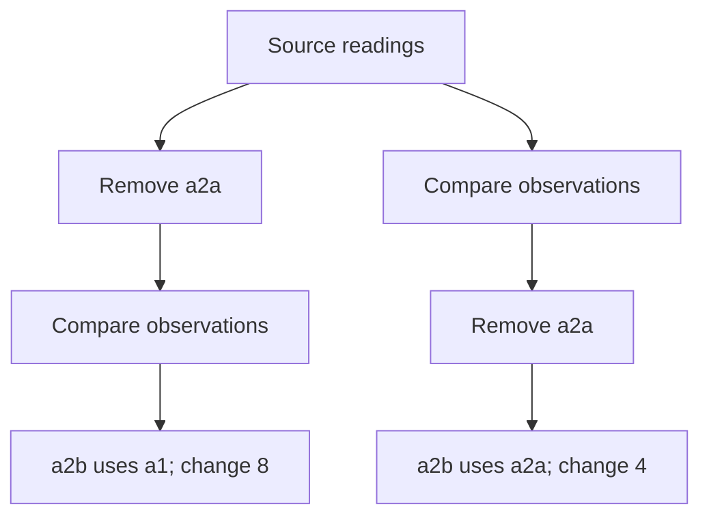

# Ordered lag and difference preparation — design report

**Decision:** build an explicit, reusable **Compare observations** project step, represented as `kind: "ordered"`. It preserves the current row grain and adds named previous-value and numeric-difference fields. The analyst declares the partition and complete ordering; every result can reveal its current record, chosen predecessor, and the reason a value is unavailable.

**Baseline:** explorEDA commit `95832bd473884aeae23453af0888b4ca5187820d`.  
**Research date:** October 25, 2026.  
**Status:** design proposal for Codex and Byron to review and integrate. No application implementation or repository modification was performed.  
**Companion:** [implementation-plan.md](implementation-plan.md), containing the concrete model, grammar, fixtures, tests, commands, and two independently shippable milestones.

## 1. What to build

The feature should answer: **“For this record, what was the value N ordered observations earlier within the same entity, and how much has it changed?”**

Build these capabilities together at the data-preparation boundary:

- One or more explicit partition fields; no partition fields means all records.
- One or more order fields, each with an explicit reading type and ascending or descending direction.
- A positive integer observation offset, defaulting to one.
- One or more named lag or numeric-difference outputs sharing that predecessor relationship.
- Current-row identity, row count, row unit, and input row presentation order preserved.
- Exact inspection of the current input row and predecessor input row, separately from ordinary source membership.
- Reuse in subsequent query steps, charts, multiple views of the query, and existing query-backed notebook charts.
- Project JSON, project text, folder save/reopen, worker evaluation, and empty-result schema support.

The finished default workflow uses a compact local editor in Query. Ship it in two useful releases:

1. **M1 — Reusable ordered preparation through project text and the native API.** A user can edit `exploreda.eda` in their editor, open the example, chart the new fields, inspect comparisons, filter or summarize them, save, reopen, and refresh safely.
2. **M2 — Visual authoring and filter placement.** Add the compact Compare observations editor, draft preview, stable output naming, and a bounded move-across-adjacent-filter action.

M1 includes actual inspection and persistence. M2 completes the intended in-app authoring journey. Neither depends on rolling calendar summaries, category mappings, wide-to-long preparation, live findings, parameterized notebooks, or a generalized reusable-output catalogue.

### Stable recommendations

“Build” means include in the proposed implementation plan; it does not authorize repository edits during this research mission.

| ID / disposition | Recommendation | Reason |
| --- | --- | --- |
| **OD-01 · Build** | Add one explicit `ordered` project step. | Its population, order, outputs, and persistence belong with the existing query graph. |
| **OD-02 · Build** | Require authored typed order terms and a unique complete order within each eligible partition. | The predecessor must survive input reorder without a hidden arrival-order rule. |
| **OD-03 · Build** | Block comparison outputs for an affected partition when full-order ties remain. | A simple partition-level rule avoids presenting an arbitrary sequence as fact. |
| **OD-04 · Build** | Keep rows with unusable partition/order values in the output, outside the sequence, with exact reasons. | Preserves grain while making the population of possible predecessors visible. |
| **OD-05 · Build** | Keep missing and invalid measures in their observation positions. | The same predecessor applies to every output; absence of a measurement is still an observation. |
| **OD-06 · Build** | Copy raw lag scalars; calculate differences from finite numeric readings using shared parsing. | Preserves source meaning and existing missing-value rules without imputation. |
| **OD-07 · Build** | Add bounded ordered-comparison evidence, separate from `sourceRows` and `contributors`. | Dependencies explain a value without changing which current records belong to a row. |
| **OD-08 · Build** | Keep query-filter position explicit; view selections and searches do not recompute prepared values. | Hiding a record and removing it from preparation are different analytical operations. |
| **OD-09 · Build** | Retain applied project/table snapshots with completed worker results. | Old values must never be explained using newly edited rules or refreshed records. |
| **OD-10 · Build** | Guard positional exact selections and inspection bookmarks with a live snapshot scope. | Keyless or duplicate-key rows must not silently become another record after refresh. |
| **OD-11 · Build** | Complete JSON/text/folder and declared-schema round trips in M1. | A field that disappears on save, empty data, or notebook compilation is not reusable. |
| **OD-12 · Build** | Add the compact visual editor and dependency-checked adjacent-filter swap in M2. | Completes analyst authoring without a general graph editor. |
| **OD-13 · Build** | Ship independent predecessor fixtures, documentation, and a runnable example with each milestone. | Correct-looking differences need independently checkable record membership. |
| **OD-14 · Explore** | Profile the actual evaluator, retained stages, and worker response during implementation. | Synthetic measurements suggest serialization can dominate this operation. |
| **OD-15 · Defer** | Elapsed duration and change rate. | They require an explicit clock, denominator units, and zero/negative interval policy. |
| **OD-16 · Defer** | Skip-missing neighbors, lead, and calendar-period comparisons. | They change the question or the predecessor population and deserve separate explicit operations. |
| **OD-17 · Avoid** | A generic window language or chart-local calculation as the canonical prepared field. | Both weaken the chosen scope and complicate reuse or row semantics. |
| **OD-18 · Avoid** | A lineage platform, persistent sorting cache, secondary index, arbitrary row cap, or new backend. | The bounded evidence model and measured local implementation are sufficient starting points. |

## 2. Evidence: what the current code actually supplies

The following are implementation facts, not inferred promises from intent documents. Paths below are relative to `packages/explorEDA/src/` unless otherwise stated. Links in the source register identify the pinned repository.

| Current fact | Evidence and consequence |
| --- | --- |
| The query union has six operations. | `types/AnalysisProject.ts::AnalysisStep` contains source, lookup, expand, calculate, filter, and aggregate. Ordered preparation is a new operation. |
| Scalar calculation sees one row. | `lib/analysis/evaluateProject.ts::calculateFrame` creates a Calculator with `data: [row.values]` and that row’s variables. `calculationFunctions` explicitly operates within a row. Keep that contract. |
| Query population is explicit. | `filterFrame` receives the preceding frame; `evaluateAnalysisQuery` follows `inputStepId`. Moving an array item alone does not move a filter in the graph. |
| Current output already feeds charts. | `components/ExplorEdaProject.tsx` maps final rows to chart data and supplies evaluated field names and types. Another result catalogue is unnecessary. |
| Grain can already change upstream. | `expandedFrame` creates parent/child keys; `aggregateFrame` creates group keys. An ordered step must compare whichever rows its input actually contains. |
| Existing references do not encode a cross-row value. | `AnalysisResultRow` has `key`, `sourceRows`, `contributors`, and optional `measureContributors`. Those describe current membership and aggregate inputs, not a predecessor relationship. |
| Source identity can be positional. | `sourceReferences` uses positions when the source has no entity key or a declared key is missing or duplicated. Identity does not establish analytic order. |
| Folder inference can create unique-looking positional keys. | Supplemental `lib/analysis/sources.ts::sourceFromRows` selects a unique ID-like/string key or synthesizes `row_number`. `folder.ts::inferSource` adopts it when key metadata is absent. Generated numbers are file positions, not durable record identity. |
| Empty frames are an authoring path. | `components/project/stepEditing.ts::queryFields` evaluates empty source tables to obtain schemas. Generated fields must exist before any successful pair exists. |
| JSON validation needs explicit integration. | `projectFile.ts::validateAnalysisProjectFile` has two operation allowlists and a recursive `fieldsAt` branch whose final alternative assumes aggregate. Its current source validation also rejects `entityKey: ""`. |
| Folder saves omit implicit query IDs. | `folder.ts::readProjectFolder` synthesizes source-only queries; `writeFolder.ts::projectFileText` omits every ID in `implicitQueries`. Modified implicit queries need promotion to explicit definitions. |
| Pending evaluation retains completed results. | `useAnalysisEvaluation` keeps the last completed result and applied bindings, but inspection currently receives current project/tables from `ExplorEdaProject`. Exact inspection needs a coherent applied snapshot. |
| Notebook compilation loses query schema. | Supplemental pinned `readNotebookText` and `readAnalysisText` pass evaluated row data onward. `DslCompileOptions` has no declared-fields input; `compileDocument` infers known fields from rows. Empty/all-null results need a schema route. |
| Positional selections lack snapshot binding. | Supplemental `analysisRowKeys.ts` encodes bare result keys. `resolveSourceRow` can resolve another keyless record at the same position. The guard proposed here is not already present. |

Two distinctions are especially important:

- A source’s `entityKey` identifies a source record. A partition field such as Device identifies a sequence of repeated readings. They need not be the same field. In the fixture, `id` is the source key and `entity` is the partition.
- The shared parser treats blank text as missing. Existing query `is-null` checks only null/undefined, and relationship matching uses its current strict scalar rules. This mission does not rewrite those existing behaviors.

`docs/research/DIRECTION.md` supersedes the old outside-demand gate in R049. The owner’s request establishes the need. The calendar-period and reusable-output briefs are contextual proposals; their older implementation descriptions are not authoritative evidence.

## 3. Boundary decision and primary-source comparison

### The four credible boundaries

| Approach | Strength | Decision and limitation |
| --- | --- | --- |
| **Explicit project step** | Names the input population and order; creates reusable fields with a natural save/inspect boundary. | **Choose.** It fits the evaluator and makes before/after filtering visible. It requires deliberate model, validation, editor, and persistence work. |
| **Generalized window expression** | Compact for experienced SQL/dataframe users; permits many operations in one language. | **Avoid for this mission.** It would add population/order semantics to an explicitly scalar engine, plus frames, null options, and a larger dependency language. |
| **Chart-local calculation** | Convenient for differences between already displayed marks or aggregate bins. | **Do not use as the canonical feature.** A mark may be a group, and chart filtering/layout can change its neighbors. It would not reliably supply a field to other query steps. |
| **Upstream preparation** | Appropriate when a database or pipeline already owns ordering and reusable outputs, or scale requires it. | **Keep as an interoperable alternative, not the default answer.** It gives up local edit/inspect/reuse and cannot replace the requested in-app capability. |

Upstream SQL is still useful as an independent arithmetic oracle. It is not a prerequisite, a new runtime dependency, or a fallback execution path.

### What the primary sources establish

The research used current official documentation, accessed October 25, 2026. Source defaults differ; the proposed explorEDA rules below are deliberate choices.

- **PostgreSQL:** window order is distinct from result display order; the population is determined before window evaluation, and an outer query can filter afterward. Its lag defaults to one prior row and NULL and respects nulls. This supports explicit population/order and distinguishing “no predecessor” from “predecessor has no measurement.” [E1, E2]
- **DuckDB:** lag supports an optional ignore-null population, while the default respects nulls. Window evaluation buffers input. This reinforces the value of one shared predecessor pass and measuring memory, without importing a complete SQL window system. [E3]
- **pandas:** grouped shift/diff provide ordinary preparation operations. Groupby preserves order within groups; sorting group keys does not sort observations. Shift by observation count differs from supplying a frequency that moves index labels. An oracle must sort explicitly and cannot assume pandas grouping equals strict typed partitions. [E4–E6]
- **Polars:** `over(order_by=...)` supplies analytic order, and its default mapping can return equal-length results to original row positions. Shift corresponds to positional lag; a diff mapping that drops positions can change shape. Preserve current-row positions in explorEDA and avoid ambiguous names for missing-value policy. [E7–E9]
- **Tableau Prep:** its Difference From editor combines partition fields, multiple order fields, directions, a value field, an observation offset, preview, and highlighted participating rows. It is the closest authoring/inspection precedent. Those docs do not establish explorEDA’s tie or refresh policy. [E10, E11]

One source-quality issue affected the oracle choice: Tableau’s multi-row article contains a previous-value example with an inconsistent offset sign, while its function reference clearly specifies the previous-row sign. The workflow remains useful evidence; the report does not copy that formula as a correctness oracle.

**Inference:** SQL contributes the partition/order/population concepts; dataframe tools support reusable row-preserving output; Tableau Prep contributes the strongest visual workflow. explorEDA should combine those bounded ideas with its existing query graph and source-inspection conventions.

## 4. Complete author, edit, use, inspect, save, and reopen journey

### Author and preview

1. Open a query whose rows represent the observations to compare. The existing scope line continues to say what a row means.
2. In M2, choose **Compare observations** in Query. The new step is appended after the current output. In M1, write the equivalent project-text block in `exploreda.eda`; the folder application reloads changed text.
3. Choose **Within** fields. The empty choice visibly reads **All records**. Do not silently infer that a record ID or device field is the desired partition.
4. Add **Order** fields. Each row shows the field, reading type, and direction. Further fields are labeled **Then by** and serve as explicit tie breakers.
5. Set **Observations back**, default 1. Choose named **Previous value** and/or **Difference** outputs. Multiple outputs share the sequence and offset.
6. Preview actual current/predecessor pairs, field values, unavailable reasons, and counts. The draft can be structurally valid even when some partitions have data issues. A bad definition cannot Apply; a valid definition with visible data issues can.
7. Apply one transaction. Cancel or Escape discards the draft and returns focus. Changing an output label preserves its field ID.

Compact controls follow `docs/ui-defaults.md`: shared field metadata, 28 px panel controls, 100 px label column, bounded nonmodal surfaces, accessible names, visible state, and viewport-safe primary actions. The editor is not a permanent sidebar or a new graph canvas.

Show a concise saved rule, for example:

> Within Entity · Time ascending, Sequence ascending · 1 observation back · Missing readings keep their place

Where unusable order values exist, the scope also says **Previous orderable observation** and identifies omitted records. A user must be able to inspect those records even when the selected pair itself succeeded.

### Use and edit

The output fields become normal query fields. A chart can plot Change, a later filter can keep Change above a threshold, a scalar calculation can divide Change by an already available scalar, and an aggregate can summarize valid changes. Multiple views can use the same query. Editing that query affects those views; the existing Copy query action supplies an independent alternative.

Reopen the ordered step to change the rule. Preserve step and output IDs for semantic edits that do not rename identity. Before removing an output or the step, use existing dependency checks and incompatible-field reporting. Update nested arrays immutably so copied queries do not mutate each other.

M2 supplies a narrowly scoped **Move before filter / Move after filter** action when an adjacent filter exists. It rewires graph edges, validates the resulting query, and refuses to move a filter before a generated field that it needs. It does not imply drag-and-drop reordering of an arbitrary query graph.

### Inspect

Use the existing row-selection and chart trace route:

- A plain chart click remains selection.
- Alt-click or Alt-Enter on a mark opens trace; its query-flow route focuses current result rows.
- Select a row and open its Comparison section.
- The section shows the applied partition and order, offset, current input row, predecessor input row, raw values, parsed numeric/order values where relevant, result, and precise reasons.
- Each role can reveal its own source records. Ordinary Related records stays separate.
- Preview limits remain visible. More records can be reached without creating a chart or modifying layout.

For `a2b`, the comparison shows current `a2b` with value 18 and sequence 2, predecessor `a2a` with value 14 and sequence 1, both in entity A at the same timestamp. The result is `18 - 14 = 4`. The timestamp tie is resolved by the explicitly saved sequence field.

### Save and reopen

Persist definitions and normal view settings. Recompute derived fields and evidence from the loaded sources. Do not save predecessor maps as source data.

- Native project JSON preserves the step and scalar source values using the current encoder.
- Project text preserves partitions, typed order clauses, direction, offset, output IDs, and labels.
- Folder saving promotes an edited implicit source query to an explicit query.
- An analysis file selects the prepared query.
- A notebook uses `eda query=reading-changes` and ordinary aliases/charts over its output.

First-release notebook reuse includes correct field availability and types on empty, singleton, and all-null results. It does **not** promise a native notebook predecessor inspector or parameterized investigation system. The accompanying Changes analysis exposes the existing Query inspection surface. Notebook chart selections remain local as documented; they do not rerun ordered preparation.

## 5. Precise ordering contract

### 5.1 Typed partition equality

Partition keys are collision-safe tuples of the **stored scalar values and their primitive types**.

- Number `1`, string `"1"`, boolean `true`, and string `"true"` are different values.
- Number `-0` and `0` are equal.
- Nonblank strings retain case, whitespace, and exact content. There is no trimming, case folding, locale collation, or date normalization for partitions.
- `isMissingValue` identifies null, undefined, empty strings, and whitespace-only strings. A row with any such partition cell is outside the sequence.
- Nonfinite numeric partition values are invalid. Unsupported non-scalar values are invalid rather than stringified.
- An empty partition list forms one global partition. Missing partition cells do not create a shared “unknown entity.”

Use a tagged tuple representation, not concatenated values separated by a punctuation character. These rules are local to ordered partitioning; relationship matching and existing aggregate grouping remain unchanged.

This distinction is intentional: **partitions use exact stored identity; order fields use the explicitly selected reading type**. Equivalent date spellings are distinct partition strings unless the analyst prepares a common value first.

### 5.2 Typed lexicographic order

Each order clause stores `fieldId`, `type`, and `direction`. Evaluate clauses left to right.

| Reading type | Normalization and comparison |
| --- | --- |
| Number | Use `finiteNumber`; compare finite numbers. Numeric text follows the shared parser; booleans and radix-prefixed text are not numbers. |
| Date | Use `timestampOf`; compare finite milliseconds. Numeric values are already timestamps under that helper. Date text without an offset follows the shared UTC rule. |
| Boolean | Use `parseBoolean`; false sorts before true. Recognized true/false text follows the shared parser. |
| String | Accept actual nonmissing strings; compare deterministic UTF-16 code units with ordinary string ordering. Do not stringify numbers or use environment-dependent locale ordering. |

Run missing detection before conversion. Every clause must be usable; a missing secondary tie-break value is not ignored merely because the primary value happens to be unique.

Ascending and descending apply independently to each clause. A positive offset always points backward in the **declared sequence**. With descending time, that predecessor can be later in wall-clock time. The UI must not call it an earlier date.

Normalize once per relevant cell, not inside every sort comparison. Equal normalized values can create ties: `1` and `"1"` under number mode, equivalent timezone spellings under date mode, and `true` and `"TRUE"` under boolean mode.

### 5.3 Ties

The full normalized order tuple must be unique within the eligible partition.

- Offer an additional **Then by** field. A stable source record ID may be suggested, but only an explicitly added clause participates.
- If ties remain, all eligible rows in that partition receive unavailable prepared outputs with an ambiguous-order status.
- Other partitions compute normally.
- Show the exact tied tuples and records, the number of tied records, and the number of affected rows.
- Never use arrival order, sort stability, a row index, a displayed table sort, or an undeclared row key to break ties.

Blocking the whole eligible partition is conservative. Some individual positions could be mathematically determinate despite a tie elsewhere. Preserving that partial result would require a more complicated ambiguity model whose benefit is small for a first release. The chosen rule is uniform, visible, and invariant under input reorder.

### 5.4 Unusable order values and retained rows

A row with a known partition but unusable order stays in the output, with no predecessor or prepared value. Valid rows in that partition compare among the remaining orderable records. The inspector shows the omitted rows because this exclusion can bridge an unknown temporal location.

A row with a missing/invalid partition cannot be assigned to an entity’s omitted count; show it in a separate unassigned-record list.

Keep the existing stage `excludedCount` at **0**: the operation removes no rows. Add distinct comparison statistics:

- Input and output rows.
- Rows outside the sequence, with partition/order reasons.
- Eligible rows in blocked partitions.
- Ambiguous partitions, tied groups, and tied records.
- Resolved predecessor pairs and insufficient-history rows.
- For lag: resolved copies, nonmissing copied values, and no-copy rows. A copied null is a successful raw lag with a missing value; raw text or infinity is not an arithmetic failure.
- For difference: finite results and unavailable results, with operand/overflow reasons.

Count unavailable output rows once. Operand-reason counts may overlap when both measures are invalid and must not be presented as an additive reconciliation.

When several structural data problems coexist, use this exclusive primary-status precedence: missing partition, invalid partition, missing order, invalid order, ambiguous order, insufficient history, paired. Retain every applicable field-level reason for inspection. A valid partition with bad order can be assigned to that partition’s omitted-record count; a missing partition cannot.

### 5.5 Offset, time, and calendar periods

For eligible partition sequence `r[0] ... r[n-1]`, offset `k` chooses `r[i-k]` when `i >= k`.

- `k` must be a positive safe integer.
- Zero, negative, fractional, nonfinite, and unsafe integers are malformed.
- An offset larger than the partition is valid; every row lacks sufficient history.
- Offset 2 means two observations back. It does not mean two hours, two days, or two completed calendar periods.
- Missing measures occupy positions. Missing/invalid ordering rows do not.

Elapsed duration and rate are deferred. A later feature must name the time field and unit, define sign under descending or nonmonotonic time, represent zero intervals, and explain unit division. Calendar-period comparisons belong with the separate calendar work and cannot be implemented by relabeling this offset.

## 6. Result semantics: lag, difference, missing values, dates, and units

### Lag

A lag copies the chosen predecessor’s raw scalar exactly. That includes numeric text, booleans, date text, null, blank text, undefined, and nonfinite numeric values. It inherits the input field’s declared type.

This choice deliberately avoids normalizing the source value just because it moved to a new field. Shared missing display still renders missing cells as `null`. Inspection preserves the raw spelling and distinguishes:

1. No predecessor exists.
2. A predecessor exists and its value is missing.
3. A predecessor exists and its value is unsuitable for numeric arithmetic.
4. A predecessor exists and its value is usable.

No predecessor produces `undefined`; an actual predecessor containing `null` produces `null`. Both may look missing in the table, but the comparison evidence distinguishes them. Existing query `is-null` does not match a raw blank lag value; changing that filter contract is outside this feature.

### Numeric difference

Difference means:

```text
difference(current) =
  finiteNumber(current[field]) - finiteNumber(predecessor[field])
```

Both operands must pass the shared numeric rules. Use `numericExclusionReason` for explanations and the same numeric parser for calculation.

- Missing current or predecessor values produce `undefined`, with the relevant role identified.
- Invalid text, boolean values inside a numeric/unknown field, NaN, and infinities produce unavailable differences.
- A missing or invalid measure still occupies its sequence position.
- A nonfinite subtraction result is unavailable with an arithmetic-overflow reason.
- Zero is a valid result. There is no zero fill or forward fill.
- Preserve both operand reasons when both fail.
- A known date or boolean field cannot be declared as a numeric-difference target. A number, string, unknown, or unspecified field can be read numerically under the shared rules; previews show conversion failures.

Use JavaScript binary64 arithmetic. Do not claim decimal, big-integer, or exact unsafe-integer support. Ordinary finite rounding is not overflow. For example, a `0.3 - 0.2` test needs a numerical tolerance, while `1e308 - (-1e308)` must return unavailable.

### Dates and units

Dates are valid order fields and lag targets. A date lag retains the original scalar representation. Declared date fields remain ineligible for numeric difference even when their payload is numeric. Untyped numeric timestamps cannot be recognized automatically: they remain ordinary numbers and receive no duration semantics.

The saved date order uses `timestampOf` and its default shared parser, independently of chart formatting, view type overrides, or a view’s `datePreset`. Under that parser, `01/02/2026` means January 2, 2026. Data requiring a different interpretation needs an explicitly prepared common representation before this step.

The supplied `FieldDefinition` has no unit metadata. M1 therefore:

- Interprets numeric difference in the same measurement unit as the single input field.
- Preserves or explicitly names that unit in the output label where known.
- Performs no automatic conversion or unit inference.
- Requires the analyst to establish common units before comparison.
- Makes no claim that mixed-unit rows are comparable merely because their raw values are numeric.

Subtracting the same measurement field also avoids confusing a difference with a rate or percentage. A later elapsed/rate feature needs its own explicit unit contract.

## 7. Filter position, views, and refresh

### The middle-record example

Entity A has values `10, 14, 18, null, 25` in its declared order. Compare `a2b = 18` with its predecessor `a2a = 14`.

| Action | Result for a2b |
| --- | --- |
| No removal | Predecessor a2a; lag 14; difference 4. |
| Query filter removes a2a **before** ordered preparation | Predecessor a1; lag 10; difference 8. |
| Query filter removes a2a **after** ordered preparation | Predecessor remains a2a; lag 14; difference 4; a2a remains inspectable as dependency evidence. |
| Table search, display sorting, chart selection, or workspace filtering hides a2a | Prepared predecessor and values remain unchanged; only the displayed/current view population changes. |
| Source refresh actually removes a2a | Recompute from the new source; predecessor becomes a1 and difference 8. |



Do not push downstream filters upstream as an optimization. That would change values. A parameter-bound query filter changes predecessors only when its graph position is before the ordered step.

### Stable identity and positional identity

The ordered operation keeps the current row’s `key`. A pair does not become a new observation identity.

- With a unique stable source key, selecting a2b continues to mean a2b after reorder or a measure update. Its predecessor and difference are recomputed.
- Without a stable key, ordering can still be deterministic from explicit fields. This does not make positional row keys durable.
- Scope positional exact selections and inspection bookmarks to the live source snapshot. A source replacement or fresh reopen makes them visibly unresolved; the user can reselect.
- Even a native file reopened with identical row content does not manufacture cross-session identity for positional records.
- Field/category predicates remain normal predicates. They are not exact record bookmarks.
- An aggregate group selection follows that group under the same key-producing definition; it is not a frozen set of member records.

Add a small runtime identity classification following existing key construction: source fallback rows are snapshot-bound; lookup/filter/calculate/ordered preserve it; expansion is snapshot-bound if either identity component is; aggregate group keys have their existing semantic identity.

Generated importer keys need the same protection. Add optional `SourceDefinition.keyOrigin: "row-position"` provenance only where `sourceFromRows` actually synthesizes a key. The importer keeps its existing key choices and values. `inferSource` forwards the marker only when adopting that inferred key; a genuine field named `row_number` is not marked by its name. Source rows with this provenance are snapshot-bound even though the generated values are unique. Native JSON and explicit project text preserve the marker; a short keyless folder declaration re-establishes it during inference.

If an explicitly saved row-position source names its generated key but the raw file entirely lacks that field, reconstruct that explicitly marked field as position plus one and retain its field metadata. Preserve any supplied field values; do not fill or overwrite present data. An arbitrary missing key without this provenance must never trigger generation. This handles source-metadata edits that make an originally implicit generated key explicit on save.

New exact-selection and bookmark tokens also carry a canonical key-definition descriptor: source IDs, key fields, and key origin, plus the key-producing expansion/group step IDs and their relationship/group-field definitions. Validate that descriptor before resolving the existing row key. This prevents an aggregate changed from grouping Entity to grouping Region from reusing the same textual key for a different group. Ordinary filter, scalar-output, and ordered-rule edits that preserve the key recipe do not change it. Unscoped saved tokens cannot establish this guarantee and surface as unresolved in the guarded ordered workflow. This is token validation around existing keys, not a new row-identity service.

Use one conservative query-source snapshot epoch for positional selections. It changes when any reachable source array or source key definition changes. This can invalidate more positional selections than strictly necessary, but it avoids a new identity-dependency system. Use a session discriminator so tokens do not accidentally match after reopen. Worker-local revision counters are not suitable host identity tokens.

One host-runtime helper owns that scope: a session discriminator and weakly held source-array identities, combined with reachable source IDs and key definitions. `singleTableProject` and `useAnalysisEvaluation` use this same helper and the returned source arrays, so a newly converted workspace's positional selections resolve immediately. Do not mint an independent hook-local epoch or derive identity from the outer tables wrapper. A true reimport, reopen, or cross-runtime handoff receives a new snapshot scope.

## 8. Exact inspection with one bounded evidence extension

### Proposed shape

Keep comparison evidence compact and keyed by its originating ordered step:

```typescript
type OrderedRowComparison = {
  inputRowKey: string;
  predecessorRowKey?: string;
  status:
    | "paired"
    | "insufficient-history"
    | "missing-partition"
    | "invalid-partition"
    | "missing-order"
    | "invalid-order"
    | "ambiguous-order";
  issueFieldIds?: string[];
};

// Proposed additions to existing runtime result types:
type OrderedResultAdditions = {
  orderedComparisons?: Record<string, OrderedRowComparison>;
  identityScope?: "snapshot";
};
```

The map key is the ordered step ID; that step supplies its `inputStepId`. The current and predecessor reference the **input result rows**, which can be raw, expanded, or grouped rows. There is no assumption that every predecessor is one source record.

Store stage-level comparison counts separately. Do not copy full current/predecessor row values into every evidence entry. The retained evaluation stages already contain those values. Resolve each pair against the same completed evaluation, and resolve its source records against the same applied tables.

### Propagation and downstream inspection

- The ordered step preserves `key`, `sourceRows`, `contributors`, row unit, and input row order.
- Ordinary row-preserving steps and expansion retain the comparison map. Expansion may change the current output key; the comparison’s original `inputRowKey` must remain unchanged.
- A later ordered step adds its own entry and does not rewrite an earlier comparison.
- Aggregate creates new group rows and does not union predecessor records into group membership.
- For a numeric aggregate over Change, use each existing `measureContributors` input row key with the aggregate’s immediate `inputStepId`. Open that exact member row and its comparison.
- Nested numeric aggregates can be inspected one input stage at a time.
- For a group-only/count summary, an on-demand group-membership helper can reuse the existing aggregate group-key rule and expose **Group members**. Those are not automatically **Count contributors**: per-entity deduplication, count(field), and conflict rules remain distinct.
- If exact count-contributor presentation is added, reuse the existing candidate-selection logic; do not reconstruct it using the ordered missing-value policy.

A scalar calculation after Change remains scalar. Its dependency inspection may lead to Change and the stored comparison; it does not receive cross-row variables or a hidden window environment.

### Worked aggregate membership

After filtering a2a **after** preparation and grouping by entity:

- A has four current members: a1, a2b, a3, a4.
- Only a2b contributes a finite numeric difference, 4.
- A’s sum of valid differences is 4.
- a2a is absent from current group membership but appears as the predecessor dependency of the included a2b difference.
- It must not increase the group count, source membership count, or sum.

Inspecting other unavailable members may reveal other predecessor dependencies. Label those by the specific comparison being inspected, rather than claiming a single flattened “all contributors” union.

### Worker coherence

Extend completed evaluation state with applied project and immutable tables references, plus the host snapshot epoch. While a new request is pending, old results can remain on screen with old rules and records coherently.

Keep authoring controls connected to current project state. Disable mutations of an old displayed flow while pending, or explicitly route them through current state; never let inspection write an old project over a newer edit.

The existing request-ID checks continue to reject obsolete responses. Sources still travel through the current worker protocol; no backend, server fallback, or second semantics implementation is added. Callers replace both changed source arrays and their enclosing tables record.

## 9. Persistence, validation, and notebook boundaries

### Model and validation

Add an `OrderedStep` member, explicit evaluator dispatch, generated fields, and shared definition validation. Validate structure and field references before examining rows so the empty-frame authoring route works.

Reject malformed offset, missing/duplicate order fields, unknown reading types/directions, unsupported operations, missing input references, duplicate output IDs, output/input collisions, known date/boolean difference targets, and attempts to reference another output in the same step. A subsequent step can consume earlier outputs.

Keep project version 1 as the existing additive model surface. A client that does not understand the new operation should reject it explicitly. Do not build version negotiation or two interpreters.

### Text

Use a dedicated project-text block; do not add lag functions to scalar expressions:

```text
ordered @changes by=readings.entity offset=1 {
  order readings.at type=date direction=asc
  order readings.seq type=number direction=asc
  lag @previous_value readings.value label="Previous value"
  difference @change readings.value label="Change"
}
```

The generic parser already supports this nested declaration shape. Each child is on its own line; semicolons are not separators. The ordered semantic branch must reject unknown or duplicated options rather than warn and ignore them. A small duplicate-name-token parser diagnostic is appropriate if needed; no grammar redesign is required.

### Native project files and folders

- Teach both operation allowlists and recursive field validation about the step.
- Permit an intentionally empty source key while still rejecting an unknown nonempty one.
- Preserve generated-position provenance in native metadata and `key-origin=row-position` project text, with the bounded file reconstruction rule above.
- Export edited implicit queries whenever they differ from their canonical synthesized source-only definition.
- Preserve source paths, external-source behavior, connections, host storage ownership, and existing analysis settings.
- Save definitions rather than derived tables or evidence.

### Notebook and analysis schema

Supplemental pinned reads established that both compilation and export need a declared-schema route. Add an optional fields/types input to `DslCompileOptions` and `DslExportOptions`; merge declared field IDs with inferred rows, prefer concrete declared types, and infer only unknown/unspecified types.

Pass the evaluation’s fields alongside rows through notebook/analysis readers and relevant export validation. Do not insert fake rows to teach the compiler a schema.

Include notebook chart write-back in that route. The current `lib/notebook/writeBack.ts::partFor` calls `exportParts(settings, { rows })`; merely expanding compiler options would still discard declared schema here. Forward the same evaluated fields through `partFor`, `rebuiltPart`, and `writeBackChart`, then verify editing, saving, and reopening a chart with an empty result.

The existing React host is `components/notebook/ExplorEdaNotebook.tsx`. Its `useNotebookResult` compile options and `handleStateChange` write-back options currently carry rows/name/last-valid text, while `fieldTypes` reaches only `DataLayerProvider`. Return evaluated fields alongside rows from `NotebookReadResult` and forward that schema through both host paths, including memo dependencies. Reuse existing concrete type metadata, but retain explicit field IDs for unknown or empty outputs.

Same-query views and notebooks are the required first boundary. Existing `exportViews` shares selected definitions from the first view and reports incompatible differences; this mission does not promise arbitrary heterogeneous-query bundle export. Notebook charts use the prepared fields; exact comparison inspection is available in the accompanying query workspace.

## 10. Independent oracle and exact expected results

The complete machine-readable fixture and reproduction run sheet are in the implementation plan. The canonical input is deliberately unsorted:

```text
a3,  A, 2026-01-03T00:00:00Z, 1, null
b2,  B, 2026-01-02T00:00:00Z, 1, 15
a1,  A, 2026-01-01T00:00:00Z, 1, 10
a2b, A, 2026-01-02T00:00:00Z, 2, 18
b1,  B, 2026-01-01T00:00:00Z, 1, 4
a4,  A, 2026-01-04T00:00:00Z, 1, 25
a2a, A, 2026-01-02T00:00:00Z, 1, 14
b3,  B, 2026-01-03T00:00:00Z, 1, 12
```

Columns are ID, entity, timestamp, sequence, value. Partition by entity; order timestamp/date ascending then sequence/number ascending.

| Current → predecessor | Lag | Difference |
| --- | --- | --- |
| a1 → none | undefined | undefined |
| a2a → a1 | 10 | 4 |
| a2b → a2a | 14 | 4 |
| a3 → a2b | 18 | undefined: current missing |
| a4 → a3 | null | undefined: predecessor missing |
| b1 → none | undefined | undefined |
| b2 → b1 | 4 | 11 |
| b3 → b2 | 15 | -3 |

Expected totals: 8 input/output rows; 8 orderable rows; 6 resolved pairs and successful raw lag copies; 5 nonmissing lag values; 2 insufficient-history rows; 4 valid differences; no ordering exclusions or ambiguous partitions.

Without sequence, A has one tied timestamp tuple containing a2a and a2b. All five A rows are blocked; B remains correct. There is one affected partition, two tied records, and five blocked eligible rows.

Independent checks executed using installed Python standard-library SQLite 3.53.1 matched separately hand-enumerated maps for baseline, offset two, both terms descending, filter before/after, reversed input, empty, singleton, and a stable-ID measure refresh. Additional checks confirmed tie membership and the sums:

- Baseline sum of valid differences: **16**.
- Remove a2a before preparation: **16**.
- Remove a2a after preparation: **12**.
- A’s sum in the last case: **4**.
- Refresh a2a from 14 to 20: a2a difference **10**; a2b lag **20**, difference **-2**.

SQLite represents both an absent lag and a null lag as SQL NULL; the independently checked predecessor ID distinguishes them. The proposed TypeScript result contract preserves the more specific undefined/null distinction.

These are independent SQL/arithmetic checks, not product tests. Shared parsing, positional selections, workers, save/reopen, notebook compilation, and browser behavior remain proposed implementation acceptance tests.

## 11. Work and memory costs before optimization

Let N be input rows, P partition fields, Q order terms, M outputs, and N_g eligible rows in each partition.

- Normalize relevant cells and partition: approximately O(N(P + Q)).
- Sort partition indexes: O(Q × sum(N_g log N_g)) in the worst comparison case.
- Detect ties and choose predecessors: O(NQ).
- Produce outputs: O(NM), plus copying the existing input value width if following current frame conventions.
- Store predecessor/status evidence: O(N) per ordered step; chained steps retain one bounded entry per originating step.
- Existing evaluation retains upstream stages. Wide rows and worker serialization can dominate the new sort.

Analytic comparison scales are approximately 66,439 for 10,000 rows in 100 balanced partitions; 996,578 for 100,000 in 100; and 1,660,964 for 100,000 in one partition. These are N log2 group-size calculations, not actual comparison counts.

### Executed synthetic measurement

A standalone scratch probe ran on existing Node v24.22.1, Linux x64, with a 1,000-row warmup and three samples per case. It grouped/sorted ordinary objects on two pre-normalized terms, emitted two scalar result slots plus compact current/predecessor/status evidence, and structured-cloned a lean stage/result payload.

| Workload | Median prepare / clone | Additional retained result / clone heap |
| --- | --- | --- |
| 10,000 rows; 100 equal partitions | 3.863 ms / 36.943 ms | 1.447 MB / 2.800 MB |
| 100,000 rows; 100 equal partitions | 44.912 ms / 379.467 ms | 14.404 MB / 30.160 MB |
| 100,000 rows; one partition | 48.761 ms / 220.122 ms | 14.401 MB / 30.162 MB |

MB is decimal. Each column is a separate median. Heap deltas were taken with forced garbage collection while retaining the input and relevant results. They are not peak-heap measurements. Clone times varied substantially; the smaller single-partition clone time is not evidence of a partition-count optimization.

The probe omits raw parsing, invalid/tied-data handling, copied source fields, full upstream stages, browser rendering, and actual worker messaging. It is not an explorEDA benchmark or a performance promise. Its useful implication is that object/evidence transport deserves measurement alongside sorting.

During M1, measure real direct/worker evaluations at 10k/100k rows, balanced/skewed/single partitions, 1/3 order fields, 1/8 outputs, and 10/40 input fields. Record prepare time, full response size, retained/peak allocation proxy, pending-snapshot retention, and first comparison-open latency. Start with the few representative cases that answer the observed bottleneck.

No persistent cache, index, row limit, or alternate engine is justified by the present evidence. Reuse the evaluator’s existing within-evaluation frame memoization and share one predecessor mapping per step.

## 12. Rejected alternatives and remaining judgment

- **Hidden stable sort:** reproducible only while source order stays the same; rejected as the semantic tie rule.
- **Automatic source-key tie breaker:** a record ID can be a valid authored clause but must not silently change the meaning of same-time events.
- **Skipping missing measures:** changes the comparison population, and can give different predecessors for different outputs. Defer as a separately named operation.
- **Treating missing-order rows as first/last:** invents a position for records whose position is unknown. Keep them visible and outside the sequence.
- **Blocking the entire query for one bad partition:** unnecessary loss of usable comparisons elsewhere. Block only the affected eligible partition.
- **Zero defaults:** obscure insufficient history and missing readings. Keep unavailable values and their reasons.
- **Flattening predecessor references into contributors:** confuses dependencies with current membership and can corrupt counts or related-record traversal.
- **Saving an enriched source copy:** duplicates data and can stale silently. Save the preparation definition.
- **A broader selection-identity or lineage initiative:** unnecessary dependency. The small snapshot guard is enough for this workflow.
- **Units, rate, or calendar behavior inferred from labels:** unreliable. Require a later explicit contract.

No unresolved semantic decision blocks the proposed implementation. Review can change product wording or rollout order, but the chosen default remains Compare observations, text/API-first M1, visual M2, raw lag, fixed retained measure positions, and partition-level blocking for unresolved full-order ties.

The main risk is **a plausible number explained by the wrong record or source generation**. The ordered contract, independent predecessor map, applied snapshot, and positional selection guard address that risk together. Arithmetic is the easy part.

## 13. Sources

### Current primary documentation

The decisive claims are summarized in section 3; the detailed contract elsewhere is this report’s proposal.

- **E1 — PostgreSQL window tutorial:** https://www.postgresql.org/docs/current/tutorial-window.html
- **E2 — PostgreSQL window function reference:** https://www.postgresql.org/docs/current/functions-window.html
- **E3 — DuckDB window functions:** https://duckdb.org/docs/2.0/sql/functions/window_functions (the stable documentation route resolved here during research).
- **E4 — pandas grouped shift:** https://pandas.pydata.org/docs/reference/api/pandas.api.typing.DataFrameGroupBy.shift.html
- **E5 — pandas grouped diff:** https://pandas.pydata.org/docs/reference/api/pandas.api.typing.DataFrameGroupBy.diff.html
- **E6 — pandas groupby ordering and missing keys:** https://pandas.pydata.org/docs/reference/api/pandas.DataFrame.groupby.html
- **E7 — Polars ordered over and mapping:** https://docs.pola.rs/api/python/stable/reference/expressions/api/polars.Expr.over.html
- **E8 — Polars shift:** https://docs.pola.rs/api/python/stable/reference/expressions/api/polars.Expr.shift.html
- **E9 — Polars diff:** https://docs.pola.rs/api/python/stable/reference/expressions/api/polars.Expr.diff.html
- **E10 — Tableau Prep multi-row visual calculations:** https://help.tableau.com/current/prep/en-us/prep_multirow_calculations.htm
- **E11 — Tableau Prep function reference:** https://help.tableau.com/current/prep/en-us/prep_function_reference.htm

### Repository citations and files read

All 34 complete files in the supplied packet were read across the research and implementation-review work. The exact baseline for every repository path is:

https://github.com/byronwall/explorEDA/tree/95832bd473884aeae23453af0888b4ca5187820d

The complete packet reading covered:

- **Rules and context:** `AGENTS.md`, `README.md`, `package.json`, `CODING_STANDARDS.md`, `docs/agent-guide.md`, `docs/ui-defaults.md`, `docs/research/DIRECTION.md`.
- **Intent context:** `docs/intent/research-ideas-100/ideas/R049-ordered-difference-transforms.md`, `docs/intent/calendar-period-analysis/intent-brief.md`, `docs/intent/reusable-analysis-outputs/intent-brief.md`.
- **Types and runtime:** `packages/explorEDA/src/types/AnalysisProject.ts`; `lib/analysis/evaluateProject.ts`, `projectFile.ts`, `useAnalysisEvaluation.ts`, `analysisWorkerProtocol.ts`; `lib/valueParsing.ts`; `lib/calculations/functions/registry.ts`.
- **Authoring and inspection:** `components/project/stepEditing.ts`, `queryEditing.ts`, `ProjectQueryPanel.tsx`, `QueryFlow.tsx`, `QueryStageRows.tsx`; `components/ExplorEdaProject.tsx`.
- **Text and supplied tests:** `lib/dsl/project.ts`, `lib/dsl/project.test.ts`, `test/lib/analysis/evaluateProject.test.ts`, `components/project/stepEditing.test.ts`.
- **Folders and notebooks:** `lib/project/folder.ts`, `lib/project/writeFolder.ts`, `lib/notebook/compileNotebook.ts`.
- **Demo/docs:** `apps/demo/src/docs/pages/project-folders.mdx`, `apps/demo/src/docs/pages/notebooks.mdx`, `apps/demo/src/demos/multiSourceShop.ts`, `apps/demo/playwright.config.ts`.

In those grouped lists, abbreviated `lib/`, `components/`, and `test/` paths are under `packages/explorEDA/src/`.

Supplemental files were fetched at the same pinned commit to resolve notebook-schema, text grammar, and selection questions. Full reads: `lib/notebook/index.ts`, `lib/notebook/readNotebook.ts`, `lib/project/analysisText.ts`, `components/project/analysisRowKeys.ts`, `components/project/sourceRowIdentity.ts`, `lib/dsl/index.ts`, `lib/dsl/views.ts`, and `lib/dsl/parse.ts`. Targeted relevant sections: `lib/dsl/compile.ts` and `lib/dsl/export.ts`, including options, schema inference, aliases, and export validation. The full compiler/exporter were not claimed as fully read.

Targeted sections of `lib/notebook/writeBack.ts` were also read: `partFor`, `rebuiltPart`, and `writeBackChart` expose the declared-schema forwarding needed for empty-result chart edits.

Targeted sections of `components/notebook/ExplorEdaNotebook.tsx` covered its props, `useNotebookResult`, `handleStateChange`, and `DataLayerProvider` call. They identify both React compile/write-back options paths; this is not a full-component read claim.

Additional pinned integration reads covered `packages/explorEDA/package.json`, `entries.json`, `tsup.config.ts`, `src/analysis.ts`, `src/components/ExplorEda.tsx`, `apps/demo/package.json`, `apps/demo/src/docs/catalogue.ts`, `apps/demo/src/docs/live/examples.ts`, `apps/demo/src/demos/examples.ts`, and `apps/demo/src/routes.ts`. They confirm the public analysis export and standalone project-example route. The current inline docs live-example specification accepts single-source data/settings, not a project/tables bundle; the plan uses a linked standalone project example and its own browser test.

The full supplemental `packages/explorEDA/src/lib/analysis/sources.ts` was also read. `sourceFromRows` established the generated-position-key issue; `singleTableProject` identified another selection-encoding call site that must receive the guarded identity context.

Especially consequential pinned sources:

- [Result model](https://github.com/byronwall/explorEDA/blob/95832bd473884aeae23453af0888b4ca5187820d/packages/explorEDA/src/types/AnalysisProject.ts)
- [Evaluator and source identity construction](https://github.com/byronwall/explorEDA/blob/95832bd473884aeae23453af0888b4ca5187820d/packages/explorEDA/src/lib/analysis/evaluateProject.ts)
- [Project validation](https://github.com/byronwall/explorEDA/blob/95832bd473884aeae23453af0888b4ca5187820d/packages/explorEDA/src/lib/analysis/projectFile.ts)
- [Folder writer](https://github.com/byronwall/explorEDA/blob/95832bd473884aeae23453af0888b4ca5187820d/packages/explorEDA/src/lib/project/writeFolder.ts)
- [Notebook reader](https://github.com/byronwall/explorEDA/blob/95832bd473884aeae23453af0888b4ca5187820d/packages/explorEDA/src/lib/notebook/readNotebook.ts)
- [Selection key encoding](https://github.com/byronwall/explorEDA/blob/95832bd473884aeae23453af0888b4ca5187820d/packages/explorEDA/src/components/project/analysisRowKeys.ts)

## 14. Closing status

**Access:** passed. The packet names the required commit and contains all 34 inventoried complete file blocks. Supplemental pinned access succeeded. No decisive missing input remains.

**Files read:** the complete packet groups and the explicitly identified supplemental files/sections are listed above; older intent proposals were not substituted for implementation evidence.

**Checks performed:** packet completeness and inventory checks; complete assigned source reads; current official documentation research; independent SQLite predecessor/arithmetic checks; a standalone synthetic Node work/memory probe; adversarial review of semantics, persistence, and identity.

**Proposed checks:** every explorEDA implementation test, parser/JSON/folder/notebook round trip, delayed-worker scenario, source-refresh selection test, actual product performance profile, and browser acceptance at 1280/783/390 px. None is represented as executed product evidence.

**Deliverables:** [design-report.md](design-report.md) and [implementation-plan.md](implementation-plan.md), also packaged together in `ordered-lag-and-difference-design.zip`. No source archive, manifest, hashes, or repository changes are included.

**Open questions:** none blocking. Codex should reconcile the named seams against its integration checkout, measure actual worker/rendering costs, and retain the explicit deferral of elapsed duration and rate unless their separate semantics are deliberately selected.

