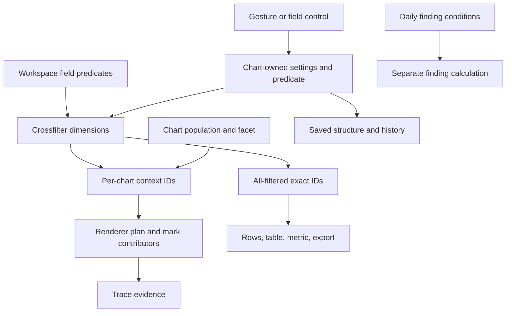

# Mosaic Selections and explorEDA: integration research and decision

**Research completed:** 2026-10-21 UTC (source retrieval began 2026-10-20 in America/Indianapolis).  
**Repository baseline:** `byronwall/explorEDA` at `9b16d78e3ed0742ed4d5858c1939fec9e758b510`.  
**Official Mosaic implementation inspected:** `uwdata/mosaic` at `9ca1d860e30ed148d0b228b92ebf30f66cb9e2ce` (2026-10-15; core/SQL source manifests 0.33.0).  
**Paper:** Heer, Moritz, Pechuk, *Mosaic Selections: Managing and Optimizing User Selections for Scalable Data Visualization Systems*, arXiv:2507.19690v1, 25 July 2025.  
**Status:** completed research and proof design. No application implementation, dependency installation, application tests, browser experiment, performance benchmark, commit, push, or PR was performed.

## 1. Executive decision

**Proceed with a small internal, exact selection contract over the existing React/TypeScript and Crossfilter implementation. Do not adopt Mosaic packages, its optimizer, DuckDB as a new interaction backend, or its renderers in the first experiment.** This is an explicit no-adoption decision for dependencies, paired with selective use of the source-owned clause and target-resolution model. Revisit that decision only after the four-consumer proof identifies a benefit that the internal design cannot provide economically. [MOS-001, MOS-003, MOS-010, MOS-011]

The immediate benefit is analytical consistency: a histogram, scatterplot, evidence table, and a bounded written finding should agree about the exact selected records and their population. The source chart may still show a larger context distribution. That distinction should be deliberate and inspectable. The value is not a new event bus or an abstract query system.

The existing implementation already supplies much of the foundation: typed field filters, a dimension per chart, independent workspace field filters, chart-local populations, exact selected row IDs, contributor traces, and project-level logical row-key adaptation. It does not yet provide one uniform interpretation across all those paths. Ordinary Bar and Heatmap definitions interpret only particular filters; table search is local; daily findings use a separate condition language; and facet/population semantics differ by interaction. [R-CF, R-FILTER, R-DEFINITIONS, R-TABLE, R-FINDINGS, R-IDENTITY]

Three source-derived issues deserve bounded reproduction before expanding the architecture:

- **Histogram and marginal boundary disagreement.** Numeric bins are half-open except the final bin, while emitted range filters use the common inclusive evaluator. A record exactly on an internal upper edge can appear in linked evidence even though it is not a contributor to the clicked bin. This is a concrete static counterexample, not a reproduced UI result. [R-BAR, R-MARGINAL, R-FILTER; MOS-002]
- **Table-local and linked predicates can diverge when a filtered column is hidden.** The table's local filter still applies, but its linked definition ignores filters for columns no longer listed. The selected population therefore needs a documented rule independent of presentation. [R-TABLE; MOS-005]
- **Persistence and identity traversals are deliberately narrow.** Existing project adaptation maps `__ID` filters to logical keys, but it does not traverse every filter-bearing location or a future geometry node. Dashboard text also has typed-value ambiguity and intentionally omits some workspace filters. A new selection must extend those existing paths and reject lossy exports. [R-IDENTITY, R-DSL, R-SAVE; MOS-007]

The first new interaction should remain **an exact lasso proof on linear numeric Scatter axes**, as the current precise-composite-selection intent requests. It should publish source-unit geometry, preserve exact evidence, and drive the four consumers. A rectangle is a useful comparison case, not completion of that lasso goal. [R-INTENTS, UP-INTERACT; MOS-004]

Performance work is justified as measurement: the repository records meaningful residual interaction cost. A new pre-aggregation backend is not yet justified. Those existing measurements are development-build long-task totals, not production p50/p95 latency, and several worst causes are already fixed in this baseline. [R-PERF; MOS-009]

### Decision boundaries

| Decision | Result |
| --- | --- |
| Research access gate | **GO.** Exact packet hashes verified; remote baseline confirmed; required semantic gaps fetched at the same commit; full v1 paper and official sources inspected. |
| Preserve current stack and renderers | **Keep.** React, TypeScript, pnpm, existing chart plans and traces. |
| Internal shared contract and exact lasso | **Explore.** Bounded four-consumer experiment with exact-ID gates. |
| Mosaic Selection adapter | **Defer.** Feasible, but adds translation and lifecycle work without removing the immediate integration work. |
| Mosaic/DuckDB interaction backend | **Defer.** Requires separate measured need, SQL consumer migration, and membership parity. |
| Pixel bins as final evidence, silent scope widening, lossy restore | **NO-GO.** Stop on the first mismatch. |

## 2. Access, baseline, evidence labels, and coverage

The supplied ZIP contains 528 manifest-listed repository files, plus `prompt.md` and `source-packet-manifest.json` (530 entries). All 528 file byte sizes and SHA-256 hashes match the supplied manifest. The separately attached `prompt(7).md` is byte-identical to the prompt inside the packet. The manifest identifies the requested repository and immutable commit. The connected GitHub commit reader independently confirmed that SHA and its merge message for PR #450, Heatmap histories, date bins, and fixed color ends. This closes the baseline identity check without moving to newer main. [SRC-PACKET, SRC-ASSIGNMENT, SRC-BASELINE]

The packet is a **selected source snapshot, not a runnable checkout**. All explicitly named minimum-route files were present. Following their actual implementation paths exposed omitted semantic dependencies, including `lib/aggregates.ts`, `lib/dailyRollup.ts`, Rows, project row-key handling, and demo history. These were fetched through read-only GitHub access **at the same baseline** into a separate research supplement. The packet itself was left unchanged. The precise supplemental inventory, hashes, reading status, and remaining peripheral omissions are in `manifest.json` and the coverage notes. [R-AGG, R-DATES, R-ROWS, R-IDENTITY, R-HISTORY]

The whole v1 HTML was read: sections 1–9, references, Appendix A (sorting/prefetching), Appendix B (view sizes), and the figures/tables. The source's HTML and images were inspected locally; the figures containing aggregation formulas and benchmark plots were viewed directly. Official implementation and documentation were reached through the paper's Mosaic links, then pinned to the October 2026 commit above. The benchmark repository was separately pinned to `72b82e1bad3e96786e63bb10877b4d5cd48cc2f5` (2025-06-25). Current source behavior is not backdated to the paper. [PAPER-V1, UP-REPO, BENCH-HARNESS]

This report uses these evidence classes:

- **Observed repository fact:** static source at the specified explorEDA commit. Tests are evidence of intended assertions unless explicitly run.
- **Paper claim:** the v1 authors' model, methods, evaluation, or limitations, cited by section/figure/table.
- **Current upstream fact:** inspected Mosaic source at its separate pinned commit.
- **Inference:** reasoning from those sources, including counterexamples that have not been exercised in the application.
- **Proposal:** a contract, score, acceptance threshold, fixture, or milestone for Codex to review.

Bracketed source IDs resolve in `mosaic-selections-sources.json`; its entries contain exact URLs, versions, symbols, retrieval dates, access limits, and collected filenames. Repository path/symbol citations remain useful when a web reader cannot display a GitHub URL. `source-material/research-notes/` contains the more detailed original audit notes and reading inventories.

### Checks completed versus not run

Completed: archive path-safety inspection; manifest/hash verification; prompt comparison; baseline commit identity lookup; exact-ref source retrieval; full-paper reading; official source/license inspection; independent fixture-set arithmetic; structured-artifact/reference/ZIP validation recorded in the final manifest. **No explorEDA or Mosaic test suite was run.** No benchmark numbers in this report were measured against explorEDA during this research. The standalone proof plan marks every product and performance check as proposed/unrun.

## 3. Current selection flow, end to end

### 3.1 The shared path already exists below renderers

`types/FilterTypes.ts` defines `ValueFilter`, `RangeFilter`, `TextFilter`, and `DateRangeFilter`; `applyFilter` supplies common evaluation. Values retain type through `categoryIncludes`; numerical ranges parse through `finiteNumber`; date bounds use the repository's UTC-aware parsing. This is reusable semantic infrastructure, although chart definitions decide which filters actually become outgoing predicates. [R-FILTER, R-VALUES]

`CrossfilterWrapper` creates a dimension keyed by internal row ID for each chart. A registered chart definition creates its row test; `dimension.filterFunction` applies it. Workspace filters have a separate dimension per field and are ANDed with the chart dimensions. `getAllData()` obtains a group for each chart dimension. A group's own dimension filter is excluded, leaving the chart a context population filtered by its peers. `localFilters` then restrict that chart's own group; they are not automatically part of the outgoing chart predicate. [R-CF: `addChart`, `updateChartFilters`, `setWorkspaceFilters`, `getAllData`; R-POP]

`DataLayerProvider.updateChart` updates saved chart settings and passes the changed settings to Crossfilter; display-only changes may preserve the previous live-items map after that wrapper update. Data-affecting changes publish refreshed live items. `components/charts/useGetLiveData.tsx` is the shared live-data path; `useGetLiveIds` reads positive group counts and optionally intersects facet IDs. `useGetAllIds(settings)` returns all rows in the chart's own population, before interactive filters, for stable domains and source evidence. There is no `useChartData.ts` in this route. [R-PROVIDER, R-LIVE]



The separate finding branch is intentional in this diagram: no inspected source establishes a current subscription of daily findings to live workspace selections. The diagram also does not imply that every table or metric uses the same exact resolver today; the branches below describe the differences.

### 3.2 Gesture writers and what they actually mean

| Interaction | Current source behavior |
| --- | --- |
| Histogram bin click/brush | `BarChart.selectBinAt` and `handleBrushChange` write a field range; brush coordinates are inverted then snapped to bin edges. Interior bins themselves use a half-open partition. |
| Categorical bar | Writes a typed value filter; ordinary Bar's definition reads its main field's first filter. Grouped/series bars use different definition branches. |
| Scatter rectangle | Inverts the displayed axes and writes independent X/Y field filters: numeric ranges or typed category lists, intersected across axes. It is not a polygon. |
| Scatter point/bubble | Uses a value filter on internal `__ID`; membership is row-specific within that data instance. |
| Scatter density/hex bin | Selects exact contributing `sourceIds`; current density bins are source-unit aggregates, not approximate pixel membership. |
| Scatter marginal | Builds a numerical bin range; the same interior-edge mismatch is possible unless the predicate gains explicit inclusivity. |
| Heatmap cell | Selects row/column values, or a row value plus a UTC date-period range. The definition accepts only its own supported cell-filter fields/types. |
| Table column | Writes chart filters through the field-filter path; table search remains a separate local condition. |
| Workspace field control | Updates the one workspace filter for that field; that field control's own distribution can exclude its own dimension. |

Sources: [R-BAR, R-SCATTER, R-DENSITY, R-MARGINAL, R-HEATMAP, R-TABLE, R-BRUSH, R-FIELD, R-DEFINITIONS].

This heterogeneity matters. A new generic predicate cannot simply be appended to every existing `filters` array: some definitions ignore it. Replacing all definitions with an AND over every array would also change existing behavior without proving compatibility. An internal adapter must initially preserve each legacy definition, while new predicate kinds use one explicit evaluator. [Inference; MOS-003]

### 3.3 Context, selected membership, and display

The raw Crossfilter group is a **context** view. Renderers may dim marks using their own filters, apply a further local selection, or use exact IDs for traces. `getFilteredRowIds()` uses `allFiltered()` and therefore includes every active chart and workspace dimension. `getChartFilteredRowIds(chart)` additionally applies that chart's local population. These methods answer different questions from `getAllData()`. [R-CF]

Scatter plans retain separate source, live, selected, omitted, and sometimes offscreen row sets. Density bins have `sourceIds` and live/selected counts, with bin edges and the automatic density maximum derived from the full chart source population. Exact source evidence survives a summarized display. Trace scope and trace bodies choose the relevant source/current/contributor set; an Alt-click on an aggregate should not be equated with the workspace-wide selected cohort without checking that mark's scope. [R-SCATTER, R-DENSITY, R-TRACE]

`MetricCard` uses chart-filtered IDs for count/sum/average and carries contributor exclusions. Its reducer can count declared entities once; conflicting values make the result unavailable. These semantics are richer than a generic SQL `COUNT(*)` followed by a chart label. [R-METRIC, R-AGG]

### 3.4 Evidence tables, export, and trace

- A DataTable chart starts from its peer-filtered live rows, then `getFilteredRows` applies its own filters and `globalSearch`. Its definition excludes the search from linked filtering. `DataTableToolbar` exports the complete filtered rows supplied to it, not just the visible/virtualized window. [R-TABLE: `filteredRows.ts`, `DataTable.tsx`, `DataTableToolbar.tsx`]
- The workspace Rows drawer obtains IDs passing active Crossfilter dimensions and then applies its own Rows-local filters/search. A chart DataTable and the Rows drawer are separate consumers with separate local state. [R-ROWS]
- Mark trace readers reconstruct contributor rows from the actual chart plan, including exclusions and denominator information where supported. `traceRows.ts` and trace scope preserve the relationship between the selected mark and its evidence. A count can include all eligible rows while a mean includes only valid measure inputs. [R-TRACE, R-AGG]
- A CSV of a locally searched table is therefore not necessarily the workspace selected cohort. The UI and any finding must say which scope it uses. The proposed proof compares exact IDs **after the same declared local restriction**, rather than forcing unlike scopes to be equal. [Inference; MOS-005, MOS-006]

### 3.5 Saving, clearing, and notebook mode

Filters live in chart settings and workspace/Rows settings. `saveToStructure` produces serializable analysis settings; `saveDataUtils` validates/restores them. The provider's host callback is not generally debounced, but state-change holding supports a single semantic edit/undo checkpoint. Project wrappers encode positional ID filters as logical row keys before persistence and decode them on restoration. Demo undo restores view/project snapshots. [R-SAVE, R-PROVIDER, R-IDENTITY, R-HISTORY]

Clearing a chart removes that chart's filters; it should not clear a second chart's clause merely because both select the same field. Deleting a chart disposes its Crossfilter dimension. Workspace field filters have an independent clear path. Empty selection means absence of a constraint; an active constraint that matches no rows is a valid zero-row result. [R-CF, R-FIELD, R-PROVIDER]

`localSelections` implements notebook behavior by clearing chart dimensions while retaining workspace dimensions. Each chart can still display its own selection locally, but the shared Crossfilter result does not automatically become a selected notebook cohort. A finding that follows one notebook chart would need an explicit source binding; a default workspace table should continue to show the workspace population. [R-CF, R-LIVE; proposal in §4]

## 4. Semantic contract and target truth tables

### 4.1 Separate six meanings

| Meaning | Required interpretation |
| --- | --- |
| Population restriction | Workspace predicates, chart `localFilters`, and explicit facet population. Defines eligible records before an interaction. |
| Interactive selection | Source-owned predicate(s) generated by a deliberate action. Must preserve field/value/geometry meaning and ownership. |
| Highlight | Hover/focus/trace emphasis. Does not silently narrow exported evidence or denominators. |
| Viewport | Axis limits, pan, zoom, clipping. Existing axis editing changes what is visible, not filter membership. |
| Encoding domain | Full-source axes/color/size references where currently present, or explicitly fixed Heatmap color ends. Not the current selected range. |
| Evidence membership | Exact eligible row IDs satisfying the declared resolved predicates at one data revision. Used by table/export/finding/trace comparisons. |

Observed support: [R-POP, R-CF, R-SCATTER, R-HEATMAP, R-UI, R-TRACE]. The separation and naming are the proposed contract, not a claim that current code already exposes this API.

### 4.2 Compare Mosaic concepts to existing concepts

| Mosaic concept | explorEDA mapping and limit |
| --- | --- |
| Clause set | Several chart-owned filters already coexist, but their interpretation is chart-definition-specific. Workspace filters are separate population controls. |
| Predicate | `applyFilter` plus chart definitions already evaluate rows. A lasso needs a bounded geometry predicate; tuple unions cannot be flattened into independent value lists. |
| Source identity | Mosaic uses a runtime object. explorEDA has persistent chart IDs, scoped by host analysis/view; a field name is not a source. |
| Client/view exclusion | Crossfilter groups omit their own chart dimension. A source chart may have several renderer layers; one exclusion policy should cover them deliberately. |
| Resolution | Existing chart dimensions intersect. Value lists union within a field. Cross-source OR and LAST are different semantics, not automatic improvements. |
| Scope | Mosaic primarily supplies SQL WHERE predicates. Chart population, table search, facet membership, and notebook selection scope still require product rules. |
| Activation | A possible upcoming interaction can trigger upstream prefetch without changing membership. It should never become an undo checkpoint or selected-row event. |
| Lifecycle | Mosaic reactive dispatch handles asynchronous updates. It does not supply this repo's saved analysis, project identity, calculated-field editing, or undo behavior. |

Sources: [UP-SEL, UP-CLAUSE, UP-COORD, UP-DISPATCH, R-CF, R-IDENTITY, R-HISTORY]. The paper's formal model is in §4 and lifecycle in §6; current source uses `clients`/`meta`/`include`, whereas v1 uses view-set terminology and describes `includes`. [PAPER-V1]

### 4.3 Formal population notation

Let `D` be one source/query result at a known revision, `W` the intersection of workspace filters, `L_v` target view v's local population, and `F_v` an explicit facet restriction. Let `P_a` and `P_b` be two exact source-owned selections. Let `Q_t` be a table's own search/local evidence restriction.

For an ordinary linked dashboard with source exclusion:

```text
context(source a) = D ∩ W ∩ L_a ∩ F_a ∩ P_b
context(source b) = D ∩ W ∩ L_b ∩ F_b ∩ P_a
evidence(target)  = D ∩ W ∩ L_target ∩ F_target ∩ P_a ∩ P_b
table export     = evidence(table) ∩ Q_t
```

`L_a` does not implicitly become `L_target`. If selection a is intended to mean only the visible contributors within `L_a`/`F_a`, its emitted predicate must explicitly include that source restriction (or exact logical row membership). This is a product choice that currently varies by chart interaction. The four-consumer proof initially uses a common un-faceted population; a separate scope test proves any later facet choice. [R-POP, R-SCATTER, R-DENSITY; MOS-014]

### 4.4 Truth table: source view and sibling

The following tables are **proposed target semantics**. All rows implicitly include their target's `D ∩ W ∩ L_v ∩ F_v`. “All” means that eligible population, never unconstrained raw data.

| Active clauses | Source a context, self-filter off | Source a selected evidence / self-filter on |
| --- | --- | --- |
| None | All | All |
| A only | All | A |
| B only | B | B |
| A and B | B | A ∩ B |
| A matches zero rows | All | Empty |
| Clear A while B remains | B | B |

| Active clauses | Source b context, self-filter off | Neutral sibling with no own clause |
| --- | --- | --- |
| None | All | All |
| A only | A | A |
| B only | All | B |
| A and B | A | A ∩ B |
| A empty, B active | Empty | Empty |
| Clear B while A remains | A | A |

The histogram may show the context column while its selected overlay and evidence use the selected column. A matching written count must bind to the latter. Source exclusion is by originating source/view identity, not by removing every predicate mentioning the same field.

### 4.5 Truth table: table, metric, and written finding

| State | Evidence table / export | Metric or proposed live finding |
| --- | --- | --- |
| No clauses | Eligible rows, then explicit Q_t | Count of eligible rows; measure over valid inputs |
| A and B | Exact A ∩ B, then Q_t | Exact A ∩ B under the binding's own declared population |
| Table search changes | Local rows/export change | Unchanged unless explicitly bound to that table scope |
| Zero matched rows | Empty table/export | Count 0; sum/mean unavailable under current reducer semantics |
| Matched rows, no valid measures | Rows remain inspectable | Count remains valid; sum/mean unavailable, exclusions shown |
| A genuine numeric zero | Row remains inspectable | Value 0, not missing/unavailable |
| Source schema/revision unavailable | Do not show stale rows as current | “Unavailable” with inspectable reason, not 0 |
| Source-self-filter display toggled | Membership unchanged | Membership unchanged |

Current daily findings do **not** implement the live-finding column. The bounded binding in §9 is proposed. A percentage denominator must be a separately named eligible population, not whatever context happens to be drawn in the source chart. [R-FINDINGS, R-TABLE, R-METRIC, R-AGG]

### 4.6 Truth table: facets and notebooks

| Facet situation | Proposed exact evidence rule | Current caveat |
| --- | --- | --- |
| No facet supplied | Use target population | `undefined` means no facet restriction. |
| Explicit empty facet set | Empty | Several live hooks treat `[]` as no restriction; ordinary generated slices are nonempty, so this is a contract edge, not a reproduced UI failure. |
| Global field selection made in facet East | Apply field predicate across eligible targets | Ordinary Bar/Scatter ranges can behave this way; source facet is not automatically added. |
| Facet-bound selection in East | Apply field predicate AND typed East restriction | Series bars add facet filters; density clicks use facet-limited source IDs. New lasso should choose this deliberately if claiming visible contributors. |
| Source facet hidden or no longer exists | Preserve meaning or mark unavailable | Do not broaden to all facets. |

| Notebook state | Default peer/Rows/metric behavior | Explicit finding/table bound to source a |
| --- | --- | --- |
| No chart selection | Workspace population | Source a's declared population |
| A selected | Peers remain at workspace population | Apply A within source a's population |
| A and B selected in different charts | Each chart keeps local selection; no cross-chart intersection | Apply only bound source a unless the author explicitly requests a compound scope |
| Clear A | Peers unchanged | Return to bound source population |
| Workspace W changes | W filters every chart | W also constrains bound evidence |

These notebook bindings are a proposal. Do not interpret `localSelections` as switching all consumers to a common implicit selected set. [R-CF, R-FACETS, R-LIVE]

### 4.7 Same fields, composition, empty state, and multiple sources

- **Two charts selecting the same field:** keep A and C as separate clauses. Default AND yields their intersection; clearing A leaves C. Overwriting by field is correct for the one workspace control per field, not for chart source identity.
- **OR within a categorical value set:** preserve existing typed values. **OR across sources:** postpone UI; if explicitly added, compute exact union once, avoid double-counting overlap, and disable incompatible preaggregation.
- **Tuple union:** `(region=East AND x=1) OR (region=West AND x=2)` differs from `region IN {East,West} AND x IN {1,2}`. The latter adds off-diagonal rows. A tuple node is a later bounded extension, not a reason to build a Boolean editor now.
- **Lasso:** a polygon excludes points inside its bounding rectangle but outside its boundary. Evaluating only rendered marks fails with omitted/sample/rasterized points. Evaluate eligible source rows, with explicit boundary inclusion and coordinate rules.
- **No selection versus zero rows:** an absent clause selects all eligible rows; a valid nonempty predicate can select none. Missing fields or stale source references are unavailable, not an instruction to remove the clause.
- **Multiple datasets:** matching column names do not establish meaning. The first proof binds one source revision. Cross-table selections require explicit project/source mappings and preserved logical keys; reuse existing project provenance before designing a new multi-source layer. [R-IDENTITY, R-PROJECT-TYPES]

## 5. Correctness risks and exact-evidence invariants

### 5.1 Hard invariants

1. **One committed meaning:** the committed predicate plus data revision and target scope determines exact membership. Pointer pixels, debounce timing, visible marks, and cache residency do not redefine it.
2. **ID equality before aggregate tolerance:** compare sets of stable logical row keys (or revision-bound internal IDs in the isolated proof). A one-row mismatch fails even if counts or averages happen to agree.
3. **Trace/export agreement under equal scope:** the union of relevant included contributors equals the exact selected IDs for a count selection. Measure exclusions remain available separately. An aggregate context mark can legitimately have a different contributor set; label and compare its own scope.
4. **No hidden denominator:** selected share is `|E| / |B|`, with E a subset of explicitly named B. A measure mean divides by valid measure inputs or declared entities, not all selected rows.
5. **No implicit widening:** unresolved field, unresolved/deleted source reference retained by a binding or predicate, explicit empty facet, stale data version, invalid polygon, or lossy restore does not turn into an all-rows result.
6. **Rendering cannot alter evidence:** resizing, changing point size, density resolution, color limits, or axis viewport preserves committed evidence unless the user explicitly changes the selection semantics.
7. **Atomic current evidence:** table, finding, metric, export, and trace use the same committed selection/data revision. If a later asynchronous backend is explored, stale completions cannot overwrite newer evidence.
8. **Lifecycle preservation:** clear-one-source, undo, restore, duplication, field edits, and data replacement either preserve declared meaning or explicitly invalidate it. A cached row-number set never silently selects new records after reorder.

These are acceptance requirements [MOS-002 through MOS-008, MOS-012, MOS-014], supported by the different existing paths above and the exactness counterexamples below.

### 5.2 Concrete histogram/marginal counterexample

Use three rows with X values `0`, `0.5`, and `1`, and two noninteger bins. The first bin is `[0, 0.5)`, with only the first row; the final bin is `[0.5, 1]`. `barPlan.binRows` and `numericBins` agree on that partition. `selectBinAt` emits `{type:"range", min:0, max:0.5}`, and `applyFilter` accepts `number <= max`. Linked evidence therefore includes the boundary row `0.5`. [R-BAR: `bins.ts:1–38`, `barPlan.ts:246–283`, `BarChart.tsx:286–340`; R-FILTER: `applyFilter.ts:18–30`]

The same pattern exists in Scatter marginal partitioning versus `marginalBinFilters`. The fix should represent upper/lower inclusivity explicitly or select the precise contributor keys where that is the intended durable meaning. Do not subtract a floating-point epsilon from the bound: that replaces a semantic rule with a scale-dependent approximation. Keep manually entered “at most” ranges inclusive; add explicit interval semantics for bin selections. Existing saves must not silently change meaning. [R-MARGINAL; MOS-002]

### 5.3 Source population is not automatically evidence population

A source chart restricted to East can emit an inclusive `x in [1,3]` and filter matching West rows in siblings. That can be useful for a global analytical predicate, but it is wrong to describe the resulting table as only the source mark's contributors. Existing writers vary: series bars add facet guards, density/hex clicks select contributor IDs, ordinary intervals often do not. Choose between “global field condition” and “contributors within this source population” at the new interaction boundary; keep that choice in provenance. [R-POP, R-SCATTER, R-DENSITY, R-FACETS; MOS-014]

### 5.4 Values, dates, absent periods, zeros, and entities

- Typed categorical identity distinguishes number `1` from string `"1"`. Numerical intervals deliberately parse valid numeric strings; a value selection and a numerical range therefore have different documented semantics. `categoryKey` and `finiteNumber` should remain the reference functions. [R-VALUES]
- Existing missing-value selection intentionally groups null/undefined/blank forms through `isMissingValue` and `applyFilter`. Do not accidentally expand that to invalid numeric text. Serialize a missing token intentionally; JSON's conversion of `undefined` inside arrays is not an adequate policy. [R-FILTER]
- UTC date periods use `[start,end)` internally; current date-range filters can represent an inclusive last millisecond or whole date's end. Reuse `timestampOf`/`dateBound` and period helpers. Offset timestamps must be compared as instants. Invalid `2025-02-30` and blank dates must not roll over or become epoch zero. `utcPeriod` currently accepts nonblank strings while `utcDay`/date filtering can accept numerical timestamps, so input eligibility needs explicit tests. [R-DATES, R-VALUES]
- A missing calendar period has no observations. A period with rows but no valid measures is unavailable. A valid measurement of zero is zero. Heatmap's delivered complete-history behavior makes this distinction visible; selection work must preserve it. [R-HEATMAP, R-AGG]
- For sums/means, `summarizeGroup` excludes invalid measures, retains reasons, and returns `undefined` when no valid measure exists. With `entityField`, repeated entities count once; conflicting values make the result unavailable. Entity reduction is group-local, so adding per-group counts can double-count an entity spanning groups. [R-AGG]

### 5.5 Delivered stable domains must remain delivered

Scatter density uses stable source-unit bins and full-source reference maximum; ordinary point/size/axis paths have their own source-domain logic. Heatmap PR #450 delivered complete date histories, independent limits/order, date-period selection, and configurable fixed color ends/square-root mapping. **Heatmap's default automatic domain still follows shown cells; fixed color ends make stability explicit.** Do not generalize Scatter's source maximum into an existing Heatmap default, or reopen delivered histories as a new milestone. [SRC-BASELINE, R-DENSITY, R-HEATMAP, R-INTENTS; MOS-008]

### 5.6 Pixel aggregation and exact membership are different properties

An aggregate can be exact for quantized bins while failing a source-space membership test. In the inspected upstream optimizer, an interval can be transformed to integer bins and filtered with inclusive `BETWEEN`. With unit floor bins, source interval `[10,20]` rejects `20.9`, but `floor(x) BETWEEN 10 AND 20` accepts it. This is a static counterexample, not a measured upstream failure. [UP-PREAGG, UP-INTERACT, UP-SQL]

For this repo, keep exact source predicates authoritative. An accelerated preview may aggregate a coarser representation only if it does not claim final membership. Exact table/export/trace/finding queries must use the original predicate or recheck candidate rows. Exact preview aggregates can be retained by re-evaluating partial boundary bins; evaluating every row in intersected bins is also exact but may erase the speed benefit. The optional acceleration proof must measure that cost. [Proposal; MOS-012]

## 6. Integration options: adopt the model selectively

### 6.1 Four independent choices

Mosaic's conceptual model, reactive `Selection` library, query optimizer, and vgplot rendering ecosystem are separable decisions. This app needs none of the last three to give a lasso one durable meaning across four consumers. The conceptual contribution is to make the owner of each clause and the target's resolution policy explicit. An internal implementation can retain Crossfilter's own-dimension exclusion and existing renderers. [R-CF, UP-SEL, UP-COORD, UP-INTERACT]

1. **Retain and document.** Fix proven boundary/scope issues, document chart-specific contracts, and leave each consumer's integration separate. This is the fallback if a shared contract fails to reduce complexity. It has the lowest migration cost but leaves daily findings and geometry with repeated interpretation work.
2. **Small internal contract over Crossfilter — recommended experiment.** Normalize effective chart predicates through narrow adapters; add exact geometry; expose one resolved evidence population to the four consumers. Keep workspace/local/facet restrictions distinct. This earns its place only if the proof removes duplication and improves traceability.
3. **Mosaic Selection adapter.** Use its source-owned clause set and reactive lifecycle while retaining React/Crossfilter/renderers. This is technically plausible, but its predicates are SQL ASTs and its identities include runtime objects and client sets. A durable JSON facade, row evaluator, lifecycle bridge, and serialization policy are still needed. That work may exceed the internal contract it replaces. The `Selection` constructor does not itself require a running DuckDB instance, but package imports/dependencies and final bundle effects must be measured rather than assumed free. [UP-SEL, UP-CLAUSE, UP-REPO, UP-DOC-REACT]
4. **Mosaic/DuckDB query backend.** Replace or supplement the interaction data path with structured SQL queries, client registration, aggregate results, and exact evidence retrieval. This has the greatest large-data potential and migration cost. DuckDB-WASM loading, data conversion, relation/schema revisions, asynchronous cancellation, query fan-out, raw-row evidence, calculated fields, and memory limits all become app responsibilities. Existing renderers can remain, but that does not make the data migration small. [UP-COORD, UP-PREAGG, UP-QUERY]

### 6.2 Task-specific scoring

Scores are research judgments on a 1–5 scale, not benchmark measurements. Higher is better; maintenance, migration, and API scores reward **less** cost/surface. Weights reflect the assignment's ranking: semantic fit 25%, exactness 25%, consumer work 15%, maintenance 10%, performance potential 10%, migration 10%, public API size 5%. Weighted score is `sum(weight × score / 5)`. Performance potential is deliberately only one factor.

| Criterion (weight) | Retain/document | Internal contract |
| --- | ---: | ---: |
| Semantic fit (25) | 2 | 5 |
| Exactness control (25) | 4 | 5 |
| Work to connect four consumers (15) | 2 | 5 |
| Maintenance simplicity (10) | 5 | 4 |
| Performance potential (10) | 2 | 3 |
| Migration ease (10) | 5 | 4 |
| Small public API (5) | 5 | 4 |
| **Weighted / 100** | **65** | **91** |

| Criterion (weight) | Mosaic Selection adapter | Mosaic/DuckDB backend |
| --- | ---: | ---: |
| Semantic fit (25) | 4 | 4 |
| Exactness control (25) | 3 | 3 |
| Work to connect four consumers (15) | 3 | 2 |
| Maintenance simplicity (10) | 2 | 2 |
| Performance potential (10) | 3 | 5 |
| Migration ease (10) | 2 | 1 |
| Small public API (5) | 3 | 1 |
| **Weighted / 100** | **61** | **58** |

The external options' exactness score reflects adaptation risk, not an assertion that SQL cannot be exact. They can reach exact membership, but must reconcile coercion, UTC rules, entities, source exclusion, and quantization with existing behavior. The internal score assumes the proposed gates pass; it is not a declaration that unimplemented code is correct. Retaining the present architecture remains acceptable if normalization introduces more special cases than it removes. [Inference from R-FILTER, R-DEFINITIONS, R-AGG, R-IDENTITY, UP-SEL, UP-PREAGG]

### 6.3 Why no dependency adoption now

- A library adapter does not eliminate a row predicate evaluator, stable identity, or the app's saved-state rules.
- The existing renderer ecosystem already provides exact traces and stable density bins. Replacing it would enlarge the proof without addressing the highest-priority gaps.
- The optimizer needs structured query information and a compatible backend. Adding metadata to a Crossfilter filter does not execute Mosaic's materialized-view algorithm.
- Lasso is not an out-of-the-box win from the inspected `region` interactor: that interactor uses a rectangle to collect rendered elements and produce tuple predicates. It is not an arbitrary source-space polygon test. [UP-INTERACT]
- Named populations, a general Boolean editor, arbitrary finding expressions, server infrastructure, and a universal query abstraction each introduce a separate product. They are unnecessary for the bounded proof. [R-INTENTS; MOS-013]

## 7. Proposed minimal contract and end-to-end flow

**Everything in this section is a proposal, not shipped code or an executed implementation.** Names are illustrative. Prefer extending existing types/functions once the proof settles the contract; do not publish all these structures as a new public API.

### 7.1 Persist meaning; derive runtime machinery

The owner key should be the pair `{analysisViewId, chartId}` (plus an interaction slot only if a demonstrated need arises). A chart ID is stable within its settings, but duplicating an analysis view retains the inner chart IDs. A process-wide map keyed only by chart ID is therefore unsafe. Do not key owners by field name: two charts selecting X must remain independently clearable. Runtime objects, client subscriptions, scales, DOM elements, hover coordinates, prefetch state, and caches are reconstructed after mount. [R-HISTORY, R-IDENTITY, UP-SEL]

Use the existing dataset/project result identity and logical row-key machinery. For the isolated proof, row IDs are valid only with a dataset revision; for project restore, convert them through `analysisRowKeys`. A schema/data/calculation revision change invalidates cached membership even if the column names remain the same. A selection geometry can be re-evaluated against new rows only through an explicit data-rebind policy; old selected row numbers cannot be reused. [R-IDENTITY, R-PROJECT-TYPES]

```ts
// PROPOSED; conceptual TypeScript, not a new committed module.
// Filter is the existing union from types/FilterTypes.ts.
type JsonScalar = string | number | boolean | null;
type StoredFilter =
  | Exclude<Filter, { type: "value" }>
  | { type: "value"; field: string; values: readonly JsonScalar[] };

type SourceKey = Readonly<{
  analysisViewId: string;
  chartId: string;
}>;

type Interval = Readonly<{
  type: "interval";
  field: string;
  units: "number" | "utc-ms";
  lower?: { value: number; inclusive: boolean };
  upper?: { value: number; inclusive: boolean };
}>;

type Atom = StoredFilter | Interval;
type Predicate =
  | { kind: "fields"; all: readonly Atom[] }
  | {
      kind: "lasso";
      xField: string;
      yField: string;
      // First proof supports linear numeric axes only.
      vertices: readonly (readonly [number, number])[];
      boundary: "include";
    };

type Clause = Readonly<{
  source: SourceKey;
  data: { id: string; revision: string };
  scope: "linked" | "source-only";
  predicate: Predicate;
  // Included only for a declared contributor-scoped interaction.
  // These are semantic source-population/facet guards, not pixels.
  sourceRestriction?: readonly Atom[];
}>;

type Target = Readonly<{
  source?: SourceKey;
  purpose: "context" | "evidence";
  includeOwn: boolean;
  localFilters: readonly StoredFilter[];
  // undefined = no facet; [] = intentionally empty facet.
  facetIds?: readonly string[];
}>;

type Resolution =
  | { status: "ready"; revision: string; ids: readonly string[] }
  | { status: "unavailable"; reason: string };
```

Validation is essential, not another framework: finite numeric bounds/vertices and serializable numbers only; distinguish numeric and string categorical values; normalize `undefined` to the documented missing token only where it preserves existing grouped-missing semantics. Preserve explicit blank-string/whitespace value selections as typed values: changing `values:[""]` into `values:[null]` would broaden the predicate. Reject nonfinite categorical numbers as unsupported unless a deliberate tagged encoding is added; never let JSON coerce them to null. Reject unresolved fields before evaluating any row and reject malformed or degenerate geometry. An empty `all` means no restriction only when intentionally created by the compatibility adapter; clearing an owner removes the clause. A valid lasso with no matching rows remains active. A missing field must not reach `applyFilter(undefined, missing-value-filter)`, which would correctly match a missing **cell** but incorrectly legitimize a missing **schema field**. [R-FILTER, R-POP]

The first polygon policy should be simple and explicit: at least three distinct finite vertices, nonzero area, no self-intersections, include points on edges, use a documented robust orientation/boundary test, and reject malformed input. Do not use a loose screen-pixel epsilon that changes membership on resize. A future nonlinear-axis lasso needs a deliberate transform-space interpretation: inverting only vertices of a straight displayed edge can change its source-space boundary. Restricting the first proof to linear numeric axes avoids silently choosing that meaning. [Proposal; MOS-004]

`Clause[]` should initially be a derived snapshot of authoritative chart settings, not a second independently mutable store. Existing chart-specific definitions decide which legacy filters are effective; a normalization adapter must preserve those decisions rather than AND every saved filter indiscriminately. A new lasso payload can be held on its owning chart, with the first proof enforcing one active selection representation per chart. A lasso commit replaces that chart's previous field selection, and a legacy gesture replaces its lasso. One atomic update should own both changes. Workspace filters remain workspace population controls. No generic event bus is needed. [R-DEFINITIONS, R-PROVIDER; MOS-003]

The proposed `Interval` makes closure visible without changing legacy saves. An implementation may instead extend `RangeFilter` with optional inclusion flags whose omitted defaults remain inclusive. Either representation must pass the same fixture; choose the one that touches fewer evaluator/validator/export paths. Do not store both redundant versions of a bound. [MOS-002, MOS-007]

### 7.2 End-to-end pseudocode

```ts
// PROPOSED; schematic calls below are not existing API claims.
onLassoCommit(pixelVertices) {
  const geometry = invertWithCurrentLinearAxes(pixelVertices);
  const predicate = validatePolygon(geometry, { boundary: "include" });
  const clause = makeOwnedClause({
    source: { analysisViewId, chartId: scatter.id },
    data: currentDataRevision,
    scope: notebook ? "source-only" : "linked",
    predicate,
    sourceRestriction: declaredContributorScope ? sourceGuards : undefined
  });
  // One history gesture. No checkpoint for pointermove/activation.
  commitChartSelection(scatter.id, clause);
}

onCommittedSettingsChange() {
  const clauses = normalizeEffectiveChartSelections(settings, currentDataRevision);
  // Compile to the existing per-chart Crossfilter predicate machinery.
  // An invalid source/field returns unavailable instead of dropping a clause.
  const snapshot = evaluateExactSnapshot(data, workspaceFilters, clauses);

  histogram.renderContext(resolve(snapshot, {
    ...histogramPopulation, source: histogram.source,
    purpose: "context", includeOwn: histogram.selfFilter
  }));
  scatter.renderContext(resolve(snapshot, {
    ...scatterPopulation, source: scatter.source,
    purpose: "context", includeOwn: scatter.selfFilter
  }));

  const evidence = resolve(snapshot, {
    ...sharedProofPopulation, purpose: "evidence", includeOwn: true
  });
  if (evidence.status === "unavailable") {
    // Propagate the reason; do not retain stale rows or treat it as count zero.
    table.setUnavailable(evidence.reason);
    finding.setUnavailable(evidence.reason);
    trace.setUnavailable(evidence.reason);
    disableExportForThisUnresolvedRevision();
    return;
  }
  // Table-local search is explicit and is not silently shared by this finding.
  table.setRows(applyTableLocalRestrictions(evidence, table.settings));
  finding.setValue(countBinding(evidence, eligibleBaseline));
  trace.setCommittedRevision(evidence.revision);
  // Export reads this committed exact population, not visible table DOM rows.
}

onClearSource(source) { removeOnlyThatOwnedClause(source); }
onRestore(saved) { validateThenRestoreMeaningAndRebuildRuntime(saved); }
```

Crossfilter remains useful: one compiled dimension predicate can evaluate a polygon or conjunction, and `group` already provides own-dimension exclusion. Compile coordinate access once and reuse existing numeric parsing; avoid rebuilding arrays of all row objects during every membership check. However, `localSelections` presently clears chart dimensions globally. The notebook adapter must explicitly reapply the source's own clause to its local evidence when required; simply reading the current all-filtered IDs is insufficient. [R-CF, R-LIVE, R-PROVIDER]

The proof's table has no additional search/local restriction, so its IDs and finding's IDs must match exactly. In normal use, a table-local `Q_t` is allowed to differ, but that scope must be displayed. If a finding is later bound to a specific table, bind the table's semantic population, not the rendered page or current virtualization window. [R-TABLE; MOS-006]

## 8. Lifecycle, persistence, and DSL consequences

| Event | Existing behavior/evidence | Proposed bounded requirement |
| --- | --- | --- |
| Clear one source | Chart filters can be cleared; workspace filters are separate. [R-PROVIDER] | Remove only that owner; retain same-field clauses from other owners. |
| Existing Clear All | `clearAllFilters` clears chart filters, workspace filters, DataTable search, and Rows filters/search; retains `localFilters`. [R-PROVIDER] | Preserve that established command. A separate proof action named “clear interactive clauses” may retain workspace/local restrictions; do not silently change Clear All. |
| Delete chart | Provider removes chart settings/dimension. [R-PROVIDER] | Remove its clause. A binding to that specific source becomes unavailable; a workspace count recomputes and labels the cleared state. |
| Duplicate chart | New chart UUID with copied settings/filter meaning. [R-PROVIDER] | New owner, copied declared meaning. No shared mutable predicate object or accidental clearing of the original. |
| Duplicate saved view | New view ID, retained inner chart IDs. [R-HISTORY] | Scope owner by view and chart; clone bindings with that view's references. |
| Save/restore | `saveDataUtils` validates existing four filter forms; raw data has special-value encoding. [R-SAVE] | Extend validator and row-key traversal for each new node. Persist semantic geometry and typed values; derive subscriptions/indices. |
| Undo/redo | Demo snapshots include settings/project definitions, capped history and gesture grouping. [R-HISTORY] | One committed gesture equals one semantic history entry. Restore selection and binding meaning together. Do not imply source data bytes are rewound. |
| Data replacement | Ordinary initialization assigns `__ID` by array index; project results have logical keys. [R-IDENTITY] | Invalidate revision-bound IDs/caches. Restore logical keys only against a verified mapping; explicit rebind is required for geometry across new data. |
| Field type/edit/removal | Type changes clear several chart/workspace/Rows filters; local-filter/dependency coverage is narrower. [R-PROVIDER, R-IDENTITY] | Traverse every relevant predicate/binding dependency. Invalid geometry or missing measures is unavailable, not silently removed from a conjunction. |
| Calculated-field refresh | Calculations and field/index caches are refreshed through provider paths. [R-PROVIDER] | Recompile affected predicates and invalidate membership/aggregate caches at a new revision. |
| DSL export/import | Compiler and exporters support current filters with path-specific fallbacks/omissions. [R-DSL] | Round-trip exact meaning or report a clear unsupported selection; never silently broaden. |

The existing project machinery is valuable. `analysisRowKeys.mapIdFilters` handles value filters on `__ID` inside chart filters and Rows settings. It does not currently traverse workspace filters, `localFilters`, or future predicates. Extend that traversal rather than creating another ID registry. Missing logical keys must remain unresolved/unavailable; an unrecognized string must never be coerced to a new row number. [R-IDENTITY]

Dashboard text needs focused care. `buildFilter` builds a `String(raw)` lookup, which can collapse number `1` and string `"1"` (and comparable Boolean/string pairs) depending on row order. The generic chart export fallback can preserve cases that a compact syntax cannot, but workspace export intentionally emits notices and omits unsupported filters. These are not equivalent preservation guarantees. Test both source orders and every relevant container. A lasso can initially be unsupported by text export if the user gets a blocking, reviewable explanation and can retain the full analysis JSON; exporting a broad approximation is unacceptable. [R-DSL; MOS-007]

The first proof should stay within one current dataset, one view, and two chart sources. Persistence hardening then expands the same proof through duplicate view, project key remapping, calculated fields, and history. This staging does not authorize a transient implementation to ship without save/restore rules; it makes the next decision testable. [Proposal]

## 9. A bounded written finding

### 9.1 Current daily findings are authored analyses

`apps/demo/src/daily/findings.ts` evaluates a separate set of conditions over a dataset and computes authored finding checks. Its numeric/string/date coercions and empty-result behavior do not match the interactive filter path in all cases. The corpus tests verify authored examples; they do not establish a live subscription to workspace selection. Its assertion path can reject empty/nonfinite results. Reusing that evaluator as an interactive binding would therefore change both meaning and failure behavior. [R-FINDINGS]

Do not silently rewrite a curated daily statement when a user filters it. A new live numeric binding should have a visible label and explicit population; the authored surrounding text remains authored. Keep the first feature to one selected-row count, with an optional mean as a second proof of missingness rather than a report language. [MOS-006, MOS-013]

### 9.2 Minimal binding

```ts
// PROPOSED persisted intent; evaluated values are derived, not saved into HTML.
type CountBinding = {
  kind: "selected-row-count";
  dataId: string;
  analysisViewId: string;
  population: "workspace-selected";
  baseline: "workspace-eligible-before-interactive-selection";
};
```

For the supplied fixture, A and B resolve to `r02, r07, r10, r11`: **“4 selected records of 12 eligible.”** “Inspect” opens those same four records at the same committed revision. With workspace East active, the result is **“3 selected records of 7 eligible.”** This first workspace-only binding uses `D ∩ W` as its denominator, excluding the interactive clauses whose share it describes. A future local/facet binding would need an explicitly declared population in its own shape; it must not inherit whichever chart happens to host the text. If numerator and denominator are not nested populations, suppress a share rather than printing a misleading percentage. [Proposal; fixture `proof-fixture.json`]

A bounded mean example is **“Mean amount 12.5; 2 valid values among 4 selected records.”** Inspect shows the four records, identifies `r02` and `r11` as included measures, and lists `r07` blank and `r10` invalid as exclusions. If zero rows match, count is `0`, while mean is unavailable. If selected rows exist but every amount is invalid, count remains valid and mean remains unavailable. `r04` alone has a genuine amount `0`; sum and mean are both `0` with one valid value. [Fixture arithmetic; R-AGG]

A stale dataset, missing field, deleted explicitly bound source, or invalid restored predicate produces **“Unavailable” with a reason and an inspection route**. It must not display `0`, silently retain an old value, or rewrite authored prose. A workspace binding is different from a source-specific binding: deleting a source legitimately removes its interactive restriction and recomputes a workspace count, while a source-specific binding cannot retain that referent. The first binding above deliberately avoids the extra source-specific binding product. [Proposal]

### 9.3 Denominators and measure limits

Use row count first. The existing MetricCard distinguishes count/sum/average, invalid values, and optional entity aggregation. Its baseline comes from all provider rows restricted by the chart's local population, **without workspace filters**; its live numerator includes workspace and chart dimensions. Thus with East active in the fixture, the current card has numerator 3 and baseline 12, whereas the proposed workspace-eligible finding says 3 of 7. These are deliberately different denominators. Compare count numerators unless a matching baseline is explicitly configured; do not silently change the existing MetricCard ratio. The current card displays “No rows” for an empty population even though its count value is zero; the proposed finding explicitly displays 0. A grouped entity count is not a row count; use a label that names the unit. [R-METRIC, R-AGG]

The current sum-share path checks a nonnegative selected sum and positive baseline sum, which is not sufficient to establish a part-to-whole relation. For values `100` and `-50`, selecting `100` yields `200%` of the net sum `50`; clamping a bar to 100% does not fix its analytical meaning. A future measure-share binding needs an explicit nonnegative measure/population rule or a signed contribution presentation. Avoid extending that behavior into prose by default. [Static inference from R-METRIC; MOS-006]

No generated claims, arbitrary JavaScript, user-authored expressions, named-population manager, or templated report DSL are needed. A count, its named denominator, a revision, and Inspect are enough to test the value of shared semantics.

## 10. Performance mechanisms, constraints, and exactness

### 10.1 What the paper contributes

The v1 paper separates selection semantics from a particular chart library, then uses known selection structure to accelerate repeated interaction queries. For one active selection, it materializes a representation grouped by the active selection's dimensions together with the output query's grouping dimensions. Other clauses can be applied during construction. Subsequent compatible changes filter and reaggregate this smaller representation. This trades preparation and memory for repeated interaction latency; it is not a universal speedup for an arbitrary predicate. [PAPER-V1 §4–6, Figs. 7–9]

Point/interval metadata helps identify dimensions and transformations. Pixel-scale quantization can sharply reduce distinct coordinates, and the actual sparse set of combinations can be much smaller than the Cartesian product. Exact aggregate values over those bins do not establish exact arbitrary source-space membership. Interaction semantics, dimensionality, query structure, and sufficient aggregate state all determine compatibility. [PAPER-V1 §5; UP-PREAGG, UP-PRECOL]

### 10.2 Current implementation audit

At the pinned implementation, `PreAggregator`, `preagg-columns`, and the sufficient-statistics map analyze structured SQL queries. Compatibility requires an analyzable base relation/query, supported grouping and aggregate expressions, and stable relevant filtering. `MosaicClient.filterStable` participates in that contract. The implementation recognizes structured point/interval clause metadata; a generic polygon or row-ID clause does not automatically acquire a useful aggregate representation. Query lineage/subquery handling broadens supported forms but does not make every SQL query or join eligible. [UP-PREAGG, UP-PRECOL, UP-STATS, UP-LINEAGE, UP-COORD]

The optimizer does not solve this app's entity conflicts, invalid-value diagnostics, contributor lists, or logical-key export by merely recognizing `COUNT` or `AVG`. A SQL conversion must define how prepared data, validity, and missingness map to columns and measures. The first internal contract can carry metadata for later evaluation without promising that an optimizer will consume it. [R-AGG, R-VALUES; inference]

| Query/selection need | Compact state that can work | Boundary of that claim |
| --- | --- | --- |
| Row count / sum | Counts and eligible sums per compatible cell | Exact only for the declared cell/selection semantics; keep invalid-input accounting separately. |
| Average | Eligible sum and count, or weighted mean and count | Never average subgroup means without weights; numerator and denominator must share eligibility. |
| Variance / covariance / regression | Counts plus supported centered or raw sufficient moments | Use the pinned implementation formulas and numeric tolerances; validate large offsets, small variance, nulls, and n≤1. |
| Min/max | Per-cell min/max when supported and selection includes whole cells | Partial-cell selection needs raw candidates or finer exact state. |
| Exact median / arbitrary quantiles | Usually values or a richer exact structure | Ordinary count/sum summaries do not suffice. An approximate sketch changes the contract. |
| Distinct entities and conflicting measures | Identity-aware state or exact contributing rows | Counts of each group cannot simply be summed; one entity can span groups. |
| Exact lasso | Source-row geometry test, or exact candidate recheck | A bitmap of overlapping screen cells is insufficient at polygon edges. |
| Trace / export | Exact row membership and declared provenance | Aggregate tuples alone cannot reconstruct individual records. |

The inspected statistics implementation supports weighted aggregate recombination and centered-moment formulas. Its implementation is the authority for a later prototype, not a hand-copied diagram. Treat numerical aggregate equality separately from exact row-ID equality: floating-point reduction order can legitimately require a declared tolerance after membership is proved identical. [UP-STATS; MOS-012]

### 10.3 AND/OR and source exclusion are compatibility conditions

Paper v1 explicitly describes the pre-aggregation approach as incompatible with union resolution because prefiltering by other clauses assumes an intersection-like condition. The inspected current optimizer/Coordinator does not expose an obvious corresponding union guard in the relevant path. This is a **static compatibility concern, not a reproduced upstream defect**. Disable that optimization for cross-source OR unless a targeted upstream test proves correct results or a separate decomposition is implemented. Do not infer optimizer safety merely because `Selection.union()` is a supported semantic constructor. [PAPER-V1 §5.1; UP-SEL, UP-PREAGG, UP-COORD; MOS-012]

`Selection.predicate(client)` also has a critical update protocol: returning `undefined` for the active own cross-filter client tells the Coordinator to skip an incremental query. It is not an all-rows SQL predicate. Passing the `noSkip` flag bypasses that optimization, but source/client clauses are still excluded by resolution; that flag is not a self-filter toggle. A neutral/no-client evidence target can resolve all relevant clauses. Any React/Crossfilter adapter must keep these cases distinct. [UP-SEL, UP-COORD]

### 10.4 Cardinality, representation, and construction

If an active 2D selection has `b_x × b_y` bins and an output groups by G categories, a dense representation can approach `b_x × b_y × G` cells before storing several measures. Adding another high-cardinality dimension multiplies the upper bound. A sparse representation stores only occupied combinations, but with weakly correlated dimensions it can still approach the dense bound or the row count. Provenance lists can dominate either representation. Count bytes, not only rows. [PAPER-V1 §5, Appendix B; UP-PREAGG]

The paper's flights illustration uses 600 bins and 24 hours, giving 14,400 theoretical combinations and 5,996 realized combinations. Appendix B's benchmark uses a different width, 540, with a 12,960 maximum for that configuration. They are not contradictory estimates. Some reported upper bounds exceed two billion combinations, so a claim that materialization is always small would be false. [PAPER-V1 §5 opening/Fig. 7, Appendix B]

Materialization is worthwhile only when construction can be amortized across enough interactions before the active source, other filters, source relation, or geometry changes. Switching active sources can rebuild the relevant views. Frequent one-off lasso edits may have a different payoff from a long sweep of the same one-dimensional brush. View fan-out matters: each output grouping/aggregate can need a different table/query, and a fast single query does not prove coherent multi-view paint is fast. [UP-PREAGG, UP-COORD; inference]

### 10.5 Invalidation and asynchronous lifecycle

The inspected implementation keys materialized constructions by query structure and keeps local maps of views. Clearing a local pre-aggregation cache and dropping persistent materialized relations are different operations. Query SQL equality does not encode that the underlying table's data or calculated values changed. A backend integration must advance data/schema/calculation revisions, invalidate both result caches and affected materialized tables, and prevent in-flight results from older revisions being presented as current. Use the upstream schema-drop/invalidation facilities deliberately rather than assuming `clear()` erases every table. [UP-PREAGG, UP-QUERY]

The Coordinator enables a query-result LRU whose default byte budget is 256 MiB; a standalone QueryManager initially uses no cache. It is **not** a total cap on DuckDB tables, WASM heap, source arrays, prepared columns, or renderer/provenance memory. A memory gate needs all relevant stores. Likewise, source activation can prepare queries before an update, but preparation is a cost even if latency is hidden from the next brush frame. [UP-QUERY, UP-COORD]

React lifecycle costs remain with either architecture: create stable owner/client objects, unsubscribe on cleanup, dispose removed clients, prevent duplicate listeners on remount, and handle async completion order. Upstream `Selection.remove(source)` returns a new selection rather than mutating the original in place; reactive links and includes are not a persistent app-state migration format. An adapter must be tested as an adapter, including unmount/recreate and old-state restoration. [UP-SEL, UP-DISPATCH, UP-DOC-REACT]

### 10.6 What can work with Crossfilter today

No new backend is needed for source-owned exact predicates, explicit exclusion, typed interval closure, a lasso row test, shared evidence IDs, or a bounded count binding. These can reuse indexed dimensions, cached field arrays, existing aggregate reducers, and renderer plans. Small memoization may help when keyed by exact data/selection/population revisions, but a global selected-ID cache cannot replace source-excluding contexts or every per-view plan. [R-CF, R-PROVIDER, R-LIVE, R-AGG]

The source already caches field columns and avoids per-row column reconstruction in critical paths. `getAllData` still visits every chart group, applies local population filters, and publishes a common nonce. Plans then perform grouping, numerical conversion, bins, geometry, contributors, exclusions, and domain work; rendering and hit-testing remain. The current shared brush commits at pointer-up, so a benchmark of continuous pointer-move database queries would introduce a new workload rather than characterize the present one. [R-CF, R-BRUSH, R-LIVE, R-PERF]

Measure those stages before caching. If drawing or contributor construction dominates, an SQL aggregate speedup can leave perceived latency almost unchanged. If repeated compatible aggregate queries dominate after exactness is established, a backend experiment becomes a reasonable separate decision. [MOS-009, MOS-011]

## 11. Benchmark evidence and a reproducible repo comparison

### 11.1 Paper v1 evaluation, with setup and limits

The evaluation uses five templates: flights histograms, airline confidence intervals, New York City taxis, Gaia astronomy, and UK property, with different output queries and data sizes. Flights has about 44.8 million original records, taxi about 1.3 billion, Gaia about 1.8 billion, and property about 29.5 million. The protein-design example motivates linked analysis but is not one of those benchmark templates. Larger flights/property cases are synthesized by upsampling with replacement and numeric perturbation; a synthetic billion-row case is not a billion independent original observations. [PAPER-V1 §2, §7, Figs. 1–5, 10–12; BENCH-HARNESS]

| Evaluation detail | Recorded setup / interpretation |
| --- | --- |
| Hardware/software | 2021 16-inch MacBook Pro, M2 Pro, 16 GB, macOS 14.5; DuckDB 1.0, DuckDB-WASM 1.29.0, Node 20.11.1. |
| WASM limits | Default single-threaded build and 32-bit/4-GB address constraint in that setup; do not generalize to all later builds. |
| Workload | 1D and 2D brush sweeps with 10%, 20%, and 30% axis widths plus slider sweeps; linked query groups. The airline template exercises averages/standard deviations over 26 groups. Only UK property's regression fit updates; the visible density raster is not fully rebuilt in that benchmark. |
| Data-size sweep | Approximately 10 thousand through 1 billion rows where a template/backend fits, using the paper's specified samples/upsampling. |
| Timed output | Query completion latency (including coordinated groups of output queries), shown with median and interquartile range. It is not pointer-event-to-browser-paint time. |
| Comparator | Unoptimized full-data queries; Figure 12 also reuses published VegaFusion/VegaPlus flights results, rather than a new comprehensive same-harness comparison across all templates. |
| Preparation | Materialized-view construction is reported separately; source table loading is another cost. Neither is equivalent to a true operating-system cold cache trial. |

The reported local preparation costs are generally subsecond through 100 million rows and reach roughly one to two minutes at a billion. WASM construction is generally subsecond through ten million rows, but billion-row configurations and some hundred-million-row Gaia/taxi cases exceed that setup's memory. Optimized repeated updates often fall in the 1–10 ms range and generally below 100 ms, but the largest taxi query-group latencies do not uniformly stay below 16.7 ms. Small property cases can favor the unoptimized path because additional sufficient-statistics and reaggregation work adds overhead. These are paper results, not promises or measurements for explorEDA. [PAPER-V1 §7, Fig. 12; BENCH-HARNESS]

Appendix A explores pan/prefetch using about 4.1 billion neuron samples: 384 channels by roughly 10.7 million time values over about 71 minutes at 2,500 Hz. The workload includes repeated half-viewport steps and jumps. Time sorting improves average query time by around 2–3× in the described experiment; adjacent prefetch helps sequential movement far more predictably than a jump. The inspected harness waits for prefetch after the timed interaction before issuing the next request, so it grants that preparation an opportunity to finish. It does not prove the same benefit at arbitrary human gesture cadence. [PAPER-V1 Appendix A, Figs. 13–14; BENCH-HARNESS `src/tile-pan.js`]

Appendix B reports theoretical/realized materialized sizes, including cases whose dense upper bound is over two billion tuples. It supports evaluating sparsity and dimensionality rather than assuming an automatic compact cube. [PAPER-V1 Appendix B, Fig. 15]

Some exact Appendix B metadata cannot be silently reconciled: the pinned sparsity script uses 242 airline positions (6,292 combinations with 26 groups), while Table 5 uses 240 (6,240); a Gaia vertical dimension is 278 in that source and 282 in the paper. Another Table 5 color/magnitude entry lists an anomalous 24 bins. These remain documented source/paper discrepancies. No empirical reconstruction was run to choose a corrected value, and none affects the semantic recommendation. [PAPER-V1 Table 5; BENCH-HARNESS `bin/sparsity.js:63–83`]

The official benchmark repository was pinned to `72b82e1bad3e96786e63bb10877b4d5cd48cc2f5` (25 June 2025). The inspected harness loads a table, runs configured query tasks, records setup separately, and derives a group's latency from its earliest start to latest completion. No OS-cache purge or full application rendering measurement was found in the relevant path. Four result CSVs were inspected as examples of the published artifacts, not rerun or claimed as a reanalysis of the entire result corpus. [BENCH-HARNESS]

### 11.2 What the repo itself has measured

`docs/performance-checks.md` documents development-build **sum of long tasks**, not production p95. For the 10,376-row/six-chart message log, row-filter clicks improved from 121–163 ms to 88–117 ms. For 27,004-row January flights, recorded post-fix ranges are 136–349 ms for row-chart clicks, 184–225 ms for heatmap clicks, 199–441 ms for line-point clicks, and 1,045–1,280 ms for a view switch. [R-PERF: lines 121–145]

The dramatic earlier line-click cost of roughly 31.8–34.4 seconds was tied to controlled-state feedback causing full restoration and a repeated full-column lookup inside row predicates. The baseline includes guards/caching for those causes. Recommending a backend to fix that already-addressed quadratic path would misread the source. View-switch cost remains described as building/drawing the new view. These observations justify stage attribution and a fresh baseline, not a claim that Crossfilter itself is the remaining bottleneck. [R-PERF, R-PROVIDER]

### 11.3 Proposed reproducible comparison — not executed

Use a full checkout at the immutable baseline with the pinned lockfile and pnpm. Record browser/runtime, hardware, OS, renderer, build mode, source/config hashes, and instrumentation version. The selected packet cannot run this protocol. Compare the baseline to one isolated proposed branch; do not compare against changing main. [Proposal; MOS-009]

Use two comparisons with explicit purposes. The immutable baseline measures existing supported gestures and regression cost; it has neither the new exact lasso nor the live finding. The completed, semantically correct internal-contract branch becomes the control for optional acceleration, with identical four-consumer settings and gestures on both sides. An instrumented baseline that consumes equivalent exact ID sets is a separate control and must be labeled as such. Added finding or geometry work cannot be attributed to a backend difference by comparing unlike workloads.

- **Data:** the existing January flights scenario; deterministic 10k and 100k synthetic rows; optional 1M only after time/memory limits are agreed. Record seed and generator. Include uniform, clustered/correlated, skewed/high-cardinality, and missing/invalid-value distributions, with deliberate exact-boundary records.
- **Views:** 4, 8, and 12 consumers with specified chart mixes and identical settings; the first four remain histogram, scatter, table, finding. Record source-exclusion and local-population policies.
- **Gestures:** 1D range, 2D rectangle as a comparison, exact lasso, same-field competing sources, active-source switches, clear/restore, and calculated-field/data invalidation. Distinguish pointer preview from committed interaction.
- **Runs:** five fresh application runs per configuration, ten documented warm-up commits, then 100 deterministic committed selections. Alternate baseline/candidate ordering (e.g. ABBA cycles) to reduce drift. Report per-run and pooled p50/p95 plus failures; retain samples rather than only an average.
- **Cold/warm:** separately measure app/data setup, first predicate compilation, first exact query, any materialization, and repeated warmed updates. Report reload policy; do not call it an OS cold cache unless that was actually controlled.
- **Timings:** gesture commit to coherent consumers/paint, exact evidence query, predicate/index update, ID materialization, plan/reducer work, and render. Define coherent completion by matching revision tokens, not the first painted chart.
- **Resources:** JS heap and additional backend/WASM/table memory where applicable, peak and retained after clear/dispose, setup bytes/time, number of queries/plans, and source switches that rebuild caches.
- **Correctness:** exact sorted logical row-ID equality at every committed state, then aggregate validity/exclusion equality, then declared numeric tolerances. Full CSV IDs and trace contributors are checked independently of visible table rows.

The semantic experiment succeeds even if latency is unchanged. Optional acceleration succeeds only if it preserves all semantics and improves a measured bottleneck after charging construction, memory, source switching, and exact evidence retrieval. The proof plan defines decision gates and requires predeclared latency, setup, and memory budgets before execution; these are not established app requirements or claimed results. [MOS-009, MOS-011, MOS-012]

## 12. Smallest four-consumer proof

The standalone proof plan is the executable specification for future authorized work. Its companion `source-material/research-notes/proof-fixture.json` contains all twelve rows, predicates, expected ID sets, and independently computed aggregate expectations. The research script computes an oracle only; it does not import or test application code.

The principal clauses are:

- **A:** numerical X in proposed half-open `[1,3)`, owned by the histogram.
- **B:** inclusive-edge triangle `(0,0) → (3,0) → (0,3)`, owned by Scatter, evaluated on finite prepared X/Y values.
- **A ∩ B:** `r02, r07, r10, r11` — four selected records. Valid amount contributors are `r02` and `r11`; sum 25 and mean 12.5.
- **Context with own exclusion:** histogram sees B's five rows; Scatter sees A's seven evidence rows, although an invalid Y row may have no plotted mark. The table/finding see the four-row intersection.
- **Same-field competing C:** X in `[2,4)` produces `A ∩ C = r03, r06, r07, r10, r11`; clearing A leaves C rather than clearing both X selections.
- **Workspace East:** baseline seven rows; `W ∩ A ∩ B = r02, r07, r11`.

These expectations are for the typed fixture representation. The app's initialization may normalize inferred numeric fields; the future harness must record the raw-to-prepared projection and pin field settings. It must not claim that numeric-vs-string X identity survives a conversion that intentionally makes them equal. Keep the raw typed-value evaluator probe and the actual prepared-data integration oracle explicit; mixed `tag` values provide a separate identity case. [R-VALUES, R-PROVIDER; proof setup requirement]

A bounding rectangle would include points outside triangle B, so the fixture detects substitution of a rectangle for lasso. The proof also includes zero rows, explicit empty facet, UTC boundaries and offsets, invalid dates, real zero measures, typed categorical values, tuple unions that differ from independent field lists, table-local search, source-self display toggles, clear/restore, reordered data/logical keys, and invalidation. Existing inclusive ranges retain their legacy tests; A's half-open bound is a proposal, not a claim that today's `RangeFilter` already expresses it.

**Semantic GO:** all exact membership, scope, trace/export, persistence, and accessibility gates pass in the full checkout and the internal design remains smaller than the adapter alternative. **NO-GO for an implementation:** any membership discrepancy, provenance loss, silent population widening, unresolved source/facet policy, or dropped predicate on restore/export. **Defer acceleration:** semantics pass but no bottleneck or cost-benefit is established. **Stop an acceleration trial:** any exact-ID mismatch, stale result, hidden setup/memory cost, or incompatible query/union path masquerades as an optimization. [MOS-002–MOS-015]

## 13. Small milestones and likely files

All edits below are **future proposals for Codex**, not changes made in this research. Paths are relative to the repository root; abbreviated component paths in the table are under `packages/explorEDA/src/`. Preserve pnpm, React/TypeScript, existing renderer families, and the repo's current conventions. Do not introduce a general query framework to finish a bounded experiment.

| Milestone / decision | Likely code and proof paths | Required documentation and reachable demo |
| --- | --- | --- |
| **M1: Correct immediate contracts.** Reproduce/fix internal bin edges; choose and prove hidden-column filter policy. Useful without any new backend or lasso. | `types/FilterTypes.ts`; `hooks/applyFilter.ts` and tests; `components/charts/BarChart/{bins.ts,barPlan.ts,BarChart.tsx}`; `components/charts/ScatterPlot/{marginalPlan.ts,ScatterSvg.tsx,summaryMarginals.test.ts}`; `components/charts/DataTable/{definition.ts,filteredRows.ts,columnOps.ts}` and existing tests. | `apps/demo/src/docs/pages/filters.mdx`: interval boundaries and hidden filters; `apps/demo/src/demos/examples.ts` plus `dashboardSettings.ts`: a tiny boundary/hidden-column example showing trace and CSV IDs. |
| **M2: Four-consumer experimental proof.** One exact linear-axis lasso plus existing histogram selection, table, and selected-count finding; explicit source exclusion and common population. Keep out of a public release until lifecycle gates pass. | `hooks/CrossfilterWrapper.ts`; `providers/DataLayerProvider.tsx`; `components/charts/useGetLiveData.tsx`; `charts/registry.ts`; Scatter writer/plan; a small proposed internal predicate/resolution helper; narrow finding binding near existing Markdown block or demo finding integration. | `filters.mdx`: source context vs evidence, clear-one-source, lasso edges; `docs/intent/precise-composite-selection/intent-brief.md`: proof outcome; `docs/intent/data-bound-narrative/intent-brief.md`: bounded count decision. Reachable `selection-proof` example with the twelve rows and Inspect/export. |
| **M3: Save, undo, identity, and scope release gate.** Same proof through restore, duplicate view/chart, field/data edits, local notebook, and explicit facet cases. Reject lossy text export. | `types/{ChartTypes.ts,SavedDataStructure.ts,AnalysisProject.ts}`; `utils/saveDataUtils.ts`; `components/project/{analysisRowKeys.ts,settingsCompatibility.ts}`; `lib/dsl/{export.ts,compile.ts}` and tests; `test/providers/{projectIdentity.test.tsx,DataLayerProvider.test.tsx}`; demo `savedViewsHistory.ts`, `savedViewsSession.ts`, `SavedViewsWorkspace.tsx` and tests. | `filters.mdx`: population/notebook/facet scope and restore behavior; package `README.md`: saved-state/API additions only if public; `docs/intent/current-analysis-trust/intent-brief.md`: verified flow. Extend `selection-proof` with save/restore/undo and a typed-value example; document unsupported DSL explicitly. |
| **M4: Measure and decide acceleration.** Reproduce baseline timings and attribute costs; only then evaluate one optional compatible aggregate optimization. | `docs/performance-checks.md`; existing performance scripts and deterministic fixture driver; affected plan/provider only if a measured bottleneck justifies a change. A backend spike remains isolated and optional. | `docs/performance-checks.md`: hardware/build/workload/raw samples and exactness gates; `filters.mdx`: any user-visible preview/commit distinction. A reachable, fixed-data comparison example retains exact table/finding/trace; no paper-speed marketing. |

For M1, retaining a hidden column's active filter with a visible filter chip is the recommended policy; atomically clearing that filter is a legitimate alternative if explicitly chosen and announced. Do not infer intent from presentation alone. For M2, an un-faceted common population avoids an unresolved population mapping; M3 must choose global versus contributor-scoped lasso before exposing it in a faceted chart. [MOS-005, MOS-014]

At each visible milestone, test the relevant keyboard flow and widths 1280, 783, and 390 px. The current README's desktop support threshold does not promise full mobile parity; the narrow checks should verify that scope/status/actions remain accessible, there is no invisible selection state or trapped focus, and the user has a documented inspection route. A pointer-only lasso is not sufficient. Use an equivalent exact keyboard operation (for example a focused source-coordinate vertex editor or an equally expressive selection route), with clear/commit/cancel and announced selected count. A keyboard rectangle alone does not prove a lasso interaction accessible. [R-UI, R-BRUSH, R-SCATTER; MOS-015]

“Inspect” in this report names the action, not a new persistent button on each chart. Follow current UI conventions: Alt-click/Alt-Enter on marks or the chart-header trace control, with an accessible route from a finding's value. Keep scope and active filters visible and use the shared compact/nonmodal controls. [R-UI]

Do not redesign completed Heatmap histories or density rendering during these milestones. Use their current examples as regression cases. Do not claim a test passed because its file already contains an assertion. Publish the actual command, commit, result, and artifact when Codex executes it later.

## 14. Recommendation index

The JSON companion contains the full problem, workflow, evidence, change, benefit, cost, exactness/performance/API impact, alternative, confidence, and proof gate for each ID. Confidence concerns the research conclusion; it is not runtime verification of a proposed fix.

| ID / class | Recommendation | Decision basis |
| --- | --- | --- |
| MOS-001 — Keep | Preserve React/TypeScript, Crossfilter, renderers and pnpm; no new dependency in first proof. | Existing exact-data foundation; lowest avoidable migration cost. |
| MOS-002 — Fix now | Give bin intervals explicit closure and prove mark-to-evidence parity. | Static three-row boundary counterexample. |
| MOS-003 — Explore | Normalize a small source-owned internal contract over current state. | Four consumers currently interpret related meaning differently. |
| MOS-004 — Explore | Exact source-space lasso on linear Scatter axes. | Current intent priority; rectangle is insufficient. |
| MOS-005 — Fix now | Resolve hidden DataTable column filter divergence. | Local evaluator and linked definition can disagree. |
| MOS-006 — Explore | One selected-count binding, named denominator, and Inspect. | Current authored findings are a separate evaluator. |
| MOS-007 — Fix now | Extend validation, logical-key traversal, lifecycle, and typed DSL guarantees before rich selections ship. | Existing traversal/serialization paths do not cover a new node automatically. |
| MOS-008 — Keep | Reuse parsing, populations, aggregate provenance, stable density and delivered Heatmap work. | Preserve known analytical meaning and avoid duplicate reducers. |
| MOS-009 — Explore | Reproduce and attribute performance in this repo. | Historical dev-build costs exist; no new production baseline yet. |
| MOS-010 — Defer | Mosaic Selection dependency adapter. | Runtime SQL/object semantics do not eliminate durable app-state work. |
| MOS-011 — Defer | Mosaic/DuckDB optimizer/backend. | Compatibility, exactness, memory and migration must earn their cost. |
| MOS-012 — Avoid | Approximate pixel membership or unproved union acceleration for exact evidence. | Concrete boundary counterexample and compatibility concern. |
| MOS-013 — Avoid | General Boolean editor, report DSL, named-population system, or query framework for this proof. | Larger product surfaces than the demonstrated need. |
| MOS-014 — Explore | Explicit global versus contributor/facet scope. | Existing interactions differ; a universal guess would change populations. |
| MOS-015 — Keep | Docs, reachable examples, keyboard, widths, and semantic gates at each milestone. | The user must be able to select, read, inspect, export, undo, and restore coherently. |

## 15. Bounded unresolved decisions

These do not block the completed research. They are decisions to settle within the proposed milestones, with a default and a stopping point:

1. **Interval shape.** Prefer optional inclusivity flags on the existing range type if that yields fewer changes; otherwise one explicit interval node. Omitted legacy flags remain inclusive. Stop if old saves change membership.
2. **Facet/source population scope.** First proof is un-faceted. Recommend contributor scope for a lasso presented as selecting visible records; preserve global field conditions when explicitly labeled. Stop faceted release until this is chosen and shown in provenance.
3. **Hidden table filter.** Recommend retain-with-visible-chip. Clear-on-hide is acceptable only as an explicit product action. Stop if siblings and the table silently use different predicates.
4. **Data replacement.** First proof uses one revision and explicit invalidation. Geometry can later be reapplied through a deliberate rebind; logical record selections use existing project keys. Stop if positional IDs silently refer to new records.
5. **Finding host.** Use one small binding in a current block or a demo-only first consumer; choose after checking current editor serialization. Do not save evaluated counts as authored HTML. Stop before building a template language.
6. **Performance threshold and budget.** The proof plan requires predeclared thresholds and budgets; choose them against a production baseline before any comparison. Defer a backend if benefits appear only when exact evidence or setup is omitted.
7. **Upstream compatibility concerns.** Pixel interval and union cases remain unrun static findings; Appendix B metadata differs from the pinned harness. These are reasons for targeted independent tests and precise provenance, not claims of universal upstream failure.

No open question requires upgrading to current main, replacing renderers, or implementing a general abstraction. If the internal proof is not simpler than carefully documented current behavior, retain the architecture and the bounded correctness fixes. That is a valid no-adoption outcome.

## 16. Evidence appendix, source material, and limits

### 16.1 Read coverage and reproducibility

`manifest.json` records the immutable baseline, source inventories, byte sizes, hashes, completed checks, explicit unrun checks, missing peripheral inputs, and open questions. `source-material/research-notes/coverage.json` consolidates team reading without counting duplicate reads as new files. Separate original coverage records identify full reads, excerpts, and collected-only upstream files. A downloaded file is not automatically recorded as fully read.

The deduplicated audit fully read 137 repository files from the packet plus its prompt, read five further packet files in excerpts, and searched two additional files. Eleven exact-baseline supplements were inspected (ten full, one excerpt). Of fifty collected official Mosaic source/docs/test/package files, thirty-two were fully read and three read in relevant excerpts; fifteen are retained as collected context without a full-read claim. Fourteen benchmark source/result files were inspected.

The required reading route was covered, including `AGENTS.md`, both READMEs, coding standards, agent/UI/performance guides, package metadata, filter/types, Crossfilter/evaluator/tests, provider/state, population/value helpers, registry/definitions, the **actual** `components/charts/useGetLiveData.tsx`, selected chart plans/writers/readers, trace, persistence, relevant DSL/demo paths, findings, and all named intent documents. Wider compiler files and peripheral demo/editor code were read selectively and are labeled that way. Eleven omitted semantic files were fetched at the exact baseline. Unfetched peripheral corpus assets and UI shells are listed rather than used to invent behavior.

No full application checkout or dependency tree was assembled. A full pnpm checkout is necessary for test/build/typecheck/browser execution. The research did not open a browser session in the user's app or run a live lasso. Source-derived counterexamples remain candidates for reproduction. The fixture oracle verifies research arithmetic, not code correctness.

### 16.2 Primary source links and version boundaries

- **Assignment and snapshot:** the two supplied attachments, preserved unchanged with their original manifest; the assignment is local research guidance, not shipped behavior. [SRC-ASSIGNMENT, SRC-PACKET]
- **Repository baseline:** [explorEDA at 9b16d78](https://github.com/byronwall/explorEDA/tree/9b16d78e3ed0742ed4d5858c1939fec9e758b510), independently confirmed through the connected commit reader. [SRC-BASELINE]
- **Paper:** Jeffrey Heer, Dominik Moritz, Ron Pechuk, [arXiv:2507.19690v1 HTML](https://arxiv.org/html/2507.19690v1) and [versioned abstract/license page](https://arxiv.org/abs/2507.19690v1), 25 July 2025. Full text, appendices and figures inspected. [PAPER-V1]
- **Official implementation:** [Mosaic at 9ca1d86](https://github.com/uwdata/mosaic/tree/9ca1d860e30ed148d0b228b92ebf30f66cb9e2ce), commit 15 October 2026. Source package version 0.33.0 is a manifest observation, not an independently verified npm release claim. [UP-REPO]
- **Official API:** [Selection](https://idl.uw.edu/mosaic/api/core/selection.html), [interactors](https://idl.uw.edu/mosaic/api/vgplot/interactors.html), and pinned documentation files alongside the implementation. Live pages may change; pinned source wins when they differ. [UP-DOC-SEL, UP-INTERACT, UP-DOC-REACT]
- **Evaluation harness:** [mosaic-selection-benchmarks at 72b82e1](https://github.com/uwdata/mosaic-selection-benchmarks/tree/72b82e1bad3e96786e63bb10877b4d5cd48cc2f5), 25 June 2025. Source/results inspected, not executed. [BENCH-HARNESS]

Every source ID in this report and the recommendations resolves in `mosaic-selections-sources.json`. That registry provides precise path/symbol/section locators, authorship, dates, retrieval limits, and original filenames. It distinguishes the 2025 paper, its benchmark repository, the 2026 official implementation, and the immutable explorEDA baseline.

### 16.3 Redistribution policy and contents

The source-material directory preserves the user-supplied packet and assignment; curated official Mosaic code/docs/tests with their original BSD 3-Clause license and Observable ISC notice; exact-ref access/hash indexes for other inspected code; original research notes; the fixture; and source-access/license notes. No credentials, installed dependencies, executables, or unrelated personal material are included.

The supplied paper URL's arXiv non-exclusive license does not establish permission to redistribute its full HTML/PDF or figures. The full paper was inspected, but the deliverable includes its citation, access note, a short excerpt, and original analysis instead. The official benchmark repository and supplemental explorEDA files likewise did not establish a blanket redistribution license in the inspected scope; their original downloads are omitted from the output, while precise URLs, hashes, access notes and limited excerpts preserve the research trail. The original user-supplied packet is included as authorized source material, unchanged. [PAPER-V1, BENCH-HARNESS, SRC-PACKET, UP-REPO]

`mosaic-selections-research.zip` contains the report, recommendations, sources, proof plan, manifest, and complete lawful `source-material/` directory. The standalone `source-material.zip` is the same directory packaged for separate download. The manifest hashes payload files; it cannot contain its own stable hash or the enclosing ZIP's hash without a recursive dependency, so those exclusions are explicit.

### 16.4 What Codex still needs to verify

Codex owns reconciliation against the full immutable checkout, reproduction of the candidate bugs, implementation, pnpm commands, visual/accessibility testing, performance execution, Git, and any review PR. The handoff is concrete: source IDs and locators, fifteen structured recommendations, a twelve-row exact oracle, a staged proof, and stop conditions. Research GO means the evidence is sufficient to make this decision; it does not mean the application gates have passed.

### 16.5 Source key for standalone reading

These compact entries identify each source without opening the JSON registry. The registry adds all related file hashes, secondary paths, precise symbols and access limits. Repository links are pinned; attachment references are preserved in the supplied-input directory.

| Source ID | Primary source / locator |
| --- | --- |
| SRC-ASSIGNMENT | Mission: decide how Mosaic Selections could help explorEDA — Entire assignment |
| SRC-PACKET | [explorEDA selected source snapshot](https://github.com/byronwall/explorEDA) — source-packet-manifest.json; archived paths |
| SRC-BASELINE | [Merge PR450: Heatmap histories, date bins, and fixed color ends](https://github.com/byronwall/explorEDA/commit/9b16d78e3ed0742ed4d5858c1939fec9e758b510) — Commit SHA/title; packet manifest |
| PAPER-V1 | [Mosaic Selections: Managing and Optimizing User Selections for Scalable Data Visualization Systems](https://arxiv.org/html/2507.19690v1) — Full §§1–9 and references |
| R-CF | [Crossfilter source-owned dimensions and resolution](https://github.com/byronwall/explorEDA/blob/9b16d78e3ed0742ed4d5858c1939fec9e758b510/packages/explorEDA/src/hooks/CrossfilterWrapper.ts) — CrossfilterWrapper.addChart/updateChartFilters/removeChart |
| R-FILTER | [Existing filter types and row predicate evaluator](https://github.com/byronwall/explorEDA/blob/9b16d78e3ed0742ed4d5858c1939fec9e758b510/packages/explorEDA/src/types/FilterTypes.ts) — Filter union |
| R-VALUES | [Prepared-value parsing and category identity](https://github.com/byronwall/explorEDA/blob/9b16d78e3ed0742ed4d5858c1939fec9e758b510/packages/explorEDA/src/lib/valueParsing.ts) — finiteNumber; isMissingValue; timestampOf; dateBound |
| R-POP | [Chart-local population helpers](https://github.com/byronwall/explorEDA/blob/9b16d78e3ed0742ed4d5858c1939fec9e758b510/packages/explorEDA/src/lib/chartPopulation.ts) — hasLocalFilters; getPopulationTest; restrictToPopulation |
| R-PROVIDER | [Data state, updates, clearing, calculations and restore](https://github.com/byronwall/explorEDA/blob/9b16d78e3ed0742ed4d5858c1939fec9e758b510/packages/explorEDA/src/providers/DataLayerProvider.tsx) — updateChart:1048–1071; DISPLAY_ONLY_KEYS |
| R-LIVE | [Actual shared live-data hook](https://github.com/byronwall/explorEDA/blob/9b16d78e3ed0742ed4d5858c1939fec9e758b510/packages/explorEDA/src/components/charts/useGetLiveData.tsx) — useGetLiveData; useGetLiveIds; useGetAllIds:61–79 |
| R-DEFINITIONS | [Chart registry and nonuniform legacy filter adapters](https://github.com/byronwall/explorEDA/blob/9b16d78e3ed0742ed4d5858c1939fec9e758b510/packages/explorEDA/src/charts/registry.ts) — ChartDefinition.getFilterFunction |
| R-BAR | [Bar and histogram bins, gestures, plans and contributors](https://github.com/byronwall/explorEDA/blob/9b16d78e3ed0742ed4d5858c1939fec9e758b510/packages/explorEDA/src/components/charts/BarChart/BarChart.select.test.tsx) — numericBins (bins.ts:1–38) |
| R-MARGINAL | [Scatter marginal bin partition and outgoing filter](https://github.com/byronwall/explorEDA/blob/9b16d78e3ed0742ed4d5858c1939fec9e758b510/packages/explorEDA/src/components/charts/ScatterPlot/marginalPlan.ts) — marginalPlan:107–123 |
| R-SCATTER | [Scatter selection, rendering, source axes and highlights](https://github.com/byronwall/explorEDA/blob/9b16d78e3ed0742ed4d5858c1939fec9e758b510/packages/explorEDA/src/components/charts/ScatterPlot/ScatterPlot.tsx) — ScatterPlot/ScatterSvg brush and point handlers |
| R-DENSITY | [Stable density/hex bins and exact contributor evidence](https://github.com/byronwall/explorEDA/blob/9b16d78e3ed0742ed4d5858c1939fec9e758b510/packages/explorEDA/src/components/charts/ScatterPlot/densityPlan.ts) — densityPlan; hexPlan; sourceIds/liveIds/selectedIds |
| R-BRUSH | [Brush gesture lifecycle and inversion](https://github.com/byronwall/explorEDA/blob/9b16d78e3ed0742ed4d5858c1939fec9e758b510/packages/explorEDA/src/hooks/useBrush.tsx) — useBrush pointer-down/move/up; clear; scale inversion |
| R-FIELD | [Field-filter writers and workspace controls](https://github.com/byronwall/explorEDA/blob/9b16d78e3ed0742ed4d5858c1939fec9e758b510/packages/explorEDA/src/hooks/useFieldFilter.ts) — useFieldFilter filter setters and reset |
| R-HEATMAP | [Delivered Heatmap histories, date periods and fixed color limits](https://github.com/byronwall/explorEDA/blob/9b16d78e3ed0742ed4d5858c1939fec9e758b510/packages/explorEDA/src/components/charts/Heatmap/Heatmap.test.tsx) — heatmapPlan; complete history/date-period helpers |
| R-DATES | [UTC day and period aggregation helpers](https://github.com/byronwall/explorEDA/blob/9b16d78e3ed0742ed4d5858c1939fec9e758b510/packages/explorEDA/src/lib/dailyRollup.ts) — utcDay; utcPeriod; daily rollup interval boundaries |
| R-METRIC | [MetricCard count, sum, average, baseline and trace](https://github.com/byronwall/explorEDA/blob/9b16d78e3ed0742ed4d5858c1939fec9e758b510/packages/explorEDA/src/components/charts/MetricCard/MetricCard.test.tsx) — MetricCard.tsx:33–36 |
| R-AGG | [Aggregate validity, entities, conflicts and pooled evidence](https://github.com/byronwall/explorEDA/blob/9b16d78e3ed0742ed4d5858c1939fec9e758b510/packages/explorEDA/src/lib/aggregates.ts) — summarizeGroup; aggregateValues:94–121 |
| R-TABLE | [DataTable local filtering, linked definition, visibility and CSV](https://github.com/byronwall/explorEDA/blob/9b16d78e3ed0742ed4d5858c1939fec9e758b510/packages/explorEDA/src/components/charts/DataTable/DataTable.tsx) — getFilteredRows (filteredRows.ts) |
| R-ROWS | [Workspace Rows evidence scope](https://github.com/byronwall/explorEDA/blob/9b16d78e3ed0742ed4d5858c1939fec9e758b510/packages/explorEDA/src/components/RowsView.tsx) — RowsView allFiltered IDs; Rows settings filters/search |
| R-TRACE | [Exact trace scopes and contributor readers](https://github.com/byronwall/explorEDA/blob/9b16d78e3ed0742ed4d5858c1939fec9e758b510/packages/explorEDA/src/components/charts/trace/ChartTracePanel.tsx) — traceRows; ChartTraceScope; ChartTracePanel; TraceBodies |
| R-FACETS | [Facet containers and source population guards](https://github.com/byronwall/explorEDA/blob/9b16d78e3ed0742ed4d5858c1939fec9e758b510/packages/explorEDA/src/components/charts/FacetRelated/FacetContainer.tsx) — FacetContainer generated facet IDs |
| R-SAVE | [Saved analysis types, validation and codec](https://github.com/byronwall/explorEDA/blob/9b16d78e3ed0742ed4d5858c1939fec9e758b510/packages/explorEDA/src/types/SavedDataStructure.ts) — isFilter:163–205; chart/local/workspace validation |
| R-IDENTITY | [Project logical row keys and field compatibility](https://github.com/byronwall/explorEDA/blob/9b16d78e3ed0742ed4d5858c1939fec9e758b510/packages/explorEDA/src/components/project/analysisRowKeys.ts) — analysisRowKeys.mapIdFilters; encode/decode |
| R-PROJECT-TYPES | [Project source/result identity and provenance types](https://github.com/byronwall/explorEDA/blob/9b16d78e3ed0742ed4d5858c1939fec9e758b510/packages/explorEDA/src/types/AnalysisProject.ts) — AnalysisSource; AnalysisView; query result row references/keys |
| R-HISTORY | [Demo history, saved view duplication and restore](https://github.com/byronwall/explorEDA/blob/9b16d78e3ed0742ed4d5858c1939fec9e758b510/apps/demo/src/savedViewsHistory.ts) — savedViewsHistory signatures/cap/branches |
| R-DSL | [Dashboard text compile/export and typed-value preservation](https://github.com/byronwall/explorEDA/blob/9b16d78e3ed0742ed4d5858c1939fec9e758b510/packages/explorEDA/src/lib/dsl/compile.ts) — compile.buildFilter:1731–1746 String(raw) lookup |
| R-FINDINGS | [Authored daily findings and bounded new binding context](https://github.com/byronwall/explorEDA/blob/9b16d78e3ed0742ed4d5858c1939fec9e758b510/apps/demo/src/daily/findings.ts) — findings condition evaluator; calculate/assert finding:226–227 |
| R-INTENTS | [Current prioritized selection and analytical-trust intent](https://github.com/byronwall/explorEDA/blob/9b16d78e3ed0742ed4d5858c1939fec9e758b510/docs/intent/precise-composite-selection/intent-brief.md) — Precise-composite selection lasso priority |
| R-PERF | [Repository measured performance evidence and guard patterns](https://github.com/byronwall/explorEDA/blob/9b16d78e3ed0742ed4d5858c1939fec9e758b510/docs/performance-checks.md) — docs/performance-checks.md:121–141 October2026 measurements |
| R-UI | [Repository process, UI defaults, stack and examples](https://github.com/byronwall/explorEDA/blob/9b16d78e3ed0742ed4d5858c1939fec9e758b510/AGENTS.md) — README integration/develop; package dependencies |
| BENCH-HARNESS | [Mosaic Selections official benchmark harness and archived examples](https://github.com/uwdata/mosaic-selection-benchmarks/tree/72b82e1bad3e96786e63bb10877b4d5cd48cc2f5) — src/benchmark.js; src/run.js; src/analyze.js |
| UP-REPO | [Official Mosaic immutable revision and licensing](https://github.com/uwdata/mosaic/blob/9ca1d860e30ed148d0b228b92ebf30f66cb9e2ce/LICENSE) — package manifests |
| UP-SEL | [Mosaic Selection implementation](https://github.com/uwdata/mosaic/blob/9ca1d860e30ed148d0b228b92ebf30f66cb9e2ce/packages/mosaic/core/src/Selection.ts) — SelectionOptions |
| UP-CLAUSE | [Mosaic typed selection clause interfaces and factories](https://github.com/uwdata/mosaic/blob/9ca1d860e30ed148d0b228b92ebf30f66cb9e2ce/packages/mosaic/core/src/clause/SelectionClause.ts) — SelectionClause |
| UP-DISPATCH | [Mosaic reactive dispatch implementation](https://github.com/uwdata/mosaic/blob/9ca1d860e30ed148d0b228b92ebf30f66cb9e2ce/packages/mosaic/core/src/Param.ts) — Param.update |
| UP-COORD | [Mosaic Coordinator and client implementation](https://github.com/uwdata/mosaic/blob/9ca1d860e30ed148d0b228b92ebf30f66cb9e2ce/packages/mosaic/core/src/Coordinator.ts) — Coordinator.clear |
| UP-PREAGG | [Mosaic materialized-view optimizer](https://github.com/uwdata/mosaic/blob/9ca1d860e30ed148d0b228b92ebf30f66cb9e2ce/packages/mosaic/core/src/preagg/PreAggregator.ts) — PreAggregator.request |
| UP-PRECOL | [Mosaic query compatibility analysis](https://github.com/uwdata/mosaic/blob/9ca1d860e30ed148d0b228b92ebf30f66cb9e2ce/packages/mosaic/core/src/preagg/preagg-columns.ts) — preaggColumns |
| UP-STATS | [Mosaic sufficient-statistics implementation](https://github.com/uwdata/mosaic/blob/9ca1d860e30ed148d0b228b92ebf30f66cb9e2ce/packages/mosaic/core/src/preagg/sufficient-statistics.ts) — sufficientStatistics |
| UP-LINEAGE | [Mosaic relation lineage and subquery pushdown](https://github.com/uwdata/mosaic/blob/9ca1d860e30ed148d0b228b92ebf30f66cb9e2ce/packages/mosaic/core/src/preagg/lineage.ts) — baseTable |
| UP-QUERY | [Mosaic query manager, consolidation, and cache](https://github.com/uwdata/mosaic/blob/9ca1d860e30ed148d0b228b92ebf30f66cb9e2ce/packages/mosaic/core/src/QueryManager.ts) — QueryManager.submit |
| UP-INTERACT | [Mosaic vgplot interval and rectangular region interactors](https://github.com/uwdata/mosaic/blob/9ca1d860e30ed148d0b228b92ebf30f66cb9e2ce/packages/vgplot/plot/src/interactors/Interval1D.js) — Interval1D.publish/clause |
| UP-SQL | [Mosaic SQL predicate operators](https://github.com/uwdata/mosaic/blob/9ca1d860e30ed148d0b228b92ebf30f66cb9e2ce/packages/mosaic/sql/src/ast/between-op.ts) — BetweenOpNode |
| UP-TEST | [Relevant official Mosaic tests (read, not run)](https://github.com/uwdata/mosaic/blob/9ca1d860e30ed148d0b228b92ebf30f66cb9e2ce/packages/mosaic/core/test/selection.test.ts) — Selection test suite |
| UP-DOC-SEL | [Official Selection API documentation at pinned revision](https://github.com/uwdata/mosaic/blob/9ca1d860e30ed148d0b228b92ebf30f66cb9e2ce/docs/api/core/selection.md) — Selection |
| UP-DOC-REACT | [Official framework-client integration documentation](https://github.com/uwdata/mosaic/blob/9ca1d860e30ed148d0b228b92ebf30f66cb9e2ce/docs/web-clients/index.md) — React Example |
