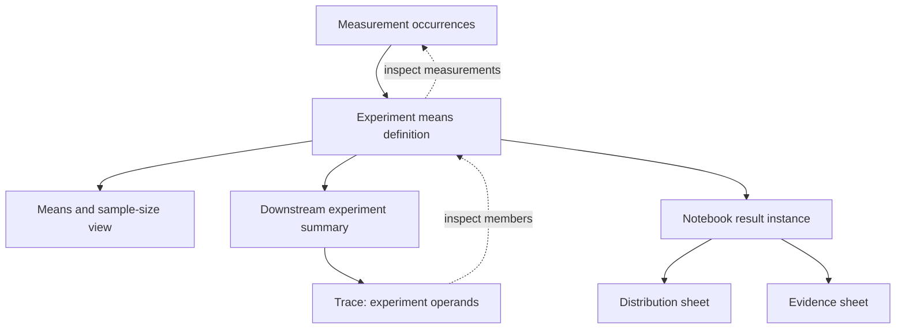

# Reusable grouped results for explorEDA

**Decision:** build named query outputs that other queries can read. Give analysts a compact **Grouped result** editor over the existing query model. Preserve the distinction between an experiment, an arithmetic operand, and an original measurement all the way through reuse and tracing.

**Mode:** Design. **Research date:** October 30, 2026. **Repository baseline:** [`5594c95690859e8ce456aa3228fa9265ba686d12`](https://github.com/byronwall/explorEDA/tree/5594c95690859e8ce456aa3228fa9265ba686d12).

This is a proposed product and implementation design. The supplied complete-file packet was read in full across the research work: all 35 selected files, with ten additional files read at the same immutable baseline. It is a complete review of that selected evidence, not a claim to have reviewed the entire repository. The mission supersedes the older intent documents' outside-demand gates. No feature was implemented, repository changed, application run, or browser acceptance test performed.

## Decision and capability gained

An analyst should be able to define **Experiment means** once, see one row per experiment, plot those rows in several views, and create another query that averages or filters those experiment rows. Editing the producer changes its dependent queries. A downstream trace should say, for example, **2 experiment means contributed to 25**, then show the five valid measurements behind those means without implying that 25 is their pooled measurement mean. The pooled mean in the proof fixture is **28**.

The proposed first-class connection is small:

```ts
// Proposed addition to AnalysisStep. This API is not implemented at the baseline.
interface ResultStep {
  id: string;
  kind: "result";
  queryId: string;
  // Added in milestone 2. Literal values owned by this reference step.
  bindings?: Record<string, AnalysisScalar>;
}
```

A result step reads the referenced query's designated `outputStepId`. It does not name a chart, saved view, notebook sheet, rendered mark, or arbitrary private stage. Existing `AnalysisQuery.id` is the definition identity; no publication flag or separate result catalogue is needed. A query ID and its effective, validated bindings identify a logical result instance. Its evaluated revision also includes its definition and source generations. **RO-01, RO-04, RO-08.**

The first milestone supports parameter-free producer closures and already supplies cross-query reuse. The next adds explicit literal bindings. Both retain automatic recomputation after relevant definition and source changes. Live chart selections remain presentation state; they do not become inputs to reusable queries. **RO-06.**

The implementation should keep React, TypeScript, the current evaluator, existing project text, local folders, and the existing notebook compiler. Start with embedded project views and a runnable demo, then authoring, local folders, and project-aware notebooks. Each stage ships with documentation and an example. **RO-10, RO-11, RO-20.**

## 1. What should be built?

### What the baseline already does

These are inspected source facts, not proposed features:

- `AnalysisQuery` owns `steps` and one `outputStepId`; `SourceStep` names a physical `sourceId`. `AnalysisView` already references a `queryId` and owns its own bindings and chart settings. There is no cross-query result step. [R01]
- `evaluateAnalysisQuery` recursively evaluates local step dependencies. `aggregateFrame` can feed a later filter, calculation, or aggregate in the same query. Several views over one query and further same-query grouping are therefore existing capabilities. [R02]
- `queryForStage` copies the required local steps into a new query. `copyQuery` gives the selected query and its local steps fresh IDs. Neither installs a live reference to its original definition. [R05]
- `AnalysisResultRow` retains physical source references and, for non-count measures, immediate contributor values and row keys. Each `AnalysisEvaluation.stages` retains intermediate rows **within that query**. The final grouped row alone is not the whole trace. A cross-query reference needs addresses into retained dependency evaluations, not a second copy of every ancestral row. [R01, R02]
- `ExplorEdaProject` evaluates the shown view with `view.bindings`, supplies result values to charts, and already presents the query, frame label, row count, applied bindings, and status in `ProjectScope`. [R04]
- Notebook blocks compile together. Sheets divide reading order; they do not establish separate data models. `ExplorEdaNotebook` uses one data array and one provider with `localSelections`. Interactive chart selections remain local to their chart. [R08]

The noticeable addition is therefore **one query consuming another query's rows through a live definition reference**, with a trace that crosses that boundary. Merely adding another grouped chart or another view would not satisfy the mission.

### Four meaningful alternatives

| Direction | What it makes easy | Decision and tradeoff |
| --- | --- | --- |
| Named reusable query outputs | Reuse an existing relational definition; filter or aggregate its output; preserve project ownership | **Build.** Add a root step referencing a query's output. Stable query IDs and the current evaluator provide a small, understandable contract. The initial picker exposes valid outputs of the existing relational query model with declared fields and computable row grain; rendered chart internals and generated statistical samples are outside that boundary. |
| A separate author-facing grouped-table definition | A concise task-specific form: input, grouping keys, measures, name | **Build the form, not another execution model.** Compile the form into ordinary query steps. A second `groupedTables[]` AST would duplicate reducers, filters, bindings, persistence, and validation. |
| Promote the current chart's output | Discover reuse while looking at a useful chart | **Defer arbitrary promotion.** A rendered chart may include hidden filters, top-N limits, binning, series, subtotals, stacking, or generated curve points. A later shortcut may create and preview an explicit query definition for a supported aggregate chart. It must not persist screen-derived values. |
| Share a stage inside an existing query | Reuse an intermediate aggregate with fewer declarations | **Reject as the public boundary.** Private step IDs, output changes, editor ownership, and parameter scope become user-visible dependencies. The designated query output is a clearer boundary. A future extraction command may create a named query and deliberately rewire consumers. |

Named output reuse also avoids making every analytic object into a dataset. The initial product is for ordinary grouped relations, with one row per explicit grouping tuple. A fitted curve's sampled points are not independent observations. Pivot subtotals, model coefficients, density grids, and arbitrary chart internals are outside this contract. **RO-15, RO-18.**

### What the strongest external examples contribute

The following are current primary-source observations retrieved on October 30, 2026. The transfer decisions are design judgments. No competitor UI was tested.

| Product or source | Documented mechanism | What transfers to explorEDA |
| --- | --- | --- |
| Observable Notebooks 2.0 and its runtime | Cells share named variables; referencing cells update reactively. Saved notebooks retain source, not computed output. The runtime documents named imports, cycle errors, and pending/fulfilled/rejected states. [E01, E02] | Separate definitions from evaluated values, evaluate dependencies in order, and expose applied state. Do not import a general JavaScript execution environment or notebook language. |
| Observable Plot | Group transforms expose grouped data and reducers; the default grouped data retains the input arrays for each group. [E03] | Retain group membership beside aggregates. A mark transform is not by itself a persisted reusable project relation. |
| Vega | A named dataset can use another named dataset as its `source`, then apply transforms. [E04] | A distinct result-read step is a direct analogue. Keep data dependencies explicit and separate from visual encodings. Do not adopt Vega as another evaluation engine. |
| Vega-Lite | Aggregation creates one record per group; join-aggregate preserves original row structure. Selections projected over aggregate fields are limited to their defining view. [E05, E06] | State the row grain structurally. Do not forward an aggregate predicate to original measurements merely because fields look related. |
| DuckDB views and relations | A view stores a query definition and is not physically materialized. Relations are lazy; reading runs the query, while materialization holds results. The current documentation resolved to version 2.0. [E07, E08] | Persist the recipe and distinguish it from a snapshot. A local result reference need not introduce a database server, SQL runtime, materialized-view manager, or permanent cache. |
| Perspective | Its current derived-table API turns a View's output into a reusable read-only Table, with updates in the same cycle. Documentation warns that rollup rows can double-count and that coarser reaggregation of ratios loses their original totals. The viewer exposes named derivations and saves their definitions. [E09] | This is the closest product analogue. Show the derivation, consumer count, and deletion impact. Feed only explicit leaf-level grouped rows into the new result, and preserve additive components when pooling. Perspective's engine and lifecycle are not prerequisites. |
| Tableau | Level-of-detail expressions distinguish row and view calculations. Its order-of-operations documentation shows why filter position changes populations and denominators. [E10, E11] | Name input filters and result filters separately. Avoid a hidden hierarchy of filter classes; the query's visible step order can explain the distinction. |
| Mosaic | Selection clauses have owners and resolution strategies, including client-specific cross-filter behavior. [E12] | Preserve explicit ownership. Suppressing a selection on its originating chart is not sufficient to prevent a cycle through a reusable-result dependency. |

The aggregate-provenance paper by Amsterdamer, Deutch, and Tannen makes a narrower supporting point: aggregate provenance must explain value computation as well as tuple membership. Its abstract was reviewed; no claim is made to have evaluated its full formal construction. The proposed row/field references borrow that distinction, not the paper's algebra. [E13]

### Why this direction is ambitious enough

The result becomes an analytical input with its own grain. An analyst can compare experiments equally, restrict downstream analysis to experiments meeting a criterion, or calculate a pooled comparison from compatible sums and valid counts. Multiple presentations remain free to disagree intentionally about visible subsets while relying on the same producer definition. Source observations remain reachable through a chain that explains what each stage counted.

That is substantially more than shared chart settings, while remaining bounded by the existing relational steps.

## 2. What does the analyst do?

### End-to-end experiment workflow

The primary example uses the 12 measurement occurrences specified in section 3 and in `proof-fixtures.json`. Its experiment IDs are present and consistent. The workflow does not need an outside participant, an export/import workaround, or an adoption gate.

1. **Open measurements.** The initial source workspace shows its summary and Rows drawer. It describes 12 measurement occurrences. Zero is a valid reading; missing and nonnumeric values remain inspectable.
2. **Create a grouped result.** In the Query panel, choose **New grouped result**. Set the input to Measurements, group by `Experiment ID`, and name it **Experiment means**. Create stable field IDs for `reading_mean`, `reading_sum`, `reading_n`, and `measurement_rows`. The default mean recipe offers valid numeric count alongside the mean.
3. **Inspect the grain before using it.** The preview shows **3 experiments · one row per Experiment ID** and the fields being produced. A is mean 10 with 2 valid readings, B is mean 40 with 3, and C has no available mean with 0. C remains a row because its observations exist.
4. **Plot the means.** A scatter plot uses `reading_n` on X and `reading_mean` on Y. It has two plotted points and three result rows; C appears in the table and missing-value count. A histogram of `reading_mean` describes experiment means, not the five original finite measurements. Axis and count copy use experiments.
5. **Reuse without changing grain.** Choose **New view using this result** to add a saved project view of the same query and bindings. It gets independent chart layout and project-view filter state. This uses an existing capability, now made explicit in the result workflow.
6. **Analyze the result in another query.** Choose **Use result in a new query**. The new query starts with `result @experiment-rows query=experiment-means`. Add a global average of `reading_mean`. This creates a downstream result whose value is 25 over two available experiment means. It continues to reference the shared producer.
7. **Filter at the intended level.** A chart filter `reading_mean >= 20` filters experiment rows in the current project view. A saved downstream query filter after the result step makes a reusable subset containing B. Neither operation changes B's mean or the producer's input population. To limit measurements to readings at most 20, edit the producer's filter **before** its aggregate; that produces A=10 and B=20.
8. **Inspect contributors.** Alt-click or Alt-Enter the downstream summary. The trace first names its immediate experiment rows and which means were eligible. Open B to see its mean's three included readings and two excluded occurrences. Switch to all members to see all five. Original measurements are reached from the trace, without injecting a filter into the producer.
9. **Edit the shared definition.** **Edit shared definition** opens the existing Query panel with a compact uses list. Valid committed edits replace the definition under the same ID. Consumers recompute; labels, grain, counts, and traces move to the completed revision together. An invalid draft does not destroy the applied result.
10. **Compare with a copy.** **Copy this definition** gives the selected query and local steps fresh IDs. Its own edits are independent. If it still reads another shared result, that reference remains and is visibly named. Copying the physical-source-backed Experiment means query makes its recipe independent of the original; it still reads the same physical data.
11. **Save, close, and reopen.** In the folder milestone, the producer and consumer definitions live once in `exploreda.eda` or `.exploreda/project.eda`. View files retain query references, bindings where applicable, and settings. Reopening evaluates the definitions from available sources. It does not restore a hidden result cache.
12. **Use in a notebook and refresh.** In the notebook milestone, select Experiment means once for the whole notebook. A “Distribution” sheet and an “Evidence” sheet show those same experiment rows. Updating a measurement or the producer refreshes both sheets. A raw-measurement workspace remains a separate analysis, or is reached through the trace; it is not silently installed as a different-grain sheet.

### Shared definitions and bound instances

“Shared” must describe exactly what is shared:

| Action | Ownership and effect |
| --- | --- |
| New view using result | Same query definition and initially equal binding values; independent saved layout and project-view interaction state |
| Use result in new query | New consumer query; its result-read step references the producer definition and, from milestone 2, owns literal producer bindings |
| Edit shared producer definition | Recomputes every consuming instance when next evaluated; names may change, IDs remain |
| Change a result-step binding | Edits that consumer query definition and all of its views/descendants; other reference steps remain unchanged |
| Change a direct producer view's binding | Changes that direct view's instance; previously captured reference bindings do not follow it |
| Copy this definition | Fresh selected query and local step IDs; upstream result references remain shared and labeled |
| Copy with dependencies | Later optional closure-cloning command; even this would share original physical sources rather than freeze data |

Capturing binding values is not capturing a data snapshot. The referenced definition and source data remain live. Display a short input summary beside the shared-result name when inputs exist. Do not call two differently bound results the same instance. **RO-04, RO-12, RO-14.**

### Concise proposed project text

The existing source, query, aggregate, and calculation forms are reused. `result` and `eligibility=numeric` below are proposed additions; this text will not execute correctly on the baseline release. The source declaration assumes a prepared file with the typed rows in the fixture. `frame` is a human label; the structural grouping fields remain authoritative.

```text
project @experiments

source @measurements "Measurements" path=data/measurements.json key=measurementId {
  field measurementId "Measurement ID" string
  field experimentId "Experiment ID" string
  field value Reading number
}

query @experiment-means "Experiment means" glyph=◆ frame=experiments {
  source @read measurements
  aggregate @by-experiment by=measurements.experimentId {
    average @reading_mean measurements.value label="Mean reading"
    sum @reading_sum measurements.value label="Reading sum"
    count @reading_n measurements.value eligibility=numeric label="Valid readings"
    count @measurement_rows label="Measurement occurrences"
  }
}

query @experiment-summary "Experiment summary" glyph=◇ frame=summary {
  result @experiment-rows query=experiment-means
  aggregate @summary {
    average @equal_experiment_mean reading_mean
    count @experiment_rows
    count @available_means reading_mean eligibility=numeric
    sum @reading_total reading_sum
    sum @reading_count reading_n
  }
  calc pooled_mean "Pooled measurement mean" = if reading_count > 0 then reading_total / reading_count else null
}

query @high-means "Experiments with mean at least 20" glyph=● frame=experiments {
  result @experiment-rows query=experiment-means
  filter @high reading_mean >= 20
}
```

The source fields match the JSON companion's `measurementId`, `experimentId`, and `value`. Their declaration form follows the existing `fieldLine` serializer; the full example still needs parser/serializer execution after the new syntax exists. The calculated conditional follows the existing `if … then … else …` expression form used in `apps/demo/src/demos/analyses/shop.ts`. [R06, R11]

Milestone 2 adds literals such as:

```text
result @experiment-rows query=experiment-means-by-phase bind.phase="baseline"
```

`bind.phase` is proposed syntax for the reference step's own binding map. `$phase`, an expression, a view ID, and a selected chart are not accepted as implicit substitutes. An unparameterized wrapper query can bind the producer and become a notebook input without introducing notebook parameter controls.

### Compact UI direction

Reuse `ProjectScope`, the existing Query side panel, field pickers, Rows drawer, and chart trace entry points. A temporary editor should not become a permanent sidebar. `grouped-results-ui.svg` is a conceptual layout companion, not a screenshot or tested implementation.

| Surface | Proposed contents |
| --- | --- |
| Existing scope line | Experiment means · rows are experiments · 3 · Shared definition · Uses 3 |
| Query panel header | Definition name; **Use result**; existing close and size actions |
| Grouped-result settings | Input; Group by; row label; compact measure rows with stable field IDs behind editable display labels |
| Definition preview | Grain statement; output field metadata; first N rows with visible preview limit; per-measure valid counts |
| Result-read step | Shared producer name, applied input summary, grain, **Edit shared definition**, and **Copy this definition** |
| Trace | Breadcrumb of query/result/measure; **Members**, **This measure**, and **Original measurements**; explicit excluded reasons |
| Status | Current, Updating, or Update failed with previous data identified; never a bare zero for unavailable input |

Settings use the repository's 28 px inner controls and 100 px label column. At 1280 px the nonmodal panel leaves analysis visible; 783 px keeps the existing two-column reading flow; 390 px uses a bounded full-width sheet with sticky actions and an explicitly scrollable table. Do not add an Inspect button to a chart: retain Alt-click, Alt-Enter, and header tracing. See the implementation plan for exact pointer and keyboard acceptance. [R12]

## 3. Exact analytical contract

### Four identities, four different questions

| Concept | Meaning in the proposed contract |
| --- | --- |
| Source occurrence | One supplied row in one physical source generation. Equal values are still separate occurrences. Duplicate or missing business keys do not silently merge them. |
| Result row | One row at a query stage's grain. For Experiment means, one explicit experiment-ID group; for its downstream global summary, one summary row. |
| Measure contributor | An immediate input row and input field that is eligible for a particular computation, with the operand value and any exclusion reason. Different measures can have different eligible populations. |
| Downstream membership | The ordered/multiplicity-preserving input row references belonging to a downstream group, including rows whose selected measure is unavailable. |

Deduplicated original-source references answer **which original records are reachable**. They do not, by themselves, answer **how many operands were reduced**, **how many experiments were averaged**, or **how much weight each measurement had**. Lookup dimensions and related-record browsing must not be counted as measurement observations.

At the baseline, source keys preserve typed values when unique; duplicate or missing keys use positional occurrence keys and diagnostics. Expansion creates distinct parent/child occurrence keys. Those guarantees are local to the supplied snapshot. This mission does not require the unmerged keyed-refresh design. [R02]

### Exact unequal-group proof

Every cell below represents the raw input value. `""`, `" "`, and `"Infinity"` are strings; `true` is a Boolean. The JSON companion preserves those types.

| Experiment | Reading occurrences | Expected grouped fields |
| --- | --- | --- |
| A | `0, 20, null` | rows 3; present-value count 2; valid numeric count 2; sum 20; mean 10 |
| B | `20, 40, 60, "n/a", ""` | rows 5; present-value count 5; valid numeric count 3; sum 120; mean 40 |
| C | `null, " ", "Infinity", true` | rows 4; present-value count 3; valid numeric count 0; sum and mean unavailable |

There are 12 physical measurement occurrences, 3 experiment rows, and 2 available experiment means. There are 5 finite readings and a finite reading sum of 140.

For an available experiment mean \(m_g\), valid count \(n_g\), and sum \(s_g\):

\[
m_g=\frac{s_g}{n_g},\quad n_g>0.
\]

The downstream equal-experiment mean is:

\[
\frac{10+40}{2}=25.
\]

The pooled measurement mean is:

\[
\frac{20+120}{2+3}=\frac{140}{5}=28.
\]

Both are legitimate, different questions. For the equal-experiment mean, each A reading has weight \(1/4\), and each B reading has weight \(1/6\). For the pooled mean, all five readings have weight \(1/5\). A flat union of those five readings cannot explain the weighting that produced 25.

The downstream global summary must report:

- `count()` = **3** experiment rows, including C.
- Numeric `count(reading_mean)` = **2** available means.
- `average(reading_mean)` = **25**.
- `sum(reading_sum)` = **140**; `sum(reading_n)` = **5**.
- Explicit guarded ratio = **28**.

For a result-root query, the existing `AnalysisEvaluation.counts.source` counts immediate input result rows, not transitive physical observations. `counts.available` remains output-row count, not numeric eligibility. The experiment summary therefore has `source=3`, `output=1`, and `available=1`; its trace separately reports two eligible experiment means, five valid measurement leaves, and twelve original members. Preserve these meanings rather than repurposing status counts as arithmetic denominators. [R02]

The existing `count(field)` only excludes `null` and `undefined`. It would count 10 present raw values here, including blank/nonnumeric/Boolean/nonfinite values, and `140 / 10 = 14` would be the wrong numeric mean. Preserve that existing count contract. Add only `eligibility: "numeric"` for query count measures with a field, using the same `numericExclusionReason` and `parseNumber` as numeric aggregation. It returns zero when no candidate is eligible. Do not expand the global chart aggregation catalogue just to implement this query support field. [R02, R03] **RO-07, RO-19.**

The same parser accepts numeric text according to existing rules and rejects blanks, Booleans, radix-style labels, and nonfinite measurements. A field declared numeric is not permission to count every non-null value as numeric. Independent measures, such as temperature and pressure, must retain separate eligibility counts; `temperature_n` cannot weight `pressure_mean` without a checked common population.

### Exact filtering and refresh results

| Operation | Exact expected result |
| --- | --- |
| Display or downstream filter `reading_mean >= 20` | B only: 1 experiment, 5 source members, 3 valid numeric contributors, mean 40. Producer remains A=10, B=40, C unavailable. |
| Producer input filter numeric reading `<= 20` on this typed fixture | A has `[0,20]`, B has `[20]`, C has no surviving observations. Two experiment rows; means 10 and 20; equal mean 15; pooled mean `40/3`. |
| Refresh B's reading 60 to 90 | B mean 50, B sum 150. Equal mean 30, pooled mean `170/5 = 34`. Group count remains 3. |
| Filter out every measurement before grouping by experiment | Zero grouped experiment rows. No fabricated A/B/C records. |
| Global aggregate with no grouping keys over an intentionally empty input | One summary row: count 0; sum/average/min/max unavailable, retaining current query semantics. |
| Select C's result row | Four members remain inspectable; numeric contributors to its reading mean are zero. C contributes no value to the equal mean. |

The pooled ratio must also be unavailable when the producer has zero groups or only C. With zero groups, downstream `sum(reading_n)` is unavailable under the existing sum semantics; with only C, it is zero while `sum(reading_sum)` is unavailable. Neither case may cause division by zero or a whole-query calculation failure. The proposed conditional formula must be checked against the actual Calculator's missing-condition behavior during implementation; JavaScript comparison behavior is not evidence for that expression language.

No input filter is inferred from selecting B or C. An analyst must author a query filter at the appropriate stage to alter its input population.

### Missing keys, empty groups, and unavailable inputs

- **No rows for a known experiment:** no group is emitted by ordinary grouping. Showing scheduled experiments that have no measurements needs an explicit experiment table and existing relationship/scaffolding work; it is not automatic densification.
- **Rows exist, but all readings are invalid:** preserve the group, show valid count 0, and show an unavailable mean/sum. Do not substitute numeric zero. The UI can render its standard `null` cell while the runtime retains its existing unavailable representation.
- **Missing experiment ID:** retain the baseline typed grouping distinction if the author groups on that field. `null` and `undefined` are different typed groups in the current evaluator. Such buckets must be labeled as missing IDs, not presented as known independent experiments. The primary recipe requires valid experiment IDs or an explicit pre-group filter; it does not silently discard them.
- **Missing source file or snapshot:** block the affected result closure. This differs from an available empty table. The folder reader currently represents missing source data with an empty array **and** `missingSources`, so the host must pass availability information rather than rely on array length. [R07]
- **Missing producer, field, or required evaluation input:** report a named dependency error. Do not run a downstream aggregate over a substitute empty table and display a plausible zero.
- **Conflicting entity measure:** preserve the existing unavailable-result policy. Eligible operand counts may still be explainable, but must not be presented as a successful value. Numeric-count eligibility does not override `entityFieldId` or its conflict behavior. [R02, R13]

`AnalysisStage.excludedCount` currently sums exclusions across non-count measures; one invalid source row can therefore appear more than once. The new inspector must use per-measure counts and label any distinct source-membership count separately. It must not relabel that aggregate total as unique excluded measurements. [R02]

### A second workflow that tests a different boundary

Use a small order/category example only to test **overlapping group membership**. It does not introduce a new rates or preparation mission.

Orders are O1=100 and O2=20. Item L1 places O1 in Red; L2 places O1 in Blue; L3 places O2 in Red. A category result counts/orders once per original order occurrence within each category:

- Red: 2 orders, amount 120.
- Blue: 1 order, amount 100.
- Summing category counts gives **3 order-category memberships**, and summing amounts gives **220 amount over memberships**.
- The distinct original orders remain **2**, with total amount **120**.

Reusing category rows does not authorize the system to deduplicate the downstream arithmetic to two orders. Nor may it claim that 220 is the total across unique orders. Immediate row membership preserves the arithmetic; original-row union preserves navigation. This is why pooling group sums/counts requires a compatible partition and population. The experiment fixture has a disjoint experiment assignment; arbitrary reusable results may not. **RO-03, RO-05, RO-07.**

### Selection direction and filter scope

| Owner or action | Scope and effect |
| --- | --- |
| Producer `FilterStep` before grouping | Changes which measurement occurrences enter that producer instance and all consumers of its result |
| Consumer `FilterStep` after `ResultStep` | Changes which producer result rows enter that consumer and its descendants; does not alter the producer |
| Project view chart/workspace filters | Retain existing linked filtering within that saved view's evaluated result rows; a second project view has its own settings/state |
| Notebook chart interaction | Retain `localSelections`: that chart's selection remains local, including when another sheet uses the same result |
| Notebook-wide authored filter | Applies at the notebook presentation scope across its shared data; does not edit the producer query |
| Rows search or local table filter | Restricts inspection presentation, not query evaluation |
| Trace a result row upstream | Resolves exact membership for inspection; does not install upstream filters or alter parameters |
| Raw measurement selected elsewhere | No automatic grouped-result recomputation or ambiguous any/all-members propagation in the first release |

Existing chart reducers may still update over the currently visible result rows. “No selection-fed computation” means no selection becomes an input edge in the reusable-query evaluator; it does not freeze ordinary chart calculations.

The first release therefore supports **live authored queries**, not live chart-selection-fed queries. Capturing a transient selection as an explicit authored predicate can be explored later. Such a command must state the stage and captured conditions, create a copied predicate, and reject unsupported chart filters; it must not save raw transient row indices. Arbitrary bidirectional cross-grain linking remains deferred. **RO-06, RO-13, RO-16.**

## 4. What changes in code and saved data?

### Model boundaries

Keep `AnalysisProject.queries` as the definition owner. A new `ResultStep` is another root, like `SourceStep`; it has no `inputStepId`. The existing local filter/calculate/aggregate steps consume it unchanged. References follow query IDs, not display names. A result exposes only its designated output; changing that output is a definition edit that requires downstream field validation.

The first grouped-result surface supports source/result reads, existing filters and scalar preparation, and a visible aggregate. It need not become a generic pipeline editor. Arbitrary result-to-result joins, generated statistical outputs, unions, and new pivot engines are not required.

Derive an output-grain descriptor from the evaluated steps. For a grouped output, retain the grouping field IDs and typed key tuple; for a global summary, record a summary grain. Use `frameLabel` only as the analyst's readable label. A post-group filter preserves grain; a later aggregate replaces it; an expansion changes it. Do not keep displaying “one experiment” after an expansion or group-key change. **RO-03.**

A result read preserves the producer's field IDs. It does not prepend a mutable display name. Imported field origins also need a qualified upstream field address: an upstream `{stepId}` cannot be interpreted as a local consumer step. Add a result-origin variant and resolve it through the retained bundle while preserving the existing source/local-step origin forms. The current single-input step model avoids combining two result schemas; a future join feature would need its own alias/collision policy. Existing field IDs remain the stable references used by charts and formulas. Renaming a measure's display label does not rename its ID.

Output field metadata must be structural, including when every value is unavailable or a keyed grouping emits zero rows. Declare aggregate measure outputs numeric and preserve declared source/group-key types; the baseline aggregate field construction currently omits a numeric `type`. An imported field must still resolve to its producer when producer and consumer happen to use the same local step ID. This requires qualified origins, not data-dependent type guessing. [R01, R02]

Retain two distinct pieces of field metadata: physical endpoint origin where applicable, and the qualified producer address for tracing. Existing relationship matching uses physical `{sourceId,fieldId}` origins, including grouped keys; replacing that information with an opaque result origin would break an otherwise valid lookup after a result read. Aggregate measure outputs have no physical endpoint origin merely because their contributors came from a source field. [R02, R17]

### Bindings: explicit ownership without a publication system

Milestone 1 accepts a producer only when its reachable output closure needs no ambient parameter values. Unrelated project parameter declarations do not make it parameterized. Milestone 2 supports literal `ResultStep.bindings` and applies these rules:

1. Resolve the parameters used by the producer's own reachable local steps. A nested result step establishes its own binding boundary.
2. Validate the explicit map against that required evaluation set. A missing value for a reachable parameterized filter is an unavailable input even when the parameter declaration is not marked `required`; the baseline filter does not treat absence as “skip this filter.” [R02]
3. Reject unknown/unused binding IDs on a result reference, mismatched types, nonfinite numbers, objects, and binding-expression or parameter-reference syntax. Accept parsed scalar literals: quoted strings such as `"$phase"` remain string data and are never evaluated. `undefined` is not persisted. Current scalar parameter types do not accept `null`; optional null-skip semantics are not invented here.
4. Canonicalize keys in sorted order and retain value types. `{a:1,b:"x"}` and `{b:"x",a:1}` identify the same instance. `1` and `"1"` do not, and the wrong type fails validation rather than coercing silently.
5. Never inherit the consuming view's bindings or the most recently opened producer view's bindings. A shared parameter control across unrelated references belongs to the separate parameterized-notebook design.
6. **Use result** takes the producer's completed `appliedBindings`, projects that map onto the producer's reachable local parameter IDs, validates every required value, and persists only that subset. Unrelated legacy direct-view bindings must not make capture fail. It never captures pending controls or forwards consumer bindings. While evaluation is pending, the initial implementation disables this action.

If B and C independently reference A with the same literal inputs, they use the same logical A instance. B1 and B2 are views of B. Changing B's reference literals updates B1 and B2 and B's descendants; C is unchanged. Editing A's definition updates both bound instances. Changing a direct A view's inputs changes only that view. These are mandatory acceptance cases, not optional copy details.

### Dependency validation and evaluation

Extend the existing evaluator rather than translating into a second engine:

- Validate project-wide query ID uniqueness and resolve references after all query declarations are parsed. Query declaration order does not control dependency order.
- Starting at the requested query's output, validate local steps and reachable result references. Reject self-reference and cycles with a readable query path. Different literal bindings do not make recursive query definitions acceptable.
- Validate upstream fields before downstream filters, measures, and calculations use them. A removed mean field must not become an accidental all-null group.
- Evaluate producers before consumers using the existing frame operations. A request-local memo keyed by query instance can reuse completed nodes within that evaluation. No cross-session cache, materialized table registry, or incremental maintenance service is added.
- Preserve one coherent bundle of the root evaluation and the dependency evaluations needed to inspect it. Each query's stage rows remain available exactly once in that bundle.
- Separate unavailable input from available empty input. A referenced missing source/producer/parameter blocks the dependent branch; a legitimate filter result of zero rows does not.
- Evaluate unrelated valid queries normally even when another saved branch is broken. Editing tools can show all validation problems without making every independent result unavailable.

This is semantic reuse of one definition. Two separately mounted project views may initially evaluate it twice. Do not promise global once-only computation or cross-view atomic commits; those would require a shared evaluation host that this feature does not need.



Solid arrows are evaluation or presentation dependencies. Dotted arrows are inspection navigation; they do not feed data back into evaluation. The diagram describes the proposed design, not a new graph-editor UI.

### Preserve intermediate meaning with references

The baseline already provides much of the needed trace: physical references, numeric contributor records, and local stage tables. The missing connection is a qualified reference to an upstream result row and input field. [R01, R02, R04]

Proposed runtime additions, with names illustrative:

```ts
// Runtime-only addressing inside one retained completed evaluation bundle.
interface AnalysisRowAddress {
  instanceKey: string;
  evaluationRevision: string;
  stepId: string;
  rowKey: string;
}

interface AnalysisInputContribution {
  row: AnalysisRowAddress;
  fieldId?: string; // omitted for count-all-rows
  input: AnalysisScalar;
  included: boolean;
  exclusionReason?: string;
}

interface AnalysisEvaluationBundle {
  rootInstanceKey: string;
  evaluations: Record<string, AnalysisEvaluation>;
  sourceGeneration: string;
}
```

Add immediate `inputRows` membership to aggregate/result boundaries, and a qualified `inputRow`/field link to measure contributors. Keep each actual input occurrence; do not turn this into a deduplicated source-row set. Count measures need contributor records too. When `entityFieldId` reduces repeated expanded rows, retain the relationship between the representative operand and the full entity member set, and preserve conflict diagnostics. The new numeric count follows the same entity reduction before numeric eligibility.

For a downstream `average(reading_mean)`, the trace starts with A and B as included operands and C as an excluded result row. Following B's `reading_mean` field opens the producer aggregate's own contributor list. It does not open the contributors of another field, and it does not re-average the union of raw measurements.

`QueryStageRows.relatedRecords` currently broadens physical references through relationships. Retain that as clearly labeled related-record browsing. It is not an exact measure contributor list. Likewise, its existing **Open source as a view** action opens the entire source, so a new exact contributor preview must not reuse that action under misleading wording. [R14]

### Revision, refresh, and stale display

Keep stable identity separate from freshness:

| Identifier | Purpose |
| --- | --- |
| Query ID | Persisted definition reference; unchanged by display-name edits |
| Instance key | Query ID plus canonical effective literal bindings; not tied to a view or sheet |
| Evaluation revision | Definition/output contract, effective bindings, source generations, and upstream evaluation revisions used for this result |
| Qualified row address | Instance, revision, stage, and row key used for trace navigation |

The current evaluator fingerprints a query and related definitions and uses immutable table-array identity as an in-process source revision. The worker protocol sends tables separately and drops obsolete request replies; the hook keeps the prior completed evaluation while pending. Extend those mechanisms to the dependency closure rather than treating the current revision string as a durable content hash. [R02, R09]

Recommended refresh contract:

- A relevant definition edit, explicit binding edit, or new immutable source array schedules evaluation of the current requested closure. A source refresh is complete when the host provides a coherent new source snapshot and availability state; no polling service is added.
- The main thread supplies a source-generation/request token with worker requests and validates it on responses. Tokens are for correctness within the host session, not persisted identity.
- Preserve the previous completed result bundle and its **applied immutable project, bindings, tables, and availability state** while the next request runs. This is one bounded previous snapshot, not a cache platform.
- Draw counts, grain, field labels, and trace data from that applied snapshot. Draft or current-definition editor controls may differ, but must be labeled as updating. Never combine old numbers with new grain labels.
- Trace navigation during pending may inspect the completed snapshot only when its matching tables/definitions are retained. If a host cannot retain them, disable that trace until ready. Never resolve an old positional source key against new tables.
- Disable result capture and selection-changing actions on stale data. Read-only inspection of the explicitly labeled previous snapshot is allowed.
- Commit a completed root and its dependencies together. Drop replies for older requests. First load without a completed snapshot shows a pending placeholder.
- On failure, show a dependency error and identify any retained previous data. Do not display it as current. A successful empty result is a normal ready state.

The source arrays are already documented as immutable inputs. Retaining references to the applied arrays is the smaller solution than serializing every physical table again in every worker response. If source availability is passed by a folder host, retain that alongside the arrays. [R04, R07, R09]

Initial result-selection policy is conservative: clear transient row selections when a completed evaluation revision changes. Preserve authored value predicates and compatible chart settings, but do not replay positional selections across refreshed data. Saved result-row selections require a verified grain/key contract; otherwise reopen with them unresolved/cleared and explain the affected selection. This avoids depending on the unmerged keyed-refresh proposal. A future stable-selection feature can improve this independently. **RO-08.**

### Changed, renamed, and removed definitions

- Rename a query or field label without changing its ID: references continue; captions update on the next coherent commit.
- Add an output field: consumers continue unless their own schema constraints reject it.
- Remove a consumed field, or make its current type incompatible with the consuming operation or saved settings: block that consumer with the producer and field named. Retain its saved settings for repair; do not overwrite them with a fallback layout. No persisted historical expected-schema contract is added.
- Change grouping keys or output stage: recompute structural grain, row identities, and dependent fields; clear transient row selections. A matching old string key is insufficient evidence of the same grain.
- Delete a producer in the UI: show its direct dependent queries/views, prevent silent deletion while it has consumers, and offer navigation to those uses. Do not cascade-delete analyses automatically.
- Delete a producer through a file edit: retain broken references as repairable diagnostics. Other query branches still open.

### Persistence and hosts

Retain the existing `AnalysisProject.version: 1` and extend the grammar under the mission's single-deployed-version assumption. The project DSL currently emits `project @id`, hardcodes version 1 when compiling, and does not validate a `version=` header. Merely adding `version=2` would not establish a meaningful version contract. No migration framework is warranted. [R06]

The new release must explicitly recognize and validate `result`, `query=`, `bind.*`, and `eligibility=numeric`; malformed or unsupported values block evaluation. Existing `checkPairs` warns about and ignores unknown settings, so **new files are not promised correct execution by older releases**. Preserve exact old-project round trips. This compatibility limit belongs in release/integration documentation, not in routine product controls.

Persist:

- Query definitions and stable IDs, output-step references, group/measure definitions, and result-step literal bindings.
- View query references, direct-view bindings, compatible presentation settings, and existing notebook text.
- Physical source declarations and existing source file/snapshot arrangements.

Do not persist computed grouped rows, dependency evaluation bundles, worker request IDs, source-generation tokens, numeric contributor arrays, runtime chart `__ID` values, or a hidden materialized result table.

The existing portable JSON path must support the same model. `projectFile.ts` validates every query's operations and fields, and `selectAnalysisProjectView` currently walks one query's local steps. Extend parsing/validation and selected-view export to retain the consumer's transitive producer queries, physical sources, relationships, and reachable parameter definitions. Also retain definitions for every selected direct-view binding, including valid legacy unused entries, and the sources/available rows needed by retained parameter option lists. Preserve an omitted source snapshot as omitted rather than manufacturing `[]`. Exporting only the downstream summary view must reopen with 25/28 and reconstruct complete lineage from its saved definitions and source rows. Computed result rows remain transient. [R17]

For folders, reusable definitions belong in the root project file. Initially expose only explicit project queries with project-owned source definitions as cross-file reusable results. `writeFolder.projectFileText` omits `implicitQueries` and `localSources`; blindly referencing one can produce a definition that disappears on save. In the folder milestone, provide an explicit source-definition promotion path, or block that reuse with the exact next action. Moving a declaration does not move or copy its physical data. Cross-file ownership must be settled before writing a reference. Leave unrelated analysis files unwritten; the edited analysis is reconstructed by `exportAnalysisText`, so comment-preserving edits are not promised. [R07, R18]

For React embedding, retain `ExplorEdaProject` and its host callbacks. The host owns project/views and replaces immutable tables on refresh. Expose the new types/evaluation support through the existing analysis entrypoint after checking its export barrel. No embedded host must adopt local folders.

For notebooks, add a project-aware wrapper around the existing generic `ExplorEdaNotebook({data})`. It resolves one query for the whole notebook, evaluates through the same hook/worker, retains analysis provenance, and supplies `AnalysisChartContextProvider`. The current `readNotebookText` maps evaluation rows to `row.data` with empty bindings, while `ProjectWorkspace` passes preloaded notebook rows; that path needs explicit integration. Simply adding another `eda query=` example does not preserve trace or refresh. [R15, R16]

The first notebook release can read a parameter-free query or a parameter-free wrapper containing a fully bound result step. No new notebook parameter controls are needed. Repeated conflicting `eda query=` declarations must be diagnosed rather than letting the first one silently create the impression of per-block sources. All sheets have one grain and result instance; interactive chart-local selections retain current behavior. **RO-09, RO-10, RO-11.**

## 5. How should it ship?

The companion [implementation-plan.md](implementation-plan.md) is the worker-ready sequence. These milestones are user-facing vertical slices; none is a standalone infrastructure project.

| Milestone | Independently useful release |
| --- | --- |
| M1 — Embedded reusable grouped results | A React project and runnable demo use one parameter-free grouped query in downstream queries, preserve contributor navigation, and round-trip definitions through project text and portable JSON, including selected-view export. |
| M2 — Compact authoring and explicit inputs | Analysts create/edit grouped results, inspect their uses, bind parameterized producer references explicitly, and distinguish copies from shared inputs. |
| M3 — Local-folder reuse | Folder users create supported shared results, save canonical definitions and consuming analyses, reopen, and refresh sources with coherent availability and lineage. |
| M4 — Notebook reuse | A project-aware notebook reads one result across sheets, refreshes with project changes, and traces through the same evaluation bundle. |

The initial reference contract, arithmetic semantics, source availability distinction, cycle detection, and trace addressing are not optional post-release hardening. They are what makes “analyze result rows” truthful. Advanced selection propagation, automatic materialization, arbitrary chart promotion, and mixed-grain notebook execution are separate deferred work.

## Rejected options and unresolved choices

### Rejected or deferred

- **Keep only today's same-query grouping:** fails to add the requested cross-query capability.
- **A second grouped-table engine:** duplicates existing steps and reducers.
- **Canonical publication inputs silently replacing view bindings:** would change existing independently bound views and require an unnecessary migration. Explicit reference-owned bindings avoid that surprise.
- **Automatically derive a result from visible chart data:** confuses display transforms, filter scope, and row grain.
- **Use flattened source references as downstream weights:** produces the wrong equal-experiment calculation and fails on overlapping groups.
- **Live downstream selection fed into an ancestor:** creates a semantic feedback path even when a chart excludes its own selection.
- **Persist every evaluated result for faster reopening:** adds stale-state and lifecycle obligations without being necessary for one local analyst.
- **Implement wide-to-long, contributor comparison, keyed refresh, category mapping, or parameterized notebook proposals here:** those adjacent missions are not prerequisites and were not treated as baseline behavior.

### Open questions that do not block M1

1. **Trace volume:** measure retained-bundle size using representative project data during implementation. The first plan uses one current/previous applied snapshot and stage references; a performance limit or lazy transfer can follow measured evidence. No performance claim is established by this research.
2. **Source promotion UX:** M3 may ship with an explicit promote-declaration action or a clear project-owned-source prerequisite. It must not silently persist a dangling cross-file dependency. The plan chooses a guided promotion if the existing saver can write the affected files coherently; otherwise the prerequisite is an acceptable narrower M3 cut.
3. **Capturing a chart predicate:** useful but optional. It needs an exact supported-filter mapping and a declared insertion stage before it can be offered. It is not needed for the authored-filter workflow.
4. **Copying a dependency closure:** optional future convenience; the initial Copy this definition action has explicit retained-sharing semantics.

These are implementation/product refinements. No user clarification, external demand proof, or participant study is required before workers start M1.

## Evidence, checks, and access status

### Checks actually performed

- Read the complete supplied mission and all 35 selected complete source files at the packet baseline.
- Read `docs/research/DIRECTION.md` and nine supplemental notebook, trace, host, portable-file, analysis-text, and row-key files at that same immutable commit.
- Inspected the current primary documentation listed below. Product claims are documentation findings, not tested competitor behavior.
- Executed the standalone mathematical proof companion using exact rational arithmetic. Its output distinguishes checked arithmetic/membership cases from proposed application acceptance cases. It is not an execution of the TypeScript evaluator.
- Checked the finished report links, companion consistency, and ZIP contents. The SVG is a conceptual design artifact.

### Checks still proposed

Repository Vitest/type checks, worker integration tests, DSL parser/serializer execution, real save/reopen, live refresh, accessibility interaction, and visual/browser acceptance at 1280/783/390 px remain for implementation. No `pnpm check` or application browser session was run against this context-only selected source packet.

### Files read

All of the following packet files were read completely. Paths are relative to the repository root.

- Rules/context: `AGENTS.md`; `README.md`; `package.json`; `CODING_STANDARDS.md`; `docs/agent-guide.md`; `docs/ui-defaults.md`.
- Intent/research context: `docs/intent/reusable-analysis-outputs/intent-brief.md`; `docs/intent/reusable-analysis-metrics/intent-brief.md`; `docs/research/data-preparation-boundary-2026-10-16/README.md`.
- Model/evaluation: `packages/explorEDA/src/types/AnalysisProject.ts`; `packages/explorEDA/src/lib/analysis/evaluateProject.ts`; `packages/explorEDA/src/lib/analysis/useAnalysisEvaluation.ts`; `packages/explorEDA/src/lib/analysis/analysisWorkerProtocol.ts`; `packages/explorEDA/src/lib/analysis/analysisWorker.ts`; `packages/explorEDA/src/lib/aggregates.ts`; `packages/explorEDA/src/lib/valueParsing.ts`.
- Project UI: `packages/explorEDA/src/components/ExplorEdaProject.tsx`; `packages/explorEDA/src/components/project/ProjectQueryPanel.tsx`; `packages/explorEDA/src/components/project/queryEditing.ts`; `packages/explorEDA/src/components/project/ProjectQueryPanel.test.tsx`.
- Text/folder: `packages/explorEDA/src/lib/dsl/project.ts`; `packages/explorEDA/src/lib/dsl/project.test.ts`; `packages/explorEDA/src/lib/project/folder.ts`; `packages/explorEDA/src/lib/project/writeFolder.ts`.
- Notebook: `packages/explorEDA/src/lib/notebook/compileNotebook.ts`; `packages/explorEDA/src/lib/notebook/sheets.ts`; `packages/explorEDA/src/components/notebook/ExplorEdaNotebook.tsx`.
- Fixtures/tests: `packages/explorEDA/src/test/fixtures/shopProject.ts`; `packages/explorEDA/src/test/lib/analysis/evaluateProject.test.ts`; `packages/explorEDA/src/test/lib/analysis/entityGrain.test.ts`.
- Docs/examples: `apps/demo/src/docs/pages/project-folders.mdx`; `apps/demo/src/docs/pages/notebooks.mdx`; `apps/demo/src/demos/examples.ts`; `apps/demo/src/demos/multiSourceShop.ts`; `apps/demo/src/demos/analyses/shop.ts`.

Additional same-baseline files: `docs/research/DIRECTION.md`; `packages/explorEDA/src/lib/notebook/index.ts`; `packages/explorEDA/src/lib/notebook/readNotebook.ts`; `packages/explorEDA/src/components/AnalysisChartContext.tsx`; `packages/explorEDA/src/components/project/QueryStageRows.tsx`; `apps/app/src/ProjectWorkspace.tsx`; `apps/demo/src/folder/FolderPage.tsx`; `packages/explorEDA/src/lib/analysis/projectFile.ts`; `packages/explorEDA/src/lib/project/analysisText.ts`; `packages/explorEDA/src/components/project/analysisRowKeys.ts`.

The decisive model, evaluator, persistence, and notebook-host evidence was available. Supporting export barrels, full host saver internals, detailed chart trace planners, and the lower-level `rowIdFilters` implementation were not reviewed; their integration verification is named in the plan rather than presented as established behavior. Open research PRs were not treated as implemented dependencies.

### Repository citations

Every repository link below is pinned to the recorded baseline. Symbols identify the relevant evidence even if later workers reconcile changed line positions.

- **R01:** [AnalysisProject.ts](https://github.com/byronwall/explorEDA/blob/5594c95690859e8ce456aa3228fa9265ba686d12/packages/explorEDA/src/types/AnalysisProject.ts): `AnalysisStep`, `AnalysisQuery`, `AnalysisView`, `AnalysisResultRow`, `AnalysisMeasureContributor`, `AnalysisEvaluation`.
- **R02:** [evaluateProject.ts](https://github.com/byronwall/explorEDA/blob/5594c95690859e8ce456aa3228fa9265ba686d12/packages/explorEDA/src/lib/analysis/evaluateProject.ts): `sourceReferences`, `expandedFrame`, `filterFrame`, `aggregateFrame`, `validateQuery`, `evaluateAnalysisQuery`, `tableRevision`.
- **R03:** [aggregates.ts](https://github.com/byronwall/explorEDA/blob/5594c95690859e8ce456aa3228fa9265ba686d12/packages/explorEDA/src/lib/aggregates.ts), `AGGREGATIONS`, `reduceNumbers`; [valueParsing.ts](https://github.com/byronwall/explorEDA/blob/5594c95690859e8ce456aa3228fa9265ba686d12/packages/explorEDA/src/lib/valueParsing.ts), `parseNumber`, `numericExclusionReason`.
- **R04:** [ExplorEdaProject.tsx](https://github.com/byronwall/explorEDA/blob/5594c95690859e8ce456aa3228fa9265ba686d12/packages/explorEDA/src/components/ExplorEdaProject.tsx): `ExplorEdaProjectProps`, `ExplorEdaProject`, `ProjectScope`, `chartContext`, `reported`, `renderedSettings`.
- **R05:** [queryEditing.ts](https://github.com/byronwall/explorEDA/blob/5594c95690859e8ce456aa3228fa9265ba686d12/packages/explorEDA/src/components/project/queryEditing.ts), `queryForStage`, `copyQuery`, `rowLabel`, `sourceView`; [ProjectQueryPanel.tsx](https://github.com/byronwall/explorEDA/blob/5594c95690859e8ce456aa3228fa9265ba686d12/packages/explorEDA/src/components/project/ProjectQueryPanel.tsx), `openCopy`, `openStage`.
- **R06:** [project.ts](https://github.com/byronwall/explorEDA/blob/5594c95690859e8ce456aa3228fa9265ba686d12/packages/explorEDA/src/lib/dsl/project.ts): `stepLines`, `measureLine`, `compileStep`, `compileQuery`, `checkReferences`, `compileProjectText`, `exportProjectText`.
- **R07:** [folder.ts](https://github.com/byronwall/explorEDA/blob/5594c95690859e8ce456aa3228fa9265ba686d12/packages/explorEDA/src/lib/project/folder.ts), `readProjectFolder`, `missingSources`, `implicitQueries`, `localSources`; [writeFolder.ts](https://github.com/byronwall/explorEDA/blob/5594c95690859e8ce456aa3228fa9265ba686d12/packages/explorEDA/src/lib/project/writeFolder.ts), `projectFileText`, `analysisFileText`.
- **R08:** [compileNotebook.ts](https://github.com/byronwall/explorEDA/blob/5594c95690859e8ce456aa3228fa9265ba686d12/packages/explorEDA/src/lib/notebook/compileNotebook.ts), `compileNotebook`; [sheets.ts](https://github.com/byronwall/explorEDA/blob/5594c95690859e8ce456aa3228fa9265ba686d12/packages/explorEDA/src/lib/notebook/sheets.ts), `notebookSheets`; [ExplorEdaNotebook.tsx](https://github.com/byronwall/explorEDA/blob/5594c95690859e8ce456aa3228fa9265ba686d12/packages/explorEDA/src/components/notebook/ExplorEdaNotebook.tsx), `DataLayerProvider`, `useNotebookResult`, `SheetTabs`.
- **R09:** [useAnalysisEvaluation.ts](https://github.com/byronwall/explorEDA/blob/5594c95690859e8ce456aa3228fa9265ba686d12/packages/explorEDA/src/lib/analysis/useAnalysisEvaluation.ts), `useWorkerEvaluation`; [analysisWorkerProtocol.ts](https://github.com/byronwall/explorEDA/blob/5594c95690859e8ce456aa3228fa9265ba686d12/packages/explorEDA/src/lib/analysis/analysisWorkerProtocol.ts), `AnalysisWorkerRequest`, `handleAnalysisWorkerRequest`.
- **R10:** [DIRECTION.md](https://github.com/byronwall/explorEDA/blob/5594c95690859e8ce456aa3228fa9265ba686d12/docs/research/DIRECTION.md); the supplied mission overrides older demand gates and reserves repository integration to Codex.
- **R11:** [examples.ts](https://github.com/byronwall/explorEDA/blob/5594c95690859e8ce456aa3228fa9265ba686d12/apps/demo/src/demos/examples.ts), `ExampleData` and the multi-source project registration; [multiSourceShop.ts](https://github.com/byronwall/explorEDA/blob/5594c95690859e8ce456aa3228fa9265ba686d12/apps/demo/src/demos/multiSourceShop.ts); [analyses/shop.ts](https://github.com/byronwall/explorEDA/blob/5594c95690859e8ce456aa3228fa9265ba686d12/apps/demo/src/demos/analyses/shop.ts), `shopText`.
- **R12:** [ui-defaults.md](https://github.com/byronwall/explorEDA/blob/5594c95690859e8ce456aa3228fa9265ba686d12/docs/ui-defaults.md); [CODING_STANDARDS.md](https://github.com/byronwall/explorEDA/blob/5594c95690859e8ce456aa3228fa9265ba686d12/CODING_STANDARDS.md); [agent-guide.md](https://github.com/byronwall/explorEDA/blob/5594c95690859e8ce456aa3228fa9265ba686d12/docs/agent-guide.md).
- **R13:** [evaluateProject.test.ts](https://github.com/byronwall/explorEDA/blob/5594c95690859e8ce456aa3228fa9265ba686d12/packages/explorEDA/src/test/lib/analysis/evaluateProject.test.ts); [entityGrain.test.ts](https://github.com/byronwall/explorEDA/blob/5594c95690859e8ce456aa3228fa9265ba686d12/packages/explorEDA/src/test/lib/analysis/entityGrain.test.ts); [shopProject.ts](https://github.com/byronwall/explorEDA/blob/5594c95690859e8ce456aa3228fa9265ba686d12/packages/explorEDA/src/test/fixtures/shopProject.ts).
- **R14:** [QueryStageRows.tsx](https://github.com/byronwall/explorEDA/blob/5594c95690859e8ce456aa3228fa9265ba686d12/packages/explorEDA/src/components/project/QueryStageRows.tsx): `QueryStageRows`, `relatedRecords`, `RelatedRecords`; [AnalysisChartContext.tsx](https://github.com/byronwall/explorEDA/blob/5594c95690859e8ce456aa3228fa9265ba686d12/packages/explorEDA/src/components/AnalysisChartContext.tsx), `AnalysisChartContextValue`.
- **R15:** [readNotebook.ts](https://github.com/byronwall/explorEDA/blob/5594c95690859e8ce456aa3228fa9265ba686d12/packages/explorEDA/src/lib/notebook/readNotebook.ts): `namedQuery`, `readNotebookText`, `NotebookContext`, `NotebookReadResult`.
- **R16:** [ProjectWorkspace.tsx](https://github.com/byronwall/explorEDA/blob/5594c95690859e8ce456aa3228fa9265ba686d12/apps/app/src/ProjectWorkspace.tsx): notebook/project rendering and save callbacks; [FolderPage.tsx](https://github.com/byronwall/explorEDA/blob/5594c95690859e8ce456aa3228fa9265ba686d12/apps/demo/src/folder/FolderPage.tsx): shared app integration.
- **R17:** [projectFile.ts](https://github.com/byronwall/explorEDA/blob/5594c95690859e8ce456aa3228fa9265ba686d12/packages/explorEDA/src/lib/analysis/projectFile.ts): `parseAnalysisProject`, `stringifyAnalysisProject`, `validateAnalysisProjectFile`, `selectAnalysisProjectView`.
- **R18:** [analysisText.ts](https://github.com/byronwall/explorEDA/blob/5594c95690859e8ce456aa3228fa9265ba686d12/packages/explorEDA/src/lib/project/analysisText.ts): `analysisViewQueries`, `readAnalysisText`, `exportAnalysisText`; [analysisRowKeys.ts](https://github.com/byronwall/explorEDA/blob/5594c95690859e8ce456aa3228fa9265ba686d12/packages/explorEDA/src/components/project/analysisRowKeys.ts): `encodeAnalysisRowKeys`, `decodeAnalysisRowKeys`, `unresolvedAnalysisRowKeys`.

### Primary external sources

- **E01:** [Observable Notebooks 2.0 system guide](https://observablehq.github.io/notebook-kit/system-guide), reactive variables and saved source. The older classic notebook documentation was checked but is not presented as the current 2.0 API.
- **E02:** [Observable runtime](https://github.com/observablehq/runtime), `variable.define`, `variable.import`, `module.derive`, observers.
- **E03:** [Observable Plot group transform](https://observablehq.github.io/plot/transforms/group), grouping data and reducers.
- **E04:** [Vega data](https://vega.github.io/vega/docs/data/), named datasets and derived sources.
- **E05:** [Vega-Lite aggregation](https://vega.github.io/vega-lite/docs/aggregate.html), aggregate versus join-aggregate and aggregation operations.
- **E06:** [Vega-Lite selection parameters](https://vega.github.io/vega-lite/docs/selection.html), aggregate-selection limitations and selection resolution.
- **E07:** [DuckDB CREATE VIEW](https://duckdb.org/docs/2.0/sql/statements/create_view), nonmaterialized view definitions.
- **E08:** [DuckDB relational API](https://duckdb.org/docs/2.0/clients/python/relational_api), lazy relations and materialization.
- **E09:** [Perspective derived tables](https://perspective-dev.github.io/guide/explanation/derived_table.html), live derivation, rollup caveats, reaggregation limits, viewer ownership and persistence.
- **E10:** [Tableau level-of-detail overview](https://help.tableau.com/current/pro/desktop/en-us/calculations_calculatedfields_lod_overview.htm), dimensionality of expressions.
- **E11:** [Tableau order of operations](https://help.tableau.com/current/pro/desktop/en-us/order_of_operations.htm), filter placement.
- **E12:** [Mosaic selections](https://idl.uw.edu/mosaic/api/core/selection.html), clause ownership and predicate resolution.
- **E13:** [Provenance for Aggregate Queries](https://arxiv.org/abs/1101.1110), Amsterdamer, Deutch, Tannen, 2011; abstract-level supporting evidence only.

## Handoff

**Access:** sufficient; exact baseline confirmed through the complete selected packet and immutable supplemental reads. **Files read:** the 35 selected files and ten additions listed above. **Verified here:** source/documentation findings, standalone fixture arithmetic, and visual inspection of the static concept. **Proposed:** all application changes and acceptance tests. **Deliverables:** this design, [implementation-plan.md](implementation-plan.md), [proof-fixtures.json](proof-fixtures.json), [verify-proof-fixtures.py](verify-proof-fixtures.py), [grouped-results-ui.svg](grouped-results-ui.svg), [grouped-results-ui.png](grouped-results-ui.png), and [reusable-grouped-results.zip](reusable-grouped-results.zip). **Unresolved:** measured trace-volume limits, source-promotion ergonomics, optional predicate capture, and optional dependency-copy convenience; none blocks the selected first milestone.
