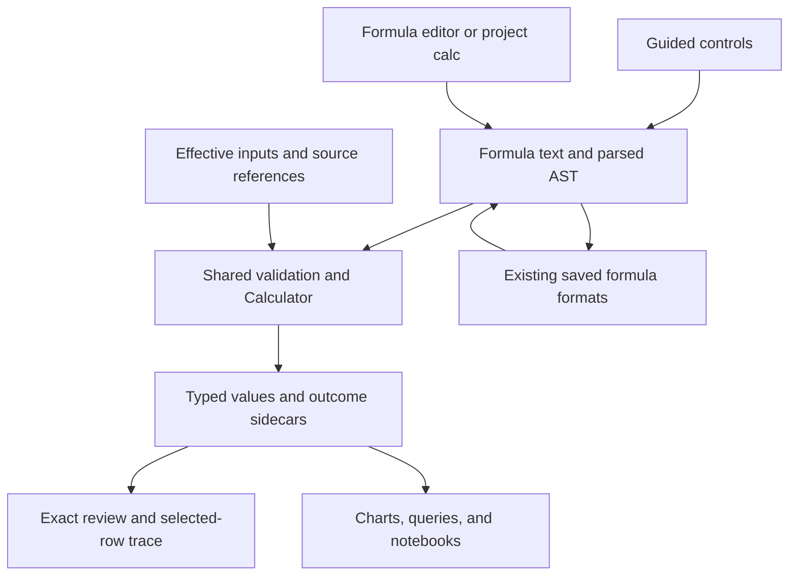

# Reusable text preparation for explorEDA

**Build a guided text-preparation editor that emits ordinary saved calculation formulas, backed by a small strict function family in the existing Calculator.** Ship trimming, literal component extraction, literal replacement, and text concatenation together with exact before/after review, failure propagation, text-preserving field types, trace, and the complete chart/project/notebook save–reopen–refresh workflow. Add explicit NFC normalization and case conversion next, then code-point length and slicing. This supplies the requested capability through existing execution and persistence seams while preserving original records; a second expression engine, new project step, or unbuilt join-key subsystem would add ownership without improving this first workflow.

**Design baseline:** `ab4ecd2aa98f3fd1da11e8f552efdb269f4b65a6`, supplied as 35 complete baseline files. Two additional research summaries have their own branch refs and are treated as proposals. **Research date:** October 31, 2026. **Status:** design and executable reference fixtures, not a repository implementation. Byron supplies the demand; no outside-demand gate is proposed.

## 1. Access and what the baseline actually supplies

Access to the complete attached source packet is confirmed. The team read all 35 baseline files and both separately marked research summaries before external research. The original attachments were not edited. The packet supports this design without another source request. It is not a runnable checkout: no claim is made to have compiled the package, opened the product, executed its workers, or tested its folder application.

Code facts below cite paths relative to `packages/explorEDA/src/`, except where another root is shown. Abbreviated filenames and directory fragments resolve to the full repository paths in §12. Function names and line ranges identify the evidence within the extracted complete files.

| Verified baseline fact | Consequence for this design |
| --- | --- |
| `lib/calculations/functions/registry.ts`, `calculationFunctions`/`getFunction`, lines 52–150, registers row arithmetic, recode, and UTC date functions. Function names are resolved case-insensitively and arity is checked. | Register one direct text implementation here. There is no general text family to preserve or duplicate. |
| `parser/semantics.ts`, grammar and `FunctionCall`/`fieldReference`, supports JSON-style double-quoted strings and bracketed quoted field names, nested calls, and conditionals; see lines 5–50 and 214–285. | Use valid syntax such as `["Order code"]`. No array result, dot-method syntax, regex literal, or new grammar is needed. |
| `engine/Calculator.ts:103–126,159–193` reads referenced values, eagerly evaluates function arguments, and routes arithmetic through `numericValue`. | Keep numeric `+`. A function registry alone cannot repair dependency failures or alter evaluation order. |
| `CalculationState.ts:107–187`, `getErrors`, `traceRow`, and `executeCalculation`, keeps errors separately from value maps and records expression steps. A failed dependency currently reaches a child as an undefined value. | Reuse the result/trace machinery and add failure-aware field reads. Otherwise strict null propagation could disguise an upstream failure. |
| `components/calculations/CalculationForm.tsx:247–267` builds active help from the real registry; `CalculationEditor.tsx:151–179` evaluates a separate draft manager after a 220 ms delay. | Extend these active surfaces. The mission identifies FunctionExplorer as mock data; it is unnecessary to this plan. |
| `CalculationPreview.tsx:37–174` uses all loaded rows, has five rows per page, and offers a failed-only filter. Its existing `changed` prop means a dirty draft, not a changed-record set. | Add explicit outcome membership and comparison labels. Do not relabel a dirty-state flag as a data-quality statistic. |
| `CategoryMapEditor.tsx` and `lib/calculations/recode.ts` implement exact typed recoding and reviewed trim/case suggestions that save formulas. | Follow the specialized-editor-to-formula precedent. Keep explicit business recoding separate from mechanical text operations. |
| `types/AnalysisProject.ts:56–63` already defines `CalculateStep`; `lib/analysis/evaluateProject.ts:440–480` executes it through Calculator while preserving each row's key and source references. | Use ordinary `calculate` steps. Add diagnostics and typing; preserve grain and lineage. |
| `DataLayerProvider.tsx:1234–1235` and `evaluateProject.ts:475–477` explicitly mark only top-level recode results as categorical/string. | Infer guaranteed text results through functions, aliases, and compatible conditionals, including restore. Correct string values alone do not prove correct downstream grouping. |
| `lib/project/analysisText.ts:135–141` flattens query evaluation to `row.data`; the complete evaluation also contains field types, diagnostics, and source references. | Retain/retrieve evaluation context at this adapter. Do not promise project review from flattened rows alone. |
| `SavedDataStructure.ts:16–19`, provider conversion helpers at 158–175, and `lib/dsl/project.ts:282–295,763–779` already persist formula text. | Formula strings remain authoritative. New functions do not require a parallel recipe, file-format migration, or persisted output cache. |

The prior category-mapping summary proposed a different project-owned representation at an earlier baseline. Current shipped code in this packet is authoritative for this mission: the category editor saves `recode()` formulas. Join-key research remains a separate unbuilt proposal. Neither prior proposal is a prerequisite. [Repository evidence: supplied prior-proposal README files; current `recode.ts`, `CategoryMapEditor.tsx`, and `CalculateStep`.]

## 2. Choose the product shape before choosing functions

| Alternative | Assessment |
| --- | --- |
| Formula functions alone | Smallest execution change; excellent for expert authors and text files. It leaves operation order, exact changed records, collisions, and first-use discoverability insufficiently served. Keep this as the common authoring substrate, not the whole product. |
| Guided preparation that emits formulas | **Choose.** The guide provides clean/extract/compose entry points, deliberate parameters, comparison, and review. Apply writes the same definition the formula editor and project query can execute. Existing category mapping supplies a relevant local precedent. |
| A new project preparation-step type | Could eventually own broader source transformations or schema changes. These row-wise scalar operations already fit `calculate`; another step would duplicate validation, text serialization, worker handling, and editor ownership. Defer it without blocking this capability. |

The guide has three starting tasks: **Clean**, **Extract**, and **Compose**. Each creates one new field. Clean begins with trim selected because the user chose that operation; other transformations are never added automatically. Extract accepts a literal separator and a part index. Compose accepts an ordered sequence of existing text fields and text literals, with explicit separator fragments. The generated formula is visible and editable.

Apply a single named calculation at a time. An analyst who wants inspectable intermediate fields can create `cleanCode`, `component`, and `label` as three separate calculations. A compact formula can instead nest calls. Both routes use the same engine. A guide recognizer reopens only formula shapes it understands exactly; arbitrary formulas stay in the ordinary formula editor. No lossy round trip through simplified controls is acceptable.

### The first complete workflow

The runnable example should use the 18 original records in `fixtures.json → workflow`. It includes padded codes, NBSP, empty text, missing/absent fields, wrong types, repeated delimiters, numeric-looking identifiers, zero-width text, and canonically equivalent spellings.

1. **Choose the actual input.** Open Prepare text for `code`, name the new field `cleanCode`, and choose Trim. Show **All 18 loaded rows · before chart filters**. Where field settings have converted the import, expose original and effective input separately. A number is not made into text merely because the original business concept is an identifier.
2. **Preview the full population.** Show `textTrim(["code"])`. The fixture yields **4 changed, 10 unchanged, 2 missing, and 2 errors**. Two successful results are empty text. The five-row page is a display limit; all counts and memberships cover 18 records.
3. **Review exact records.** Changed opens `r01`, `r03`, `r05`, `r07`. Errors opens `r10` and `r11`, preserving numeric `12` and boolean `true` as original evidence. Source text and prepared output are both visible. Escaped text/code points explain invisible differences on demand.
4. **Review many-to-one results.** Clean output `AB-001` includes `r01`, `r02`, `r03`, `r17`; two changed rows join two unchanged rows. The empty-output group includes `r06`, `r07`. These are two transformation-collision groups, not instructions to merge entities.
5. **Apply and group.** Apply creates one calculation through the existing add/update action and one undo step. Group a chart on `cleanCode`; preserve strings such as `"0012"` as text. Chart filtering must not change the preparation review's full input population.
6. **Extract the component.** Save `textPart(["cleanCode"], "-", 1)` as `component`. There are **10 present, 6 missing, and 2 failed** outcomes. `CD--002` has an existing empty second component. `0012` has no second component. The preview distinguishes them.
7. **Compose the label.** Save `textConcat(["site"], " · ", ["component"])` as `label`. There are **9 produced labels, 7 missing, and 2 errors**, with five distinct produced labels. The UI says Produced because a new composite has no single original value to call changed.
8. **Trace a selected result.** For `r01`, show `" AB-001 " → "AB-001" → "001" → "North · 001"`, the formula at each named field, and each executed call. The error chain for `r10` retains its original text-type failure. Unexecuted conditional branches are not presented as executed steps.
9. **Save, reopen, refresh.** Save formulas and original rows through existing formats. Reopening rebuilds results and review. Reordering preserves outcomes by valid source identity. In the supplied append/change/delete refresh, clean review becomes **4 changed, 12 unchanged, 1 missing, 1 error**. No old positional row membership is reused.
10. **Reuse in queries and notebooks.** Put the same functions in ordinary project `calc` steps and bind a notebook sheet/chart to that prepared query. Show source and derived fields together. Export derived table values or a typed review snapshot. Source files remain unchanged.

This is M1 acceptance, not a promise that current code already performs these new steps. In particular, project/worker/restore typing and evidence retention are required implementation work.

## 3. Primary-source comparison and the decisions it changes

The sources were inspected on October 31, 2026. This research did not execute Power Query, OpenRefine, DuckDB, or PostgreSQL. Documentation that says “characters” or “whitespace” without an exact Unicode definition is not evidence for a particular edge case.

### Power Query

Power Query provides separate trim, replacement, extraction, and combination operations. `Text.Trim` permits overriding its trim set; `Text.Split` matches a whole multi-character separator; `Text.Middle` uses a zero-based start with an optional count and clips at the end. `Text.AfterDelimiter` selects a delimiter occurrence, which is a different operation from selecting a split component. These support small explicit operations, but explorEDA should not copy an unspecified character unit. [P01, P04, P06, P07]

`Text.Replace` replaces all occurrences case-sensitively. `Text.Combine` ignores null values, whereas `Text.From` is a separately named conversion operation with culture support. `Text.Lower` also accepts culture. Adopt explicit operations and explicit conversion boundaries; choose strict missing propagation for the initial concatenation API and no ambient locale. [P02, P03, P05, P08]

### OpenRefine

GREL distinguishes trimming, substring extraction, replacement, splitting, and joining. Substring indices start at zero, with an exclusive end and optional negative indices. Split has an option to preserve empty components; replacement and split can also accept regex. `toString(null)` produces `"null"`. Its `normalize()` removes diacritics and maps extended western text toward ASCII; it is not Unicode NFC. These differences support naming and documenting explorEDA's own strict contract rather than assuming familiar names imply compatible semantics. [P09]

OpenRefine's expression editor previews transformations and offers history/help, but its transformations are one-time operations rather than continuously evaluated formulas stored in cells. Borrow inspectability while retaining explorEDA's saved, reevaluated calculations and single language. [P10]

### DuckDB and PostgreSQL

DuckDB separately names character and grapheme length/slicing functions. Its `split_part` uses one-based positions and returns empty text for an out-of-range part. `concat` skips nulls while `||` propagates null. It supplies explicit `nfc_normalize`. The contrast establishes useful choices: preserve absent-versus-empty information, name the unit, and avoid claiming SQL compatibility. [P11]

PostgreSQL lower/upper follow database locale, while normalization accepts four named forms and defaults to NFC in UTF8. `concat` converts arbitrary inputs to text and ignores nulls. Its case-folding operation is distinct from ordinary lowercasing, and split-part positions start at one. These are useful comparison points, not semantics to inherit silently. [P12]

### Unicode and ECMAScript

Unicode distinguishes canonical normalization from compatibility normalization. NFC can reconcile equivalent spellings without generally collapsing compatibility characters; concatenating two normalized strings does not guarantee the result is normalized. Extended grapheme clusters approximate user-perceived text units and can contain multiple code points. Default case conversion and case folding serve different purposes. ECMAScript specifies whole-string default casing and code-point iteration, while its trim set is the union of its whitespace and line terminators. These support the explicit contracts below. [P13–P18]

## 4. The API and semantic contract

All names below are proposals. Registration remains case-insensitive, following `getFunction`; saved spelling is not rewritten. “Text” means a primitive, well-formed JavaScript string. No automatic stringify, locale collation, normalization, or missing-to-empty conversion occurs.

| Release and signature | Exact behavior |
| --- | --- |
| M1 `textTrim(text)` | Trim the fixed edge set below. Preserve all interior characters. Return text or logical missing. |
| M1 `textPart(text, delimiter, index)` | Select a zero-based component split by a nonempty exact delimiter, left-to-right, nonoverlapping. Preserve empty components. An absent component returns logical missing. |
| M1 `textReplace(text, search, replacement)` | Replace every nonoverlapping exact match, once, with literal replacement text. Nonempty search; replacement can be empty. |
| M1 `textConcat(text1, text2, …)` | At least two strict nullable text operands; no implicit separator. Any permitted missing operand makes the result missing after argument validation. |
| M2 `textNormalize(text)` | NFC only, explicitly requested. No form argument, accent removal, transliteration, or case change. |
| M2 `textLower(text)` / `textUpper(text)` | Whole-string, locale-independent ECMAScript default case conversion. No locale argument and no case-folding promise. |
| M3 `textLength(text)` | Count Unicode scalar values/code points. Return a number or logical missing. |
| M3 `textSlice(text, start, count?)` | Zero-based code-point start, optional count. Omitted count means the remainder; clip a valid count at the end. Start at/beyond the end or count zero gives empty text. |

The first text argument accepts null or undefined as missing. Concatenation permits missing in every operand. Delimiters, replacement text, and positional controls must be present and valid even when a data argument is missing. Positional arguments are actual nonnegative safe-integer numbers; numeric strings, booleans, fractions, negative values, non-finite numbers, and explicit null are invalid. `-0` is numerically zero. Do not truncate or coerce controls.

### Missing, empty, and error are different outcomes

| Input/example | Proposed outcome |
| --- | --- |
| `textTrim(null)` or a referenced undefined value | Successful logical missing. |
| `textTrim("")` | Successful empty text, unchanged. |
| `textTrim("   ")` | Successful empty text, changed. |
| `textTrim(12)` / `textTrim(true)` / a Date object | A text-type error, not a label. |
| `textPart("A-", "-", 1)` | Existing empty component: `""`. |
| `textPart("A", "-", 1)` | Component absent: logical missing. |
| `textConcat("A", null)` | Logical missing. |
| `textConcat(null, 17)` | Text-type error; null does not conceal the invalid evaluated operand. |

Do not use `isMissingValue` as the text input gate. Its measurement-oriented definition treats blank and whitespace-only strings as missing (`lib/valueParsing.ts:15–21`). Add a narrowly shared text reader/validator in that module, following the repository's raw-value parsing rule, and let the pure text operations call it. It must retain those strings. The generic measurement rule need not change.

The baseline manager converts successful null to undefined, while the project evaluator retains null. The semantic contract is successful missing, not byte-identical internal containers. Failure stays separately observable. `fixtures.json` states the logical result; `project-fixture.json` additionally states both storage conventions. No existing saved format needs migration to accommodate this distinction.

### Whitespace: an enumerated set, not a vague promise to clean

`textTrim` removes only these 25 code points at the two ends:

```text
U+0009–U+000D
U+0020 U+00A0 U+1680
U+2000–U+200A
U+2028 U+2029 U+202F U+205F U+3000 U+FEFF
```

This freezes the current ECMAScript trim profile and aligns with the baseline category suggestions' use of `.trim()`. It includes NBSP and edge BOM/zero-width no-break space. It does not mean Unicode's differently defined `White_Space` property. Retain U+0085 NEL, U+180E, U+200B zero-width space, U+200C, U+200D zero-width joiner, and U+2060 word joiner. Retain every interior character, including internal NBSP or BOM. Explicit literal replacement can remove a known character when the analyst chooses that transformation. There is no broad `clean()` that silently strips controls or invisible formatting. [P14; repository `recode.ts::suggestGroups`; exact cases `TRIM-*`.]

### Delimiters and replacement

`textPart("AA::BB::CC", "::", 1)` returns `"BB"`; `textPart("A::B", ":", 1)` returns empty text. A delimiter is a sequence, never a set of characters or a regex. Without the delimiter the entire string is component zero. Leading, repeated, and trailing delimiters create empty components. A request past the final component returns null. An empty delimiter is invalid, avoiding implicit character splitting.

Matching is exact and case-sensitive. Neither source nor delimiter is normalized. Thus a composed `é` does not match decomposed `e` plus combining acute unless the author explicitly normalizes the relevant data. This also applies to replacement.

Replacement scans the original left-to-right and does not rescan inserted text: `textReplace("aaa", "a", "aa")` yields six `a` characters. `textReplace("aaa", "aa", "X")` yields `"Xa"`. `$&`, `$1`, backslashes, and brackets in replacement are literal. A direct JavaScript replacement-string call would interpret some dollar sequences; use a literal scanner or a callback. The included reference uses a scanner. [Exact cases `PART-*`, `REPLACE-*`; ECMAScript replacement rules in P13.]

### Concatenation and display labels

Strict concatenation protects completeness. A missing site should not silently yield a plausible partial label. An author can explicitly provide a fallback with the existing conditional syntax:

```text
textConcat(
  ["site"] == null ? "Unknown site" : ["site"],
  " · ",
  ["component"]
)
```

The formula language supports multiline input; project `calc` declarations write the equivalent expression on one line. An erroring dependency still fails when the guard reads it; the guard handles genuine missing data, not hidden failures.

Concatenation does not produce safe compound identifiers. Tuples `["AB", "C"]` and `["A", "BC"]` both yield `"ABC"`. Even separators can collide when present in components. A label is a display value, and collision review compares typed ordered input tuples structurally. Do not repurpose it as an entity key or relationship endpoint.

Numeric/date formatting remains explicit. Existing `formatDate` can supply a deliberate UTC date fragment. A general number/date/boolean formatter and an explicitly named null-skipping label join can be explored later; they are not implicit conversion inside text functions. No upstream-preparation escape is needed to complete the three requested text tasks.

### Normalization and casing

NFC is an explicit, narrowly useful normalization operation. The exact fixtures reconcile `e\u0301` with `é`, preserve fullwidth `Ａ`, ligature `fi`, circled `①`, and NBSP, and include Hangul composition and combining-mark ordering. Original sequences remain available in review. NFC is not accent removal or fuzzy equivalence. If a concatenated result must be NFC, normalize the final result explicitly; normalized fragments alone are insufficient. [P15; cases `NFC-*`, `CONCAT-07`, `ENGINE-15`.]

Use whole-string `toLowerCase`/`toUpperCase` semantics after strict input validation. Do not map one code point at a time: Greek final sigma is contextual. Native checks of the proposed fixtures establish `I → i`, `İ → i\u0307`, `ı → ı` under lowercasing, and `straße → STRASSE` under uppercasing. Lowercasing that uppercase result gives `strasse`, not the original `straße`. These operations are not inverses and are not a universal identifier-equality policy. No default Turkish locale is inferred from the browser, operating system, or text. [P13, P17; cases `CASE-*`.]

NFKC/NFKD, transliteration, accent stripping, case folding, and language-tailored casing are deferred because they need separately named behavior and review consequences. This is a scope decision, not a claim that these operations are always undesirable.

### Code points versus grapheme clusters

Choose **code points for saved analytical length and slicing**, and defer grapheme-aware display slicing as a distinct API. Code-point iteration avoids splitting UTF-16 surrogate pairs and supplies a simple positional contract. It can still separate combining marks or emoji sequences; help must call the unit code points, not visible characters.

| String | Proposed `textLength` and slicing consequence |
| --- | --- |
| `A😀B` | Length 3; slice at 1 for 1 returns the whole emoji. |
| `e\u0301` | Length 2; slice at 1 for 1 returns the combining accent alone. |
| `👩‍💻` | Length 3; the middle code point is U+200D. |
| `🇺🇸` | Length 2; either regional indicator can be selected. |
| `👨‍👩‍👧‍👦` | Length 7 despite its common single-glyph display. |

Grapheme clusters are more suitable for perceived-character editing and display truncation, but their segmentation has its own standard and runtime-version behavior. Do not quietly substitute UTF-16 units or `Intl.Segmenter` graphemes under the same saved function name. A future function can name its unit explicitly. [P16; exact `LENGTH-*` and `SLICE-*` cases.]

All text functions, starting in M1, reject unpaired UTF-16 surrogates without repairing the original string. A tiny surrogate validator can cover runtimes without `isWellFormed`. This makes every accepted string a sequence of Unicode scalar values. Do not delete original malformed data; review/export must retain its escaped code-unit evidence.

## 5. Validation, errors, and honest execution traces

Keep the existing evaluator order and make the extra validation precise:

1. **Definition checks:** known fields/functions, arity, and syntactically literal control arguments, including a signed numeric literal represented as unary `+`/`-`. Run these even on empty project input. Do not add general constant folding or execute arbitrary dependency-free calls during validation.
2. **Row expression evaluation:** the Calculator evaluates each function argument expression eagerly, left-to-right. An error here prevents the helper from receiving argument values.
3. **Helper validation:** validate collected arguments left-to-right. Check every present concat operand and every required control before null propagation.
4. **Operation:** return logical missing or a successful value.

This explains two otherwise surprising but necessary fixtures. `textConcat(17, 1 / 0)` reports existing `Division by zero` before the helper can reject `17`. Referencing NaN/Infinity causes existing `Calculation produced a non-finite number` inside `Calculator.value`, before a text helper sees it. The direct helper and expression-engine suites intentionally have different expectations. `undefined` is not a language literal; fixtures use a missing/undefined row field or a transport tag. [Repository `Calculator.ts:71–97,103–126`; `parser/semantics.ts` keyword rules; `ENGINE-01–04,17`.]

The proposed new diagnostic codes are `TEXT_TYPE`, `TEXT_UNICODE`, `TEXT_EMPTY_PATTERN`, `TEXT_INDEX`, and `DEPENDENCY_ERROR`. Preserve the readable `error` string consumed by existing UI. The reference oracle additionally labels arity failures `TEXT_ARITY`; the integration contract must keep the existing message `Invalid arguments. Use <syntax>`. Codes can be carried additively without rewriting old error messages.

Representative exact messages are:

```text
textTrim argument 1 must be text or missing; received number.
textTrim argument 1 contains an unpaired UTF-16 surrogate.
textPart argument 2 must not be empty.
textPart argument 3 must be a non-negative safe integer number.
Dependency "clean" failed: textTrim argument 1 must be text or missing; received number.
```

### Failure propagation must happen at the read

Add a small optional field-error lookup to `CalculationContext`; populate it from manager error caches and project row calculation outcomes. Consult it in the field-reference branch of Calculator. Preserve it during trace execution. Existing `getErrors` can remain a string-map adapter so current consumers continue to work.

An unused failed dependency must not poison a successful conditional. Conversely, `bad == null ? "fallback" : bad` reads `bad` and must report its dependency failure rather than treating it as genuine missing. Static unknown function/field/arity and literal-control errors still reject a definition even in a dead branch; dynamic row errors retain short-circuit semantics. This is consistent with the existing separation between structural validation and row evaluation. [Repository `CalculationState.ts:115–187`; `Calculator.ts::validateExpression`, literal and conditional branches; `ENGINE-06–12,18–19`.]

The evaluator already records `CalculationStep[]`; the current UI mostly displays named dependencies. Extend that UI rather than implementing a second trace calculator. Match step IDs to the actual parsed AST, show executed arguments/results/errors, and mark an unconsumed dependency as not read if it is displayed. Trace only the selected row on demand. The trace's final logical result must equal the batch result, including failure origin and missing reason.

## 6. Review evidence, collisions, and exact membership

Treat review as a derived view of the current evaluation, with three layers:

- **Original record:** untouched imported values and property presence, reached through the current source reference.
- **Effective input:** the value actually supplied to the calculator after existing field settings or earlier query stages.
- **Output and outcome:** present value, successful missing with reason, or failure with origin.

The provider retains raw data separately from values after `applyFieldSettings` (`DataLayerProvider.tsx:518–527,1367–1382`). If original `"12"` became numeric `12`, review must show that conversion; strict text functions should reject the effective number. Re-selecting an appropriate text/categorical source interpretation may recover an original string, but no function can reconstruct leading zeros already absent from the supplied data.

### Define denominators and comparisons

For a single-source clean/extract operation, with comparison field C:

```text
N = changed-present + unchanged-present + successful-missing + failed
present = changed-present + unchanged-present
empty-output is a subset of present
```

Equality is exact typed scalar/string equality. Missing excludes errors. An absent part is missing with reason `part-absent`; a nullish data operand is missing with reason `source-missing`, displayed as **Missing input**. Here input means the effective operand, not a claim that an original source cell was missing. Retain reason metadata through calls/dependencies without inventing a second value model; an optional runtime reason and origin are sufficient. For several missing operands, retain the first missing operand's reason and origin in argument order, after all collected arguments validate. Explicit null has a literal origin. An unrelated existing function without reason evidence may remain simply Missing; do not invent an origin. The primitive value contract stays `null` for successful missing. For composition use Produced/Missing/Error; an edit may compare old and new **outcomes** separately, including error→value transitions.

The comparison field is derived from a recognized guide shape or explicitly chosen for the current review. It need not become saved recipe metadata. An arbitrary formula has no automatic single-source before value. After reopening, show inputs and output and request a comparison selection only if the user opens that optional comparison tool; do not block reuse of the formula.

For project calculations, N is the number of input-frame rows at that step, including prior filters or fan-out. Label that grain. Navigation to distinct original records can deduplicate `sourceRows`, but never substitute the unique-source count for the calculation-row denominator. Aggregated inputs are compared at their aggregate grain; original contributors remain evidence, not one-to-one before/after rows.

### Collision definition

A collision is one present output produced by more than one distinct immediate input value, or typed ordered tuple for composition. Include every member, including unchanged rows. Repeated identical inputs alone are duplicates. Exclude failures and successful missing from text collision groups; empty text remains eligible.

The workflow's `AB-001` group contains three exact source spellings and four rows. Counting only changed rows would hide the existing spelling they joined. The composed-label example `ABC` contains two distinct tuples across three rows. Do not build tuple identity by concatenating components with a delimiter; compare the structure and types. [Fixtures `workflow.cleanCodeCollisions` and `compositionCollision`.]

Collisions after extraction may be expected: selecting a prefix intentionally groups several codes. Review informs the user; it does not introduce a mandatory approval ritual or an automatic merge. Existing category maps remain the appropriate explicit tool for business aliases, especially where equal spelling does not imply equal meaning.

### Scope, refresh, and cache ownership

Use current workspace row IDs only within one data revision. Project source keys follow existing `sourceReferences`: typed unique entity keys are stable; missing/duplicate keys use positions (`evaluateProject.ts:92–157`). Preparation never edits that identity. Rebuild membership on append, delete, reorder, field-setting changes, formula changes, or source replacement. Clear stale preview selections on refresh unless the existing identity layer resolves them unambiguously.

Key review caches by current input/evaluation revision, formula definition, and comparison choice. Chart-only filters do not invalidate a full-source workspace review. A late preview response must be discarded when its draft/data revision no longer matches. Apply checks that the preview represents the current draft/input; if it does not, recompute using the normal editor flow. This needs an ordinary revision token, not an enterprise transaction protocol.

The complete preview may use existing workers where appropriate. Compute summary/membership once; paginate rendering. Do not replace complete counts with sample counts. Do not retain every intermediate string for every row just to support trace. Measure before adding caches or thresholds beyond the existing invalidation paths.

## 7. Reuse, typing, persistence, notebooks, and export

### One execution path and one durable definition



Generate formula text using `JSON.stringify` for literal text and field names, then parse that text into the AST. Do not hand-construct an AST whose `rawInput` says something else: execution and save/reopen would diverge. Function help needs separate display syntax and valid insertion examples, so the ellipsis in a signature is never pasted as executable syntax. The active registry can carry these small metadata additions without becoming a generic plugin framework.

Infer guaranteed result kinds from registry metadata, known calculated references, literals, and compatible conditional branches. Text-or-null is text; text-or-number is unknown/mixed, not coerced. `textLength` is numeric. Resolve calculation dependencies topologically with existing cycle checks. Apply inferred types to normal column construction **and** restore (`DataLayerProvider.tsx:1199–1268,1421–1447`), project fields, and flattened host adapters. Explicit user type overrides must remain visible. Test numeric-looking text after a filter is restored, not only immediately after creation.

### Project calculations and worker parity

Keep `CalculateStep.expression`. Extend project runtime outcomes with per-field error/reason context; keep `AnalysisDiagnostic` row/field/step identification. `calculateFrame` should validate once against input field IDs before mapping rows, so empty tables cannot hide unknown calls or invalid literal controls. Preserve `key`, `sourceRows`, and `contributors` when adding values. Review the specific adapters that currently flatten query evaluation.

Both foreground and worker entry points must import the same registry, helpers, validation, kind inference, and outcome conventions. The packet does not contain every worker/host entry; the plan gives discovery commands instead of inventing inspected files. An actual worker round trip must be tested. Separate sources or duplicated browser/Node implementations are unnecessary.

Project empty-input validation can use declared input field metadata. The baseline standalone manager derives field names from row keys; a host with no rows and no schema cannot establish that a field exists. Pass available declared names into validation, or retain an explicit unavailable-field/schema result and revalidate when data arrives. Still validate function names, arity, and literal controls. Do not fabricate a schema or claim full field validation from an empty array.

Prepared results can be used by subsequent calculations, query filters, aggregation, charts, and notebook bindings. They are **not automatically supported join keys**: current relationship resolution expects source-origin endpoints and raw target tables (`evaluateProject.ts::relationshipSide`, lookup/expand code). This release must neither claim otherwise nor depend on the unbuilt source-key preparation design.

### Saved forms and original evidence

| Surface | Existing support and required closure |
| --- | --- |
| Workspace settings JSON | Saves `{resultColumnName, expression}`. Register new functions in validation; preserve expression text and inferred output kinds on restore. |
| Full analysis JSON | `saveRawData` uses original `rawData`. Use `stringifySavedAnalysis`/`parseSavedAnalysis`, whose special-value encoding preserves undefined/non-finite originals. Plain `JSON.stringify` is insufficient for exact source evidence. |
| Dashboard/project text | Existing formula/`calc` syntax carries the operation. Test quotes, backslashes, literal escapes, and Unicode. No extra recipe language or format migration. |
| Analysis/folder files | Reevaluate saved queries from current source files, preserve type/fault/provenance context in host adapters, and save edited calculation definitions through existing paths. Do not rewrite source files. |
| Notebook | Use existing query/field bindings and saved calculations. Keep last-valid/frozen block state explicit. Confirm host reevaluation after source refresh and after query edits. |
| Review export | Add a typed JSON snapshot with presence/type, original/effective/output values, scope, source references, and outcome/error. Existing CSV table export remains a convenient value export. |

Source evidence: provider `saveToStructure`/`saveRawData` at 1313–1365; `saveDataUtils.ts:47–127,1177–1203`; project text serializer/parser; `folder.ts::readProjectFolder`; notebook `compileNotebook.ts:1–9,142–219,325–335`.

The full analysis serializer preserves null, own-property undefined, absent properties, non-finite values, and exact strings through its existing conventions. The separate raw-data clipboard helper uses plain JSON (`saveDataUtils.ts:1205–1213`), so it must not be described as the exact-evidence export. That is an export routing decision for this feature, not a mandate to audit every serializer.

Runtime review counts, row memberships, comparison selections, and caches are not saved. They would become stale after refresh and can destabilize the provider's saved-state fingerprint/host echo handling. Save definitions and originals; recompute derived evidence. [Provider fingerprint and saved-state handling, lines 251–278,1654–1663,1690–1713.]

Notebooks can already consume ordinary prepared fields once host adapters carry them correctly. They do not already have a dynamic preparation-status finding kind. M1 promises sheets/charts/ordinary findings over prepared fields; it does not claim a prose binding such as “four rows changed” without a separate explicit predicate/status feature. The existing finding schema has no preparation-status case (`saveDataUtils.ts:164–190`).

## 8. Milestones and what proves each

The separate [implementation-plan.md](implementation-plan.md) is the worker-ready plan. It names existing/proposed files, ordered tasks, tests, docs, examples, risks, and a single verification run sheet.

| Milestone | Proof that makes it shippable |
| --- | --- |
| **M1: four functions and the complete workflow** | Run exact direct/engine/dependency fixtures, all 18 workflow memberships, six-row project lineage and grouping, empty-input validation, source-preserving JSON/text/folder reopen, refreshed notebook binding, and actual worker parity. Exercise pointer/keyboard at 1280, 783, and 390 px. Ship calculated-fields/project-folders docs and the runnable text-preparation example together. |
| **M2: NFC and whole-string casing** | Pass canonical/compatibility examples, Turkish-I/sharp-S/final-sigma cases, deliberate collision membership, trace and saved-chain reopen, and the supported runtime corpus. Add the Unicode section and runnable example steps in the same release. |
| **M3: code-point length/slicing** | Pass surrogate, combining mark, emoji, empty/omitted/invalid-boundary cases; maintain numeric/text kinds through aliases, conditionals, project/worker/restore. Add explicit code-point help and the visual examples in the same release. |

M1 can be implemented in internal tasks, but shipping only a function registry while postponing exact review or project/restore behavior would fail the mission's first-workflow requirement. The main M1 risk is an apparently correct editor result losing its type, failure, or source reference downstream. M2's risk is mistaking display transformations for identifier equality. M3's risk is users expecting graphemes from a code-point operation.

Performance checks remain proposed. Measure representative 10,000/100,000-row text columns with short/medium values, dependent calculations, wrong-type rows, and replacement growth. Record both calculation and rendering costs. Reuse the current debounce and revision invalidation, avoid per-row registry/field discovery or source-row scans, and retain exact population counts. The supplied reference oracle favors clarity; its `Array.from` slices are not a claim of an optimal production memory policy or benchmark.

## 9. Rejected alternatives and deliberate later scope

- **Implicit stringify or overloaded `+`: Avoid.** They change existing arithmetic and erase identifier/type evidence. A visible formatting function can be designed separately.
- **Silent case folding, punctuation stripping, accent removal, or NFKC: Avoid as defaults.** These can combine distinct business values. Explicit future operations need their own contracts and review.
- **Regex in this release: Defer.** Literal extraction and replacement cover the chosen bundle. A later separately named regex API must choose syntax, flags, capture/no-match semantics, replacement tokens, and execution limits. RE2 demonstrates a different runtime/syntax tradeoff with linear-time matching and bounded memory; choosing a browser-compatible implementation is separate research, not a dependency for M1. [P19]
- **Graphemes hidden behind “length”: Avoid.** A future explicit display-oriented grapheme function is reasonable; changing units under a saved formula is not.
- **Broad catch-all `clean`: Avoid.** Operation order and characters removed must be inspectable.
- **New project step, plugin system, or saved-format migration: Defer absent a concrete need.** The baseline already has the correct scalar formula seam.
- **Persisted row-output/history machinery: Avoid for this scope.** One current evaluation and existing host history suffice. Recompute review after refresh; do not invent cross-refresh change history.
- **Implicit entity merging or prepared relationship keys: Avoid.** Display labels and derived categories do not establish identity. Existing source references remain authoritative.

## 10. Exact fixtures and checks actually performed

The deliverables include independently specified expectations rather than snapshots generated by the proposed helpers:

- [fixtures.json](fixtures.json): **170 direct function cases** (130 successful, 40 failures), explicit Unicode sequences, **19 expression-engine integration cases**, three missing-reason metadata cases, the 18-row chained workflow, exact memberships/collisions, reorder and refresh expectations, typed outputs, and original-evidence persistence cases.
- [project-fixture.json](project-fixture.json): complete baseline-shaped `AnalysisProject` v1, original source table, equivalent `.eda` text, exact two-step outcomes, stable source references, grouping, reorder/refresh, and empty-table validation expectations.
- [reference-text-functions.mjs](reference-text-functions.mjs): executable strict-value reference for the nine proposed functions. It is a companion oracle, not a patch, parser, or alternate product engine.
- [verify-fixtures.mjs](verify-fixtures.mjs): executes direct cases and explicit workflow/project reference arithmetic, checking memberships and original-data preservation. It intentionally reports product-integration cases as unexecuted.

Executed in this run:

```text
170 direct expected-value/error cases passed.
Workflow partitions, groups, collisions, reorder, refresh, source preservation passed.
Six-row project oracle results and fixture structure passed.
323 assertions passed.
Node v24.22.1; ICU 78.3; runtime Unicode 17.0.
```

An independent native-method check also verified all 130 successful direct expectations, 155 code-point annotations, complete workflow outcomes, and project group/source membership before/after reorder and refresh. The 40 failure cases and 19 engine cases were separately reviewed against the stated phases. These are semantic/reference checks, not evidence that the unbuilt feature works in explorEDA.

**Not executed:** the actual Ohm parser, Calculator integration, missing-reason metadata propagation, project text compiler, product test suites, worker, chart grouping, save/reopen, folder refresh, notebook UI, browser input, or performance benchmark. The packet lacks a runnable dependency-complete checkout. Formula syntax was checked against the supplied grammar by inspection; the worker must execute those acceptance cases after implementation.

The current Unicode standards retrieved describe Unicode 18, while the available Node runtime reports Unicode 17. The tested strings use established mappings; the checks do not establish identical handling of every newly assigned character across all engines. Use native whole-string methods for this local/current-version scope, run the corpus on supported browsers and Node, and document observed differences. Do not promise archival Unicode-version reproducibility or bundle a version registry without a concrete requirement. [P15–P18; executed runtime metadata above.]

Run the companion checks from the unzipped directory:

```bash
# Execute only the supplied semantic oracle and fixture arithmetic.
node verify-fixtures.mjs

# The program prints the assertion count and explicitly lists unexecuted product checks.
# Integration commands and real browser acceptance are in implementation-plan.md.
```

## 11. Open questions and implementation risks

No unresolved product choice blocks M1. The following need checkout-level implementation evidence:

- Locate the current worker, field-menu, notebook host, and exporter adapters omitted from the packet. Preserve typed field and fault context through them; test the actual foreground/worker paths.
- Confirm how the current categorical profiler and restored filters present successful empty text. Review must always distinguish it from missing; downstream typed-category tests determine the required adapter work.
- Use existing exact-row inspection components where they can show original/effective/output values without losing provenance. Choose presentation details through the required three-width checks.
- Measure current preview and collision-review cost before adding caches or capacity controls; exact review counts and record membership must remain complete.
- Determine supported runtime behavior for new Unicode assignments during M2 verification. The operation names and tested contract remain fixed.

Future scope with no dependency on M1: explicit numeric formatting/null-skipping labels, locale-bearing casing, grapheme display slicing, a bounded regex family, and source-owned join-key policy. These are Explore/Defer items in [recommendations.md](recommendations.md), not additional approval or demand gates.

## 12. Complete files read and evidence inventory

All 35 baseline files below were read completely, not just searched. Line-number citations elsewhere refer to these exact file interiors at `ab4ecd2aa98f3fd1da11e8f552efdb269f4b65a6`.

**Rules, direction, and context (7 files):**

- `AGENTS.md`
- `docs/agent-guide.md`
- `docs/ui-defaults.md`
- `CODING_STANDARDS.md`
- `README.md`
- `docs/research/DIRECTION.md`
- `docs/intent/research-ideas-100/ideas/R048-text-preparation-functions.md`

**Calculation implementation (6 files, under `packages/explorEDA/src/`):**

- `lib/calculations/functions/registry.ts`
- `lib/calculations/parser/semantics.ts`
- `lib/calculations/engine/Calculator.ts`
- `lib/calculations/types.ts`
- `lib/calculations/CalculationState.ts`
- `lib/calculations/recode.ts`

**Calculation UI (5 files):**

- `components/calculations/CalculationEditor.tsx`
- `components/calculations/CalculationForm.tsx`
- `components/calculations/CalculationPreview.tsx`
- `components/calculations/CalculationTrace.tsx`
- `components/calculations/CategoryMapEditor.tsx`

**Calculation tests (4 files):**

- `test/lib/calculations/engine/Calculator.test.ts`
- `test/lib/calculations/parser/parser.test.ts`
- `test/lib/calculations/traceRow.test.ts`
- `test/lib/calculations/recode.test.ts`

**Project evaluation and text/folder persistence (5 files):**

- `types/AnalysisProject.ts`
- `lib/analysis/evaluateProject.ts`
- `lib/dsl/project.ts`
- `lib/project/analysisText.ts`
- `lib/project/folder.ts`

**Provider, save types, parsing, and notebook (5 files):**

- `providers/DataLayerProvider.tsx`
- `utils/saveDataUtils.ts`
- `types/SavedDataStructure.ts`
- `lib/valueParsing.ts`
- `lib/notebook/compileNotebook.ts`

**Docs and examples (3 files):**

- `apps/demo/src/docs/pages/calculated-fields.mdx`
- `apps/demo/src/docs/pages/project-folders.mdx`
- `apps/demo/src/demos/examples.ts`

**Separately referenced prior proposals (2 files, not baseline implementation):**

- `docs/research/category-mappings-2026-10-24/README.md`, ref `origin/codex/category-mappings-design-2026-10-24`
- `docs/research/join-key-2026-10-25/README.md`, ref `origin/codex/join-key-design-2026-10-25`

The complete `pro-prompt(20261031-204013).md` was also read. Its instruction to preserve all original result files takes precedence over the older archival wording in the direction page. No commits, pushes, PRs, or repository edits were made.

### Primary sources

These are current retrieved primary pages. Section citations refer to the relevant semantic claim, not to an executed comparison product.

- **P01** — Microsoft, [Text.Trim](https://learn.microsoft.com/en-us/powerquery-m/text-trim).
- **P02** — Microsoft, [Text.Combine](https://learn.microsoft.com/en-us/powerquery-m/text-combine).
- **P03** — Microsoft, [Text.Replace](https://learn.microsoft.com/en-us/powerquery-m/text-replace).
- **P04** — Microsoft, [Text.AfterDelimiter](https://learn.microsoft.com/en-us/powerquery-m/text-afterdelimiter).
- **P05** — Microsoft, [Text.Lower](https://learn.microsoft.com/en-us/powerquery-m/text-lower).
- **P06** — Microsoft, [Text.Middle](https://learn.microsoft.com/en-us/powerquery-m/text-middle).
- **P07** — Microsoft, [Text.Split](https://learn.microsoft.com/en-us/powerquery-m/text-split).
- **P08** — Microsoft, [Text.From](https://learn.microsoft.com/en-us/powerquery-m/text-from).
- **P09** — OpenRefine, [GREL functions](https://openrefine.org/docs/manual/grelfunctions), particularly trim, substring, split, replace, toString, and normalize.
- **P10** — OpenRefine, [Expressions](https://openrefine.org/docs/manual/expressions), transformation and preview model.
- **P11** — DuckDB, [Text functions](https://duckdb.org/docs/2.0/sql/functions/text), retrieved through its stable-documentation redirect to the 2.0 LTS page.
- **P12** — PostgreSQL, [String functions and operators](https://www.postgresql.org/docs/18/functions-string.html), version 18 page returned by current documentation during this run.
- **P13** — TC39, [ECMAScript text processing](https://tc39.es/ecma262/multipage/text-processing.html), String normalization, casing, replacement, well-formedness, and iteration algorithms. The live specification is a moving document; no product-version claim is inferred from its heading.
- **P14** — TC39, [ECMAScript lexical grammar: whitespace and line terminators](https://tc39.es/ecma262/multipage/ecmascript-language-lexical-grammar.html#sec-white-space).
- **P15** — Unicode, [UAX #15: Unicode Normalization Forms, revision 58](https://www.unicode.org/reports/tr15/tr15-58.html), including canonical/compatibility forms and concatenation.
- **P16** — Unicode, [UAX #29: Unicode Text Segmentation, revision 49](https://www.unicode.org/reports/tr29/tr29-49.html), extended grapheme clusters.
- **P17** — Unicode, [Unicode 18 Chapter 3: Default Case Algorithms](https://www.unicode.org/versions/Unicode18.0.0/core-spec/chapter-3/), §3.13.
- **P18** — Unicode, [Character Encoding Stability Policy](https://www.unicode.org/policies/stability_policy.html), normalization stability and its assigned-character qualification.
- **P19** — Google, [RE2 repository and README](https://github.com/google/re2), matching guarantees and resource tradeoffs.

## 13. Delivery status

**Access:** complete scoped baseline and both separately referenced proposals read; no missing input blocks this design. **Checks completed:** source analysis, primary-source comparison, 323 reference assertions, independent native semantic checks, and fixture structural review. **Checks proposed:** real product/parser/worker/browser/persistence/notebook integration and performance. **Original results:** preserve this report, [implementation-plan.md](implementation-plan.md), [recommendations.md](recommendations.md), [fixtures.json](fixtures.json), [project-fixture.json](project-fixture.json), [reference-text-functions.mjs](reference-text-functions.mjs), and [verify-fixtures.mjs](verify-fixtures.mjs). **Open questions:** implementation adapter locations, empty-category host behavior, runtime Unicode coverage, and measured preview cost; none is a demand gate or a reason to postpone the first workflow.
