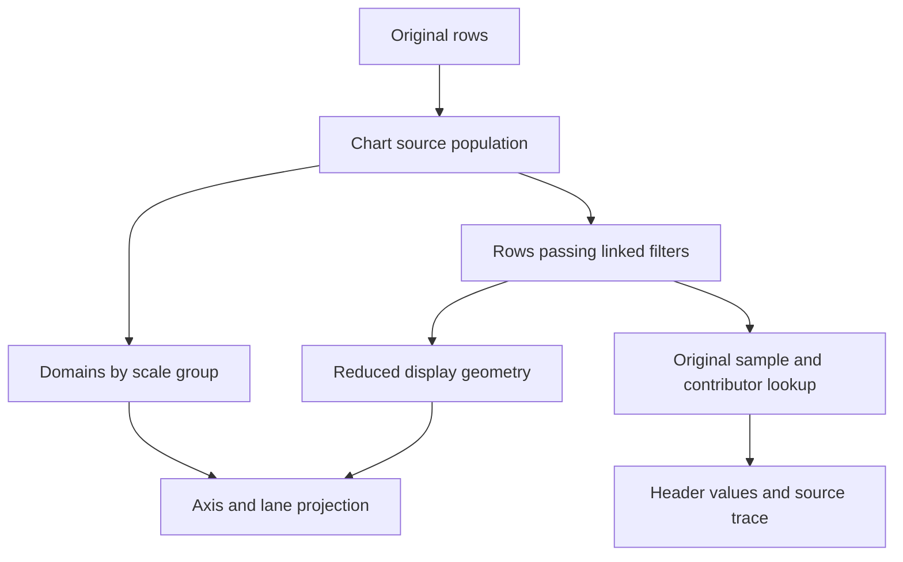

# explorEDA: exceptional time series and arbitrary Y scales

**Status: research and proposed design; every recommendation remains unapproved.**

- Assignment date and intended preservation folder: `2026-10-18-pro`, under `docs/intent/time-series-axes/raw/`.
- Research access date: **2026-10-19 UTC**; the assignment began on **2026-10-18 in America/Indianapolis**.
- Repository: [byronwall/explorEDA](https://github.com/byronwall/explorEDA).
- Permitted baseline: `9b16d78e3ed0742ed4d5858c1939fec9e758b510`.
- Intended Codex integration branch: `codex/time-series-axes-research-2026-10-18`.
- Companions: [recommendations.json](recommendations.json), [proof-plan.md](proof-plan.md), [sources.md](sources.md), [manifest.json](manifest.json).

## 1. Decision summary

**Build arbitrary scale assignment, with bounded axis presentation. Keep React, TypeScript and the existing D3 rendering foundation.** The valuable capability is letting any series join a named scale group or own a scale, while making its physical values, unit, range and source records easy to read. Drawing an unlimited number of rulers around one plot is a poor default for that capability.

The preferred small hybrid has three parts:

1. **Shared values by default.** Compatible same-unit signals share a named scale so their magnitudes and differences remain comparable. Unit equality is a useful suggestion, not proof that two variables belong together. Do not infer units from field names or numerical range. Existing unitless charts keep their current shared interpretation until the user changes it.
2. **An explicit Own scale action, with a focused overlay.** A series may have its own bounds and linear/log/symlog transform. With several groups, show one clearly identified, editable Y axis for the explicitly focused series/group. Keep every series' group and range available in a compact roster. Focus changes inspection, not filters, domains or data. Two visible left/right axes remain an optional presentation for exactly two groups when labels fit.
3. **Shared-time lanes after a bounded proof.** One lane per scale group uses the same time window and cursor. Lanes expose physical-value reading without twenty side gutters. A one-series group produces the requested one-scale-per-line experience. Overlay remains the deliberate choice for close timing comparison.

**The first release should improve observation lines.** Calendar summaries have a separate renderer, one metric and optional category split. Keep their shared Y scale, period/contributor trace and additive area rules; repair their time-domain and missing-period behavior in a separate, explicit slice. Arbitrary scales for calendar category series and multiple calendar measures are deferred.

**The highest-value companion improvement is an exact cursor backed by original samples.** The current observation cursor searches reduced geometry and then requires equal retained X values. Better scale controls cannot compensate for an incomplete or misleading readout.

There are **15 stable recommendations, TS-01 through TS-15**. The core sequence is renderer truth and sample inspection, then scale groups and focused editing. Lanes and long-form irregular tags are conditional follow-ons. Normalized/indexed overlays, cross-chart navigation synchronization and any rendering-library experiment remain below the first-release line.

The remembered chemical-plant tool is **unidentified**. The unfinished phrase “the ability to plot every line on its” is interpreted here as a possible request for each line's own scale/axis, not completed as a confirmed quotation and not attributed to a vendor.

## 2. Access gate, method and limits

**GO through the attached selected-source packet.** Its manifest names the requested repository and exact baseline. All **34 files**, totaling **568,336 source bytes**, matched their declared sizes and SHA-256 hashes. The package repository field and README corroborate the identity within the packet. Every required path in the assignment is present, including the three supplied LineChart test files and the additional trace body.

The exact GitHub baseline tree was attempted and the research reader returned `DisabledError`. No independent Git tree or commit-object verification was obtained. Hash verification establishes that the extracted files match the supplied manifest; it does not independently authenticate a Git commit. The packet is the explicitly permitted baseline route and is **not a runnable checkout**.

**Coverage:** 31 files were read in full across the review. The three large demo catalogs were searched and their relevant line, calendar, area, facet, annotation and coverage entries inspected; unrelated dashboard definitions were not reviewed line by line. [sources.md](sources.md) lists every path and reading depth. Missing dependencies such as the store, save validator, annotation implementation and image exporter are identified as Codex inspection gates. Their behavior is not invented from imports.

**Evidence labels used below:**

- **V — verified source fact:** supported by the exact packet code or its documentation; code and documentation are distinguished where they disagree.
- **D — documented external behavior:** official manual, project documentation, vendor training or a dated vendor response. All linked external sources were accessed 2026-10-19 UTC.
- **O — observed live interaction:** none established. No industrial system, provider demo or live explorEDA flow was operated.
- **I — inference / P — proposal:** analytical judgment or an unbuilt design. Scores, effort and target measurements are proposals, not benchmark or usability results.

Current primary sources were reachable. Decisive scale, grouping, cursor and sampling claims were opened directly; search-engine fallbacks that returned unrelated results were discarded. Current PI Vision guide pages and parts of ECharts' dynamic option reference were not extractable. Dated vendor responses and accessible official docs support the bounded claims made here.

## 3. Current-state audit

**V, baseline toolchain:** the root [package.json](https://github.com/byronwall/explorEDA/blob/9b16d78e3ed0742ed4d5858c1939fec9e758b510/package.json) declares `pnpm@11.9.0`. The library [package.json](https://github.com/byronwall/explorEDA/blob/9b16d78e3ed0742ed4d5858c1939fec9e758b510/packages/explorEDA/package.json) identifies `exploreda` version `0.2.0`, React 18/19 peer compatibility, TypeScript and D3 scale/shape dependencies; the inspected chart source uses those primitives. Dependency declarations are not a lockfile or an installed-runtime verification. The proposed work stays in this framework.

### 3.1 What the two renderers actually do

**V:** `LineChart` dispatches on `settings.time`; `ObservationLineChart` and `TimeSeriesChart` are different implementations. A date-valued X field alone is not proof of aggregation: the observation tests include an ISO-date line. See [LineChart.tsx, LineChart / ObservationLineChart](https://github.com/byronwall/explorEDA/blob/9b16d78e3ed0742ed4d5858c1939fec9e758b510/packages/explorEDA/src/components/charts/LineChart/LineChart.tsx#L61-L110) and [LineChart.test.tsx](https://github.com/byronwall/explorEDA/blob/9b16d78e3ed0742ed4d5858c1939fec9e758b510/packages/explorEDA/src/components/charts/LineChart/LineChart.test.tsx#L93-L118). Baseline links in this report are navigation aids; the packet supplied the inspected bytes.

| Concern               | Observation lines                                                                                    | Calendar summaries                                                                            |
| --------------------- | ---------------------------------------------------------------------------------------------------- | --------------------------------------------------------------------------------------------- |
| Series identity       | A numeric field in `seriesField[]`                                                                   | One aggregation/measure, optionally split into category series                                |
| Y assignment          | `useRightAxis` partitions fields into two shared groups                                              | One `plan.yScale`; does not read `useRightAxis` or observation series styles                  |
| X position            | Numeric X or actual parsed timestamp                                                                 | Midpoint of a UTC day/week/month/year interval                                                |
| Domain population     | All chart-source IDs before facet intersection; live IDs draw marks                                  | Facet-scoped all/live IDs; X window uses live periods; Y unions full/current aggregate values |
| View bounds           | X and left Y apply `limits`; right Y does not                                                        | Y applies `limits`; X limits are not consumed by this planner                                 |
| True log              | Left Y allows log; right path does not enable it                                                     | Unfilled line Y allows log; filled areas force linear                                         |
| Exact evidence access | Shared hover exists, but depends on reduced points; no raw-series trace registration is visible here | Bucket/guide trace, contributors, exclusions, period selection and keyboard mark navigation   |

The exact definitions are in [definition.ts, SeriesSettings / TimeSeriesSettings](https://github.com/byronwall/explorEDA/blob/9b16d78e3ed0742ed4d5858c1939fec9e758b510/packages/explorEDA/src/components/charts/LineChart/definition.ts#L17-L68). Calendar wiring is in [TimeSeriesChart.tsx](https://github.com/byronwall/explorEDA/blob/9b16d78e3ed0742ed4d5858c1939fec9e758b510/packages/explorEDA/src/components/charts/LineChart/TimeSeriesChart.tsx#L70-L100), and the population/range logic is in [timeSeriesPlan.ts, planTimeSeries](https://github.com/byronwall/explorEDA/blob/9b16d78e3ed0742ed4d5858c1939fec9e758b510/packages/explorEDA/src/components/charts/LineChart/timeSeriesPlan.ts#L136-L185).

**V:** The right-axis option is real, but is weaker than the main axis. All right-marked fields share one extent. Its scale inherits symlog when selected globally, but a saved global log yields a linear right scale; it also ignores manual Y limits. The renderer draws right ticks directly, formats them using the first right field and bypasses the planned axis/edit-strip infrastructure. It is not a template for arbitrary editable axes. See [LineChart.tsx, rightAxisSeries and rightYScale](https://github.com/byronwall/explorEDA/blob/9b16d78e3ed0742ed4d5858c1939fec9e758b510/packages/explorEDA/src/components/charts/LineChart/LineChart.tsx#L372-L420), [right ticks](https://github.com/byronwall/explorEDA/blob/9b16d78e3ed0742ed4d5858c1939fec9e758b510/packages/explorEDA/src/components/charts/LineChart/LineChart.tsx#L693-L722), and [numericScale.ts](https://github.com/byronwall/explorEDA/blob/9b16d78e3ed0742ed4d5858c1939fec9e758b510/packages/explorEDA/src/components/charts/Axis/numericScale.ts).

### 3.2 Preserve the intended invariants, but do not claim universal implementation

**V, documented rule:** [docs/ui-defaults.md](https://github.com/byronwall/explorEDA/blob/9b16d78e3ed0742ed4d5858c1939fec9e758b510/docs/ui-defaults.md) requires source-based domains across linked filters, explicit view limits that clip without filtering, header readouts, Alt-click/Alt-Enter source inspection, hidden-mark notices, and one edit per undo step. A filtered aggregate may enlarge an automatic range beyond its full-source reference; it must not shrink below that reference. [ChartTypes.ts](https://github.com/byronwall/explorEDA/blob/9b16d78e3ed0742ed4d5858c1939fec9e758b510/packages/explorEDA/src/types/ChartTypes.ts#L63-L126) distinguishes `limits`, `filters` and `localFilters`; deprecated `min`/`max` remain unused placeholders.

**V, implementation limits:** Calendar X currently follows the live scoped period range; calendar facets compute their own full-reference Y values. Full-domain recursion can itself hit the 2,000-period/30-live-group planning guards. These are reasons to prove and repair the desired contract, not to write that all current domains are stable. The own-filter/local-filter contract is visible in comments and selected test expectations; its hook implementation is omitted. See [timeSeriesPlan.ts, domainValues and scales](https://github.com/byronwall/explorEDA/blob/9b16d78e3ed0742ed4d5858c1939fec9e758b510/packages/explorEDA/src/components/charts/LineChart/timeSeriesPlan.ts#L309-L401).

**V:** `AxisName`, guide IDs and edit dispatch are limited to X/Y. A future focused rail can reuse one geometric Y slot, but must carry the owning `scaleId` through edit, trace, title and clipping notices. Never copy the focused group's settings into primary `yAxis`. See [axisPlan.ts](https://github.com/byronwall/explorEDA/blob/9b16d78e3ed0742ed4d5858c1939fec9e758b510/packages/explorEDA/src/components/charts/Axis/axisPlan.ts), [AxisLayer.tsx](https://github.com/byronwall/explorEDA/blob/9b16d78e3ed0742ed4d5858c1939fec9e758b510/packages/explorEDA/src/components/charts/Axis/AxisLayer.tsx) and [useAxisEditing.tsx](https://github.com/byronwall/explorEDA/blob/9b16d78e3ed0742ed4d5858c1939fec9e758b510/packages/explorEDA/src/components/charts/InPlace/useAxisEditing.tsx).

### 3.3 Data fidelity and interaction risks that matter before polish

- **V: cursor/reduction coupling.** Observation hover searches rendered/reduced X values, then uses exact-X `find` per series. Independently reduced lines can omit each other's retained timestamps. Duplicate X values can be drawn while the readout returns one value. See [LineChart.tsx, hover readout](https://github.com/byronwall/explorEDA/blob/9b16d78e3ed0742ed4d5858c1939fec9e758b510/packages/explorEDA/src/components/charts/LineChart/LineChart.tsx#L536-L557) and [pointer search](https://github.com/byronwall/explorEDA/blob/9b16d78e3ed0742ed4d5858c1939fec9e758b510/packages/explorEDA/src/components/charts/LineChart/LineChart.tsx#L625-L651).
- **V: gaps and reduction.** Missing/nonfinite Y values split sorted observation runs. Long elapsed gaps between valid samples do not. `reduceDataPoints` retains bucket start/min/max, not guaranteed final samples or source IDs. Large constant-X input collapses to its first point; many short runs can bypass reduction. These are source-level failure cases to reproduce, not measured production failures. See [LineChart.tsx, segments](https://github.com/byronwall/explorEDA/blob/9b16d78e3ed0742ed4d5858c1939fec9e758b510/packages/explorEDA/src/components/charts/LineChart/LineChart.tsx#L226-L269) and [chartUtils.ts, reduceDataPoints](https://github.com/byronwall/explorEDA/blob/9b16d78e3ed0742ed4d5858c1939fec9e758b510/packages/explorEDA/src/lib/chartUtils.ts).
- **V: calendar missingness is usefully explicit.** An absent count/sum bucket can be zero-filled when requested; an invalid populated bucket and an empty average remain unavailable. Stacks require nonnegative counts/sums and complete component periods. See [timeSeriesPlan.ts](https://github.com/byronwall/explorEDA/blob/9b16d78e3ed0742ed4d5858c1939fec9e758b510/packages/explorEDA/src/components/charts/LineChart/timeSeriesPlan.ts#L209-L308) and [areaCharts.test.tsx](https://github.com/byronwall/explorEDA/blob/9b16d78e3ed0742ed4d5858c1939fec9e758b510/packages/explorEDA/src/components/charts/LineChart/areaCharts.test.tsx).
- **V: point suppression is not performance proof.** Calendar keeps eligible bucket circles in the DOM, making dense inactive circles transparent. Its 2,000-period and 30-live-group caps are functional guards, not tested latency guarantees. See [TimeSeriesChart.tsx, mark rendering](https://github.com/byronwall/explorEDA/blob/9b16d78e3ed0742ed4d5858c1939fec9e758b510/packages/explorEDA/src/components/charts/LineChart/TimeSeriesChart.tsx#L334-L427).
- **V: parsing must remain centralized.** `timestampOf` accepts numeric timestamps, but `utcPeriod` accepts strings only; calendar field discovery uses the more permissive `utcDay`. The omitted conversion pipeline might reconcile this, so reproduce the mismatch before calling it an end-user bug. See [dailyRollup.ts](https://github.com/byronwall/explorEDA/blob/9b16d78e3ed0742ed4d5858c1939fec9e758b510/packages/explorEDA/src/lib/dailyRollup.ts) and [valueParsing.ts](https://github.com/byronwall/explorEDA/blob/9b16d78e3ed0742ed4d5858c1939fec9e758b510/packages/explorEDA/src/lib/valueParsing.ts).

### 3.4 Documentation, demos and integration seams

**V:** [line.mdx](https://github.com/byronwall/explorEDA/blob/9b16d78e3ed0742ed4d5858c1939fec9e758b510/apps/demo/src/docs/pages/line.mdx) introduces calendar summaries and then says each series can use the right axis/style/points. That sentence needs an observation-only boundary. `coverage.ts` still labels true log unsupported despite selected renderer support; its entry is not authoritative runtime evidence.

Existing useful examples are `product-activity` / `activityDashboard`, `calendar-series` / `timeSeriesDashboard`, `area-charts` / `areaDashboard`, `unemployment-area`, and `forecast-fan-line` / `fanLineDashboard`. The last uses two observation charts with local filters. `tech-sparklines` uses **Composition** and an instance scale; it does not establish ordinary Line lanes. See [examples.ts](https://github.com/byronwall/explorEDA/blob/9b16d78e3ed0742ed4d5858c1939fec9e758b510/apps/demo/src/demos/examples.ts), [coverage.ts](https://github.com/byronwall/explorEDA/blob/9b16d78e3ed0742ed4d5858c1939fec9e758b510/apps/demo/src/demos/coverage.ts), and [dashboardSettings.ts](https://github.com/byronwall/explorEDA/blob/9b16d78e3ed0742ed4d5858c1939fec9e758b510/apps/demo/src/demos/dashboardSettings.ts).

The [agent guide](https://github.com/byronwall/explorEDA/blob/9b16d78e3ed0742ed4d5858c1939fec9e758b510/docs/agent-guide.md) identifies `DataLayerProvider.updateChart`, save validation, DSL, host callback, history and Notes owners. These are **documented seams, not inspected implementations**. Both selected renderers write to the provider and do not consume the declared draft `onSettingsChange` callback; preview isolation needs proof. Notes already have record/interval/scale and facet semantics; a second annotation system would be unnecessary.

## 4. What to borrow from industrial tools and modern providers

### 4.1 Industrial products: interaction patterns, not a product-identification claim

All behavior in this section is **D**, with access on 2026-10-19 UTC. Borrow/adapt/avoid judgments are **P**. No live interaction quality was observed.

| Product and evidence context                                  | Documented capability                                                                                                                                                                                                                                                                                                                                                                                                                                                                     | Implication for explorEDA                                                                                                                                                                      |
| ------------------------------------------------------------- | ----------------------------------------------------------------------------------------------------------------------------------------------------------------------------------------------------------------------------------------------------------------------------------------------------------------------------------------------------------------------------------------------------------------------------------------------------------------------------------------- | ---------------------------------------------------------------------------------------------------------------------------------------------------------------------------------------------- |
| **Seeq Workbench**, rolling latest/cloud                      | Lane membership and axis groups are separate. Combining lanes retains limits; sharing a Y axis unifies limits; spreading signals also resets to automatic scales. Fixed limits and visible-time autoranging are separate controls. [IND-01](https://support.seeq.com/latest/cloud/adjusting-signal-lanes-axes-formatting)                                                                                                                                                                 | Borrow the independent concepts. Make layout changes preserve bounds; give reset its own action. Avoid copying a full industrial formatting pane or visible-window autoranging as the default. |
| **AVEVA PI Vision**, official guide plus 2025 vendor response | Independent per-trace scales exist; grouped scales were delivered in PI Vision 2025. The vendor explicitly distinguishes grouping from right-side axis placement. [IND-05](https://github.com/AVEVA/AVEVA-Samples-PI-System/blob/main/docs/PI-Vision-Extensibility-Docs/PI%20Vision%20Extensibility%20Guide.md), [IND-07](https://pisystem.feedback.aveva.com/ideas/PIVISION-I-17), [IND-08](https://pisystem.feedback.aveva.com/ideas/PIVISION-I-736)                                    | Borrow named groups for related variables and deliberate independent scaling. Avoid outdated “only single versus multiple scales” comparisons and unsupported two-sided-axis checkmarks.       |
| **PI ProcessBook**, legacy context                            | AVEVA's 2021-10-20 announcement describes retirement and transition toward PI Vision. An exact support-end date was not verified. [IND-09](https://www.aveva.com/en/perspectives/blog/why-we-are-retiring-aveva-pi-systems-pi-processbook/)                                                                                                                                                                                                                                               | Retain useful historical trend ideas; do not select it as a current new platform or identify it as the remembered browser tool.                                                                |
| **Aspen Process Explorer / aspenONE Process Explorer**        | Current vendor training distinguishes desktop Process Explorer, A1PE, the Process Data Add-in and IP.21 Process Browser. Its agenda covers time shifts, zoom, scooters, pen scaling/sampling, tables and global/private timelines. Exact arbitrary group/focused-axis behavior is not verified. [IND-10](https://esupport.aspentech.com/UniversityCourse?id=a3p0B0000004YoIQAU)                                                                                                           | Borrow visible time scope and immediate tabular evidence. Avoid assuming a course agenda proves usability or a precise scale implementation.                                                   |
| **Aspen Process Data**                                        | Separately documented as an Excel add-in for plant-data retrieval. A1PE also has a 2025 web-visualization datasheet and appears in the V15 platform matrix. [IND-11](https://esupport.aspentech.com/UniversityCourse?id=a3p0B0000004YmhQAE), [IND-12](https://home.aspentech.com/-/media/aspentech/home/resources/data-sheet/pdf/fy25/q5/at-4592-update-branding-a1pe-data-sheet-v1.pdf), [IND-13](https://www.aspentech.com/-/media/aspentech/home/platform-support/v15/v15messpecs.pdf) | Keep product names distinct. “Process Data” is not established as a rename of Process Explorer. No historian integration follows from this comparison.                                         |

Two additional industrial lessons are decisive. Seeq separates the displayed time range from a broader investigation range, and distinguishes visual summarization from the values used analytically. Its interpolation documentation also treats maximum permissible gaps and interval aggregates explicitly. Borrow those distinctions while retaining explorEDA's own filter semantics. [IND-02](https://support.seeq.com/latest/cloud/adjusting-time-ranges), [IND-03](https://support.seeq.com/latest/cloud/signal-summarization), [IND-14](https://support.seeq.com/latest/cloud/interpolation).

**No inspected source proves the exact proposed focus-only axis interaction.** It is a design hypothesis derived from scale ownership and density constraints. Its attribution and usability gate must be passed locally.

### 4.2 Mainstream product UX and library primitives

These are five mainstream comparisons: Grafana plus four suitable libraries. They answer what to borrow and what integration would still cost, not which vendor “wins.” Sources are official and accessed 2026-10-19 UTC.

| Provider                         | Documented strengths relevant to this task                                                                                                                                                                                                                                                                                                                                                                                         | Borrow, adapt or avoid                                                                                                                                                                                                                                                                                              |
| -------------------------------- | ---------------------------------------------------------------------------------------------------------------------------------------------------------------------------------------------------------------------------------------------------------------------------------------------------------------------------------------------------------------------------------------------------------------------------------- | ------------------------------------------------------------------------------------------------------------------------------------------------------------------------------------------------------------------------------------------------------------------------------------------------------------------- |
| **Grafana**, mutable latest docs | Field overrides, multiple Y axes, unit-based placement, all-series tooltip with hovered-series emphasis, configurable null gaps and time navigation. Its documented data format expects unique timestamps per series. [P01](https://grafana.com/docs/grafana/latest/visualizations/panels-visualizations/visualizations/time-series/)                                                                                              | Borrow visible units/group ownership and focus emphasis. Adapt values to the existing header. Avoid equating dashboard time changes with linked row filtering or assuming duplicate support. No focused-axis behavior is established.                                                                               |
| **Highcharts Stock**             | Series can share/reference multiple axes; navigator, crosshair/readout controls and an optional keyboard/screen-reader module are documented. [P02](https://www.highcharts.com/docs/chart-concepts/axes), [P05](https://www.highcharts.com/docs/stock/navigator), [P06](https://www.highcharts.com/docs/accessibility/accessibility-module-feature-overview), [P07](https://www.highcharts.com/docs/chart-concepts/tooltip)        | Borrow navigation and keyboard inspection patterns. Default line grouping averages samples; default ordinal X compresses elapsed gaps. Explicitly override those semantics in any experiment. [P03](https://www.highcharts.com/docs/stock/data-grouping), [P04](https://api.highcharts.com/highstock/xAxis.ordinal) |
| **Plotly.js**                    | Named Y-axis references, overlaid axes, shared-axis subplots, unified hover, range controls and explicit drag modes. Unified hover gives no more than one entry per trace at the closest coordinate. [P09](https://plotly.com/javascript/multiple-axes/), [P10](https://plotly.com/javascript/reference/layout/), [P12](https://plotly.com/javascript/subplots/), [P13](https://plotly.com/javascript/range-slider/)               | Borrow coordinated lanes and explicit Zoom/Select modes. Duplicate/sample-time disclosure still needs application logic; selection availability depends on trace representation. Automatic layout is not proof of readable twenty-axis attribution.                                                                 |
| **Apache ECharts**               | Multiple axes with `yAxisIndex`, offsets, time axes, axis pointers and zoom configuration. Optional ARIA descriptions and decals address specific accessibility needs. [P15](https://echarts.apache.org/handbook/en/concepts/axis/), [P16](https://echarts.apache.org/handbook/en/best-practices/aria/)                                                                                                                            | Borrow separation of pointer and axis coordination. Do not treat generated descriptions as full keyboard access or processed point indices as row IDs. Its changelog explicitly distinguishes raw indices in a dataZoom-related tooltip change. [P17](https://echarts.apache.org/en/changelog.html)                 |
| **uPlot**                        | Scale keys are independent of optional visible axes. Current source-tree docs distinguish aligned shared-X arrays from per-series faceted arrays; faceted mode delegates nearest-X lookup to the app/plugin. Cursor sync, focus and live legend values are project features. [P19](https://leeoniya.github.io/uPlot/docs/), [P20](https://leeoniya.github.io/uPlot/docs/data-modes.html), [P21](https://github.com/leeoniya/uPlot) | Borrow the small scale mapping and dense value roster. Avoid the outdated claim that all data must be aligned. Faceted data does not automatically solve cursor lookup, source identity or accessibility. No vendor benchmark is adopted as an explorEDA result.                                                    |

**Version limits:** Grafana and Seeq use rolling documentation. PI Vision's grouped-scale claim is explicitly version 2025; the training workbook is 2024. Provider release inventories at access listed Highcharts Stock 13.1.1, Plotly.js 4.1.2, ECharts 6.1.0 and uPlot 1.6.32, but some Highcharts API pages identify earlier versions and uPlot's source-tree docs are not a release contract. These numbers are source context, not selected dependencies. [P23](https://changelog.highcharts.com/), [P14](https://github.com/plotly/plotly.js/releases), [P17](https://echarts.apache.org/en/changelog.html), [P22](https://github.com/leeoniya/uPlot/releases).

### 4.3 Library decision

**P, TS-15:** Keep the existing library. The packet confirms React/TypeScript, pnpm 11.9.0 and D3 scale/shape usage. New coordinate transforms are not the principal risk; state ownership, original-row inspection, period aggregation, Notes, keyboard behavior and export are. Replacing the renderer would still require those contracts and could discard useful existing behavior. See [package.json](https://github.com/byronwall/explorEDA/blob/9b16d78e3ed0742ed4d5858c1939fec9e758b510/package.json) and [packages/explorEDA/package.json](https://github.com/byronwall/explorEDA/blob/9b16d78e3ed0742ed4d5858c1939fec9e758b510/packages/explorEDA/package.json).

If an explicit performance or accessibility gate later fails after a bounded repair, compare the existing renderer with **one** pinned candidate on the same data/interaction contract. uPlot is a reasonable density experiment; Highcharts is a reasonable accessible-navigation experiment. Neither is a replacement recommendation. Verify the selected version's license and embedding terms then; this research makes no pricing or license-compatibility assertion.

## 5. What “arbitrary Y axes” should mean

### 5.1 Separate transformation, membership and presentation

A **scale** maps values into vertical positions. A **scale group** names a shared transform/domain and its meaning. An **axis** is a visible ruler describing a scale. A **lane** allocates a vertical region. These are separate decisions.

One scale per line is valuable for tiny variations in differently ranged signals and for event timing. Shared scales are valuable for physical differences, outliers and comparable amplitudes. Normalization changes the displayed quantity; hiding axes does not normalize the data mathematically. Lanes separate marks without necessarily changing their scales.

### 5.2 Compare the alternatives fairly

**P: scores are ordinal expert judgments, not measurements.** The common reference task is reading exact values and event timing for 2, 6 and 20 signals at the required widths. Each option is assumed to have equally competent labels, original-value readouts and the proposed full-source-domain policy. A score of 0 means the task is effectively unsupported; 5 means possible with substantial switching or ambiguity; 10 means direct and reliably attributable under these assumptions. Differences of one point are not meaningful empirical differences. There is **no total or weighted winner**.

Options:

- **A — bare independent overlay:** one scale per series, rulers mostly hidden, no dedicated focused-axis model.
- **B — named shared groups only:** persistent group assignment, conventional one/two-axis presentation.
- **C — every scale visibly left/right:** multiple offset tick gutters for arbitrary groups.
- **D — focused overlay:** arbitrary groups, one explicitly focused ruler and visible ownership roster.
- **E — normalized/indexed overlay:** transformed values on a common dimensionless/reference scale.
- **F — shared-time lanes:** one lane per semantic scale group.
- **G — preferred staged hybrid:** named groups + focused overlay, optional two-axis display, lanes after proof.

| Option | Scale attribution                         | Physical-value reading                      |
| ------ | ----------------------------------------- | ------------------------------------------- |
| A      | 2 — hidden mapping is easy to miss        | 3 — exact roster helps, ruler does not      |
| B      | 8 — clear while groups fit two axes       | 9 — direct shared-value comparisons         |
| C      | 6 — explicit labels become crowded        | 7 — good at two; scanning degrades          |
| D      | 8 — focus and group name must agree       | 8 — active ruler plus original-value roster |
| E      | 8 — common transformed quantity is clear  | 3 — raw values require a second reading     |
| F      | 9 — local labels accompany each lane      | 9 — rulers remain attached to groups        |
| G      | 9 — task chooses an explicit presentation | 9 — values/groups survive each transition   |

| Option | Timing/shape comparison                      | Twenty-series density                         |
| ------ | -------------------------------------------- | --------------------------------------------- |
| A      | 9 — signals overlay closely                  | 5 — many overlapping strokes                  |
| B      | 6 — large within-group ranges flatten detail | 4 — mixed units exceed its display vocabulary |
| C      | 8 — overlay aids timing                      | 1 — gutters consume the chart                 |
| D      | 9 — overlay and deliberate emphasis          | 6 — roster helps; occlusion remains           |
| E      | 9 — relative shapes align                    | 6 — transformation does not remove occlusion  |
| F      | 8 — aligned cursor, more vertical scanning   | 8 — scroll/expanded height is required        |
| G      | 9 — overlay for timing, lanes for density    | 8 — no promise that twenty fit a small tile   |

| Option | Filter stability                                  | Accessibility potential                         |
| ------ | ------------------------------------------------- | ----------------------------------------------- |
| A      | 9 — source-based domains are possible             | 3 — hidden rulers burden nonvisual explanation  |
| B      | 9 — group domains can remain fixed                | 8 — small number of clearly named scales        |
| C      | 9 — number of rulers does not force rescaling     | 4 — reading/focus order becomes long            |
| D      | 9 — focus must never refit                        | 8 — explicit focus + semantic value list        |
| E      | 8 — pinned baseline needed; moving baseline fails | 6 — raw and transformed values need explanation |
| F      | 9 — shared X and stable group domains             | 9 — linear lane order and inspectable records   |
| G      | 9 — one resolved source policy across layouts     | 8 — transitions add keyboard/focus complexity   |

| Option | Build economy (10 = least work) | Principal failure case                                       |
| ------ | ------------------------------- | ------------------------------------------------------------ |
| A      | 8                               | Easy implementation produces an unclear analytical product   |
| B      | 8                               | Does not solve twenty different groups or tiny outlier peers |
| C      | 4                               | Editing, labels and exports grow with gutter count           |
| D      | 6                               | Reader mistakes the active axis for every line's axis        |
| E      | 6                               | Rebaselining, zero/negative bases and lost magnitude         |
| F      | 5                               | Height, scrolling and annotation/export coordination         |
| G      | 4                               | Scope grows unless the overlay ships before lanes            |

Filter scores are intentionally similar: stability is a domain-policy requirement, not an automatic benefit of a visualization type. The hybrid is preferred because it retains the B/D analytical strengths and introduces F only when density justifies its cost. It does not dominate on implementation economy or simplicity.

### 5.3 Defaults for 2, 6 and 20 series

| Situation                               | Initial presentation                                         | Explicit next action                                                                 |
| --------------------------------------- | ------------------------------------------------------------ | ------------------------------------------------------------------------------------ |
| Two same-unit, comparable signals       | One shared group/axis                                        | Own scale only for a shape task; preserve shared comparison                          |
| Two different known units               | Two named groups; paired axes if labels fit                  | Focused axis on narrow width; lanes if attribution fails                             |
| Six same-unit sensors with one outlier  | One shared group reveals the outlier                         | Put outlier in its own group/lane, or temporarily give selected peers own scales     |
| Six mixed-unit or widely ranged signals | Named groups, focused overlay                                | Lanes for value reading; overlay selected signals for event timing                   |
| Twenty irregular tags                   | Proposed lane/details workflow, after raw-grouped-data proof | Search/focus a small subset; all groups remain reachable; no twenty-axis gutter wall |

Changing from two to three groups must switch axis presentation, not data scale values. Narrow resizing may reduce paired axes to the focused ruler without changing saved groups or limits. Initial breakpoint policy should use **available plot width**, not the viewport alone: allow paired axes only if measured labels leave at least 280 CSS px of plot; otherwise use focused presentation. The 280 px floor is a proposed experiment threshold, not a validated design standard.

## 6. Preferred UX and smallest coherent state model

### 6.1 Explicit transitions

**P:** Keep the existing Data/Axes/Labels/Notes/Filters surfaces. In observation-series settings, replace Right axis with **Scale: [group name]**, plus Own scale and Join group actions. A compact series roster shows name, line sample, unit, group, resolved range and focus/visibility state. A group with several units cannot be newly created accidentally: require conversion before combining known incompatible units. Units may be blank/unknown; call that state out without inventing metadata.

- **Own scale** allocates a stable new group ID. Preserve the current transform and any explicit limits initially. When limits are automatic, the new group resolves against that series' source values; show the resulting range change. It does not clear manual bounds.
- **Join group** adopts that group's transform and limits. Preserve the series' declared measurement meaning, refuse known incompatible units, and require an explicit unit declaration or a visible unresolved-unit state for unknown inputs. A group label neither converts values nor establishes compatibility. Preview the new range before the commit; source values and row filters stay unchanged.
- **Focus a series** changes the ruler/readout owner through a distinct roster control, keyboard or explicit touch action. Hover may emphasize a path; it must not repeatedly swap the axis. Clicking a plotted mark retains row/bucket selection semantics.
- **Overlay / Lanes** changes layout only. First lane order follows group order of first appearance in the existing series order; no separate lane-drag framework is needed initially. One lane belongs to one group; several series may share it.
- **Hide / Show** controls paint and inspection roster state, not row filtering or source-domain membership. Hidden series remain discoverable with their unit/group. Focus fallback is deterministic when its series is hidden/removed.
- **Reset range** clears only the named group/end. **Reset time view** clears X view limits. **Reset view** clears time and all group limits in the active renderer as one explicit view action: primary plus extras in Observations, only the shared primary in Calendar. Dormant observation extras are untouched by a Calendar reset. None clears row filters. These labels must distinguish existing clear-filter behavior.

**Gridlines:** with one group, ordinary horizontal gridlines work. With several groups in one overlay, keep horizontal gridlines off by default; optionally show only the focused group's grid with a persistent owner label. A crossover of differently scaled lines is not equality. Lanes may show their own group gridlines. Annotations always project through their saved owner, never the currently focused group.

### 6.2 Proposed settings delta

This is a **design sketch, not current public API or implementation code**. Keep the existing primary `yAxis` and `yAxisLabel` authoritative. Store only additional groups in `yScales`; resolve both forms through one helper. This avoids duplicating primary bounds and minimizes disruption to other chart types.

```ts
type YScaleId = string; // "primary" is reserved; other IDs survive renaming.
type NumericYType = "linear" | "log" | "symlog";

interface ExtraYScale {
  label: string;
  unit?: string; // Display metadata, never an automatic conversion.
  formatField?: string; // Reuse an existing field formatter where appropriate.
  scaleType?: NumericYType;
  limits?: AxisLimits;
}

interface ProposedLineScaleDelta {
  yAxis: AxisSettings & { unit?: string };
  yAxisLabel: string; // Primary group's existing visible label owner.
  yScales?: Record<YScaleId, ExtraYScale>; // MUST NOT contain "primary".
  trendView?: {
    layout: "overlay" | "lanes";
    axes: "focused" | "paired"; // Paired requires exactly two groups + room.
  };
}

// Existing visual properties remain in SeriesSettings.
interface ProposedSeriesScaleDelta {
  scaleId?: YScaleId; // Omitted means "primary"; replaces useRightAxis.
  visible?: boolean; // Omitted means true; never changes source domains.
}

// Component/controller inspection state, not saved chart settings.
interface TrendInspection {
  focusedSeriesKey?: string;
  cursorTime?: number;
  pinned?: boolean;
  dragMode: "select" | "zoom";
}
```

For primary tick formatting, use the existing primary member's formatter according to a deterministic resolved rule; extra groups may retain a `formatField` selected when created. The group's **unit is printed once in its label/roster**, rather than appending a second currency symbol to already formatted ticks. Each precise readout retains the source field's formatting and an exact/unrounded value in its existing detail/trace route. Conflicting same-unit precision is a formatting choice; different physical units require conversion, not formatting. There is no new unit-conversion library or automatic inference from text such as “Temperature (C).”

The existing unused `AxisSettings.title` must not become another competing label source. In this proposal primary uses `yAxisLabel`; extra groups use `label`; the resolver exposes one label. If Codex instead unifies label ownership across axes, scope and prove that change explicitly. Common tick typography can continue to come from chart settings; extra groups need only semantic scale settings.

**State example — synthetic temperature/pressure/flow observation chart.** Unrelated existing fields/styles are omitted; this is not a complete importable saved analysis.

```json
{
  "type": "line",
  "xField": "Timestamp",
  "seriesField": ["Temperature_C", "Pressure_bar", "Flow_L_per_min"],
  "yAxisLabel": "Temperature",
  "yAxis": { "scaleType": "linear", "unit": "°C" },
  "yScales": {
    "pressure": {
      "label": "Pressure",
      "unit": "bar",
      "formatField": "Pressure_bar",
      "scaleType": "linear"
    },
    "flow": {
      "label": "Flow",
      "unit": "L/min",
      "formatField": "Flow_L_per_min",
      "scaleType": "linear",
      "limits": { "min": 850, "max": 1000 }
    }
  },
  "seriesSettings": {
    "Temperature_C": { "scaleId": "primary" },
    "Pressure_bar": { "scaleId": "pressure" },
    "Flow_L_per_min": { "scaleId": "flow" }
  },
  "trendView": { "layout": "overlay", "axes": "focused" }
}
```

An inspection state such as `{focusedSeriesKey: "Pressure_bar", cursorTime: 1767268920000, pinned: true, dragMode: "select"}` is transient. Reload starts focus at the first visible series in saved order; cursor motion/focus does not create history entries. A lane switch or committed scale edit is saved through the existing chart edit path. Keyboard focus is not the same thing as row selection.

### 6.3 Source populations and resolved plans

**P:** Compute a resolved group plan once for shared domains and reuse it for geometry, guides, readouts and Notes. Do not maintain an enterprise scale service, independent chart schema versions, or a second data store.



- **Reference population:** chart-eligible source rows after intentional `localFilters`, before linked filters, facet subdivision, hiding or time zoom. Changing a local filter/source/series assignment deliberately changes this population; ordinary linked filtering does not. Include valid X/Y sample pairs and applicable interval bounds. Report excluded-coordinate counts; values with no plottable X should not invisibly stretch a new automatic domain.
- **Observation group domain:** extent of eligible source values for all assigned members, using existing bounded/log helpers, with a deterministic constant/empty fallback. New group assignment is a settings edit; filtering is not. All facets use the same group's reference domain initially. Independent facet scales remain a different future choice.
- **Calendar domain:** compute reference and current buckets at the same facet × split-series × period grain as the displayed marks, without reusing a capped display plan; then union their extrema across facets. Do not sum or average separate facet buckets together to obtain the shared domain. Union full-source and current aggregate values where filtering can exceed reference extrema. X spans the full chart-source period range across facets. Preserve explicit limits over the automatic result; hiding marks must not remove their source contribution from the reference.
- **Fit to visible samples:** defer automatic visible-window fitting. An explicit future action may calculate bounds and save them as ordinary manual limits, with “fitted to this window” context. Zoom itself must not rebase Y.
- **Manual bounds:** keep clipped rows available in counts/trace. Label lower/upper hidden counts by group, separate from nonpositive-log exclusions. If the entire series is clipped, its roster remains reachable. Reject reversed/nonfinite bounds; log bounds must be positive. Never silently replace log with symlog. Filled areas remain linear.

### 6.4 Precise inspection, data preparation and narrow layout

**P, TS-04/09/10:** Keep original samples with series identity, source row IDs, timestamp, finite value/status and stable ordering. Build lookup independently from reduced paint geometry. For a shared cursor, show each series' actual sample time and one of **Exact**, **Nearest (±duration)**, **No nearby sample**, **Missing/invalid**, or **Multiple samples at this time**. Do not report a segment's interpolated value as recorded. Nearest-value tolerance must be explicit before labeling a sample current; without a declared tolerance, show its time difference rather than inventing “fresh” status.

Ties choose the earlier timestamp for a nearest candidate; multiple rows at that same time remain a duplicate set, not silently last/first/average. Default proposed duplicate drawing uses distinct sample markers and breaks ambiguous incoming/outgoing connections at the duplicate cluster; provide all IDs in the readout/trace. That conservative rule avoids invented ordering. Any later “last sample” or aggregate policy needs explicit source-order/aggregation semantics.

Linear connections remain the normal observation choice. Preserve explicit invalid gaps; add an optional maximum elapsed gap and show actual sample points on demand. Existing smooth/step choices must name their display interpretation. Smooth lines do not authorize interpolated cursor measurements. Calendar marks remain interval summaries even when a line connects their midpoints.

The header keeps the active series' precise value/time in one line. A **Values** control in that header opens a bounded, nonmodal list for multi-series readings; it is not a floating tooltip over the plot or a new persistent workspace sidebar. The series roster is semantic chart content, not an inspector panel. At 390 px, keep a compact group/unit label and focused value visible, with other values reachable by keyboard/touch. For twenty groups, use chart details or a bounded lane viewport; explicitly show “6 of 20 lanes visible” when that is the case. A cropped image must state the subset; a full-lane export must materialize every intended lane.

### 6.5 State, Notes, export, trace and compatibility

| Boundary          | Proposed rule                                                                                                                                       | Proof required                                                                                                            |
| ----------------- | --------------------------------------------------------------------------------------------------------------------------------------------------- | ------------------------------------------------------------------------------------------------------------------------- |
| Settings/undo     | `updateChart` through the existing edit transaction; one commit for a group change or drag; Escape cancels. Hover/cursor/focus remain transient.    | One callback/checkpoint per committed edit; none for cancel or cursor movement; draft preview isolation                   |
| Scale identity    | Stable IDs survive label/order changes; primary is reserved; groups cannot be deleted with dangling members                                         | Reject dangling IDs before saving; explicit compatible reassignment; no label-as-ID lookup                                |
| Notes             | Data-space references carry group identity; record callouts follow series identity; time annotations use shared X; intervals widen only their owner | Focus/lane changes cannot move a saved physical threshold onto another scale; preserve facet key and original record keys |
| Calendar trace    | Preserve bucket interval, aggregation, raw/converted contributors, exclusions and stack components                                                  | No fake single record for an aggregate; date endpoints and source IDs unchanged                                           |
| Observation trace | Add explicit sample/duplicate/segment evidence through existing trace scope                                                                         | Alt-click/Alt-Enter returns exact original rows after reduction and clipping                                              |
| Save/DSL/export   | Extend actual validators/defaults/setting keys and export path coherently; freeze a truthful current scale key in images                            | JSON and Dashboard text round trip; group labels/units/ranges survive image export; editor controls omitted               |
| Facets vs lanes   | Facets partition rows; lanes arrange scale groups; source domains shared across facets initially                                                    | Do not turn a lane switch into a filter or per-facet rescale                                                              |

**Existing `useRightAxis` saves are a product/API decision, not a reason for a migration framework.** Preferred proposed disposition: if retaining existing saved analyses is required, add one small normalization boundary in the existing restore/import path, then emit only canonical `scaleId` settings. Map all false/omitted flags to primary and all true flags to **one shared extra group**, not one group per old line. Preserve the right group's actual old auto-range semantics: symlog only when old global symlog was selected; otherwise linear, including when primary was log; no inherited primary limits. Preserve styles and convert actual legacy Notes bindings after inspecting their schema.

If Byron intentionally chooses a breaking 0.x settings change instead, document that decision and its affected saves before implementation. Do not carry two renderer versions or silently broaden what old right-axis settings meant. The packet proves a public saved-settings contract and existing boolean, but contains no inventory of users' saved analyses; Codex must settle that concrete API choice locally. This is not a blocker to completing research.

### 6.6 Exact change surfaces

**Inspected owners proposed to change:** `packages/explorEDA/src/components/charts/LineChart/definition.ts`, `LineChart.tsx`, `LineChartSettingsPanel.tsx`, `LineSeriesSettings.tsx`, `TimeSeriesChart.tsx`, `TimeSeriesSettingsPanel.tsx`, `timeSeriesPlan.ts`, `timeSeriesTrace.ts`, `TimeSeriesTraceBody.tsx`; `Axis/axisPlan.ts`, `Axis/axisBounds.ts`, `Axis/numericScale.ts`, `Axis/AxisLayer.tsx`; `InPlace/useAxisEditing.tsx`; `types/ChartTypes.ts`; `lib/chartUtils.ts`, `lib/dailyRollup.ts`, `lib/valueParsing.ts` only where a proved parsing mismatch needs repair. Reuse helpers; do not rewrite parsing or every chart.

**Small proposed new modules, only if they reduce duplicated logic:** `LineChart/lineScalePlan.ts` for group/domain resolution; `LineChart/observationSeriesPlan.ts` for original sample/run/lookup preparation; `LineChart/TrendSeriesList.tsx` for accessible ownership and values; `LineChart/TrendLanes.tsx` only after the lane proof. These paths do not exist in the inspected packet.

**Documented/imported dependencies to inspect before edits:** `providers/DataLayerProvider.tsx`, `components/charts/useGetLiveData.ts`, `components/charts/BaseChart.tsx`, `components/PlotChartPanel.tsx`, `components/charts/InPlace/useChartEdit.ts`, `utils/saveDataUtils.ts`, `utils/defaultSettings.ts`, `types/SavedDataStructure.ts`, `lib/dsl/{compile,export,settingKeys}.ts`, `lib/annotations/{types,context,resolve,validate}.ts`, `lib/fieldSettings.ts`, and the actual Notes renderer and image-export owner. Extensions and exact locations of uninspected modules must be confirmed in the local checkout; no new export module is assumed.

Every visible milestone includes `apps/demo/src/docs/pages/line.mdx`, its relevant live-example registration in `apps/demo/src/docs/live/examples.ts`, and the trio `apps/demo/src/demos/{examples,coverage,dashboardSettings}.ts`. Source-backed proposed examples and exact section scope are in [proof-plan.md](proof-plan.md). This follows [AGENTS.md](https://github.com/byronwall/explorEDA/blob/9b16d78e3ed0742ed4d5858c1939fec9e758b510/AGENTS.md) and the existing [progressive built-in charts intent](https://github.com/byronwall/explorEDA/blob/9b16d78e3ed0742ed4d5858c1939fec9e758b510/docs/intent/progressive-built-in-charts/shape-brief.md).

## 7. Four concrete synthetic scenarios

All values and proposed interactions here are **synthetic**. No plant/customer data or live observations are represented. These fixtures are specified for later app proof; arithmetic can be checked independently without claiming the renderer passed.

### S1 — Temperature, pressure and flow: magnitude and timing are different tasks

Six wide observation rows use timestamps from `2026-01-01T12:00:00Z` through `12:05:00Z` at one-minute steps:

```json
{
  "minute": [0, 1, 2, 3, 4, 5],
  "Temperature_C": [180, 182, 189, 184, 181, 180],
  "Pressure_bar": [3.0, 3.05, 3.4, 3.2, 3.05, 3.0],
  "Flow_L_per_min": [900, 920, 980, 870, 900, 910]
}
```

**Walkthrough:** Choose Observations, use the actual timestamp, select the three fields, and explicitly assign units/groups. Focus Pressure: the ruler is labeled Pressure · bar and only its group is editable. Move or keyboard-step to 12:02; the header/Values list shows **189 °C, 3.40 bar and 980 L/min**, all exact at that time. Pin the cursor, switch to lanes and back: numbers, ranges, grouping and row selection do not change. Set Flow max to 950: the 980 sample is clipped with a Flow upper-end count of one, remains in the trace, and does not reduce the row count. Reset that bound only.

**Interpretation:** Peaks coincide at 12:02 in this constructed example; no causal or statistical-correlation conclusion follows. For linear scales, a plotted crossover under independent scales means equality of normalized screen positions:

`(valueA - lowerA) / (upperA - lowerA) = (valueB - lowerB) / (upperB - lowerB)`.

For a separate two-sample crossover illustration, temperature `[182,184]` on `[180,190]` occupies `[0.2,0.4]`; pressure `[3.2,3.1]` on `[3.0,3.5]` occupies `[0.4,0.2]`, so the lines cross. Changing only pressure's range to `[0,4]` gives `[0.8,0.775]`, removing the crossing. Raw values did not change. Positive affine axis changes do not change Pearson correlation of a fixed set of paired observations; the visual evidence and implied equality change. Irregular sample pairing, transformed/log values and time-window choices are separate statistical decisions.

**Reject** a prototype if editing the focused pressure axis changes temperature bounds, or if the current ruler appears to apply to all three units.

### S2 — Six same-unit sensors with an outlier

At the same six timestamps, use °C series:

```json
{
  "T1": [20.0, 20.2, 20.1, 20.4, 20.2, 20.1],
  "T2": [20.1, 20.3, 20.2, 20.5, 20.3, 20.2],
  "T3": [19.9, 20.1, 20.0, 20.3, 20.1, 20.0],
  "T4": [20.2, 20.4, 20.3, 20.6, 20.4, 20.3],
  "T5": [20.0, 20.1, 20.0, 20.2, 20.1, 20.0],
  "T6": [20.1, 20.2, 20.1, 80.0, 20.2, 20.1]
}
```

**Walkthrough:** Start with one Temperature group. The source extent is **19.9–80.0 °C** before padding; the outlier is visible. At minute 3, T1 is 20.4 and T6 is 80.0: their difference is **59.6 °C**. “Own scale for every series” makes small peer variation occupy much more height, but must retain the group/range labels and access to the shared comparison. Prefer placing T6 in its own group and lane while T1–T5 remain comparable. Their source extent is **19.9–20.6 °C** before padding. A linked filter that excludes the outlier row must not silently refit T6's reference range. Hiding T6 is a visibility action, not deleting its evidence or filtering other views.

**Reject** any default that initially normalizes all six and conceals the exceptional magnitude. Same unit does not require a forever-shared range; it establishes the useful initial comparison.

### S3 — Twenty irregular process tags

This requires a **future exact grouped-observation input**, not Calendar summaries. A reproducible fixture can use long rows with `rowKey`, `Timestamp`, `Tag`, `Value`, and declared unit metadata. For tag index `j = 0..19` and sample index `k = 0..59`, set seconds after `2026-01-01T12:00:00Z` to `k*(17+j) + (7*k+3*j)%5`. Tags 0–6 use °C, 7–13 bar, 14–19 L/min. Choose base values by those units and deterministic small variation; the proof plan defines the exact generator and edge variants.

Delete tag 0 samples 20–25, set tag 1 sample 30 to null, add a second tag 2 sample at sample 10's exact time with a distinct row key/value, and add one known one-sample spike. A tag's absent row means no observation at that time; a present null is an explicit invalid/missing sample. Sparse wide padding cannot silently express both meanings.

**Walkthrough:** Choose the future Observations split field Tag, with Value as the sole measure. Explicitly choose Own scale for each tag for the twenty-group proof. Inspect those twenty groups/lanes in chart details; search for and focus three tags without changing row filters. The shared cursor has one requested time, but each tag's readout shows its actual sample time and offset. The duplicate reports two source rows. Set a maximum gap of 90 seconds for tag 0: the removed run breaks its line. The null breaks tag 1. Zoom X without changing Y references; the spike remains reachable through original lookup even if a reduced display or narrow width omits its point marker.

**Input contract:** reuse raw field-series preparation first. A later `observationSplitField` can be valid only with one value field. Derive stable, type-aware series keys from measure field, split field and split value; never key groups by display label alone. Calendar category keys/period values are not interchangeable with these exact samples. The exact extension to keyed series settings belongs to that bounded follow-on, not a generic series-provider framework.

**Reject** fake synchronous interpolation, duplicate averaging without instruction, a universal null-padded union that turns every other tag's row into a gap, or an unannounced 20-tag cutoff. Repeated panes, a scroll viewport and an overlay subset have measurable tradeoffs; twenty readable full-height signals will not fit in a small chart tile.

### S4 — Weekly sales summaries with missing periods

Use Monday-start UTC weeks and synthetic rows:

```json
[
  { "id": "s1", "date": "2026-01-05", "channel": "Web", "sales": 100 },
  { "id": "s2", "date": "2026-01-06", "channel": "Web", "sales": 200 },
  { "id": "s3", "date": "2026-01-05", "channel": "Store", "sales": 50 },
  { "id": "s4", "date": "2026-01-19", "channel": "Web", "sales": 0 },
  { "id": "s5", "date": "2026-01-20", "channel": "Store", "sales": null },
  { "id": "s6", "date": "2026-01-26", "channel": "Web", "sales": 120 },
  { "id": "s7", "date": "2026-01-27", "channel": "Store", "sales": 80 }
]
```

**Walkthrough:** Choose Calendar summaries → Week → Sum sales → Split by channel. Keep one USD scale. Week of January 5 is Web **300**, Store **50**. Week of January 12 has no source rows. Week of January 19 contains a real Web zero and an invalid Store measure. January 26 is **120/80**. The full X reference remains `[2026-01-05T00:00:00Z, 2026-02-02T00:00:00Z)` when linked filtering hides boundary weeks.

Gap mode leaves January 12 unavailable. Explicit zero-fill is available for absent count/sum buckets; in this Sum view, the invalid Store bucket stays invalid. Switching to Average yields Web **150** for the first week and no empty-week averages. Clicking Web/January 5 selects the source records whose fixture `id` values are `s1` and `s2`; Codex records their corresponding provider row IDs in the proof. Alt-trace shows the interval `[Jan 5, Jan 12)` and contributors. It does not claim the plotted midpoint is a sale timestamp. An area remains zero-based and linear; a stack totals **350** for the first week and **200** for the last, and breaks for an incomplete period.

For the domain-expansion variant, filter the first week's Web average to the 200 row: the live value **200** may exceed the full-source aggregate reference **150**, so automatic Y expands. It should not force a manual bound to expand. This is why “filter stability” must include the documented aggregate exception.

**Reject** disappearance of missing weeks from elapsed time, filling invalid values with zeros, averaging daily averages, or routing one channel to an independent scale while still calling the result an additive stack.

## 8. Rank the whole time-series experience

The priorities below are **P** and are linked to falsifiable gates in the JSON and proof plan. Value/cost are estimates for this project, not general provider rankings.

| Rank / recommendations  | Essential analytical outcome                                                                               | Renderer scope                                                      |
| ----------------------- | ---------------------------------------------------------------------------------------------------------- | ------------------------------------------------------------------- |
| 1 — TS-01, TS-07        | Honest mode documentation, stable source/time references and explicit missing/aggregate meaning            | Both, with separate calendar work                                   |
| 2 — TS-04               | Shared crosshair with original values, actual sample times, duplicate/gap status and exact trace           | Observation first; calendar bucket values retain interval semantics |
| 3 — TS-02, TS-03, TS-05 | Arbitrary named groups, own-scale action, clear attribution, bounds/reset and true log exclusions          | Observation first; calendar retains shared Y                        |
| 4 — TS-11, TS-12        | Correct Notes/trace/export/save/undo, keyboard access and reachable narrow controls                        | Required gates for every changed mode                               |
| 5 — TS-06               | Explicit Select versus Zoom, direct time bounds and reset; no accidental linked filtering                  | Both, preserving period-snapped calendar selection                  |
| 6 — TS-08               | Shared-time lanes and a discoverable subset for dense comparisons                                          | Observation first, conditional proof                                |
| 7 — TS-09, TS-10        | Exact grouped irregular tags, gap/duplicate policies, extrema-preserving reduction and bounded performance | Raw observations; calendar performance measured separately          |
| 8 — TS-13, TS-14        | Optional indexed/normalized comparisons and separate-chart view synchronization                            | Deferred until core tasks show a concrete need                      |
| Constraint — TS-15      | Preserve D3/React/TypeScript unless a measured gate justifies one candidate experiment                     | Whole integration                                                   |

**Annotations:** preserve and correctly project the existing Notes capabilities now. New alarms, collaborative notes, historian events, interval computation, automated anomaly detection and a second annotation editor are attractive scope expansion. No such feature is required to answer the scale question. Existing source tracing and supplied interval evidence are more valuable than adding new annotation kinds.

**Navigation:** direct date/time inputs, one reset and clearly separated brush/zoom behavior come before a navigator/minimap. Synchronized cursor/time windows inside lanes are necessary to the lane design; synchronizing arbitrary separate charts is a different future state/ownership problem. Observation row selection and calendar period/category selection must remain meaningful throughout.

**Performance:** optimize original lookup and bounded painting separately. Retain first/last plus min/max source indices per visible pixel bucket/run, with explicit gap boundaries and no statistical averaging; reduction must not be reused for source lookup or aggregates. More than one extremum can map to one pixel, so fidelity means retaining the extrema/evidence contract, not promising every spike has an individually distinguishable screen shape. Calendar needs a separate DOM/focus/cap audit. All budgets and stress checks are unrun.

## 9. Risks, unanswered questions and stopping conditions

### Material risks

- **Misattributed axis:** a focus-only ruler can be mistaken for a global ruler. Visible group labels, no hover-driven axis swap, an explicit focus action and a small blind-reading experiment are acceptance requirements. Fall back to lanes/paired presentation if ownership errors persist.
- **False magnitude/correlation cues:** independent bounds can equalize noise and excursions. Show scale ranges and preserve a one-step shared-value comparison. Linear scaling does not create statistical evidence; crossovers are not equality.
- **Manual clipping and log omissions:** unchanged row counts can confuse users unless the owning scale's omitted counts remain visible and traceable. Negative or zero data must never silently become positive, disappear from source evidence, or trigger automatic symlog.
- **Cross-mode state:** observation-only groups must not leak into calendar stacks. Changing Data mode uses the current explicit mode-transition path; the core release leaves observation `scaleId` assignments and additional `yScales` dormant while Calendar is active. Primary `yAxis` and `yAxisLabel` remain shared across modes: existing Calendar display/metric actions can change their transform or label. Returning to Observations restores assignments, without promising unchanged primary transform, limits or label. Calendar derives measurement meaning from its selected metric and must ignore unrelated observation-group unit metadata. Prove these transitions and the existing mode-change filter reset. Exact restoration of separate primary configurations per mode is a later explicit ownership decision.
- **Hidden state and exports:** focus, visibility, lanes, local filters and manual ranges each have distinct meanings. A saved image must disclose the actual plotted groups/ranges and any omitted lane subset even though transient cursor controls disappear.
- **Scope growth:** units, source identity, Notes and save validation are necessary integration work. A universal scale/series framework, multi-measure calendar builder or all-provider bakeoff is not.

### Decisions Codex must resolve before implementation

1. **Existing-save support:** approve the small deterministic `useRightAxis` normalization or an intentional 0.x settings break. Inspect actual validator/DSL/Notes keys first.
2. **Unit availability:** confirm whether existing field settings have usable unit metadata beyond display formatting. Until verified, require explicit declarations for known series measurement meaning, retain a visible unresolved-unit state otherwise, and make no automatic grouping promise. Group labels alone are not compatibility evidence; Codex must locate an existing metadata owner or propose one bounded declaration field.
3. **Full-source scope:** verify `useGetAllIds` and `useGetLiveIds` implementation, own-filter exclusion and local-filter handling; prove calendar reference domains without renderer caps.
4. **Draft/undo ownership:** determine how the preview callback, `updateChart`, `holdStateChanges` and demo history interact. A renderer-side effect must not create saved edits during inspection.
5. **Lane appetite:** decide whether the focused overlay already solves the first six-series task. Ship that slice before committing to the height/export work of twenty lanes.

These are implementation gates with explicit proposed policies, not missing essentials that prevent a research recommendation. No provider UI was tested and the packet omits several integration owners, so this is a complete research/design deliverable with a deliberately limited source review, **not a claimed complete repository or usability review**.

### What is deferred or rejected

- **Reject as defaults:** an axis gutter for every series; hidden independent scaling; automatic per-series normalization; silent fit on linked filters; mixed-unit additive stacks; implicit duplicate averaging; provider replacement for axis primitives alone.
- **Defer:** min-max, z-score, percent/index-to-baseline modes; mixed-scale calendar overlays; multiple calendar measures; multiple independent scale groups within a single lane; independent facet scales; synced navigation across separate charts; navigator overview until direct navigation is proven; historian ingestion/live streaming.
- **Reopen normalization only with a named task.** Min-max destroys absolute amplitude and needs a constant-series rule; z-score depends on a declared population/standard-deviation convention; index-to-100 needs a fixed nonzero baseline/time and a policy for negative/absent bases. Never rebase on brush or viewport changes. Highcharts' visible/pre-range compare baseline is useful evidence of why this must be explicit. [P08](https://www.highcharts.com/docs/stock/compare).

## 10. Delivery and actual verification

The proof-first sequence, named docs sections/examples, effort ranges, acceptance/rejection gates and Codex run sheet are in [proof-plan.md](proof-plan.md). The machine-readable review queue in [recommendations.json](recommendations.json) records value, cost, affected paths, alternatives, evidence, confidence and proposed disposition for all **15** IDs. Codex still classifies each recommendation as adopt/investigate/defer/reject and owns the local integration and review PR.

**Actually performed:** attachment/manifest parsing; 34/34 source size/hash verification; source and selected-test reading; relevant demo catalog inspection; primary-source research and decisive claim verification; independent arithmetic checks of synthetic fixtures; final UTF-8/JSON/link/ID/archive/manifest validation as recorded in the companion proof plan.

**Not performed:** `pnpm` install, Vitest, typecheck, build, `pnpm check`, application runtime, browser interaction at any width, accessibility or performance measurement, saved-data/DSL/image-export round trips, prototype implementation, repository edit, commit, push, PR or deployment. No proposed design is represented as passing those checks.
