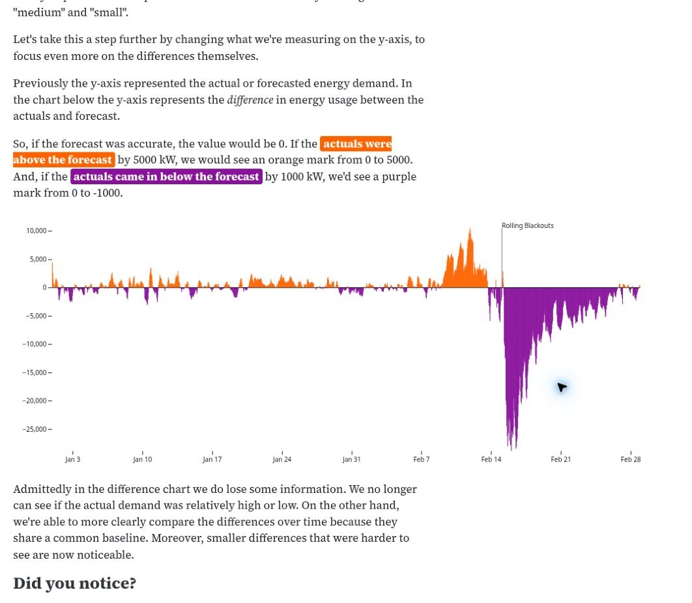
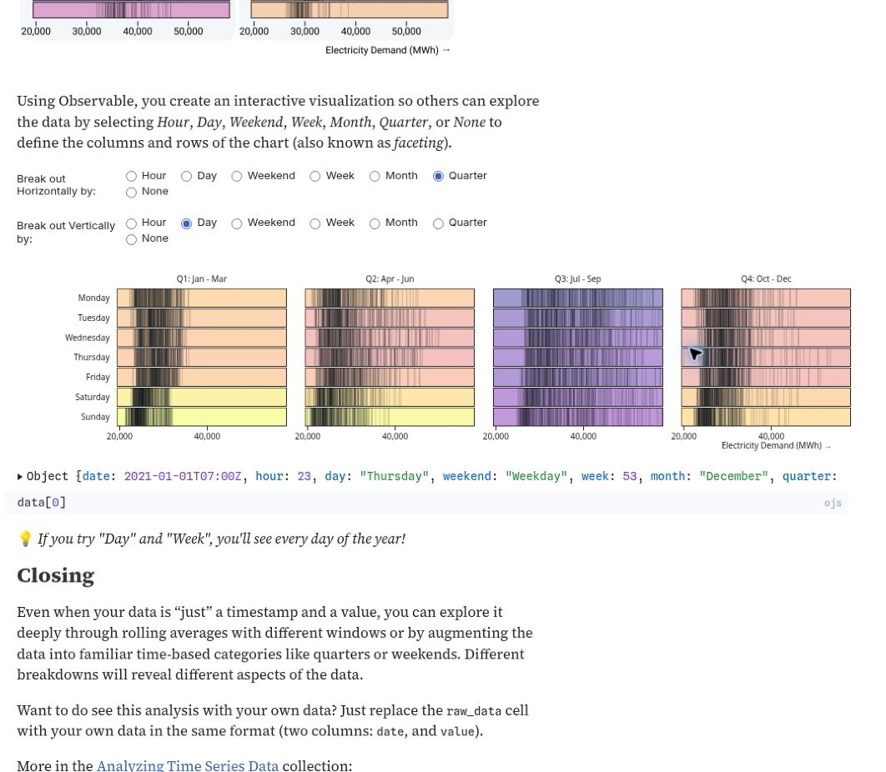
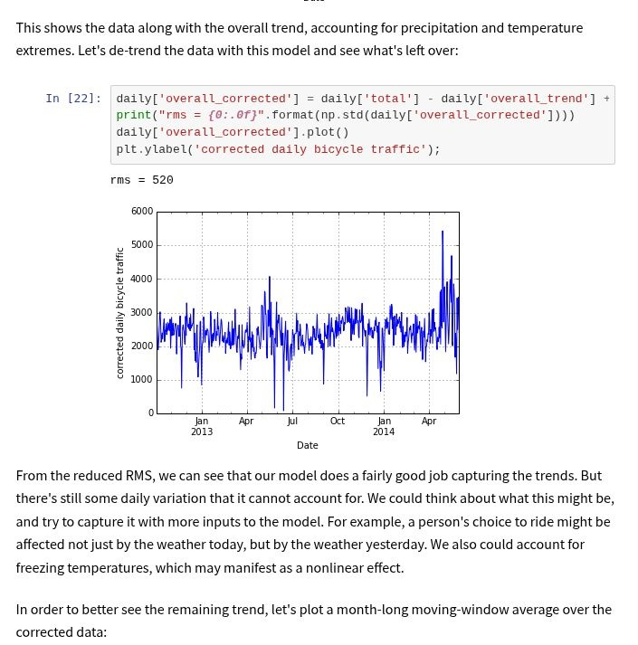

# Notebook research: a useful first reproduction

Captured from [Observable's forecast investigation](https://observablehq.com/@observablehq/whats-different-timeseries-forecast-performance). The prose explains a new measure before the graphic displays it.

## Recommended starting point

Use **forecast performance** as the first reproduction candidate. It connects a small calculation to a clear analytical question. Preserve the source table, actual/forecast comparison, `delta = actuals - forecast`, signed differences, and a later event window.

The important test is whether an author can change either representation and retain one coherent analysis. Change the formula in text. Change a chart field, axis limit, or color through its controls. Save, reopen, and compare the result with its definition. A local event window must leave the earlier full series intact.

Before building, retrieve and inspect the attached CSV. The Pro agent observed loaded rows, but did not download those bytes. Resolve its inconsistent unit labels, timestamps, missing values, and duplicate hours before fixing expected results.

This recommendation follows the Pro report. Byron selected it as the first proof on 2026-10-13.

## What all eleven examples contribute

The [complete illustrated report](exploreda-notebook-research/exploreda-notebook-examples.html) contains seven Observable examples and four external investigations. Each entry includes source links, data meaning, calculations, and reproduction elements. The table below gives each example a distinct role in this initiative.

| Example                                                                                                        | Useful reproduction elements                                                                           | Scope implication or limit                                                                                                                 |
| -------------------------------------------------------------------------------------------------------------- | ------------------------------------------------------------------------------------------------------ | ------------------------------------------------------------------------------------------------------------------------------------------ |
| [Observable Penguins](https://observablehq.com/@observablehq/plot-exploration-penguins)                        | Data preview → scatter → species color → sex facets; later counts and distributions.                   | Small alternative for chart editing. Preserve missing categories. Teaching reveals are optional; one requested numerical answer is absent. |
| [Forecast performance](https://observablehq.com/@observablehq/whats-different-timeseries-forecast-performance) | Two series → named subtraction → signed result → local event window.                                   | Best first calculation-and-edit test. Resolve units. The original window is authored, not an observed reader brush.                        |
| [Analysis adventure](https://observablehq.com/@observablehq/what-caused-this-an-analysis-adventure)            | Cached fuel records → hourly totals → grouped lines → common-scale facets.                             | Tests aggregate/detail meaning and consistent colors. Reconcile hourly/energy labels; decomposition alone does not establish cause.        |
| [Date Patterns](https://observablehq.com/@observablehq/discovering-date-patterns)                              | Raw table → rolling line → local calendar fields → grouped distributions and means.                    | Broader workflow candidate. Make timezone, window edges, ordering, and separate control scopes explicit.                                   |
| [Correlation over time](https://observablehq.com/@observablehq/correlation-over-time)                          | Hourly join → colored scatter → calendar facets with a full-data reference.                            | Tests shared inputs with separate controls and shared styling. Verify join cardinality and prepared category definitions.                  |
| [Bratenahl](https://observablehq.com/@themarshallproject/bratenahl-stops-tickets)                              | Missingness explanation → officer rates/table → size-encoded scatter; optional geographic comparisons. | Tests denominators and independent branches. Its sensitivity output fails; unknown-race treatment differs between calculations.            |
| [Spatial tutorial](https://observablehq.com/@michelleeesi/local-spatial-autocorrelation-interactive-tutorial)  | Neighbor weights → standardized values/lag → Moran comparison → permutations → local results/map.      | Later specialized reference for explicit reruns and randomness. Some cells fail; no seed control was observed.                             |
| [Seattle cycling](https://jakevdp.github.io/blog/2014/06/10/is-seattle-really-seeing-an-uptick-in-cycling/)    | Counts → temporal summaries → weather join → model → predictions → corrected series.                   | Stretch candidate for dependent results. Review legacy model and uncertainty methods before repeating numerical claims.                    |
| [Silge Penguins](https://juliasilge.com/blog/palmer-penguins/)                                                 | Filter → scatter → held-out model check → coefficients → revised scatter.                              | A model can motivate a chart edit without becoming that chart's execution dependency. Fitting and validation add scope.                    |
| [OWID decoupling](https://ourworldindata.org/co2-gdp-decoupling)                                               | Metric definitions → baseline normalization → three lines → country/table inspection.                  | Tests baseline lookup and data meaning. Series end in different years; the observed table initially showed more countries.                 |
| [Film dialogue](https://pudding.cool/2017/03/film-dialogue/)                                                   | Character/film join → word shares → within-film ranks → selected-film details.                         | Tests different row meanings and selection scopes. Released aggregates omit parts of preparation; age rules and genre data need work.      |

## A progression after the first proof

[Date Patterns](https://observablehq.com/@observablehq/discovering-date-patterns) adds a useful second challenge: two calculation branches over the same source. Its line brush controls the visible line interval. It does not narrow the later grouped distribution. A reconstruction that applies every interaction globally would change the investigation.

Retain the distribution marks when claiming a faithful reproduction. A group-mean chart can be an early simplification, but loses information. Local calendar fields also require more than the current UTC date functions.

[Seattle cycling](https://jakevdp.github.io/blog/2014/06/10/is-seattle-really-seeing-an-uptick-in-cycling/) is the stretch case. Its question depends on adjustment for weather and temporal effects. Reproducing only the first time series would miss that argument. Use one reviewed model and explicit window rules before considering the full historical sequence.

## What the evidence changes

- **Reading order and execution order need separate meaning.** Moving prose or a result should not silently change its input. The Silge example also separates editorial motivation from calculation dependencies.
- **Controls need a declared scope.** Display limits, source filters, grouping changes, and shared colors affect different things. Their defining text should make those effects understandable.
- **Two-way editing must preserve meaning.** A color change should preserve a formula. A grouping or denominator change can alter a calculation. Stable block references are a promising mechanism to evaluate.
- **Text includes two kinds of claims.** A computed value can refresh. A human conclusion may need review after inputs change. Automatic narrative generation is not established demand.
- **Tables explain graphics.** Source rows, intermediate results, and chart values have different meanings. Inspection should reveal which one the reader sees.
- **Errors can remain local.** The retained broken notebook branches show why a failed calculation should not obscure unrelated results. Invalid drafts and stochastic reruns still need product decisions.

These are research implications and candidate behaviors. They do not resolve the scope questions by themselves.

## Existing foundations and concrete gaps

The [dashboard language](../../../packages/explorEDA/README.md#dashboard-text) already compiles settings and exports them to equivalent text. The exporter regenerates definitions from settings; this does not prove preservation of authored prose, comments, or block formatting.

[Calculated fields](../../application-feature-inventory.md#supported-expressions), chart editing, facets, and bounded grouped summaries provide useful foundations. The package also has [related-table queries](../../../packages/explorEDA/README.md#related-tables). Joins should therefore start with that existing query path. They are not a reason to assume a new query engine is necessary.

The current date functions use UTC. Named grouped summaries have a narrower contract than arbitrary reusable notebook outputs. Rolling calculations and reusable model results need separate checks. A chart fit is not a saved model pipeline. These distinctions refine the Pro report's compatibility hypotheses; no browser reproduction was performed here.

## Scope recommendation

A single-column arrangement of existing text and chart panels could cheaply test reading flow. It would leave the main uncertainty unresolved: graphical edits writing back into the right authored definition.

Keep the first proof centered on that edit cycle, one prepared source, and a simple derived measure. Use ordinary prose and conventional charts. Defer general model execution, spatial statistics, stochastic runs, and automatic narrative updates until a selected workflow requires them.

Pass the first proof when text edits, graphical edits, local scope, and reopening agree on the calculation and output. Failure to preserve that agreement should change the design before broader examples expand it.

The scope decisions now live in the [intent brief](https://github.com/byronwall/explorEDA/blob/6d9130ba1c5242c15bbbeb9b20b7fd0707d0aa0e/docs/intent/notebook-analysis/intent-brief.md) and [shape brief](https://github.com/byronwall/explorEDA/blob/6d9130ba1c5242c15bbbeb9b20b7fd0707d0aa0e/docs/intent/notebook-analysis/shape-brief.md). Evidence, source qualifications, and original assets remain in the [research packet](README.md).
