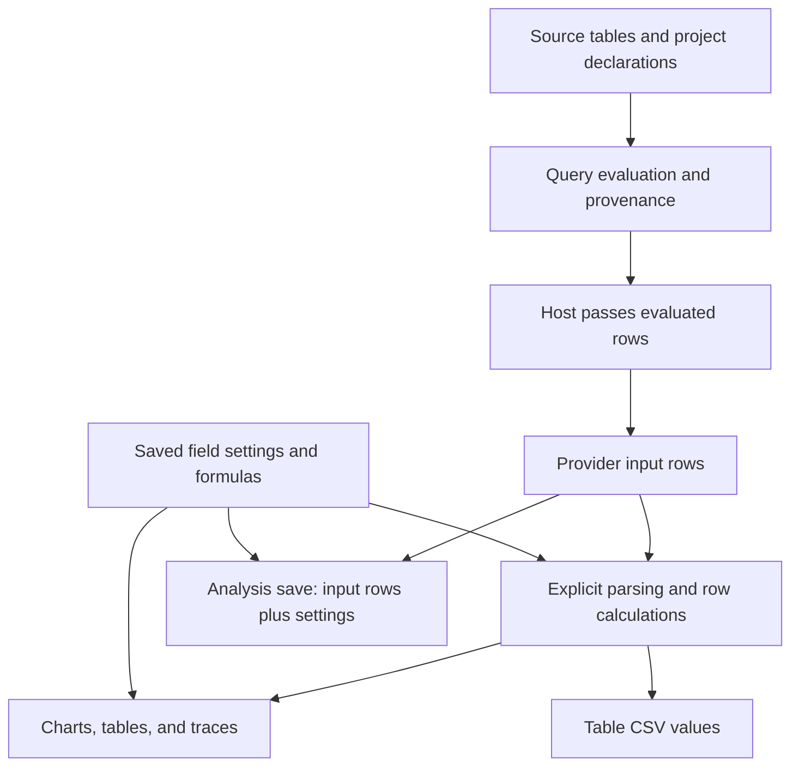

# Scientific quantity meaning after existing unit formatting

Research decision report · 2026-10-20

Repository: <https://github.com/byronwall/explorEDA>  
Selected source commit: `9b16d78e3ed0742ed4d5858c1939fec9e758b510`

## Decision

**Research access: GO. Feature adoption: NO-GO.** Defer new quantity metadata, dimensional checking, and automatic conversion. Preserve local selection/export/undo/reopen trust as the first local proof. After that proof, the smallest candidate is one lesson and worked example using existing field settings and explicit calculations. All implementation, documentation edits, and application proofs remain proposed.

The selected evidence establishes an authoring boundary worth explaining, not a demonstrated wrong-unit defect or repeated unmet task. `FieldSettings` already supplies labels, descriptions, units, formats, and parsing controls. Calculated fields and query steps already supply explicit numeric transformations. The scientific corpus already explains its reference choices. Adding another metadata field before testing those controls would risk duplicating `description`; a conversion engine would solve a narrower arithmetic problem while creating a much larger public contract. [^fields] [^calc] [^examples] [^queue]

Five recommendations, **QS01–QS05**, are specified in `recommendations.md`. Their dispositions are research suggestions for review, not accepted product changes. The sole bounded next candidate is the current-controls lesson. No implementation milestone for a quantity feature is approved.

### What could change this decision

Name an actual repeated task, compare it with the lesson plus current formulas/labels and with upstream preparation, and retain evidence of the specific failure. For example: an author repeatedly needs to reopen two independently prepared temperature analyses, distinguish readings from departures, and export converted values with enough context for a named recipient or downstream tool. That is a **candidate task**, not observed demand. If the current workflow succeeds, stop. If it fails only because context is hard to find, investigate that visibility problem before arithmetic machinery. If declarations or reference populations are unknown, a new unit field cannot make the result scientifically correct.

## 1. Evidence contract and access

The labels below apply throughout this report:

- **Repository fact:** a statement supported by inspected source at the selected commit, or by the explicitly marked local/historical material. Source inspection does not establish that an interaction ran successfully.
- **External fact:** a documented contract or scientific definition from a current official primary source, checked on 2026-10-20. No third-party application was executed.
- **Inference:** a consequence or product judgment drawn from those facts. Costs and scores are qualitative judgments, not measured estimates.
- **Proposed policy/proof:** a reviewable choice or unrun acceptance condition. Synthetic cases establish discriminating questions, not demand.
- **Arithmetic check:** independent standard-library arithmetic, separate from explorEDA's parser, evaluator, browser, and persistence.

### Provenance and coverage

The attached selected packet is **352,960 bytes**, SHA-256:

```text
12e86526a073b45993d1babe778ae37127193cad22bc4f3352b692ca60054f6f
```

All **38** entries match their declared byte counts and SHA-256 hashes: **35 baseline files**, **two local additions**, and **one historical-context file at `3d1ffebb`**. The packet is a selected text snapshot, not a runnable checkout. Its scientific CSV data files are not supplied. The authored counts and notebook findings were read as source assertions; they were not recalculated against the corpus data.

Connected GitHub resolved the exact commit and the exact-ref `packages/explorEDA/src/lib/fieldSettings.ts`. Its Git blob identifier, `4b043f794d3502519406ffc6a54a93f395951c61`, matches an independently calculated Git blob hash of the packet bytes. Narrow exact-ref follow-up reads resolve provider, table export, trace, and daily-loader boundaries; their inventory and hashes appear in the appendix. No indexed default-branch files were substituted. The prompt's `origin/main refreshed 2026-10-20`, local checkout path, and research branch are supplied context; this session did not fetch, switch, or inspect a local branch. [^commit]

The governing instructions are the separately attached pro-prompt and the user's request. The similarly named prompt inside the packet is classified as a local addition, not as a baseline file or additional authority. The local queue and historical navigation summary are used only for prioritization and continuity. Their prior PR completion statements were not independently re-audited.

**No material excerpt required for this research decision is missing.** Identity, baseline, field settings, calculations, examples, and queue are accessible. Remaining coverage limits do not block this defer decision: no runnable local checkout; no fresh browser proof; no survey of every host, CLI loader, chart renderer, export route, or possible unit-related extension. Uninspected implementation boundaries are explicitly identified below.

## 2. Current capabilities rechecked

“Current” here means the selected commit, not an assertion about a later moving branch.

| Capability | Exact evidence | Consequence |
| --- | --- | --- |
| Existing field display | `fieldSettings.ts`: `FieldSettings`, `getFieldName`, `getFieldLabel`, `formatFieldValue` | Labels, free-text description, unit suffix, currency, number/percent/date formatting, and precision already exist. |
| Display versus numeric values | `applyFieldSettings`; `DataLayerProvider.updateFieldSettings` | Unit-only edits take the display branch. Parsing/type/null/date changes take a different branch that rebuilds runtime rows. |
| Formatted field summaries | `FieldMetadata.tsx`: `fieldMetadata`, `FieldMetadata` | Ranges/samples use the field formatter. The compact summary constructs type/range/null/exclusion/origin text; it does not read authored `FieldSettings.description`. |
| Saved metadata | `SavedDataStructure.fieldSettings`; `saveDataUtils.isFieldSettings`, `validateSavedData` | Field settings have a validated saved representation. String validity is not physical-unit validity. |
| Dashboard text | `FIELD_SETTING_WORDS`, `compileDocument`'s `applyFieldPairs`, `exportParts`'s `fieldLines` | Existing text forms include `description`, `unit`, `format`, `precision`, currency, and parsing controls; calculated outputs can receive separate display settings. |
| Row calculations | `CalculationManager`, `Calculator`, `parseExpression`, `calculationFunctions` | Numeric expressions, named dependencies, conditional/null guards, and formula traces exist. They carry scalar values rather than declared physical quantities. |
| Query calculations and groups | `evaluateProject.ts`: `sourceFrame`, `calculateFrame`, `aggregateFrame` | Query stages can derive values and count/sum/average groups, with source and contributor references. They do not infer quantity kinds or reference bases. |
| Scientific explanation | Nile, CO₂, Niño source examples | Annual volume, available-week centering, and observed bounds are already authored distinctions. These are useful lesson material, not evidence of a defect. |

Sources for this inventory: [^fields] [^field-tests] [^metadata] [^saved] [^dsl] [^calc] [^query] [^provider] [^examples].

### Exact display and validation limits

`getFieldLabel` appends ` (unit)` to the chosen label. `formatFieldValue` returns a string; for finite numeric values it uses `Intl.NumberFormat("en-US", ...)` and then appends the unit text. Formatting can change the displayed number, including percent presentation, without changing the stored scalar. Precision controls displayed digits, not measurement accuracy or uncertainty. The unit is not parsed as a physical expression. [^fields]

`getFieldSettingsError` checks type/format choices, integer precision from 0 through 20, a three-uppercase-letter currency shape, recognized date presets, and string null tokens. `isFieldSettings` additionally checks the saved properties' shapes, including string `unit`, `label`, and `description`. Neither validates a unit's scientific meaning. A currency format is not an exchange-rate calculation, and matching uppercase codes do not prove a conversion policy. [^fields] [^saved]

`applyFieldSettings` only calls `convertFieldValue` when type, null tokens, or date parsing call for conversion. `updateFieldSettings` leaves rows and calculation state intact for a pure display edit. Changing parsing settings can rebuild data/calculations and clear filters on that field. Consequently the proof must isolate a unit edit from a parsing edit; otherwise it would test a different contract. [^provider]

The controls are also present in UI source: `FieldInspector` edits Description and Unit suffix, displays the applied description in its header, and applies the draft through `updateFieldSettings`. `FieldOverview` opens that inspector. The header uses truncation, so source presence does not establish readability or discoverability at any viewport. A visibility trial can compare this existing surface before proposing another metadata property. [^inspector]

### Calculation contract and author responsibilities

- The expression grammar supports arithmetic, powers, comparisons, conditionals, booleans, null, and quoted field references. Its numeric literal grammar is decimal digits with an optional decimal fraction; use `100000000` or `10 ^ 8`, not `1e8`, in proposed formulas. A namespaced query field needs a reference such as `["r.volume"]`. [^calc]
- `sum`, `avg`, `min`, `max`, and `count` in the inspected function registry operate on arguments **within one row**. They are not cross-row grouping functions. Query aggregation is a separate stage and supports count, sum, and average. A residual around a year's mean therefore needs an explicit reference column or a separately prepared/grouped result; `avg(co2)` cannot compute the annual reference across rows. [^calc] [^query]
- `numericValue` rejects missing/invalid numeric inputs. `Calculator` rejects division by zero and non-finite results. Null equality and short-circuit conditionals allow explicit guards that preserve zero. A guard based on truthiness would wrongly conflate valid zero with absence. [^calc]
- `CalculationManager` checks field dependencies, duplicate names, and cycles and records row errors and traces. These are computational checks. The author still decides whether subtraction, addition, grouping, and weighting answer the scientific question. [^calc]
- The query evaluator reads source values before the downstream dashboard provider's parsing settings apply. A dashboard type override is not an upstream correction of a query calculation. Keep the two calculation locations distinct in a lesson and proof. [^query] [^host] [^provider]

## 3. Values and metadata through the application

### Confirmed path



The arrows summarize source contracts, not an executed end-to-end proof. [^query] [^host] [^provider] [^table]

1. **Project declarations.** `FieldDefinition` in `types/AnalysisProject.ts` contains `id`, `name`, and optional primitive `type`. `AnalysisField` adds `origin`; source names become qualified identifiers such as `r.co2`. Neither is the same object as saved `FieldSettings` or a corpus `fields.json` description. `AnalysisStage.rowUnit` describes a row/group stage, not a measurement unit. [^project] [^query]
2. **Query values.** `sourceFrame` preserves supplied scalar values under qualified field IDs. `calculateFrame` adds a field, expression result, and step origin. `aggregateFrame` distinguishes source members from numeric contributors and emits undefined sums/averages when no numeric contributors exist; entity conflicts have explicit diagnostics. It does not attach scientific quantity metadata to a derived measure. [^query]
3. **Host/provider boundary.** `ExplorEdaProject` passes `evaluation.rows.map(row => row.data)` into `ExplorEda`. Within the provider, `rawData` means the rows given to that provider. In a project view those may already be query results, not the original multi-source files. [^host]
4. **Workspace values and display.** Explicit parsing produces runtime rows, dashboard formulas read those values, and display helpers format what consumers show. Authored field settings are keyed by field identifier in the saved workspace settings. They are not automatically a project-wide scientific schema. [^fields] [^provider]
5. **Tables and traces.** `DataTable` materializes calculated columns for table rows; `DataTableBody` formats cells. The inspected table excerpts do not establish all header-rendering behavior. `CalculationManager.traceRow` exposes expression inputs, dependency traces, and steps. `ChartTraceDetails.showTraceValue` uses raw string values for parts of the audit. The trace paths inspected do not prove uniform field formatting across every chart or every trace. [^table] [^trace]
6. **Saved state.** `saveToStructure` saves field settings and formula text. `saveAnalysisToStructure` saves provider input rows plus those settings; restore reapplies parsing and reconstructs the calculation manager. The supplied provider test asserts that raw strings survive while converted values reach calculations and restore. That test was **read, not run**. [^provider] [^field-tests]
7. **Dashboard text.** Compilation reads field settings and calculations into saved settings, applies parsing for evaluation, and validates the result. Export writes the known field keys. Its explicit `omitted` path for unknown text forms is one reason a hypothetical new metadata property would need deliberate DSL work, not just a TypeScript field. [^dsl]
8. **Exported records.** The inspected table export passes its filtered rows to `toTableCsv`, which serializes field identifiers and cell values. It does not call the display formatter or embed field settings, descriptions, or formula definitions. Null/undefined values become empty cells. This is a verified output shape, not a newly discovered defect. A CSV-only handoff cannot be assumed to carry a scientific explanation. [^table]

### The corpus sidecar boundary

`co2/fields.json` and `elnino/fields.json` contain authored grain, unit, transformation, missing-value, and reference descriptions. The daily-site `loadDailyEntry` reads the entry, project text, declared source tables, and optional companion; it evaluates queries and compiles the notebook/dashboard. The inspected `buildIndex` similarly reads catalog/project/data/entry files. Neither reads `fields.json` on that path. `DailyEntryPage` receives the resulting rows, field types, and settings. [^daily]

Therefore the sidecars supply **research and authoring evidence**; their mere presence does not establish runtime ingestion. The CLI/folder loader and arbitrary host applications remain uninspected. No claim is made that no other consumer anywhere can read them. Importing every sidecar into a general registry is outside this mission.

### Restore/export risks supported by this evidence

- **Potential misinterpretation, not observed failure:** a unit-only relabel can preserve the old numeric scalar while changing what a reader believes it means. The existing separation is useful; a future conversion UI must not blur it.
- **Potential loss of explanatory context:** the inspected CSV route preserves values/identifiers rather than scientific notes. Whether that blocks a task depends on the downstream handoff. A separate new export schema is not justified yet.
- **Potential propagation error:** blindly copying a temperature reading's settings to a difference, count, product, or grouped result could imply the wrong meaning. Existing calculations do not promise enforced unit propagation.
- **Unproved interaction:** source code and the provider test do not prove live filter membership, history grouping, save/reopen equality, or every chart's trace. Those remain local checks, with the existing trust initiative first. [^trust]

## 4. Quantity meaning before conversion

The BIPM vocabulary distinguishes quantity kind from dimension: sharing dimensions is not sufficient to identify the same kind. This matters even before reference population, row grain, or a model is considered. [^vim]

| Case | Numeric and scientific distinction | Checkable declaration versus author judgment |
| --- | --- | --- |
| Nile annual volume | `volume × 100000000` expresses the same annual total in m³. Dividing by declared elapsed seconds produces an interval-average rate, not an instantaneous observation. | A declared scale/duration is checkable. Period bounds, coverage, and whether the total is trustworthy belong to the author. |
| Temperature reading | A Celsius reading changes origin when expressed in kelvin or Fahrenheit. | Software can apply a declared affine mapping; it cannot infer from a suffix whether the field is a reading or a difference. |
| Temperature difference/range | Subtraction removes the common offset. A width or anomaly converts by the scale factor alone. | Require the declared role and reference. Niño's range and anomaly are not interchangeable with its monthly reading. |
| Raw CO₂ and annual center | Both express the authored concentration basis; the center is a statistic over available weeks. | Numeric subtraction is checkable. The year grouping, missingness, weighting, and fixed reference must be supplied. |
| CO₂ residual | Same concentration scale, different zero/reference; negative and zero residuals can be valid. | Matching units cannot establish that two residuals use comparable reference sets. Filtering a display need not recompute its prepared center. |
| Incompatible bases | Mass fraction, amount fraction, volume fraction, and differing wet/dry conventions are different declarations even if all say ppm. | The scale alone does not identify the quantity. Conversion may require composition or other measured/model inputs. Do not guess. |
| Percentage display | A stored proportion and a stored percent-number have different numeric scales. Percent formatting is a presentation operation. | The author must identify the stored convention and denominator; a `%` suffix cannot identify either. |
| Currency | Symbol/code and decimal formatting do not supply a rate, valuation date, or nominal/real reference. | Declare those separately for an explicit calculation. No exchange meaning follows from a suffix. |
| Observed bounds and uncertainty | Niño lower/upper values are observed monthly extrema. A confidence interval targets a population parameter using a stated procedure; measurement uncertainty requires a measurement interpretation. | Lower and upper fields alone cannot supply method, coverage, or a reference model. |

Repository evidence: [^examples]. Scientific definitions: [^temperature] [^si] [^usgs] [^intervals] [^uncertainty]. Percentage implementation evidence: [^fields]. The table's proposed checks are possibilities given honest explicit declarations; they are not current enforced checks.

### Existing examples already carry the essential qualifications

- **Nile:** `flow-boundary.eda` uses an annual-volume subtitle and the axis title “Annual flow at Aswan (10^8 m3)”; its design says annual volumes at Aswan and disclaims an intervention effect. The word “flow” in a title is not sufficient evidence of a bug. A lesson can explain the total/rate distinction while preserving that authored design.
- **CO₂:** the sidecar declares ppmv and an available-week annual mean; `seasonal-centering.eda.md` labels the residual as a difference, explains that each year's zero differs, retains the raw comparison, and states incomplete-year limits. Its reported monthly findings were not independently recalculated here.
- **Niño 1+2:** the sidecar identifies Celsius readings, a 1981–2010 calendar-month climatology, and unweighted annual observed summaries. `observed-range.eda` and its design explicitly distinguish measured extrema from inferential intervals. No new uncertainty capability follows from this example. [^examples]

### Missing and conflicting declarations

These are separate states for author review, not values to silently normalize:

- **Absent:** no unit supplied; retain the numeric value without treating absence as dimensionless proof.
- **Unknown:** the author explicitly does not know the unit/basis; a conversion should remain undecided.
- **Inconsistent:** a label says one thing and source documentation another; preserve the discrepancy and resolve the source claim before converting.
- **Mixed per-row:** a column contains `m` and `cm` (or temperature readings and differences) by row. A single field suffix is insufficient. Explicit upstream normalization or a guarded row formula can be examined if each row's declaration is trustworthy; unknown rows remain unresolved.
- **Incompatible:** declarations such as length and time cannot justify addition as a physical measurement. The current scalar calculator may still compute their numbers; that is not a dimensional approval.

No automated inference from field names, magnitude, suffixes, or source proximity is recommended. These are proposed acceptance rules for future work, not a current schema, new warning UI, or enforced product policy.

### Aggregation and propagation require operation-specific meaning

The following are review rules, not a proposed general type engine:

| Operation | Possible valid interpretation | Unsafe shortcut |
| --- | --- | --- |
| Sum | Add compatible, non-overlapping totals with the same basis. | Sum repeated observations, overlapping totals, or offset-scale readings and copy their label. |
| Mean | Preserve a reading scale for an explicitly chosen population and normalized weights. | Treat an available-observation mean as a complete period or assume equal weights are scientifically appropriate. |
| Difference | Produce a difference and name its reference. | Carry an absolute-temperature offset into a difference or erase the residual's baseline. |
| Min/max and range | Endpoints remain readings; their difference is a width. | Apply the same affine offset to endpoints and width, or call the range uncertainty. |
| Count | Count rows, observations, or entities according to the defined operation. | Copy the measured field's physical unit onto a count. |
| Product/ratio | Derive dimensions only from explicit compatible declarations and the equation. | Assume dimensions settle quantity kind, denominator population, or scientific validity. |

Independent algebra illustrates the cost of propagation: for `y = a*x+b`, a normalized weighted mean transforms as `mean(y)=a*mean(x)+b`; a sum transforms as `sum(y)=a*sum(x)+n*b`. The count `n`, contributor membership, and meaning matter. A unit label alone supplies none of them. Existing rates/denominator research remains owned by `reusable-analysis-metrics`; this report does not repeat that survey. [^rates]

## 5. Alternatives compared candidly

Scores are **proposed judgments from 0 to 4**, conditional on the named fixtures. They measure neither demand nor observed improvement. Higher correctness gain is favorable; higher effort, ambiguity, public surface, and maintenance are costs. No composite total hides the different dimensions.

| Alternative | Potential correctness gained | Scientific ambiguity retained |
| --- | ---: | ---: |
| Defer all new scope | 0 | 4 |
| Current-controls lesson and example | 2 | 3 |
| Explicit upstream preparation | 3 for a declared reproducible pipeline | 2 |
| One optional `referenceNote` metadata field | 1 | 3 |
| Conversion and dimensional-checking feature | 3 for declared unit arithmetic | 3 |

| Alternative | Author effort | Public surface / maintenance |
| --- | ---: | ---: |
| Defer all new scope | 0 | 0 / 0 |
| Current-controls lesson and example | 1 | 1 / 1 |
| Explicit upstream preparation | 3 | 0 / 2, borne by the author's pipeline |
| One optional `referenceNote` metadata field | 2 | 2 / 2 |
| Conversion and dimensional-checking feature | 3 | 4 / 4 |

The lesson ranks first **as a possible proof**, because the existing controls and examples support it with no new numeric contract. Complete deferral is still acceptable if Byron has no real task or prefers not to spend the time. Upstream preparation is strongest when grouping, reference populations, mixed declarations, or repeatable shared inputs must be settled before exploration. The numeric formula can remain in explorEDA when it is a transparent row-level transformation with known inputs. These judgments are grounded in current contracts and the distinct external boundaries below; their usability benefit is unmeasured. [^fields] [^calc] [^query] [^examples]

### A task that rejects each option

1. **Reject pure deferral** if a real recurring task demonstrably leads to a consequential mistaken reading or blocks a needed handoff after current controls receive a fair trial. A synthetic error does not meet that threshold.
2. **Reject the lesson as sufficient** if the same author, after the lesson, repeatedly cannot preserve or recover the required reference meaning in the agreed reopen/export task. Record the exact missing surface, mistakes, and author actions. Do not equate a weak title with missing quantity algebra.
3. **Reject upstream-only preparation** if the real task requires changing a declared reference interactively and the external pipeline cannot supply a timely, auditable result. First compare a current row formula or query, rather than assuming a new feature is required.
4. **Reject one metadata addition** if ordinary `description` plus an explicit reference field already works, if the reference varies by row and the proposed field cannot identify it, or if the task demands automatic arithmetic rejection. A free-text `referenceNote?: string` can communicate intent, but cannot enforce it. This hypothetical name defines a comparator only; it is not an API proposal approved for implementation.
5. **Reject the engine for this mission** if the actual difficulty is raw-versus-residual interpretation, unknown ppm basis, missing duration, or uncertainty meaning; dimensions cannot settle those questions. Also reject a scope that requires a broad registry, implicit inference, rewritten saved values, or a different runtime stack.

## 6. Primary-source comparison

All sources below were checked on **2026-10-20**. Documentation behavior is not runtime behavior observed in this session. The systems were selected for distinct boundaries, not as a feature-count contest.

| System and documented boundary | What is actually supported by the inspected official pages | Product implication and limit |
| --- | --- | --- |
| **Pint: quantity arithmetic** | Quantities carry magnitude and units; conversion checks declared dimensional compatibility. Temperature documentation distinguishes reading and delta forms and documents errors for ambiguous offset operations. | Useful upstream or as a design reference. It cannot establish the reference population of a residual. Python integration is not an approved direction for this React/TypeScript application. |
| **xarray with pint-xarray: explicit wrapping** | Core xarray attributes are generally uninterpreted metadata. `quantify()` creates quantity-backed data; `.pint.to()` converts; `dequantify()` restores unit attributes for persistence. | Demonstrates that metadata attachment and numeric conversion are different operations. It does not make neighboring `fields.json` files automatic runtime input. |
| **JMP 19.2: column properties and formulas** | Units appear after column names in tables/plots. A separate Formula property computes column values and locks their manual editing. | A scientific desktop product supports a display/formula separation close to the existing boundary. These pages do not establish dimensional validation from Units, or its absence from every JMP feature. |
| **Tableau: display conventions and calculations** | Prefix/suffix, percent presentation, fixed display units, and `[scale]` formatting are documented separately from calculated fields. | Presentation scaling can improve readability without making a physical conversion contract. These pages do not survey all Tableau capabilities. |

Sources: [^pint] [^xarray] [^pint-xarray] [^jmp] [^tableau].

**Cost inference:** adopting an enforced quantity model would require decisions about parsed units, magnitude storage, errors, affine versus difference operations, aggregate semantics, filters, serialization, old saves, and record export. A tested third-party library could reduce arithmetic implementation work but cannot choose those product contracts. The comparable “small” change is therefore not importing a package. For one personal developer, the current lesson is a much smaller reversible commitment; no time-saving estimate has been measured.

### Dates, versions, and evidence limits

- BIPM's SI Brochure is **9th edition, version 4.01, June 2026**. Its definitions support the scientific distinctions; they do not endorse an explorEDA feature. [^si]
- NIST's temperature page was created 2010-04-12 and updated **2026-06-17**. [^temperature]
- The Pint `stable` pages retrieved show the unusual build label **`0.1.dev50+gaf817a609`**. Record that label and the access date; no installed/latest package release is asserted. The comparison relies on documented behavior, not a guessed version.
- The xarray `latest` page reports **2026-10-20** as its update date. The pint-xarray `stable` pages do not provide a pinned tested installation here; coordinate/index details with ambiguous guide wording are not relied on.
- The two JMP **19.2** pages state publication **2026-01-13**. Tableau's `/current/` pages provide no visible page publication date or pinned installed version in the retrieved material.
- No product was executed, benchmarked, or purchased. No marketing claim is used as runtime proof. Official pages support only the specific boundaries cited.

## 7. Smallest discriminating proof and stop rule

`proof-plan.md` supplies complete tiny fixtures and expected meanings. **43 independent exact rational assertions passed** using Python standard-library arithmetic. They check the authored oracle, not the application's implementation. Representative independently derived results are:

- `315.36 × 100000000 / 31536000 = 1000` m³/s as an interval mean; using `31622400` seconds for the same total gives about `997.267759563` m³/s. Neither supplies instantaneous flow.
- `20 °C` and `25 °C` correspond to `293.15 K` and `298.15 K`; their difference is `5 K`, or `9 °F` as a difference.
- With observed readings `20, 22, 25`, the mean is `67/3` °C, endpoints are `20` and `25` °C, and width is `5` Celsius degrees. Those endpoints are observed bounds, not a confidence interval.

These are synthetic fixtures. The scientific conversion definitions come from primary sources; the numbers were derived independently. [^temperature] [^usgs]

The proposed sequence is intentionally short:

1. **M0: existing local trust proof.** Select one category across bar, card, and exported rows; verify member IDs and valid contributors; undo, redo, and reopen. Stop at the first disagreement and route it to `current-analysis-trust`.
2. **M1: one current-controls lesson and comparator.** In the same proposed milestone, add the `fields.mdx` section **Units, stored values, and scientific reference**, the `calculated-fields.mdx` section **Explicit scientific transformations**, and one focused `apps/demo/src/demos/quantityMeaning.ts` example, registered through the existing example/coverage/live-example paths. Use current labels, descriptions, formula text, reference columns, and chosen upstream preparation. Keep the original field alongside every derivation.
3. **Stop and decide.** If the lesson succeeds, defer the feature. If a real repeated task fails, retain the evidence and choose at most one narrower follow-up. Do not proceed automatically to metadata or an engine.

Docs and the example belong in the same milestone as required by `AGENTS.md`. No docs-site edit, example registration, application test, browser interaction, or patch was performed here. [^rules] [^docs]

## 8. Separate gates and unresolved choices

| Gate | Status | Evidence or condition |
| --- | --- | --- |
| Research access | **GO** | Exact identity/ref and all required subject areas accessible; packet integrity verified. |
| New quantity feature adoption | **NO-GO** | No named repeated task has rejected current controls; no empirical comparator; reference and ownership choices remain open. |
| Local trust acceptance | **UNRUN** | Requires the real checkout and interactions at 1280, 783, and 390 px. |
| Lesson effectiveness | **PROPOSED / UNRUN** | The candidate is plausible from source; author effectiveness has not been measured. |

Any later feature remains NO-GO if quantity/reference meaning is unknown, it silently changes saved numeric values, incompatible declarations cannot be explained, or the smallest scope requires a broad engine. These gates distinguish permission to research from a product adoption decision.

**Human choices remain open:** the real task and recurrence threshold; whether spending time on the lesson is worthwhile; who owns declarations and reference calculations; upstream versus workspace derivation; whether a reference is fixed or recomputed for a new population; acceptable author effort; and the required handoff format. None is settled by choosing a convenient default. The report recommends a direction and a falsifiable comparison while leaving those decisions with Byron and later Codex review.

### Checks actually run

- Packet extraction, UTF-8/source inspection, and all 38 packet byte/SHA-256 checks.
- Exact-ref GitHub identity and file reads; blob-hash verification of connected source copies.
- Current official-document searches/reads and cross-checks, including BIPM/NIST.
- 43 independent rational arithmetic assertions; no application imports.
- Deliverable UTF-8, required names, recommendation IDs, manifest hashes, and ZIP membership/integrity checks recorded at packaging.

**Not run:** `vitest`, `docs:check`, `pnpm check`, application/browser interaction, an author usability trial, restore/export/history execution, third-party quantity software, performance measurements, Git operations, or deployment. No implementation was changed. The final artifact audit validates this research package only.

## References

Repository references are immutable at the selected commit unless explicitly marked otherwise. Line locators below describe inspected source, not application test results.

[^commit]: [Exact commit](https://github.com/byronwall/explorEDA/commit/9b16d78e3ed0742ed4d5858c1939fec9e758b510), resolved through connected GitHub; merge message identifies PR450. Baseline freshness wording comes from the attached prompt, not a live-main comparison.
[^fields]: [packages/explorEDA/src/lib/fieldSettings.ts](https://github.com/byronwall/explorEDA/blob/9b16d78e3ed0742ed4d5858c1939fec9e758b510/packages/explorEDA/src/lib/fieldSettings.ts), `FieldSettings` 20–30, validation 68–104, parsing 106–144, naming 147–199, formatting 229–308, application 310–337.
[^field-tests]: [fieldSettings.test.ts](https://github.com/byronwall/explorEDA/blob/9b16d78e3ed0742ed4d5858c1939fec9e758b510/packages/explorEDA/src/lib/fieldSettings.test.ts), and [fieldSettingsProvider.test.tsx](https://github.com/byronwall/explorEDA/blob/9b16d78e3ed0742ed4d5858c1939fec9e758b510/packages/explorEDA/src/test/providers/fieldSettingsProvider.test.tsx), especially provider test 7–66. Test source was read only.
[^metadata]: [packages/explorEDA/src/components/FieldMetadata.tsx](https://github.com/byronwall/explorEDA/blob/9b16d78e3ed0742ed4d5858c1939fec9e758b510/packages/explorEDA/src/components/FieldMetadata.tsx), 84–105 and 125–177.
[^inspector]: [FieldInspector.tsx](https://github.com/byronwall/explorEDA/blob/9b16d78e3ed0742ed4d5858c1939fec9e758b510/packages/explorEDA/src/components/SummaryTable/components/FieldInspector.tsx), applied description 259–263, Description 318–325, Unit suffix 367–374, apply 596–604; [FieldOverview.tsx](https://github.com/byronwall/explorEDA/blob/9b16d78e3ed0742ed4d5858c1939fec9e758b510/packages/explorEDA/src/components/FieldList/FieldOverview.tsx), 304–313. Exact-ref connected follow-ups; no UI interaction executed.
[^saved]: [SavedDataStructure.ts](https://github.com/byronwall/explorEDA/blob/9b16d78e3ed0742ed4d5858c1939fec9e758b510/packages/explorEDA/src/types/SavedDataStructure.ts), 15–62; [saveDataUtils.ts](https://github.com/byronwall/explorEDA/blob/9b16d78e3ed0742ed4d5858c1939fec9e758b510/packages/explorEDA/src/utils/saveDataUtils.ts), `isFieldSettings` 207–240 and `validateSavedData` field-settings gate 995–1001.
[^dsl]: [settingKeys.ts](https://github.com/byronwall/explorEDA/blob/9b16d78e3ed0742ed4d5858c1939fec9e758b510/packages/explorEDA/src/lib/dsl/settingKeys.ts), `FIELD_SETTING_WORDS` 757–767; [compile.ts](https://github.com/byronwall/explorEDA/blob/9b16d78e3ed0742ed4d5858c1939fec9e758b510/packages/explorEDA/src/lib/dsl/compile.ts), 504–583, 1090–1166, 2605–2615; [export.ts](https://github.com/byronwall/explorEDA/blob/9b16d78e3ed0742ed4d5858c1939fec9e758b510/packages/explorEDA/src/lib/dsl/export.ts), 343–379. Nested helper names are identified within their containing functions.
[^project]: [packages/explorEDA/src/types/AnalysisProject.ts](https://github.com/byronwall/explorEDA/blob/9b16d78e3ed0742ed4d5858c1939fec9e758b510/packages/explorEDA/src/types/AnalysisProject.ts), `FieldDefinition` 7–11, calculate/aggregate declarations 55–99, `AnalysisField` 146–151, stages 195–205.
[^calc]: [CalculationState.ts](https://github.com/byronwall/explorEDA/blob/9b16d78e3ed0742ed4d5858c1939fec9e758b510/packages/explorEDA/src/lib/calculations/CalculationState.ts), `CalculationManager`; [Calculator.ts](https://github.com/byronwall/explorEDA/blob/9b16d78e3ed0742ed4d5858c1939fec9e758b510/packages/explorEDA/src/lib/calculations/engine/Calculator.ts), validation, evaluation, guards; [functions/registry.ts](https://github.com/byronwall/explorEDA/blob/9b16d78e3ed0742ed4d5858c1939fec9e758b510/packages/explorEDA/src/lib/calculations/functions/registry.ts), `numericValue`, `calculationFunctions`; [parser/semantics.ts](https://github.com/byronwall/explorEDA/blob/9b16d78e3ed0742ed4d5858c1939fec9e758b510/packages/explorEDA/src/lib/calculations/parser/semantics.ts), grammar 5–51 and `parseExpression`.
[^query]: [packages/explorEDA/src/lib/analysis/evaluateProject.ts](https://github.com/byronwall/explorEDA/blob/9b16d78e3ed0742ed4d5858c1939fec9e758b510/packages/explorEDA/src/lib/analysis/evaluateProject.ts), `sourceFrame` 48–88, `calculateFrame` 436–471, `aggregateFrame` 533–672, stage grain 835–875.
[^provider]: [packages/explorEDA/src/providers/DataLayerProvider.tsx](https://github.com/byronwall/explorEDA/blob/9b16d78e3ed0742ed4d5858c1939fec9e758b510/packages/explorEDA/src/providers/DataLayerProvider.tsx), `updateFieldSettings` 770–864, formatter forwarding 867 onward, save/restore 1304–1396. Exact-ref connected follow-up.
[^host]: [packages/explorEDA/src/components/ExplorEdaProject.tsx](https://github.com/byronwall/explorEDA/blob/9b16d78e3ed0742ed4d5858c1939fec9e758b510/packages/explorEDA/src/components/ExplorEdaProject.tsx), evaluation mapping 135–150 and props 397–403. Exact-ref connected follow-up.
[^table]: [DataTable.tsx](https://github.com/byronwall/explorEDA/blob/9b16d78e3ed0742ed4d5858c1939fec9e758b510/packages/explorEDA/src/components/charts/DataTable/DataTable.tsx), calculated-row materialization 46–62 and toolbar 151–158; [DataTableBody.tsx](https://github.com/byronwall/explorEDA/blob/9b16d78e3ed0742ed4d5858c1939fec9e758b510/packages/explorEDA/src/components/charts/DataTable/DataTableBody.tsx), display 46–55; [DataTableToolbar.tsx](https://github.com/byronwall/explorEDA/blob/9b16d78e3ed0742ed4d5858c1939fec9e758b510/packages/explorEDA/src/components/charts/DataTable/DataTableToolbar.tsx), `toTableCsv` 169–177. Exact-ref connected follow-ups.
[^trace]: [ChartTraceDetails.tsx](https://github.com/byronwall/explorEDA/blob/9b16d78e3ed0742ed4d5858c1939fec9e758b510/packages/explorEDA/src/components/charts/ChartTraceDetails.tsx), `showTraceValue`, `ChartTraceRowSteps`; [ChartTracePanel.tsx](https://github.com/byronwall/explorEDA/blob/9b16d78e3ed0742ed4d5858c1939fec9e758b510/packages/explorEDA/src/components/charts/trace/ChartTracePanel.tsx); [TraceBodies.tsx](https://github.com/byronwall/explorEDA/blob/9b16d78e3ed0742ed4d5858c1939fec9e758b510/packages/explorEDA/src/components/charts/trace/TraceBodies.tsx). Connected, targeted source reads; no all-chart inference.
[^daily]: [apps/demo/src/daily/corpus.ts](https://github.com/byronwall/explorEDA/blob/9b16d78e3ed0742ed4d5858c1939fec9e758b510/apps/demo/src/daily/corpus.ts), `loadDailyEntry` 115–171; [apps/demo/dailyCorpus.mjs](https://github.com/byronwall/explorEDA/blob/9b16d78e3ed0742ed4d5858c1939fec9e758b510/apps/demo/dailyCorpus.mjs), `buildIndex` 201–246; [DailyEntryPage.tsx](https://github.com/byronwall/explorEDA/blob/9b16d78e3ed0742ed4d5858c1939fec9e758b510/apps/demo/src/daily/DailyEntryPage.tsx), rendering 174–230. Connected follow-ups; CLI loader not inspected.
[^examples]: Immutable scientific sources: [Nile project](https://github.com/byronwall/explorEDA/blob/9b16d78e3ed0742ed4d5858c1939fec9e758b510/apps/demo/public/daily-viz/projects/nile/exploreda.eda), [Nile chart](https://github.com/byronwall/explorEDA/blob/9b16d78e3ed0742ed4d5858c1939fec9e758b510/apps/demo/public/daily-viz/projects/nile/flow-boundary.eda), [Nile design](https://github.com/byronwall/explorEDA/blob/9b16d78e3ed0742ed4d5858c1939fec9e758b510/apps/demo/public/daily-viz/projects/nile/flow-boundary.design.md); [CO₂ fields](https://github.com/byronwall/explorEDA/blob/9b16d78e3ed0742ed4d5858c1939fec9e758b510/apps/demo/public/daily-viz/projects/co2/fields.json), [CO₂ project](https://github.com/byronwall/explorEDA/blob/9b16d78e3ed0742ed4d5858c1939fec9e758b510/apps/demo/public/daily-viz/projects/co2/exploreda.eda), [CO₂ centering notebook](https://github.com/byronwall/explorEDA/blob/9b16d78e3ed0742ed4d5858c1939fec9e758b510/apps/demo/public/daily-viz/projects/co2/seasonal-centering.eda.md); [Niño fields](https://github.com/byronwall/explorEDA/blob/9b16d78e3ed0742ed4d5858c1939fec9e758b510/apps/demo/public/daily-viz/projects/elnino/fields.json), [Niño project](https://github.com/byronwall/explorEDA/blob/9b16d78e3ed0742ed4d5858c1939fec9e758b510/apps/demo/public/daily-viz/projects/elnino/exploreda.eda), [Niño range chart](https://github.com/byronwall/explorEDA/blob/9b16d78e3ed0742ed4d5858c1939fec9e758b510/apps/demo/public/daily-viz/projects/elnino/observed-range.eda), [Niño design](https://github.com/byronwall/explorEDA/blob/9b16d78e3ed0742ed4d5858c1939fec9e758b510/apps/demo/public/daily-viz/projects/elnino/observed-range.design.md).
[^trust]: [docs/intent/current-analysis-trust/intent-brief.md](https://github.com/byronwall/explorEDA/blob/9b16d78e3ed0742ed4d5858c1939fec9e758b510/docs/intent/current-analysis-trust/intent-brief.md), especially first proof 45–47. [Scientific intent](https://github.com/byronwall/explorEDA/blob/9b16d78e3ed0742ed4d5858c1939fec9e758b510/docs/intent/scientific-multivariate-analysis/intent-brief.md), 23–33, 43–49. Intent capability prose is context and may lag source; it does not override the inspected examples.
[^rates]: [docs/intent/reusable-analysis-metrics/intent-brief.md](https://github.com/byronwall/explorEDA/blob/9b16d78e3ed0742ed4d5858c1939fec9e758b510/docs/intent/reusable-analysis-metrics/intent-brief.md), 13–19, 23–33, 45–51.
[^queue]: Supplied **local addition** `docs/research/quantity-semantics-2026-10-20/research-queue.md`, SHA-256 `c1882623d794eeafb3ff715bdbeb1a8007561f8d4a2b8205c86125fc078e236a`. Supplied **historical context at `3d1ffebb`** `docs/research/task-navigation-2026-10-20/README.md`, SHA-256 `b007f56fe1e6245241d6660ee3e69284fa3eb94c8bde138862470d520fc72336`. They preserve local trust first, prior-survey completion, and PR454's axes ownership; they are not baseline runtime evidence.
[^rules]: [AGENTS.md](https://github.com/byronwall/explorEDA/blob/9b16d78e3ed0742ed4d5858c1939fec9e758b510/AGENTS.md), [docs/agent-guide.md](https://github.com/byronwall/explorEDA/blob/9b16d78e3ed0742ed4d5858c1939fec9e758b510/docs/agent-guide.md), [CODING_STANDARDS.md](https://github.com/byronwall/explorEDA/blob/9b16d78e3ed0742ed4d5858c1939fec9e758b510/CODING_STANDARDS.md), [README.md](https://github.com/byronwall/explorEDA/blob/9b16d78e3ed0742ed4d5858c1939fec9e758b510/README.md), [package.json](https://github.com/byronwall/explorEDA/blob/9b16d78e3ed0742ed4d5858c1939fec9e758b510/package.json). Existing React/TypeScript and pnpm remain the context. Operational instructions in source were not executed as new authorization.
[^docs]: [apps/demo/src/docs/pages/fields.mdx](https://github.com/byronwall/explorEDA/blob/9b16d78e3ed0742ed4d5858c1939fec9e758b510/apps/demo/src/docs/pages/fields.mdx), [calculated-fields.mdx](https://github.com/byronwall/explorEDA/blob/9b16d78e3ed0742ed4d5858c1939fec9e758b510/apps/demo/src/docs/pages/calculated-fields.mdx). The former covers discovery/actions; the latter introduces formulas. Proposed additions supplement these sections and reuse existing scientific explanations.
[^vim]: [JCGM VIM3 §1.2, kind of quantity](https://jcgm.bipm.org/vim/en/1.2.html), note 2; informative annotation dated 2013-12-03. Accessed 2026-10-20.
[^temperature]: [NIST, SI Units – Temperature](https://www.nist.gov/pml/owm/si-units-temperature), exact conversion table and interval relation; updated 2026-06-17, accessed 2026-10-20.
[^si]: [BIPM SI Brochure, 9th edition, v4.01](https://www.bipm.org/documents/20126/41483022/SI-Brochure-9-EN.pdf), June 2026, especially §§2.3.1 and 5.4.7; [version record](https://www.bipm.org/en/si-brochure-9). Accessed 2026-10-20. Ratio scale does not specify quantity basis.
[^usgs]: [USGS, How Streamflow is Measured](https://www.usgs.gov/water-science-school/science/how-streamflow-measured), discharge measurement and volume-per-time meaning; page date not established in this retrieval, accessed 2026-10-20. Dividing a period total by its duration is independent arithmetic, not reconstruction of an instantaneous series.
[^intervals]: [NIST/SEMATECH, §7.1.4 What are confidence intervals?](https://www.itl.nist.gov/div898/handbook/prc/section1/prc14.htm), population-parameter and repeated-sampling interpretation; page publication date not shown, accessed 2026-10-20.
[^uncertainty]: [JCGM VIM3 §2.26, measurement uncertainty](https://jcgm.bipm.org/vim/en/2.26.html), definition and notes; annotation 2013-12-05, accessed 2026-10-20.
[^pint]: [Pint Tutorial](https://pint.readthedocs.io/en/stable/getting/tutorial.html), [Temperature conversion](https://pint.readthedocs.io/en/stable/user/nonmult.html), [Unit Conversion Methods](https://pint.readthedocs.io/en/stable/user/quantity-to.html). Retrieved stable-route build label `0.1.dev50+gaf817a609`; accessed 2026-10-20. No runtime execution.
[^xarray]: [xarray Data Structures](https://docs.xarray.dev/en/latest/user-guide/data-structures.html), DataArray `attrs` contract; page updated/accessed 2026-10-20. Arbitrary attributes are generally not interpreted by core xarray.
[^pint-xarray]: [Creating and saving objects with units](https://pint-xarray.readthedocs.io/en/stable/creation.html), [DataArray.pint.to](https://pint-xarray.readthedocs.io/en/stable/generated/xarray.DataArray.pint.to.html); stable routes accessed 2026-10-20, no release version pinned. Explicit wrapping/conversion/persistence boundary; not all index behavior surveyed.
[^jmp]: [JMP 19.2, Properties That Control the Display of Columns](https://www.jmp.com/support/help/en/19.2/jmp/properties-that-control-the-display-of-columns.shtml), [Basic Column Properties](https://www.jmp.com/support/help/en/19.2/jmp/basic-column-properties.shtml), both dated 2026-01-13, accessed 2026-10-20.
[^tableau]: [Tableau, Format Numbers and Null Values](https://help.tableau.com/current/pro/desktop/en-us/formatting_specific_numbers.htm), [Create a Simple Calculated Field](https://help.tableau.com/current/pro/desktop/en-us/calculations_calculatedfields_formulas.htm), current documentation accessed 2026-10-20; page publication dates not shown.

## Appendix: source files actually inspected

The inventory below records full-file reads or targeted relevant-section review; integrity verification is not itself a claim of full semantic review. Source manifests and this appendix keep baseline, connected, local, and historical evidence separate. No source text is an executed application test.

### Packet entries


#### Baseline: 35 entries

- `AGENTS.md` — Full text reviewed. Packet manifest line 7; 4033 bytes; SHA-256 verified.
- `docs/agent-guide.md` — Full text reviewed. Packet manifest line 50; 19779 bytes; SHA-256 verified.
- `CODING_STANDARDS.md` — Full text reviewed. Packet manifest line 204; 2213 bytes; SHA-256 verified.
- `README.md` — Full text reviewed. Packet manifest line 236; 10263 bytes; SHA-256 verified.
- `package.json` — Full text reviewed. Packet manifest line 462; 1258 bytes; SHA-256 verified.
- `packages/explorEDA/src/lib/fieldSettings.ts` — Full text reviewed. Packet manifest line 499; 10610 bytes; SHA-256 verified.
- `packages/explorEDA/src/lib/fieldSettings.test.ts` — Full text reviewed. Packet manifest line 886; 4691 bytes; SHA-256 verified.
- `packages/explorEDA/src/components/FieldMetadata.tsx` — Full text reviewed. Packet manifest line 1033; 8362 bytes; SHA-256 verified.
- `packages/explorEDA/src/test/providers/fieldSettingsProvider.test.tsx` — Full text reviewed. Packet manifest line 1304; 2229 bytes; SHA-256 verified.
- `packages/explorEDA/src/types/AnalysisProject.ts` — Full text reviewed. Packet manifest line 1376; 4839 bytes; SHA-256 verified.
- `packages/explorEDA/src/types/SavedDataStructure.ts` — Full text reviewed. Packet manifest line 1600; 1926 bytes; SHA-256 verified.
- `packages/explorEDA/src/utils/saveDataUtils.ts` — targeted:20-130,207-246,886-906,982-1012,1053-1112. Packet manifest line 1667; 38882 bytes; SHA-256 verified.
- `packages/explorEDA/src/lib/dsl/settingKeys.ts` — targeted:746-799. Packet manifest line 2800; 15004 bytes; SHA-256 verified.
- `packages/explorEDA/src/lib/dsl/compile.ts` — symbol search plus targeted:476-588,866-930,1081-1180. Packet manifest line 3603; 88842 bytes; SHA-256 verified.
- `packages/explorEDA/src/lib/dsl/export.ts` — targeted:312-403. Packet manifest line 6493; 20402 bytes; SHA-256 verified.
- `packages/explorEDA/src/lib/calculations/CalculationState.ts` — Full text reviewed. Packet manifest line 7103; 6231 bytes; SHA-256 verified.
- `packages/explorEDA/src/lib/calculations/engine/Calculator.ts` — Full text reviewed. Packet manifest line 7293; 5702 bytes; SHA-256 verified.
- `packages/explorEDA/src/lib/calculations/functions/registry.ts` — Full text reviewed. Packet manifest line 7477; 3629 bytes; SHA-256 verified.
- `packages/explorEDA/src/lib/calculations/parser/semantics.ts` — Full text reviewed. Packet manifest line 7600; 11557 bytes; SHA-256 verified.
- `packages/explorEDA/src/lib/analysis/evaluateProject.ts` — symbol search plus targeted:1-89,436-472,533-674,755-878. Packet manifest line 8030; 29524 bytes; SHA-256 verified.
- `apps/demo/src/docs/pages/fields.mdx` — Full text reviewed. Packet manifest line 8961; 1052 bytes; SHA-256 verified.
- `apps/demo/src/docs/pages/calculated-fields.mdx` — Full text reviewed. Packet manifest line 8987; 1054 bytes; SHA-256 verified.
- `docs/intent/scientific-multivariate-analysis/intent-brief.md` — Full text reviewed. Packet manifest line 9008; 3595 bytes; SHA-256 verified.
- `docs/intent/reusable-analysis-metrics/intent-brief.md` — Full text reviewed. Packet manifest line 9063; 3280 bytes; SHA-256 verified.
- `docs/intent/current-analysis-trust/intent-brief.md` — Full text reviewed. Packet manifest line 9120; 3006 bytes; SHA-256 verified.
- `apps/demo/public/daily-viz/projects/nile/exploreda.eda` — Full text reviewed. Packet manifest line 9173; 286 bytes; SHA-256 verified.
- `apps/demo/public/daily-viz/projects/nile/flow-boundary.eda` — Full text reviewed. Packet manifest line 9192; 839 bytes; SHA-256 verified.
- `apps/demo/public/daily-viz/projects/nile/flow-boundary.design.md` — Full text reviewed. Packet manifest line 9212; 830 bytes; SHA-256 verified.
- `apps/demo/public/daily-viz/projects/co2/fields.json` — Full text reviewed. Packet manifest line 9230; 7821 bytes; SHA-256 verified.
- `apps/demo/public/daily-viz/projects/co2/exploreda.eda` — Full text reviewed. Packet manifest line 9506; 1064 bytes; SHA-256 verified.
- `apps/demo/public/daily-viz/projects/co2/seasonal-centering.eda.md` — Full text reviewed. Packet manifest line 9558; 2867 bytes; SHA-256 verified.
- `apps/demo/public/daily-viz/projects/elnino/fields.json` — Full text reviewed. Packet manifest line 9630; 9674 bytes; SHA-256 verified.
- `apps/demo/public/daily-viz/projects/elnino/exploreda.eda` — Full text reviewed. Packet manifest line 9960; 1285 bytes; SHA-256 verified.
- `apps/demo/public/daily-viz/projects/elnino/observed-range.eda` — Full text reviewed. Packet manifest line 10018; 1077 bytes; SHA-256 verified.
- `apps/demo/public/daily-viz/projects/elnino/observed-range.design.md` — Full text reviewed. Packet manifest line 10041; 814 bytes; SHA-256 verified.

#### Local additions: two entries

- `docs/research/quantity-semantics-2026-10-20/pro-prompt.md` — Selected mission/context sections reviewed; the separately attached governing prompt was read in full. Packet manifest line 10059; 11846 bytes; SHA-256 verified.
- `docs/research/quantity-semantics-2026-10-20/research-queue.md` — Full text reviewed. Packet manifest line 10138; 2709 bytes; SHA-256 verified.

#### Historical context: one entry

- `docs/research/task-navigation-2026-10-20/README.md` — Full text reviewed. Packet manifest line 10172; 2606 bytes; SHA-256 verified.

### Connected follow-ups: 16 additional exact-ref files

Each copy below was retrieved at the selected commit. Both SHA-256 and the Git blob hash were checked. All sixteen were reviewed in the indicated scope; they are not additional claims of runnable-checkout access.

- `packages/explorEDA/src/providers/DataLayerProvider.tsx` — symbol search plus targeted:1-70,514-552,770-883,1304-1405,1438-1484,1655-1692.
  - 55689 bytes; SHA-256 `c0ab7260c912fb628d393e7cbae1c752e44db4a20e347d9ec07f755b3ae7771d`.
- `apps/demo/dailyCorpus.mjs` — symbol search plus targeted:1-85,180-248.
  - 12498 bytes; SHA-256 `3f77353d7e3945b46ccf8b87864f619a9ccbf9c0f4d01eebed4dc456ce114b60`.
- `packages/explorEDA/src/components/ExplorEdaProject.tsx` — symbol search plus targeted:135-164,200-256,344-365,397-420.
  - 15265 bytes; SHA-256 `5574df5b5dcbba664b0ce4764e9de300b112f951f9da1f55024245c0160c6618`.
- `packages/explorEDA/src/lib/valueParsing.ts` — targeted:1-110.
  - 10226 bytes; SHA-256 `18793ed3c9f09e3ac6c184fd658ad68b88f564c5c2d800bac7108188afd845d6`.
- `apps/demo/src/daily/corpus.ts` — full.
  - 5741 bytes; SHA-256 `a00bd8097d24292070146a2d1047ed3fdd0019d3d30902766aac490c3b6a5a0e`.
- `apps/demo/src/daily/DailyEntryPage.tsx` — targeted symbol/excerpt inspection:174-230 (input props and loader use).
  - 16684 bytes; SHA-256 `6089fbb47a0b691b2f2ac686b8ca0e72700029d0bde0d6ba7ba493d1214e5124`.
- `packages/explorEDA/src/components/charts/trace/ChartTracePanel.tsx` — imports/symbol inspection; dispatch/filter formatting, not every body implementation.
  - 9190 bytes; SHA-256 `8296f16ebb4f6ad3734f24463f0f8172369c6de0f43db234e07b6bdd71f0be9b`.
- `packages/explorEDA/src/components/charts/trace/TraceBodies.tsx` — targeted symbol/excerpt inspection:guide values, facet raw/prepared labels.
  - 8365 bytes; SHA-256 `4eac440729653164bd28716dd25fa504fe4ec4b760b2becce7062ab9a4812327`.
- `packages/explorEDA/src/components/RowsView.tsx` — full.
  - 1758 bytes; SHA-256 `34c1d5c2df55089d49c3711c6b65548f8652ad1f4285e5111ef37569c52024c0`.
- `packages/explorEDA/src/components/charts/ChartTraceDetails.tsx` — targeted:1-70,124-198.
  - 6881 bytes; SHA-256 `6f3696c5658f0ee0946e89eebf2602664a81230e7329ba4f35c5591adaa59e61`.
- `packages/explorEDA/src/components/charts/DataTable/DataTable.tsx` — targeted:1-158,237-243.
  - 8968 bytes; SHA-256 `0039f22156ef1dd3f0cd6ef58e73115a7f3b5ae12eaf8c4e04e2677295bc74c1`.
- `packages/explorEDA/src/components/charts/DataTable/DataTableToolbar.tsx` — targeted:24-57,169-177.
  - 5533 bytes; SHA-256 `401418aac8f4c132ccdb3b906ccefad82392e94db56e1bd558eb582e74bf65a7`.
- `packages/explorEDA/src/components/charts/DataTable/DataTableBody.tsx` — targeted:23-66,105-137.
  - 4812 bytes; SHA-256 `2e1dd3e7e05d119545c364f48c2be563d0d7a0daeaac1749c8713d9ee6a7cd70`.
- `packages/explorEDA/src/components/charts/DataTable/filteredRows.ts` — full.
  - 2197 bytes; SHA-256 `0723f9d5341214b0522d6c8231a0ee9ec32dd816b6e0a6067c9d49bedb5c147b`.
- `packages/explorEDA/src/components/FieldList/FieldOverview.tsx` — targeted:imports and FieldInspector call path 304-313.
  - 14204 bytes; SHA-256 `be58521bd593f91088998917a4d4cf328ca28ce4bddcd918fff592fc3919d970`.
- `packages/explorEDA/src/components/SummaryTable/components/FieldInspector.tsx` — targeted:75-125,186-200,244-275,293-386,573-611.
  - 23271 bytes; SHA-256 `54a92d51d031af549d0ffc8fa9784f0dee5da8072fad47d94740ba488b9e9335`.

### Specific remaining coverage limits

- Scientific input CSVs named by the supplied projects, including `apps/demo/public/daily-viz/projects/nile/data/r.csv`, `co2/data/r.csv`, `co2/data/annual.csv`, `co2/data/gaps.csv`, `elnino/data/r.csv`, `elnino/data/annual.csv`, and `elnino/data/episodes.csv`, were not read. No corpus row count, missingness count, or reported finding was independently validated. The CO₂/Niño shorthand paths in this bullet share the `apps/demo/public/daily-viz/projects/` prefix.
- `apps/demo/src/savedViewsHistory.ts` and `apps/demo/src/SavedViewsWorkspace.tsx` were identified by the agent guide but not inspected or run. Their role guides the proposed trust proof; no fresh history/reopen acceptance is asserted.
- CLI/folder loading, full host persistence, and chart renderers outside the inspected table/trace call paths remain uninspected. The component implementing each later real task must be identified at proof time. No speculative path is presented as a missing required excerpt.
